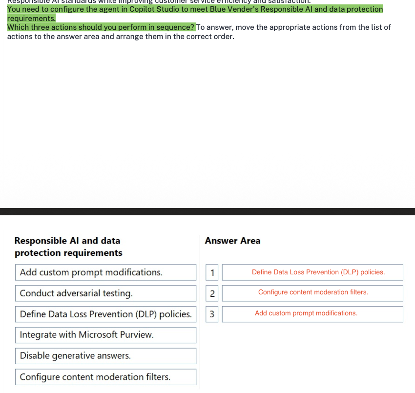
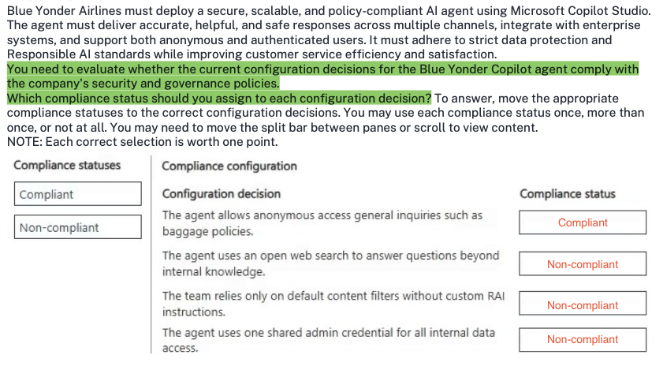
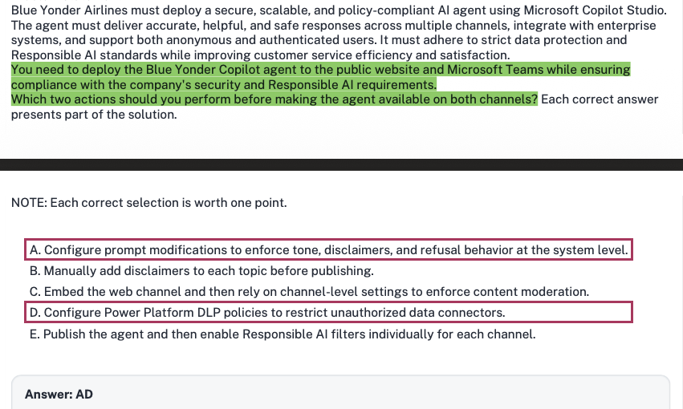
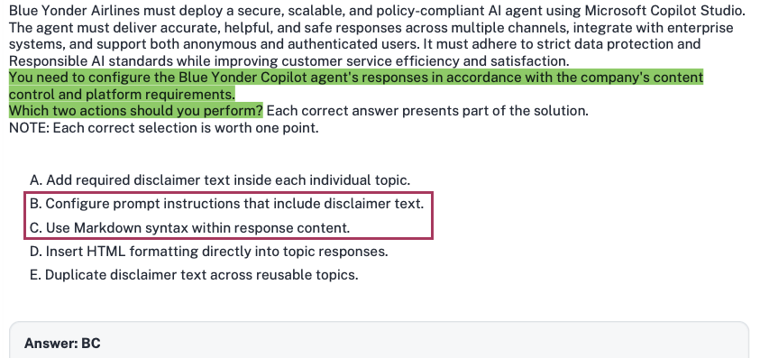
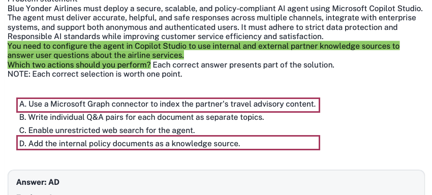
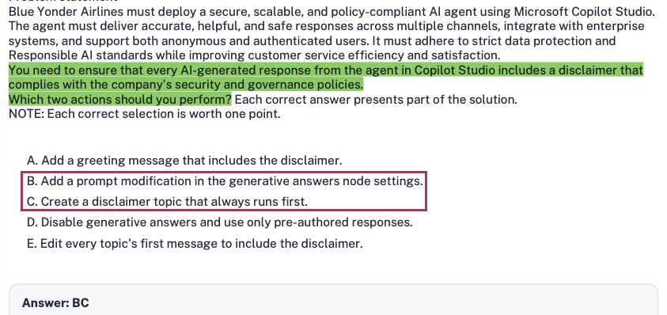
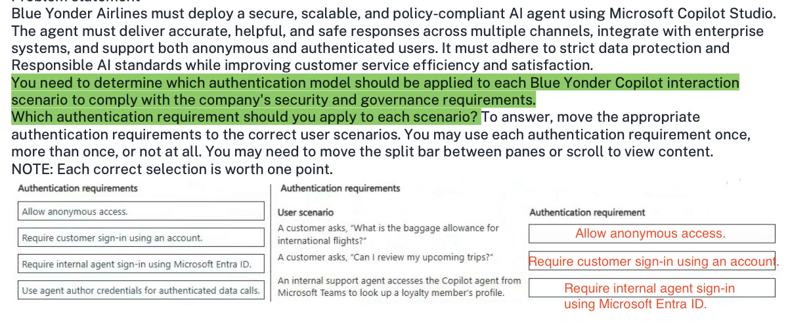
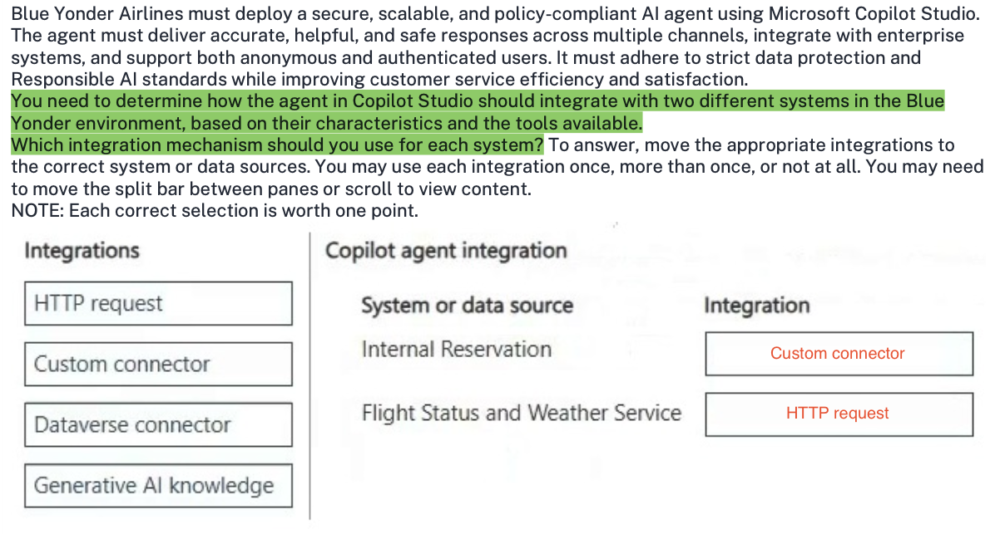
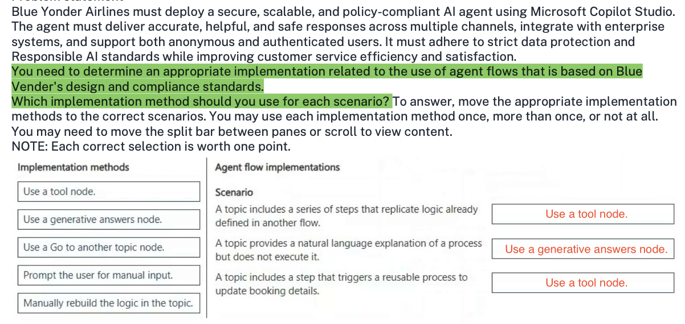
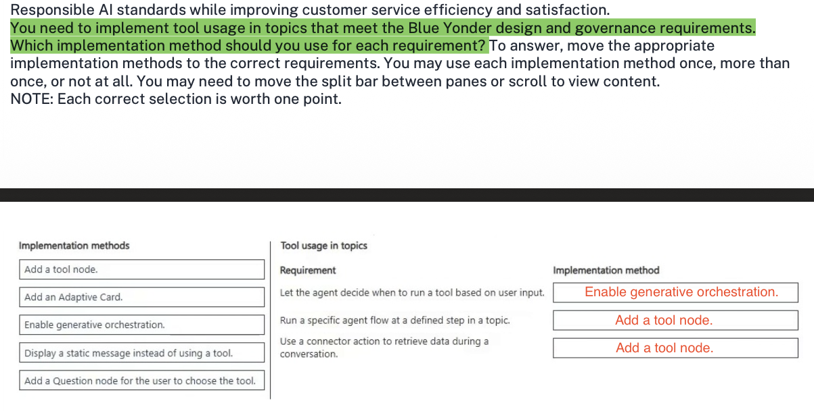

# Blue Yonder Airlines

**DRAG DROP -**

**Case Study -**

This is a case study. Case studies are not timed separately from other exam sections. You can use as much exam time as you would like to complete each case study. However, there might be additional case studies or other exam sections. Manage your time to ensure that you can complete all the exam sections in the time provided. Pay attention to the Exam Progress at the top of the screen so you have sufficient time to complete any exam sections that follow this case study.

To answer the case study questions, you will need to reference information that is provided in the case. Case studies and associated questions might contain exhibits or other resources that provide more information about the scenario described in the case. Information provided in an individual question does not apply to the other questions in the case study.

A Review Screen will appear at the end of this case study. From the Review Screen, you can review and change your answers before you move to the next exam section. After you leave this case study, you will NOT be able to return to it.

**To start the case study -**

To display the first question in this case study, select the "Next" button. To the left of the question, a menu provides links to information such as business requirements, the existing environment, and problem statements. Please read through all this information before answering any questions. When you are ready to answer a question, select the "Question" button to return to the question.

---

### Background

Blue Yonder Airlines is a global carrier headquartered in Los Angeles, California, operating domestic and international flights. The company serves millions of passengers annually through its website, mobile app, and call centers. To improve customer service efficiency and reduce call center volume, Blue Yonder is deploying an AI agent in Microsoft Copilot Studio.

The agent will handle customer inquiries across multiple channels – web chat, mobile app, and Microsoft Teams (for internal support staff). It will answer questions, retrieve data from enterprise systems, and escalate to human agents when needed.

The project is led by a cross-function team:

* **Product manager:** Defines requirements and success metrics.

* **Lead agent author:** Designs topics, intents, and generative behavior.

* **Flow designers:** Build agent flows and integrations.

* **IT/security and compliance:** Oversees identity, data protection, and Responsible AI (RAI) compliance.

---

### Current environment

#### Channels

* **Public website:** Embedded web chat

* **Mobile app:** In-app chatbot

* **Microsoft Teams:** Internal support agent access

#### Identity and access

* **Customers:** Anonymous access for general inquiries (e.g., flight status, baggage policy). Authentication is required for personal data access (e.g., bookings, loyalty points).

* **Internal staff:** Authenticate via Microsoft Entra ID.

#### Data sources

* **Reservation and Ticketing System (internal):** REST API, no prebuilt connector with custom enterprise database.

* **Flight Status and Weather APIs (external):** REST APIs with API keys.

* **Customer Support Knowledge Base:** SharePoint library with PDFs and policy documents.

* **Loyalty Program Data:** Stored in Dynamics 365 and Dataverse.

* **Travel Advisory Content:** Uses REST API with partner services.

#### Integration mechanisms

* Custom connectors must be used for internal APIs that lack prebuilt connectors.

* HTTP request nodes may be used for lightweight external APIs.

* Knowledge sources must be used for unstructured content.

* Agent flows must be used to encapsulate reusable logic (e.g., rebooking).

---

### Business requirements

#### Omnichannel support

* Deploy the agent across web, mobile, and Teams with a consistent user experience. The Teams deployment must also support internal staff.

#### Self-service capabilities

The agent must handle common inquiries such as:

* Flight status

* Booking and rebooking

* Loyalty program questions

* Travel policies and baggage rules

#### Human escalation

If the agent cannot resolve an issue or the user requests help, it must:

* Escalate to a human agent.

* Transfer the conversation transcript and relevant context.

* Redact any sensitive personal data before escalation.

#### Knowledge integration

* The agent must use scalable methods for knowledge integration and must not rely on manually authored Q&A topics for each document.

#### Performance metrics

* **First-contact resolution:** +25%

* **Tier-1 call deflection:** ≥20%

* **Response time:** 90% of queries answered within 30 seconds

* **Accuracy:** ≥95% for known FAQs

* **CSAT:** ≥85% for AI-handled interactions

---

### Technical requirements

#### Platform constraints

* No custom code is permitted; only Copilot Studio's built-in tools may be used.

* All backend logic must be implemented using agent flows.

* Markdown must be used for formatting (e.g., bold, bullet points); HTML is not supported.

#### Authentication

* Sign-in is required for personal data access.

* Anonymous access is allowed for general inquiries.

* User identity must be used for data access; shared or builder credentials must not be used.

#### Compliance and security

* Power Platform DLP policies must be enforced to block unauthorized data flows.

* Responsible AI content moderation filters must be enabled.

* Prompt modifications must be added to enforce tone, disclaimers, and refusal behavior.

* Disclaimers must be applied consistently across all generative responses. Manual edits to individual topics must be avoided.

#### Monitoring and maintenance

* All conversations and actions must be logged for auditing.

* Weekly reviews of transcripts and metrics must be conducted.

---

### Issues and constraints

* **API rate limits:** External APIs (e.g., flight status) have usage limits. Agent flows must handle retries and caching to avoid exceeding quotas.

* **Knowledge base limits:** Copilot Studio has limits on the number and size of indexed documents. Large files must be split or summarized.

* **Generative answer risks:** Generative responses must be constrained to avoid policy violations. Prompt modifications and filters must be used to enforce tone, safety, and compliance.

* **User input variability:** Users phrase questions in diverse ways. Topics must include varied trigger phrases and fallback handling.

* **Authentication UX:** The agent must clearly explain when sign-in is required and handle transitions smoothly across channels.

---

### Problem statement

Blue Yonder Airlines must deploy a secure, scalable, and policy-compliant AI agent using Microsoft Copilot Studio. The agent must deliver accurate, helpful, and safe responses across multiple channels, integrate with enterprise systems, and support both anonymous and authenticated users. It must adhere to strict data protection and Responsible AI standards while improving customer service efficiency and satisfaction.

## Question 1

You need to configure the agent in Copilot Studio to meet Blue Vender's Responsible AI and data protection requirements.

Which three actions should you perform in sequence? To answer, move the appropriate actions from the list of actions to the answer area and arrange them in the correct order.

---

### Responsible AI and data protection requirements

* Add custom prompt modifications.

* Conduct adversarial testing.

* Define Data Loss Prevention (DLP) policies.

* Integrate with Microsoft Purview.

* Disable generative answers.

* Configure content moderation filters.

---

### Answer Area

1. [                ]

2. [                ]

3. [                ]

### 1. Extracted Question Summary

* **Case Study Scenario (Blue Yonder Airlines):** Blue Yonder Airlines is deploying an AI agent in Microsoft Copilot Studio across public website chat, a mobile app, and Microsoft Teams (for internal staff). Under the **Compliance and security** and **Issues and constraints** sections of the case study, the project explicitly mandates:

* Power Platform Data Loss Prevention (DLP) policies must be enforced to block unauthorized data flows.

* Responsible AI content moderation filters must be enabled.

* Prompt modifications must be added to enforce tone, disclaimers, and refusal behavior across all generative responses (avoiding manual edits to individual topics).

* **Question (Case Study Question 1 — Drag and Drop):** You need to configure the agent in Copilot Studio to meet Blue Yonder's Responsible AI and data protection requirements. Which three actions should you perform in sequence? Move the appropriate three actions from the left (`Responsible AI and data protection requirements`) to the `Answer Area` and arrange them in the correct order (1 through 3).

* **Available Actions (Left Column):**
* Add custom prompt modifications.

* Conduct adversarial testing.

* Define Data Loss Prevention (DLP) policies.

* Integrate with Microsoft Purview.

* Disable generative answers.

* Configure content moderation filters.

---

### 2. Correct Answer

* **1:** **Define Data Loss Prevention (DLP) policies.**

* **2:** **Configure content moderation filters.**

* **3:** **Add custom prompt modifications.**

---

### 4. Official Microsoft Justification

* **Governance, Content Moderation & System-Level Prompt Guardrails (`AB-620T00` — Configure Responsible AI, security, and governance for agents in Copilot Studio):** Implementing enterprise data protection and Responsible AI guardrails in Copilot Studio follows an environment-to-agent-to-prompt governance hierarchy that directly matches the three explicit controls listed under Blue Yonder Airlines' **Compliance and security** requirements:

1. **Tenant/Environment Data Boundary (`Define Data Loss Prevention (DLP) policies`):** Administrators first establish Power Platform **Data Loss Prevention (DLP) policies** at the tenant or environment level to classify connectors and block unauthorized cross-boundary data flows before agent connectors or channels are exposed.

2. **Agent-Level Safety Thresholds (`Configure content moderation filters`):** Inside Copilot Studio's generative AI settings, makers configure **content moderation filters** (High, Medium, or Low) to enforce baseline Responsible AI safety guardrails across generated responses.

3. **Global Generative Behavior & Disclaimers (`Add custom prompt modifications`):** Finally, makers add system-level **custom prompt modifications / instructions** so tone, refusal behavior, and disclaimers are applied uniformly across all generative answers without manually editing individual topics.

---

### 5. Distractor Analysis (Why Others Are Wrong)

* **Conduct adversarial testing:** While red-teaming is a general RAI validation practice, the Blue Yonder Airlines case study explicitly enumerates the exact three required controls under *Compliance and security* (`DLP policies`, `content moderation filters`, and `prompt modifications`), whereas adversarial testing is not mentioned anywhere in the case study.

* **Integrate with Microsoft Purview:** Microsoft Purview is not specified in the Blue Yonder Airlines case study requirements.

* **Disable generative answers:** Turning off generative answers directly contradicts the case study requirements, which rely on generative responses governed by prompt modifications and content moderation filters.

---

### 6. Exam Keyword / Trap Alert

* **Keywords:** Look directly at the **Compliance and security** bullets in Image 2 (`image_bf7bbe.png`): *"Power Platform DLP policies must be enforced"*, *"Responsible AI content moderation filters must be enabled"*, and *"Prompt modifications must be added"*.

* **Trap:** In Microsoft Case Study questions, always anchor your selections strictly to the explicit requirements stated in the case study exhibits rather than plausible-sounding outside best practices like **Conduct adversarial testing** or **Integrate with Microsoft Purview**.

## Question 9

You need to evaluate whether the current configuration decisions for the Blue Yonder Copilot agent comply with the company's security and governance policies.

Which compliance status should you assign to each configuration decision? To answer, move the appropriate compliance statuses to the correct configuration decisions. You may use each compliance status once, more than once, or not at all. You may need to move the split bar between panes or scroll to view content.

**NOTE:** Each correct selection is worth one point.

---

### Compliance statuses

* Compliant

* Non-compliant

---

### Compliance configuration

| Configuration decision | Compliance status |
| --- | --- |
| The agent allows anonymous access general inquiries such as baggage policies.| [          ] |
| The agent uses an open web search to answer questions beyond internal knowledge.| [          ] |
| The team relies only on default content filters without custom RAI instructions.| [          ] |
| The agent uses one shared admin credential for all internal data access.| [          ] |

### 1. Extracted Question Summary

* **Case Study Scenario (Blue Yonder Airlines):** You need to evaluate whether four current configuration decisions for the Blue Yonder Airlines Copilot Studio agent comply with the company's security, governance, and Responsible AI policies established in the case study:

* **Identity & Access / Authentication Rules:** Anonymous access is explicitly allowed for general inquiries (e.g., flight status, baggage policy), sign-in is required for personal data access, and user identity must be used for data access—shared or builder credentials must **not** be used.

* **Compliance, Security & Knowledge Rules:** Power Platform DLP policies must be enforced, Responsible AI content moderation filters must be enabled, custom prompt modifications must be added to enforce tone, disclaimers, and refusal behavior, and generative responses must be constrained to grounded enterprise/approved sources to avoid policy violations.

* **Question (Blue Yonder Airlines Case Study — Drag and Drop):** Which compliance status should you assign to each configuration decision? Move `Compliant` or `Non-compliant` from the left (`Compliance statuses`) to each of the four rows under `Compliance configuration` on the right.

* **Available Statuses (Left Column):**
* `Compliant`

* `Non-compliant`

* **Target Configuration Decisions (Right Table):**
1. The agent allows anonymous access general inquiries such as baggage policies.

2. The agent uses an open web search to answer questions beyond internal knowledge.

3. The team relies only on default content filters without custom RAI instructions.

4. The agent uses one shared admin credential for all internal data access.

---

### 2. Correct Answer

* **The agent allows anonymous access general inquiries such as baggage policies.:** **Compliant**

* **The agent uses an open web search to answer questions beyond internal knowledge.:** **Non-compliant**

* **The team relies only on default content filters without custom RAI instructions.:** **Non-compliant**

* **The agent uses one shared admin credential for all internal data access.:** **Non-compliant**

---

### 4. Official Microsoft Justification

* **Case Study Policy Enforcement & Copilot Studio Security Governance (`AB-620T00` — Configure Responsible AI, security, and governance for agents in Copilot Studio):** Auditing each configuration decision against Blue Yonder Airlines' documented governance rules and Microsoft Copilot Studio security standards yields the following compliance rulings:
1. **Tiered Authentication for Public vs. Personal Data (`Compliant`):** Blue Yonder's *Identity and access* and *Authentication* requirements explicitly state: *"Customers: Anonymous access for general inquiries (e.g., flight status, baggage policy)"* while requiring sign-in only for personal data access (bookings, loyalty points).

2. **Unconstrained Web Grounding (`Non-compliant`):** Under Blue Yonder's *Data sources* and *Issues and constraints* rules, the agent must rely on approved internal/partner sources (SharePoint library, Dynamics 365/Dataverse, internal/partner REST APIs) and *"Generative responses must be constrained to avoid policy violations"*. Enabling open web search introduces unvetted external answers and violates data/policy boundaries.

3. **Mandatory Custom Prompt Guardrails (`Non-compliant`):** Under *Compliance and security*, Blue Yonder explicitly mandates *both* Responsible AI content moderation filters **and** custom prompt modifications to enforce tone, disclaimers, and refusal behavior across all generative responses—relying solely on default filters without custom RAI instructions fails compliance.

4. **End-User Authentication vs. Shared Credentials (`Non-compliant`):** Under *Authentication*, Blue Yonder explicitly stipulates: *"User identity must be used for data access; shared or builder credentials must not be used"*. Using a single shared admin credential breaks per-user authorization (maker-provided vs. end-user authentication in Copilot Studio) and violates least-privilege access.

---

### 5. Distractor Analysis (Why Others Are Wrong)

* **Assigning `Non-compliant` to Row 1:** Incorrect because the case study explicitly authorizes anonymous access for general inquiries including flight status and baggage policies.

* **Assigning `Compliant` to Rows 2, 3, or 4:** Incorrect because open web search violates constrained generative grounding, omitting custom RAI prompt instructions violates the explicit disclaimer/refusal mandate, and using a shared admin credential violates the strict ban on shared or builder credentials.

---

### 6. Exam Keyword / Trap Alert

* **Keywords:** *"Anonymous access for general inquiries"* = **Compliant**; *"open web search"*, *"without custom RAI instructions"*, and *"one shared admin credential"* = **Non-compliant**.

* **Trap:** Do not assume anonymous access is automatically insecure—always cross-check against the case study's **Authentication / Identity and access** rules, which explicitly allow anonymous access for general public inquiries while strictly prohibiting **shared or builder credentials**.

## Question 25

You need to deploy the Blue Yonder Copilot agent to the public website and Microsoft Teams while ensuring compliance with the company's security and Responsible AI requirements.

Which two actions should you perform before making the agent available on both channels? Each correct answer presents part of the solution.

**NOTE:** Each correct selection is worth one point.

A. Configure prompt modifications to enforce tone, disclaimers, and refusal behavior at the system level.

B. Manually add disclaimers to each topic before publishing.

C. Embed the web channel and then rely on channel-level settings to enforce content moderation.

D. Configure Power Platform DLP policies to restrict unauthorized data connectors.

E. Publish the agent and then enable Responsible AI filters individually for each channel.

### 1. Extracted Question Summary

* **Case Study Scenario (Blue Yonder Airlines):** You need to deploy the Blue Yonder Copilot Studio agent to the public website and Microsoft Teams while ensuring compliance with the company's security and Responsible AI requirements.

* **Question:** Which two actions should you perform before making the agent available on both channels? (Each correct answer presents part of the solution.)

* **Options:**
* **A.** Configure prompt modifications to enforce tone, disclaimers, and refusal behavior at the system level.

* **B.** Manually add disclaimers to each topic before publishing.

* **C.** Embed the web channel and then rely on channel-level settings to enforce content moderation.

* **D.** Configure Power Platform DLP policies to restrict unauthorized data connectors.

* **E.** Publish the agent and then enable Responsible AI filters individually for each channel.

* **Visible Answer in Screenshot:** `Answer: AD`

---

### 2. Correct Answer

* **A: Configure prompt modifications to enforce tone, disclaimers, and refusal behavior at the system level.**

* **D: Configure Power Platform DLP policies to restrict unauthorized data connectors.**

---

### 3. Verification of Visible Selection / Community Key

* **Correct.** The visible key (`Answer: AD`) is accurate because Blue Yonder Airlines' *Compliance and security* policy explicitly mandates both system-level prompt modifications (avoiding manual edits to individual topics) and Power Platform Data Loss Prevention (DLP) policies to block unauthorized data flows prior to channel rollout.

---

### 4. Official Microsoft Justification

* **Pre-Deployment Security & Responsible AI Guardrails (`AB-620T00` / `AB-100` — Configure Responsible AI, security, and governance for agents in Copilot Studio):** Under Microsoft Learn's Copilot Studio governance architecture and Blue Yonder Airlines' explicit compliance constraints, central guardrails must be applied at the environment and system level *before* publishing to end-user channels:

1. **System-Level Generative Instructions (`Configure prompt modifications to enforce tone, disclaimers, and refusal behavior at the system level`):** Copilot Studio allows makers to define global system instructions / prompt modifications so tone, disclaimers, and refusal rules apply automatically across all generative answers and channels—directly satisfying Blue Yonder's rule: *"Disclaimers must be applied consistently across all generative responses. Manual edits to individual topics must be avoided"*.

2. **Environment-Level Connector Governance (`Configure Power Platform DLP policies to restrict unauthorized data connectors`):** Power Platform Data Loss Prevention (DLP) policies classify connectors (`Business`, `Non-Business`, `Blocked`) and enforce Copilot Studio-specific connector and channel rules at the environment boundary—directly satisfying Blue Yonder's requirement: *"Power Platform DLP policies must be enforced to block unauthorized data flows"*.

---

### 5. Distractor Analysis (Why Others Are Wrong)

* **B:** Manually editing individual topics to insert disclaimers is error-prone, unscalable, and explicitly forbidden by the case study (*"Manual edits to individual topics must be avoided"*).

* **C:** Content moderation filters in Copilot Studio are configured centrally at the **agent** level (not via channel-level settings after embedding the web chat), and deploying before configuring safety guardrails violates pre-release compliance.

* **E:** Responsible AI content moderation is configured at the **agent** level *before* publishing, not per channel after publishing the agent to live users.

---

### 6. Exam Keyword / Trap Alert

* **Keywords:** *"before making the agent available on both channels"* + *"enforce tone, disclaimers, and refusal behavior at the system level"* (**A**) + *"Power Platform DLP policies"* (**D**).

* **Trap:** Reject any option that applies Responsible AI filters **after publishing** (**E**), via **channel-level settings** (**C**), or through **manual edits to individual topics** (**B**).

## Question 26

Blue Yonder Airlines must deploy a secure, scalable, and policy-compliant AI agent using Microsoft Copilot Studio. The agent must deliver accurate, helpful, and safe responses across multiple channels, integrate with enterprise systems, and support both anonymous and authenticated users. It must adhere to strict data protection and Responsible AI standards while improving customer service efficiency and satisfaction.

You need to configure the Blue Yonder Copilot agent's responses in accordance with the company's content control and platform requirements.

Which two actions should you perform? Each correct answer presents part of the solution.

**NOTE:** Each correct selection is worth one point.

A. Add required disclaimer text inside each individual topic.

B. Configure prompt instructions that include disclaimer text.

C. Use Markdown syntax within response content.

D. Insert HTML formatting directly into topic responses.

E. Duplicate disclaimer text across reusable topics.

### 1. Extracted Question Summary

* **Case Study Scenario (Blue Yonder Airlines):** You need to configure the Blue Yonder Copilot Studio agent's responses in accordance with the company's content control and platform requirements. From the Blue Yonder Airlines case study specifications:

* **Platform constraints:** *"Markdown must be used for formatting (e.g., bold, bullet points); HTML is not supported."*

* **Compliance and security:** *"Prompt modifications must be added to enforce tone, disclaimers, and refusal behavior. Disclaimers must be applied consistently across all generative responses. Manual edits to individual topics must be avoided."*

* **Question:** Which two actions should you perform? (Each correct answer presents part of the solution.)

* **Options:**
* **A.** Add required disclaimer text inside each individual topic.

* **B.** Configure prompt instructions that include disclaimer text.

* **C.** Use Markdown syntax within response content.

* **D.** Insert HTML formatting directly into topic responses.

* **E.** Duplicate disclaimer text across reusable topics.

---

### 2. Correct Answer

* **B: Configure prompt instructions that include disclaimer text.**

* **C: Use Markdown syntax within response content.**

---

### 4. Official Microsoft Justification

* **System-Level Prompt Instructions & Cross-Channel Markdown Rendering (`AB-620T00` — Author and configure generative responses and channel experiences in Copilot Studio):** Under Microsoft Learn's Copilot Studio authoring standards and Blue Yonder Airlines' explicit platform and compliance constraints, response formatting and global disclaimers must be configured centrally rather than hardcoded per topic:
1. **Global Prompt Instructions (`Configure prompt instructions that include disclaimer text`):** Configuring system-level instructions / prompt modifications in Copilot Studio enforces consistent tone, refusal rules, and mandatory disclaimers across all generative responses—directly fulfilling the case study requirement that *"Disclaimers must be applied consistently across all generative responses. Manual edits to individual topics must be avoided."*

2. **Standardized Markdown Formatting (`Use Markdown syntax within response content`):** Across omnichannel deployments (Web chat, Mobile app, and Microsoft Teams), Copilot Studio uses Markdown for structured text rendering (bold, bullet points, links) rather than raw HTML—directly matching the case study constraint: *"Markdown must be used for formatting (e.g., bold, bullet points); HTML is not supported."*

---

### 5. Distractor Analysis (Why Others Are Wrong)

* **A:** Manually adding disclaimers inside each individual topic directly violates the case study's explicit compliance rule: *"Manual edits to individual topics must be avoided."*

* **D:** Raw HTML formatting is explicitly prohibited by the case study's platform constraints (*"HTML is not supported"*) and does not render uniformly across Copilot Studio channels such as Microsoft Teams.

* **E:** Duplicating disclaimer text across reusable topics still relies on manual per-topic maintenance and fails to enforce disclaimers automatically across all generative answers.

---

### 6. Exam Keyword / Trap Alert

* **Keywords:** *"content control and platform requirements"* = **Configure prompt instructions that include disclaimer text** (**B**) + **Use Markdown syntax within response content** (**C**).

* **Trap:** Always cross-check the **Technical requirements → Platform constraints** section of the Blue Yonder Airlines case study—it explicitly pairs **Markdown** (not HTML) with **prompt modifications** (not per-topic edits).

## Question 12

You need to configure the agent in Copilot Studio to use internal and external partner knowledge sources to answer user questions about the airline services.

Which two actions should you perform? Each correct answer presents part of the solution.

**NOTE:** Each correct selection is worth one point.

A. Use a Microsoft Graph connector to index the partner's travel advisory content.

B. Write individual Q&A pairs for each document as separate topics.

C. Enable unrestricted web search for the agent.

D. Add the internal policy documents as a knowledge source.

### 1. Extracted Question Summary

* **Case Study Scenario (Blue Yonder Airlines):** You need to configure the agent in Microsoft Copilot Studio to use internal and external partner knowledge sources to answer user questions about airline services. From the Blue Yonder Airlines case study specifications:

* **Data sources:** Customer Support Knowledge Base is stored in a SharePoint library with PDFs and policy documents, and Travel Advisory Content comes from partner services.

* **Knowledge integration:** *"The agent must use scalable methods for knowledge integration and must not rely on manually authored Q&A topics for each document."*

* **Constraints:** Generative responses must be constrained to approved knowledge sources rather than open web search.

* **Question:** Which two actions should you perform? (Each correct answer presents part of the solution.)

* **Options:**
* **A.** Use a Microsoft Graph connector to index the partner's travel advisory content.

* **B.** Write individual Q&A pairs for each document as separate topics.

* **C.** Enable unrestricted web search for the agent.

* **D.** Add the internal policy documents as a knowledge source.

* **Visible Answer in Screenshot:** `Answer: AD`

---

### 2. Correct Answer

* **A: Use a Microsoft Graph connector to index the partner's travel advisory content.**

* **D: Add the internal policy documents as a knowledge source.**

---

### 3. Verification of Visible Selection / Community Key

* **Correct.** The visible key (`Answer: AD`) is accurate because connecting internal SharePoint policy documents as native Copilot Studio **Knowledge** sources (**D**) and indexing external partner data via a **Microsoft Graph connector** (**A**) provide scalable, governed retrieval-augmented grounding without manual per-document topic authoring or unrestricted web search.

---

### 4. Official Microsoft Justification

* **Scalable Enterprise & External Knowledge Grounding (`AB-620T00` — Ground agents with knowledge sources in Copilot Studio):** Under Microsoft Learn's Copilot Studio knowledge architecture (*Add knowledge to an agent*), enterprise agents ground generative responses in structured and unstructured repositories using scalable native and Microsoft Graph connectors:
1. **External Partner Knowledge Indexing (`Use a Microsoft Graph connector to index the partner's travel advisory content`):** Microsoft Graph connectors ingest external third-party/partner repositories into Microsoft 365 semantic index, allowing Copilot Studio agents to ground answers securely across external partner content with enterprise-grade access controls.

2. **Internal Document Grounding (`Add the internal policy documents as a knowledge source`):** Adding SharePoint libraries, PDFs, and policy documents directly under the agent's **Knowledge** tab enables native semantic search and citation-backed generative answers—satisfying Blue Yonder's requirement to *"use scalable methods for knowledge integration and must not rely on manually authored Q&A topics for each document"*.

---

### 5. Distractor Analysis (Why Others Are Wrong)

* **B:** Writing individual Q&A pairs per document as separate topics is unscalable and explicitly prohibited by the case study's *Knowledge integration* rule (*"must not rely on manually authored Q&A topics for each document"*).

* **C:** Enabling unrestricted web search introduces unvetted public web answers and violates Blue Yonder's compliance requirement that generative responses remain constrained to approved enterprise and partner sources.

---

### 6. Exam Keyword / Trap Alert

* **Keywords:** *"internal and external partner knowledge sources"* + *"scalable methods for knowledge integration"* = **Microsoft Graph connector** (**A**) + **Add the internal policy documents as a knowledge source** (**D**).

* **Trap:** Immediately eliminate **manual Q&A topics** (**B**) and **unrestricted web search** (**C**)—both directly violate Blue Yonder Airlines' documented *Knowledge integration* and *Compliance and security* rules.

## Question 13

You need to ensure that every AI-generated response from the agent in Copilot Studio includes a disclaimer that complies with the company's security and governance policies.

Which two actions should you perform? Each correct answer presents part of the solution.

**NOTE:** Each correct selection is worth one point.

A. Add a greeting message that includes the disclaimer.

B. Add a prompt modification in the generative answers node settings.

C. Create a disclaimer topic that always runs first.

D. Disable generative answers and use only pre-authored responses.

E. Edit every topic's first message to include the disclaimer.

### 1. Extracted Question Summary

* **Case Study Scenario (Blue Yonder Airlines):** You need to ensure that every AI-generated response from the agent in Microsoft Copilot Studio includes a disclaimer that complies with the company's security and governance policies. From the Blue Yonder Airlines case study specifications:

* **Compliance and security:** *"Prompt modifications must be added to enforce tone, disclaimers, and refusal behavior. Disclaimers must be applied consistently across all generative responses. Manual edits to individual topics must be avoided."*

* **Platform constraints:** *"All backend logic must be implemented using agent flows."*

* **Question:** Which two actions should you perform? (Each correct answer presents part of the solution.)

* **Options:**
* **A.** Add a greeting message that includes the disclaimer.

* **B.** Add a prompt modification in the generative answers node settings.

* **C.** Create a disclaimer topic that always runs first.

* **D.** Disable generative answers and use only pre-authored responses.

* **E.** Edit every topic's first message to include the disclaimer.

* **Visible Answer in Screenshot:** `Answer: BC`

---

### 2. Correct Answer

* **B: Add a prompt modification in the generative answers node settings.**

* **C: Create a disclaimer topic that always runs first.**

---

### 3. Verification of Visible Selection / Community Key

* **Correct (with architectural nuance).** The visible dump key (`Answer: BC`) accurately reflects the two remaining valid options after eliminating the three options that violate the case study's explicit constraints (`A`, `D`, and `E`), though in real-world Copilot Studio architecture **Option B** (prompt modification in the generative answers node / system instructions) directly appends disclaimers to *every* AI-generated response while **Option C** acts as an initial session-level disclaimer guardrail without manually editing individual topics.

---

### 4. Official Microsoft Justification

* **Generative Answers Prompt Modification & Centralized Disclaimer Enforcement (`AB-620T00` / `AB-100` — Configure Responsible AI, security, and governance for agents in Copilot Studio):** Under Microsoft Learn's Copilot Studio documentation (*Create generative answers* and *Configure system instructions / prompt modifications*), enforcing consistent disclaimers across AI-generated output without manual per-topic maintenance relies on two centralized mechanisms:
1. **Generative Answers Prompt Modification (`Add a prompt modification in the generative answers node settings`):** Within the **Create generative answers** node (and agent-level generative AI instructions), makers configure **Custom instructions / prompt modifications** that instruct the LLM to include mandatory disclaimer text, enforce tone, and apply refusal rules dynamically on every generated response—directly fulfilling Blue Yonder's rule: *"Prompt modifications must be added to enforce tone, disclaimers, and refusal behavior. Disclaimers must be applied consistently across all generative responses"*.

2. **Centralized Disclaimer Topic (`Create a disclaimer topic that always runs first`):** By process of elimination under Blue Yonder's strict constraint (*"Manual edits to individual topics must be avoided"*), isolating a reusable/initial disclaimer topic (such as an `On Conversation Start` or redirected system-level topic) centralizes disclaimer delivery in a single place rather than duplicating text across every topic or relying solely on a static greeting message.

---

### 5. Distractor Analysis (Why Others Are Wrong)

* **A:** A greeting message runs only once when a conversation initializes; it does not attach a disclaimer to subsequent AI-generated answers or mid-session topic transitions.

* **D:** Disabling generative answers violates Blue Yonder Airlines' core architectural design, which mandates scalable generative knowledge grounding across SharePoint documents and partner sources rather than manually authored static Q&A topics.

* **E:** Editing every individual topic's first message directly violates the case study's explicit compliance constraint: *"Manual edits to individual topics must be avoided"*.

---

### 6. Exam Keyword / Trap Alert

* **Keywords:** *"every AI-generated response... includes a disclaimer"* + *"Manual edits to individual topics must be avoided"* = **Add a prompt modification in the generative answers node settings** (**B**) + **Create a disclaimer topic that always runs first** (**C**).

* **Trap:** Immediately eliminate **Option D** (*Disable generative answers*) and **Option E** (*Edit every topic's first message*), as both directly contradict explicit sentences in the Blue Yonder Airlines case study exhibit.

## Question 14

You need to determine which authentication model should be applied to each Blue Yonder Copilot interaction scenario to comply with the company's security and governance requirements.

Which authentication requirement should you apply to each scenario? To answer, move the appropriate authentication requirements to the correct user scenarios. You may use each authentication requirement once, more than once, or not at all. You may need to move the split bar between panes or scroll to view content.

**NOTE:** Each correct selection is worth one point.

---

### Authentication requirements

* Allow anonymous access.

* Require customer sign-in using an account.

* Require internal agent sign-in using Microsoft Entra ID.

* Use agent author credentials for authenticated data calls.

---

### Authentication requirements (Answer Area)

| User scenario | Authentication requirement |
| --- | --- |
| A customer asks, "What is the baggage allowance for international flights?"| [          ] |
| A customer asks, "Can I review my upcoming trips?"| [          ] |
| An internal support agent accesses the Copilot agent from Microsoft Teams to look up a loyalty member's profile.| [          ] |

You need to determine which authentication model should be applied to each Blue Yonder Copilot interaction scenario to comply with the company's security and governance requirements.

Which authentication requirement should you apply to each scenario? To answer, move the appropriate authentication requirements to the correct user scenarios. You may use each authentication requirement once, more than once, or not at all. You may need to move the split bar between panes or scroll to view content.

**NOTE:** Each correct selection is worth one point.

### 1. Extracted Question Summary

* **Case Study Scenario (Blue Yonder Airlines):** You need to determine which authentication model should be applied to each Blue Yonder Copilot Studio interaction scenario to comply with the company's security and governance requirements. From the Blue Yonder Airlines case study specifications:

* **Identity and access / Authentication:** Customers receive anonymous access for general inquiries (e.g., flight status, baggage policy), sign-in is required for personal data access (e.g., bookings, loyalty points), internal staff authenticate via Microsoft Entra ID, and user identity must be used for data access—shared or builder credentials must **not** be used.

* **Question (Blue Yonder Airlines Case Study — Drag and Drop):** Which authentication requirement should you apply to each scenario? Move the appropriate authentication requirements from the left (`Authentication requirements`) to match the three rows under `User scenario` on the right (each requirement may be used once, more than once, or not at all).

* **Available Authentication Requirements (Left Column):**
* Allow anonymous access.

* Require customer sign-in using an account.

* Require internal agent sign-in using Microsoft Entra ID.

* Use agent author credentials for authenticated data calls.

* **Target User Scenarios (Right Table):**
1. A customer asks, "What is the baggage allowance for international flights?"

2. A customer asks, "Can I review my upcoming trips?"

3. An internal support agent accesses the Copilot agent from Microsoft Teams to look up a loyalty member's profile.

---

### 2. Correct Answer

* **A customer asks, "What is the baggage allowance for international flights?":** **Allow anonymous access.**

* **A customer asks, "Can I review my upcoming trips?":** **Require customer sign-in using an account.**

* **An internal support agent accesses the Copilot agent from Microsoft Teams to look up a loyalty member's profile.:** **Require internal agent sign-in using Microsoft Entra ID.**

---

### 4. Official Microsoft Justification

* **Tiered End-User Authentication & Microsoft Entra ID Security (`AB-620T00` — Configure authentication and security for agents in Copilot Studio):** Under Microsoft Learn's Copilot Studio authentication documentation (*Configure user authentication in Copilot Studio*) and Blue Yonder Airlines' explicit *Identity and access* policy, authentication is enforced selectively based on user persona and data sensitivity:

1. **Public Policy & General FAQ Queries (`Allow anonymous access`):** Asking about general international baggage allowances queries public policy knowledge rather than personal records, directly matching Blue Yonder's rule: *"Customers: Anonymous access for general inquiries (e.g., flight status, baggage policy)"*.

2. **Authenticated Customer Self-Service (`Require customer sign-in using an account`):** Reviewing upcoming trips accesses personal reservation and booking records, requiring customer authentication (via manual OAuth 2.0 / customer identity provider) in accordance with: *"Authentication is required for personal data access (e.g., bookings, loyalty points)"*.

3. **Internal Workforce Access in Microsoft Teams (`Require internal agent sign-in using Microsoft Entra ID`):** Internal customer support staff accessing the agent via Microsoft Teams to look up loyalty profiles must authenticate with **Microsoft Entra ID** (`Authenticate with Microsoft` / Teams SSO) so downstream Dataverse/Dynamics 365 calls execute under the support agent's own Entra identity—matching *"Internal staff: Authenticate via Microsoft Entra ID"*.

---

### 5. Distractor Analysis (Why Others Are Wrong)

* **Use agent author credentials for authenticated data calls:** Directly violates Blue Yonder Airlines' strict security mandate under *Authentication*: *"User identity must be used for data access; shared or builder credentials must not be used"*. Using maker/author credentials (`Maker-provided authentication`) bypasses per-user RBAC and exposes sensitive customer data to unauthorized callers.

---

### 6. Exam Keyword / Trap Alert

* **Keywords:** *"baggage allowance"* = **Allow anonymous access**; *"review my upcoming trips"* = **Require customer sign-in using an account**; *"internal support agent... from Microsoft Teams"* = **Require internal agent sign-in using Microsoft Entra ID**.

* **Trap:** Never select **Use agent author credentials** in enterprise case studies that mandate per-user identity—Blue Yonder explicitly forbids shared or builder credentials.

## Question 33

You need to determine how the agent in Copilot Studio should integrate with two different systems in the Blue Yonder environment, based on their characteristics and the tools available.

Which integration mechanism should you use for each system? To answer, move the appropriate integrations to the correct system or data sources. You may use each integration once, more than once, or not at all. You may need to move the split bar between panes or scroll to view content.

**NOTE:** Each correct selection is worth one point.

---

### Integrations

* HTTP request

* Custom connector

* Dataverse connector

* Generative AI knowledge

---

### Copilot agent integration (Answer Area)

| System or data source | Integration |
| --- | --- |
| Internal Reservation| [          ] |
| Flight Status and Weather Service| [          ] |

### 1. Extracted Question Summary

* **Case Study Scenario (Blue Yonder Airlines):** You need to determine how the agent in Microsoft Copilot Studio should integrate with two different systems in the Blue Yonder environment based on their characteristics and available tools. From the Blue Yonder Airlines case study specifications:

* **Data sources:**
* *Reservation and Ticketing System (internal):* REST API, no prebuilt connector with custom enterprise database.

* *Flight Status and Weather APIs (external):* REST APIs with API keys.

* **Integration mechanisms:**
* *Custom connectors must be used for internal APIs that lack prebuilt connectors*.

* *HTTP request nodes may be used for lightweight external APIs*.

* **Question (Blue Yonder Airlines Case Study — Drag and Drop):** Which integration mechanism should you use for each system? Move the appropriate integrations from the left (`Integrations`) to match the two target rows under `System or data source` (`Copilot agent integration`) on the right (each integration may be used once, more than once, or not at all).

* **Available Integrations (Left Column):**
* `HTTP request`

* `Custom connector`

* `Dataverse connector`

* `Generative AI knowledge`

* **Target Systems / Data Sources (Right Table):**
1. `Internal Reservation`

2. `Flight Status and Weather Service`

---

### 2. Correct Answer

* **Internal Reservation:** **Custom connector**

* **Flight Status and Weather Service:** **HTTP request**

---

### 4. Official Microsoft Justification

* **Connector Governance vs. Lightweight REST Invocation (`AB-620T00` / `AB-100` — Integrate and extend agents in Copilot Studio):** Under Microsoft Learn's Copilot Studio integration architecture and Blue Yonder Airlines' explicit *Integration mechanisms* rules, external and internal APIs map to distinct integration primitives based on governance and authentication requirements:

1. **Enterprise Internal APIs (`Custom connector`):** Wrapping the internal Reservation and Ticketing REST API in a Power Platform **Custom connector** provides a strongly typed OpenAPI schema, supports user-delegated authentication (OAuth 2.0 / Microsoft Entra ID), and enables environment-level Data Loss Prevention (DLP) governance—directly fulfilling Blue Yonder's explicit rule: *"Custom connectors must be used for internal APIs that lack prebuilt connectors"*.

2. **Lightweight External REST APIs (`HTTP request`):** Using Copilot Studio's native **Send an HTTP request** node (or an agent flow HTTP action) directly invokes external REST endpoints secured with API keys without the overhead of maintaining a full custom connector—directly fulfilling Blue Yonder's explicit rule: *"HTTP request nodes may be used for lightweight external APIs"*.

---

### 5. Distractor Analysis (Why Others Are Wrong)

* **Dataverse connector:** In the Blue Yonder Airlines case study, Dataverse and Dynamics 365 store **Loyalty Program Data**, whereas the Reservation and Ticketing System runs on a custom enterprise database exposed via a REST API with no prebuilt connector.

* **Generative AI knowledge:** Knowledge sources are designed for unstructured static/semi-structured content (such as the SharePoint PDF policy library), not transactional real-time flight reservations or live API-key weather/flight-status feeds.

---

### 6. Exam Keyword / Trap Alert

* **Keywords:** *"Internal Reservation"* = **Custom connector**; *"Flight Status and Weather Service"* = **HTTP request**.

* **Trap:** Always cross-reference the **Data sources** and **Integration mechanisms** sections of the Blue Yonder Airlines case study exhibit (`image_bf7e66.jpg`)—Microsoft explicitly dictates that internal APIs lacking prebuilt connectors require **Custom connectors** while lightweight external APIs use **HTTP request** nodes.

## Q34

Blue Yonder Airlines must deploy a secure, scalable, and policy-compliant AI agent using Microsoft Copilot Studio. The agent must deliver accurate, helpful, and safe responses across multiple channels, integrate with enterprise systems, and support both anonymous and authenticated users. It must adhere to strict data protection and Responsible AI standards while improving customer service efficiency and satisfaction.

You need to determine an appropriate implementation related to the use of agent flows that is based on Blue Vender's design and compliance standards.

Which implementation method should you use for each scenario? To answer, move the appropriate implementation methods to the correct scenarios. You may use each implementation method once, more than once, or not at all. You may need to move the split bar between panes or scroll to view content.

**NOTE:** Each correct selection is worth one point.

---

### Implementation methods

* Use a tool node.

* Use a generative answers node.

* Use a Go to another topic node.

* Prompt the user for manual input.

* Manually rebuild the logic in the topic.

---

### Agent flow implementations

| Scenario | Implementation method |
| --- | --- |
| A topic includes a series of steps that replicate logic already defined in another flow.| [          ] |
| A topic provides a natural language explanation of a process but does not execute it.| [          ] |
| A topic includes a step that triggers a reusable process to update booking details.| [          ] |

### 1. Extracted Question Summary

* **Case Study Scenario (Blue Yonder Airlines):** You need to determine an appropriate implementation related to the use of agent flows based on Blue Yonder Airlines' design and compliance standards. From the Blue Yonder Airlines case study specifications:

* **Integration mechanisms:** *"Agent flows must be used to encapsulate reusable logic (e.g., rebooking)."*

* **Platform constraints:** *"No custom code is permitted; only Copilot Studio's built-in tools may be used. All backend logic must be implemented using agent flows."*

* **Question (Blue Yonder Airlines Case Study — Drag and Drop):** Which implementation method should you use for each scenario? Move the appropriate implementation methods from the left (`Implementation methods`) to match the three target rows under `Scenario` (`Agent flow implementations`) on the right (each method may be used once, more than once, or not at all).

* **Available Implementation Methods (Left Column):**
* `Use a tool node.`

* `Use a generative answers node.`

* `Use a Go to another topic node.`

* `Prompt the user for manual input.`

* `Manually rebuild the logic in the topic.`

* **Target Scenarios (Right Table — `Agent flow implementations`):**
1. A topic includes a series of steps that replicate logic already defined in another flow.

2. A topic provides a natural language explanation of a process but does not execute it.

3. A topic includes a step that triggers a reusable process to update booking details.

---

### 2. Correct Answer

* **A topic includes a series of steps that replicate logic already defined in another flow.:** **Use a tool node.**

* **A topic provides a natural language explanation of a process but does not execute it.:** **Use a generative answers node.**

* **A topic includes a step that triggers a reusable process to update booking details.:** **Use a tool node.**

---

### 4. Official Microsoft Justification

* **Encapsulating Reusable Backend Logic with Agent Flows & Tool Nodes (`AB-620T00` / `AB-100` — Integrate and extend agents in Copilot Studio):** Under Microsoft Learn's Copilot Studio authoring documentation (*Call an agent flow as a tool from a topic* and *Create generative answers*) and Blue Yonder Airlines' explicit architectural constraints:

1. **Eliminating Duplicated Flow Logic (`Use a tool node`):** In Copilot Studio, agent flows (and Power Automate cloud flows) are exposed to topics as **Tools** (`Add a tool` node). When a topic would otherwise duplicate steps already encapsulated in an existing flow, makers invoke that existing agent flow via a **tool node** rather than rebuilding or duplicating logic inside the topic—directly upholding Blue Yonder's rule: *"Agent flows must be used to encapsulate reusable logic"*.

2. **Informational Process Explanations (`Use a generative answers node`):** When a user asks how a process works without executing a backend transaction, a **Create generative answers** node synthesizes a natural language explanation grounded in connected knowledge sources (such as the SharePoint policy/FAQ library) without invoking backend execution flows.

3. **Executing Transactional Updates (`Use a tool node`):** Triggering a reusable backend process to update reservation/booking records requires invoking an **agent flow** through a **tool node**, adhering to Blue Yonder's platform constraint: *"All backend logic must be implemented using agent flows"*.

---

### 5. Distractor Analysis (Why Others Are Wrong)

* **Use a Go to another topic node:** Redirects conversational dialogue flow to another Copilot Studio topic, but does not invoke an agent flow (`another flow`) or execute backend transactional logic.

* **Prompt the user for manual input:** Captures user variables (`Ask a question` node) rather than invoking existing flow logic, explaining a process from knowledge sources, or executing a backend booking update.

* **Manually rebuild the logic in the topic:** Directly violates Blue Yonder Airlines' design standards (*"Agent flows must be used to encapsulate reusable logic"* and *"All backend logic must be implemented using agent flows"*).

---

### 6. Exam Keyword / Trap Alert

* **Keywords:** *"replicate logic already defined in another flow"* = **Use a tool node**; *"natural language explanation of a process"* = **Use a generative answers node**; *"triggers a reusable process to update booking details"* = **Use a tool node**.

* **Trap:** Remember the explicit rule in the question instructions (*"You may use each implementation method once, **more than once**, or not at all"*)—**Use a tool node** is intentionally used **twice** because Copilot Studio invokes agent flows from topics via **Tool** nodes for both reusing existing flow logic and executing backend updates.

## Question 66

You need to implement tool usage in topics that meet the Blue Yonder design and governance requirements.

Which implementation method should you use for each requirement? To answer, move the appropriate implementation methods to the correct requirements. You may use each implementation method once, more than once, or not at all. You may need to move the split bar between panes or scroll to view content.

**NOTE:** Each correct selection is worth one point.

---

### Implementation methods

* Add a tool node.

* Add an Adaptive Card.

* Enable generative orchestration.

* Display a static message instead of using a tool.

* Add a Question node for the user to choose the tool.

---

### Tool usage in topics

| Requirement | Implementation method |
| --- | --- |
| Let the agent decide when to run a tool based on user input.| [          ] |
| Run a specific agent flow at a defined step in a topic.| [          ] |
| Use a connector action to retrieve data during a conversation.| [          ] |

### 1. Extracted Question Summary

* **Case Study Scenario (Blue Yonder Airlines):** You need to implement tool usage in topics that meet Blue Yonder Airlines' design and governance requirements. From the Blue Yonder Airlines case study specifications:

* **Integration mechanisms & Platform constraints:** Custom connectors must be used for internal APIs lacking prebuilt connectors, agent flows must be used to encapsulate reusable logic, and all backend logic must be implemented using Copilot Studio's built-in tools and agent flows.

* **Question (Blue Yonder Airlines Case Study — Drag and Drop):** Which implementation method should you use for each requirement? Move the appropriate implementation methods from the left (`Implementation methods`) to match the three target rows under `Requirement` (`Tool usage in topics`) on the right (each implementation method may be used once, more than once, or not at all).

* **Available Implementation Methods (Left Column):**
* `Add a tool node.`

* `Add an Adaptive Card.`

* `Enable generative orchestration.`

* `Display a static message instead of using a tool.`

* `Add a Question node for the user to choose the tool.`

* **Target Requirements (Right Table — `Tool usage in topics`):**
1. `Let the agent decide when to run a tool based on user input.`

2. `Run a specific agent flow at a defined step in a topic.`

3. `Use a connector action to retrieve data during a conversation.`

---

### 2. Correct Answer

* **Let the agent decide when to run a tool based on user input.:** **Enable generative orchestration.**

* **Run a specific agent flow at a defined step in a topic.:** **Add a tool node.**

* **Use a connector action to retrieve data during a conversation.:** **Add a tool node.**

---

### 4. Official Microsoft Justification

* **Generative Orchestration vs. Deterministic Topic Tool Nodes (`AB-620T00` / `AB-100` — Orchestrate and extend agents with tools and agent flows in Copilot Studio):** Under Microsoft Learn's official Copilot Studio documentation (*Use generative orchestration* and *Add tools to a topic*), Copilot Studio supports two distinct patterns for invoking tools (connectors, agent flows, custom prompts, and REST actions) depending on whether execution is AI-orchestrated or deterministically authored inside a topic:
1. **Autonomous Runtime Tool Selection (`Enable generative orchestration`):** When **generative orchestration** is enabled, the Copilot Studio orchestrator dynamically evaluates the user's intent, conversation context, and each registered tool's description and input/output schema to decide automatically when to invoke a tool and extract required inputs from user input.

2. **Deterministic Agent Flow Execution (`Add a tool node`):** When an author requires a specific **agent flow** (such as Blue Yonder's reusable rebooking or booking update flow) to execute at an exact step within a structured topic conversation, makers explicitly insert a **Tool** node (`Add a tool`) into the topic authoring canvas.

3. **Deterministic Connector Action Execution (`Add a tool node`):** Similarly, invoking a Power Platform **connector action** (such as Blue Yonder's custom connector for the internal Reservation and Ticketing API) at a defined point in a conversation to retrieve enterprise data is implemented by adding a **Tool** node directly in the topic.

---

### 5. Distractor Analysis (Why Others Are Wrong)

* **Add an Adaptive Card:** Adaptive Cards render rich interactive UI layouts for collecting or displaying structured user data; they do not execute backend agent flows, connector actions, or autonomous tool orchestration.

* **Display a static message instead of using a tool:** Displaying static text fails to retrieve live enterprise data or execute transactional backend processes required by the scenario.

* **Add a Question node for the user to choose the tool:** Forcing end users to manually select technical tools via a Question node degrades user experience and contradicts Copilot Studio's generative orchestration model, where the agent autonomously selects the appropriate tool based on user input.

---

### 6. Exam Keyword / Trap Alert

* **Keywords:** *"Let the agent decide when to run a tool based on user input"* = **Enable generative orchestration**; *"Run a specific agent flow at a defined step"* = **Add a tool node**; *"Use a connector action to retrieve data"* = **Add a tool node**.

* **Trap:** Remember that in Copilot Studio, both **agent flows** and **connector actions** are surfaced as **Tools** inside topics—and because the instructions explicitly allow reusing items (*"You may use each implementation method once, **more than once**, or not at all"*), **Add a tool node** is intentionally used **twice**!

