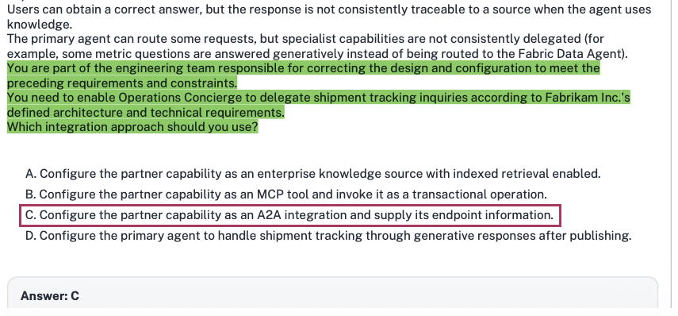
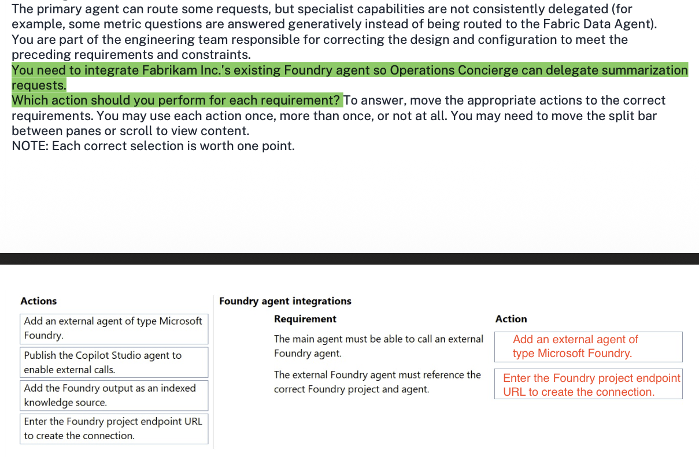
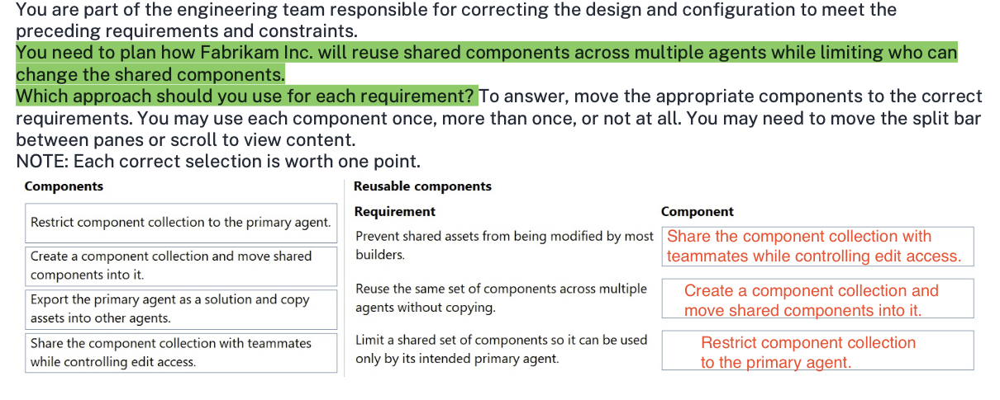
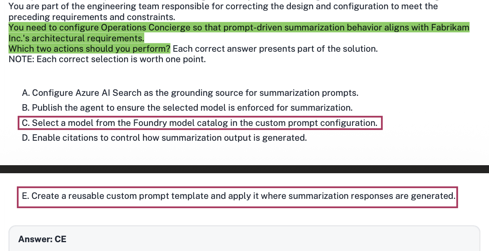
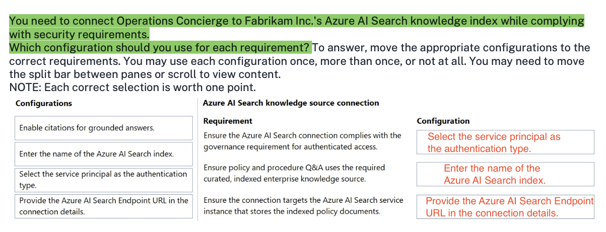

# Fabrikam Inc

**Case Study -**

This is a case study. Case studies are not timed separately from other exam sections. You can use as much exam time as you would like to complete each case study. However, there might be additional case studies or other exam sections. Manage your time to ensure that you can complete all the exam sections in the time provided. Pay attention to the Exam Progress at the top of the screen so you have sufficient time to complete any exam sections that follow this case study.

To answer the case study questions, you will need to reference information that is provided in the case. Case studies and associated questions might contain exhibits or other resources that provide more information about the scenario described in the case. Information provided in an individual question does not apply to the other questions in the case study.

A Review Screen will appear at the end of this case study. From the Review Screen, you can review and change your answers before you move to the next exam section. After you leave this case study, you will NOT be able to return to it.

**To start the case study -**

To display the first question in this case study, select the "Next" button. To the left of the question, a menu provides links to information such as business requirements, the existing environment, and problem statements. Please read through all this information before answering any questions. When you are ready to answer a question, select the "Question" button to return to the question.

---

### Background

Fabrikam Inc. is a Canada-based manufacturer with a growing service organization that supports field technicians and internal operations teams. Fabrikam Inc. plans to launch a new internal agent solution named Operations Concierge to reduce time spent searching policy content, retrieving operational metrics, and executing routine transactions.

The agent will be used by three groups:

* Service coordinators who triage incoming service requests

* Field technicians who need guided procedures and parts availability

* Operations managers who monitor KPIs and exceptions

The agent solution must work in real-world operational conditions. Users often ask questions mid-call with a customer or while coordinating parts shipments. The agents require quick, reliable outcomes. As a result, Fabrikam Inc. requires the solution to:

* Provide grounded answers with traceability when it provides guidance.

* Retrieve real-time metrics when users ask for operational status.

* Execute authenticated updates when users initiate a flow (such as creating a parts request).

Fabrikam Inc. also expects the solution to be maintained by multiple makers and developers across the year. The company has experienced duplicated logic and inconsistent behavior across different agents. This project emphasizes reuse, governance, and maintainability across teams.

---

### Current environment

Fabrikam Inc. runs three Microsoft Power Platform environments for agent development and release: Dev, Test, and Prod.

The team plans to build the agent and validate it in Dev and Test, then promote to Prod by using a controlled release process that supports repeatable deployments.

Fabrikam Inc. already has two assets the team wants to reuse:

* A partially completed Copilot Studio agent named Service Desk Agent, used by IT to create internal tickets and route requests

* A Microsoft Foundry agent created by a central AI team that performs specialized summarization and classification for long-form text (for example, summarizing call transcripts into an incident narrative)

Fabrikam Inc. also has operational and knowledge data sources:

* A curated policy library (internal SOPs, service warranty rules, escalation criteria, and standard operating procedures)

* A set of indexed documents and procedures in an Azure AI Search service that supports vector search for the policy library

* A Microsoft Fabric workspace that includes a semantic model used by operations leadership for reporting

---

### Business requirements

Fabrikam Inc. requires Operations Concierge to meet the following business requirements:

* **Traceability requirement:** When the agent provides policy guidance or procedural recommendations, users must be able to see where the answer came from.

* **Metrics requirement:** When users ask about service performance (backlog, SLA risk, parts shortages, dispatch delays), the solution must return up-to-date metrics in a structured format that operations managers can use in weekly reviews.

* **Transaction requirement:** The solution must support authenticated updates initiated during conversations, including creating a parts request and updating a service case status.

In addition, Fabrikam Inc. wants to avoid duplicating common assets across agents:

* The team must reuse the same set of escalation topics, MCP tool definitions, and a standard safety disclaimer across three different agents.

* Only the platform engineering group as allowed to edit shared assets. However, all agent authors must be able to use them.

---

### Technical requirements

The Fabrikam Inc. solution architecture uses a multi-agent approach so that specialist responsibilities are isolated and can evolve independently.

The Operations Concierge (primary agent) must coordinate the following specialist capabilities:

* **Policy and procedure Q&A:** Use an enterprise knowledge source that supports indexed retrieval across the curated policy library and service procedures.

* **Operational metrics:** Delegate metric queries to a Fabric Data Agent that reads governed business data through the Fabric semantic model.

* **Authenticated updates:** Use tools exposed by an existing internal Model Context Protocol (MCP) server that provides transactional operations for the service organization.

* **Specialized processing:** Delegate summarization and classification requests to an existing Microsoft Foundry agent.

Fabrikam Inc. will onboard two MCP servers as tools:

* **PartsOps MCP server:** exposes tools for parts availability checks and parts request creation. The server requires per-user authentication because actions must be traceable to the requesting user.

* **WarrantyRules MCP server:** exposes a read-only tool for validating warranty coverage. The server uses an API key shared by the agent team.

Fabrikam Inc. has also defined a collaboration requirement with the existing Service Desk Agent:

* The primary agent must delegate IT-specific requests to the existing Service Desk Agent rather than reimplement ticket creation logic.

Finally, Fabrikarn Inc. plans to support a partner integration:

* For shipment tracking inquiries, Fabrikam Inc. will delegate to a partner-provided agent that is only available through a standardized agent-to-agent endpoint.

---

### Issues and constraints

During early testing, Fabrikam Inc. found three recurring problems:

* Makers are copying and modifying the same components across agents, resulting in inconsistent disclaimers and duplicated tools.

* Users can obtain a correct answer, but the response is not consistently traceable to a source when the agent uses knowledge.

* The primary agent can route some requests, but specialist capabilities are not consistently delegated (for example, some metric questions are answered generatively instead of being routed to the Fabric Data Agent).

---

### Question 35

You are part of the engineering team responsible for correcting the design and configuration to meet the preceding requirements and constraints.

You need to enable Operations Concierge to delegate shipment tracking inquiries according to Fabrikam Inc.'s defined architecture and technical requirements.

Which integration approach should you use?

A. Configure the partner capability as an enterprise knowledge source with indexed retrieval enabled.

B. Configure the partner capability as an MCP tool and invoke it as a transactional operation.

C. Configure the partner capability as an A2A integration and supply its endpoint information.

D. Configure the primary agent to handle shipment tracking through generative responses after publishing.

### 1. Extracted Question Summary

* **Case Study Scenario (Fabrikam Inc. — Operations Concierge):** Fabrikam Inc. is deploying a multi-agent internal solution named **Operations Concierge** in Microsoft Copilot Studio across Dev, Test, and Prod environments. Under **Technical requirements** for external partner integration, the case study explicitly specifies: *"For shipment tracking inquiries, Fabrikam Inc. will delegate to a partner-provided agent that is only available through a standardized agent-to-agent endpoint."*

* **Question (Question 35):** You need to enable Operations Concierge to delegate shipment tracking inquiries according to Fabrikam Inc.'s defined architecture and technical requirements. Which integration approach should you use?

* **Options:**
* **A.** Configure the partner capability as an enterprise knowledge source with indexed retrieval enabled.

* **B.** Configure the partner capability as an MCP tool and invoke it as a transactional operation.

* **C.** Configure the partner capability as an A2A integration and supply its endpoint information.

* **D.** Configure the primary agent to handle shipment tracking through generative responses after publishing.

* **Visible Answer in Screenshot:** `Answer: C`

---

### 2. Correct Answer

* **C: Configure the partner capability as an A2A integration and supply its endpoint information.**

---

### 3. Verification of Visible Selection / Community Key

* **Correct.** The visible key (`Answer: C`) is accurate because the case study explicitly states that the external partner's shipment tracking agent is exposed exclusively via a *"standardized agent-to-agent endpoint"*, which maps directly to Copilot Studio's **Agent-to-Agent (A2A)** protocol integration.

---

### 4. Official Microsoft Justification

* **Multi-Agent Orchestration via Agent-to-Agent (A2A) Protocol (`AB-620T00` / `AB-100` — Orchestrate multi-agent solutions and integrate external agents in Copilot Studio):** Under Microsoft Learn's official Copilot Studio multi-agent architecture (*Connect external agents using Agent-to-Agent (A2A)*):
* **Standardized Cross-Platform Agent Delegation (`Configure the partner capability as an A2A integration and supply its endpoint information`):** The **Agent-to-Agent (A2A)** protocol is an open standard that enables a primary Copilot Studio orchestrator agent to discover, authenticate with, and delegate conversational sub-tasks to external agents hosted outside the environment or built on third-party platforms. Supplying the partner agent's A2A endpoint URL / agent card allows Operations Concierge to route shipment tracking inquiries directly to the external specialist agent.

---

### 5. Distractor Analysis (Why Others Are Wrong)

* **A:** Enterprise knowledge sources (such as Azure AI Search or SharePoint) index static or semi-structured documents for RAG retrieval; they cannot invoke a live external partner agent endpoint for real-time shipment tracking.

* **B:** Model Context Protocol (**MCP**) servers expose deterministic tools, resources, and prompts (such as Fabrikam's internal `PartsOps` and `WarrantyRules` MCP servers), whereas the partner shipment tracker is explicitly defined as an autonomous external agent exposed over a *"standardized agent-to-agent endpoint"* (**A2A**).

* **D:** Handling shipment tracking directly through the primary agent's generative answers violates Fabrikam's multi-agent delegation architecture and provides no connection to the external partner's live tracking system.

---

### 6. Exam Keyword / Trap Alert

* **Keywords:** *"partner-provided agent"* + *"standardized agent-to-agent endpoint"* = **A2A integration** (**C**).

* **Trap:** Do not confuse **MCP (Model Context Protocol)** (**B**) with **A2A (Agent-to-Agent)** (**C**)—in the Fabrikam Inc. case study, internal tool servers (`PartsOps`, `WarrantyRules`) use **MCP**, while external cross-agent delegation to the partner's agent uses **A2A**.

## Question 36

The primary agent can route some requests, but specialist capabilities are not consistently delegated (for example, some metric questions are answered generatively instead of being routed to the Fabric Data Agent).

You are part of the engineering team responsible for correcting the design and configuration to meet the preceding requirements and constraints.

You need to integrate Fabrikam Inc.'s existing Foundry agent so Operations Concierge can delegate summarization requests.

Which action should you perform for each requirement? To answer, move the appropriate actions to the correct requirements. You may use each action once, more than once, or not at all. You may need to move the split bar between panes or scroll to view content.

**NOTE:** Each correct selection is worth one point.

---

### Actions

* Add an external agent of type Microsoft Foundry.

* Publish the Copilot Studio agent to enable external calls.

* Add the Foundry output as an indexed knowledge source.

* Enter the Foundry project endpoint URL to create the connection.

---

### Foundry agent integrations

| Requirement | Action |
| --- | --- |
| The main agent must be able to call an external Foundry agent.| [          ] |
| The external Foundry agent must reference the correct Foundry project and agent.| [          ] |

### 1. Extracted Question Summary

* **Case Study Scenario (Fabrikam Inc. — Operations Concierge):** You need to integrate Fabrikam Inc.'s existing Microsoft Foundry agent (created by a central AI team for specialized summarization and classification of long-form text) so that the primary orchestrator agent (**Operations Concierge**) can delegate summarization requests.

* **Question (Fabrikam Inc. Case Study — Drag and Drop):** Which action should you perform for each requirement? Move the appropriate actions from the left (`Actions`) to match the two target rows under `Requirement` (`Foundry agent integrations`) on the right (each action may be used once, more than once, or not at all).

* **Available Actions (Left Column):**
* `Add an external agent of type Microsoft Foundry.`

* `Publish the Copilot Studio agent to enable external calls.`

* `Add the Foundry output as an indexed knowledge source.`

* `Enter the Foundry project endpoint URL to create the connection.`

* **Target Requirements (Right Table — `Foundry agent integrations`):**
1. `The main agent must be able to call an external Foundry agent.`

2. `The external Foundry agent must reference the correct Foundry project and agent.`

---

### 2. Correct Answer

* **The main agent must be able to call an external Foundry agent.:** **Add an external agent of type Microsoft Foundry.**

* **The external Foundry agent must reference the correct Foundry project and agent.:** **Enter the Foundry project endpoint URL to create the connection.**

---

### 4. Official Microsoft Justification

* **Connecting External Microsoft Foundry Agents in Copilot Studio (`AB-620T00` / `AB-100` — Orchestrate multi-agent solutions and integrate external agents in Copilot Studio):** Under Microsoft Learn's official Copilot Studio multi-agent documentation (*Connect an external Microsoft Foundry agent*), delegating specialized generative or analytical workloads from a primary Copilot Studio orchestrator to a Microsoft Foundry (Azure AI Foundry) agent uses a dedicated native integration pattern:
1. **Registering the External Agent (`Add an external agent of type Microsoft Foundry`):** Within the primary Copilot Studio agent's **Agents** section, makers select **Add an agent → Connect an external agent** and choose **Microsoft Foundry** as the external agent type so the orchestrator can route specialized summarization and classification requests to it.

2. **Binding the Foundry Project & Target Agent (`Enter the Foundry project endpoint URL to create the connection`):** Configuring the Microsoft Foundry external agent connection requires providing the **Microsoft Foundry project endpoint URL** (along with the specific Foundry agent ID/reference) so Copilot Studio establishes an authenticated runtime binding to the exact Foundry project and target agent.

---

### 5. Distractor Analysis (Why Others Are Wrong)

* **Publish the Copilot Studio agent to enable external calls:** Publishing deploys the Copilot Studio agent to end-user channels; it does not register an external Microsoft Foundry agent or bind its project endpoint.

* **Add the Foundry output as an indexed knowledge source:** A Microsoft Foundry agent is an active, callable specialist agent for dynamic text summarization and classification—not a static document repository indexed as a knowledge source.

---

### 6. Exam Keyword / Trap Alert

* **Keywords:** *"call an external Foundry agent"* = **Add an external agent of type Microsoft Foundry**; *"reference the correct Foundry project and agent"* = **Enter the Foundry project endpoint URL to create the connection**.

* **Trap:** Do not confuse **A2A (Agent-to-Agent)** integrations (used for third-party/partner agents over a standardized A2A endpoint, as in Question 35) with **Microsoft Foundry** external agent connections, which have their own native **Microsoft Foundry** agent type and bind via the **Foundry project endpoint URL**.

## Question 37

The primary agent can route some requests, but specialist capabilities are not consistently delegated (for example, some metric questions are answered generatively instead of being routed to the Fabric Data Agent).

You are part of the engineering team responsible for correcting the design and configuration to meet the preceding requirements and constraints.

You need to plan how Fabrikam Inc. will reuse shared components across multiple agents while limiting who can change the shared components.

Which approach should you use for each requirement? To answer, move the appropriate components to the correct requirements. You may use each component once, more than once, or not at all. You may need to move the split bar between panes or scroll to view content.

**NOTE:** Each correct selection is worth one point.

---

### Components

* Restrict component collection to the primary agent.

* Create a component collection and move shared components into it.

* Export the primary agent as a solution and copy assets into other agents.

* Share the component collection with teammates while controlling edit access.

---

### Reusable components

| Requirement | Component |
| --- | --- |
| Prevent shared assets from being modified by most builders.| [          ] |
| Reuse the same set of components across multiple agents without copying.| [          ] |
| Limit a shared set of components so it can be used only by its intended primary agent.| [          ] |

### 1. Extracted Question Summary

* **Case Study Scenario (Fabrikam Inc. — Operations Concierge):** You need to plan how Fabrikam Inc. will reuse shared components (escalation topics, MCP tool definitions, and a standard safety disclaimer) across multiple agents while limiting who can change the shared components. From the Fabrikam Inc. case study specifications:

* **Business requirements:** *"The team must reuse the same set of escalation topics, MCP tool definitions, and a standard safety disclaimer across three different agents. Only the platform engineering group is allowed to edit shared assets. However, all agent authors must be able to use them."*

* **Question (Fabrikam Inc. Case Study — Drag and Drop):** Which approach should you use for each requirement? Move the appropriate components from the left (`Components`) to match the three target rows under `Requirement` (`Reusable components`) on the right (each component may be used once, more than once, or not at all).

* **Available Components (Left Column):**
* `Restrict component collection to the primary agent.`

* `Create a component collection and move shared components into it.`

* `Export the primary agent as a solution and copy assets into other agents.`

* `Share the component collection with teammates while controlling edit access.`

* **Target Requirements (Right Table — `Reusable components`):**
1. `Prevent shared assets from being modified by most builders.`

2. `Reuse the same set of components across multiple agents without copying.`

3. `Limit a shared set of components so it can be used only by its intended primary agent.`

---

### 2. Correct Answer

* **Prevent shared assets from being modified by most builders.:** **Share the component collection with teammates while controlling edit access.**

* **Reuse the same set of components across multiple agents without copying.:** **Create a component collection and move shared components into it.**

* **Limit a shared set of components so it can be used only by its intended primary agent.:** **Restrict component collection to the primary agent.**

---

### 4. Official Microsoft Justification

* **Component Collections & Role-Based Governance in Copilot Studio (`AB-620T00` / `AB-100` — Manage reusable agent assets and component collections in Copilot Studio):** Under Microsoft Learn's official Copilot Studio documentation (*Use component collections to share components across agents*), **Component Collections** are dedicated Power Platform solution-aware containers designed to package, govern, and share reusable topics, tools/actions, knowledge sources, and entities across multiple agents without manual duplication:
1. **Granular Edit vs. Consumer Permissions (`Share the component collection with teammates while controlling edit access`):** Sharing a component collection with maker teams grants read/use permissions so authors can consume the shared components inside their agents, while restricting **edit/owner** permissions exclusively to the platform engineering group—preventing unauthorized modifications by most builders.

2. **Centralized Reuse Without Duplication (`Create a component collection and move shared components into it`):** Creating a **component collection** and moving common topics, MCP tools, and disclaimers into it allows multiple agents in the same environment to reference a single authoritative definition rather than copying components across agents.

3. **Scoped Agent Binding (`Restrict component collection to the primary agent`):** Component collection access and availability can be scoped/restricted to specific target agents so a shared component set is consumed only by its intended primary agent.

---

### 5. Distractor Analysis (Why Others Are Wrong)

* **Export the primary agent as a solution and copy assets into other agents:** Copying assets across agents recreates the exact recurring problem identified in Fabrikam Inc.'s *Issues and constraints* section (*"Makers are copying and modifying the same components across agents, resulting in inconsistent disclaimers and duplicated tools"*).

---

### 6. Exam Keyword / Trap Alert

* **Keywords:** *"Prevent shared assets from being modified"* = **Share the component collection... controlling edit access**; *"Reuse... across multiple agents without copying"* = **Create a component collection**; *"used only by its intended primary agent"* = **Restrict component collection to the primary agent**.

* **Trap:** Never select any option that **copies** assets between agents—Copilot Studio solves multi-agent asset duplication natively through **Component Collections** with controlled sharing permissions.

## Question 38

You are part of the engineering team responsible for correcting the design and configuration to meet the preceding requirements and constraints.

You need to configure Operations Concierge so that prompt-driven summarization behavior aligns with Fabrikam Inc.'s architectural requirements.

Which two actions should you perform? Each correct answer presents part of the solution.

**NOTE:** Each correct selection is worth one point.

A. Configure Azure AI Search as the grounding source for summarization prompts.

B. Publish the agent to ensure the selected model is enforced for summarization.

C. Select a model from the Foundry model catalog in the custom prompt configuration.

D. Enable citations to control how summarization output is generated.

E. Create a reusable custom prompt template and apply it where summarization responses are generated.

### 1. Extracted Question Summary

* **Case Study Scenario (Fabrikam Inc. — Operations Concierge):** You are part of the engineering team responsible for correcting the design and configuration of Operations Concierge to meet Fabrikam Inc.'s architectural requirements and reuse/governance standards. You need to configure Operations Concierge so that prompt-driven summarization behavior aligns with Fabrikam Inc.'s architectural requirements.

* **Question:** Which two actions should you perform? (Each correct answer presents part of the solution.)

* **Options:**
* **A.** Configure Azure AI Search as the grounding source for summarization prompts.

* **B.** Publish the agent to ensure the selected model is enforced for summarization.

* **C.** Select a model from the Foundry model catalog in the custom prompt configuration.

* **D.** Enable citations to control how summarization output is generated.

* **E.** Create a reusable custom prompt template and apply it where summarization responses are generated.

---

### 2. Correct Answer

* **C: Select a model from the Foundry model catalog in the custom prompt configuration.**

* **E: Create a reusable custom prompt template and apply it where summarization responses are generated.**

---

### 4. Official Microsoft Justification

* **Custom Prompts, Foundry Model Selection & Reusable Prompt Assets (`AB-620T00` / `AB-100` — Create and manage custom prompts and AI Builder / Foundry models in Copilot Studio):** Under Microsoft Learn's official Copilot Studio documentation (*Use custom prompts in Copilot Studio* and *Choose a model from the Microsoft Foundry model catalog*):
1. **Model Selection in Prompt Configuration (`Select a model from the Foundry model catalog in the custom prompt configuration`):** Within the Copilot Studio / Power Platform custom prompt builder (`Prompt` tool), makers explicitly select an appropriate generative model from the **Microsoft Foundry model catalog** (such as GPT-4o or GPT-4o-mini) to govern reasoning quality, context window capacity, and latency for long-form summarization tasks.

2. **Reusable Prompt Asset Architecture (`Create a reusable custom prompt template and apply it where summarization responses are generated`):** Creating a standalone, reusable **custom prompt** asset encapsulates the summarization instructions, input variables, output format (e.g., Text or JSON), and model choice so multiple topics or agents can invoke the exact same governed template without duplicating prompt logic—directly satisfying Fabrikam Inc.'s core architectural mandate emphasizing reuse, governance, and maintainability across teams.

---

### 5. Distractor Analysis (Why Others Are Wrong)

* **A:** In Fabrikam Inc.'s architecture, **Azure AI Search** is used as an enterprise knowledge source for indexed vector retrieval across the curated policy and SOP library, whereas prompt-driven summarization operates on passed-in text inputs (such as call transcripts) rather than querying Azure AI Search for grounding.

* **B:** Publishing deploys the agent to end-user channels; it is a general release step rather than an architectural configuration action that defines prompt-driven summarization behavior.

* **D:** Citations provide source traceability attribution on knowledge-grounded answers; they do not control the structure, model selection, or generation behavior of a summarization prompt.

---

### 6. Exam Keyword / Trap Alert

* **Keywords:** *"prompt-driven summarization behavior"* + *"architectural requirements"* (reuse & governance) = **Select a model from the Foundry model catalog in the custom prompt configuration** (**C**) + **Create a reusable custom prompt template** (**E**).

* **Trap:** Do not confuse **Azure AI Search** (**A**) or **citations** (**D**) with custom prompt configuration—those two apply to Fabrikam Inc.'s **Policy and procedure Q&A** traceability requirement, not prompt-driven text summarization.

## Question 39

You need to connect Operations Concierge to Fabrikam Inc.'s Azure AI Search knowledge index while complying with security requirements.

Which configuration should you use for each requirement? To answer, move the appropriate configurations to the correct requirements. You may use each configuration once, more than once, or not at all. You may need to move the split bar between panes or scroll to view content.

**NOTE:** Each correct selection is worth one point.

---

### Configurations

* Enable citations for grounded answers.

* Enter the name of the Azure AI Search index.

* Select the service principal as the authentication type.

* Provide the Azure AI Search Endpoint URL in the connection details.

---

### Azure AI Search knowledge source connection

| Requirement | Configuration |
| --- | --- |
| Ensure the Azure AI Search connection complies with the governance requirement for authenticated access.| [          ] |
| Ensure policy and procedure Q&A uses the required curated, indexed enterprise knowledge source.| [          ] |
| Ensure the connection targets the Azure AI Search service instance that stores the indexed policy documents.| [          ] |

### 1. Extracted Question Summary

* **Case Study Scenario (Fabrikam Inc. — Operations Concierge):** You need to connect the primary agent (**Operations Concierge**) to Fabrikam Inc.'s Azure AI Search knowledge index (which stores indexed vector search documents for the curated policy library and service procedures) while complying with security and architectural requirements.

* **Question (Fabrikam Inc. Case Study — Drag and Drop):** Which configuration should you use for each requirement? Move the appropriate configurations from the left (`Configurations`) to match the three target rows under `Requirement` (`Azure AI Search knowledge source connection`) on the right (each configuration may be used once, more than once, or not at all).

* **Available Configurations (Left Column):**
* `Enable citations for grounded answers.`

* `Enter the name of the Azure AI Search index.`

* `Select the service principal as the authentication type.`

* `Provide the Azure AI Search Endpoint URL in the connection details.`

* **Target Requirements (Right Table — `Azure AI Search knowledge source connection`):**
1. `Ensure the Azure AI Search connection complies with the governance requirement for authenticated access.`

2. `Ensure policy and procedure Q&A uses the required curated, indexed enterprise knowledge source.`

3. `Ensure the connection targets the Azure AI Search service instance that stores the indexed policy documents.`

---

### 2. Correct Answer

* **Ensure the Azure AI Search connection complies with the governance requirement for authenticated access.:** **Select the service principal as the authentication type.**

* **Ensure policy and procedure Q&A uses the required curated, indexed enterprise knowledge source.:** **Enter the name of the Azure AI Search index.**

* **Ensure the connection targets the Azure AI Search service instance that stores the indexed policy documents.:** **Provide the Azure AI Search Endpoint URL in the connection details.**

---

### 4. Official Microsoft Justification

* **Configuring Azure AI Search as an Enterprise Knowledge Source (`AB-620T00` / `AB-100` — Ground agents with knowledge sources in Copilot Studio > Add Azure AI Search as a knowledge source):** Under Microsoft Learn's official Copilot Studio documentation for connecting an **Azure AI Search** knowledge source, establishing a governed, authenticated vector/hybrid retrieval connection requires three core connection parameters:
1. **Microsoft Entra ID / Service Principal Authentication (`Select the service principal as the authentication type`):** When configuring the Azure AI Search connection in Copilot Studio, choosing **Service principal** (Microsoft Entra ID application identity) enforces enterprise-grade, governed authentication rather than relying on shared static admin keys.

2. **Target Vector/Semantic Index Selection (`Enter the name of the Azure AI Search index`):** Within a single Azure AI Search service, multiple indexes can exist; specifying the exact **index name** binds the agent's policy and procedure Q&A strictly to the curated, indexed enterprise policy repository.

3. **Service Instance Endpoint Binding (`Provide the Azure AI Search Endpoint URL in the connection details`):** Supplying the **Azure AI Search Endpoint URL** (`https://<service-name>.search.windows.net`) identifies and connects Copilot Studio to the specific Azure AI Search resource instance hosting the indexed policy documents.

---

### 5. Distractor Analysis (Why Others Are Wrong)

* **Enable citations for grounded answers:** Citations address Fabrikam Inc.'s **Traceability requirement** (showing users where an answer came from in the UI), rather than configuring the connection parameters (authentication type, endpoint URL, and index name) for the Azure AI Search knowledge source.

---

### 6. Exam Keyword / Trap Alert

* **Keywords:** *"authenticated access"* = **Select the service principal as the authentication type**; *"curated, indexed enterprise knowledge source"* = **Enter the name of the Azure AI Search index**; *"targets the Azure AI Search service instance"* = **Provide the Azure AI Search Endpoint URL**.

* **Trap:** Do not confuse UI-level **citations** (which satisfy answer *traceability*) with connection-level **index name** and **endpoint URL** parameters when configuring an Azure AI Search knowledge source.

--- 

## Additional Questions 

---

## Additional Question 1: Service Desk Agent Collaboration

### Question Prompt

You are part of the engineering team responsible for correcting the design and configuration to meet the preceding requirements and constraints.

You need to enable collaboration requirements for Operations Concierge.

Which two actions should you perform? Each correct answer presents part of the solution.

**Options:**

* **A.** Enable allow connections from other agents on the Service Desk Agent.
* **B.** Replace the Service Desk Agent with an MCP server.
* **C.** Publish Operations Concierge to enable delegation automatically.
* **D.** Add the Service Desk Agent as an indexed knowledge source.
* **E.** Publish the Service Desk Agent.

### Correct Answer

* **A. Enable allow connections from other agents on the Service Desk Agent.**
* **E. Publish the Service Desk Agent.**

### Official Microsoft Justification

* **Multi-Agent Delegation in Copilot Studio (`AB-620T00` — Configure multi-agent collaboration from Copilot Studio > Integrate an existing agent in Copilot Studio):** For a primary Copilot Studio agent (`Operations Concierge`) to delegate IT ticket creation requests to another existing Copilot Studio agent (`Service Desk Agent`) in the same environment, two prerequisites are required on the child/specialist agent:
1. **Cross-Agent Connection Permission (`A`):** In the **Service Desk Agent's** settings, you must explicitly turn on **Let other agents connect to and use this one** (*allow connections from other agents*).
2. **Published Runtime State (`E`):** A child Copilot Studio agent must be **published** before a primary orchestrator agent can discover, connect to, and invoke it at runtime (and any future updates to the child agent must be republished to take effect).

* **Why Others Are Wrong:** Replacing the agent with an MCP server (**B**) violates the requirement to reuse the existing Service Desk Agent; publishing only the primary agent (**C**) does not expose the child agent; and an agent is an active conversational orchestrator rather than a static knowledge source (**D**).

---

## Additional Question 2: Multi-Agent Architecture Design

### Question Prompt

You need to design a solution that provides Fabrikam Inc. with a multi-agent design approach with existing agents.

Which approach should you use for each requirement? To answer, move the appropriate approaches to the correct requirements. You may use each approach once, more than once, or not at all.

**Available Approaches:**

* `Delegate to a knowledge-focused agent.`
* `Delegate to a data-access agent.`
* `Delegate to a tools-first agent.`
* `Consolidate all capabilities into a single monolithic agent.`

**Target Requirements:**

| Requirement | Approach |
| --- | --- |
| Policy questions | **[          ]** |
| Metric requirements | **[          ]** |
| Transaction requirements | **[          ]** |

### Correct Answer

* **Policy questions:** **Delegate to a knowledge-focused agent.**
* **Metric requirements:** **Delegate to a data-access agent.**
* **Transaction requirements:** **Delegate to a tools-first agent.**

### Official Microsoft Justification

* **Multi-Agent Specialization Patterns (`AB-620T00` — Configure multi-agent collaboration from Copilot Studio > Design multi-agent solutions in Copilot Studio):** Separating distinct operational domains into specialized agents prevents tool/knowledge routing collisions and lets teams maintain each capability independently:
1. **Policy questions → Knowledge-focused agent:** Unstructured policy and SOP lookups rely on indexed retrieval (Azure AI Search) with citation grounding.
2. **Metric requirements → Data-access agent:** Analytical KPI queries (backlog, SLA risk, parts shortages, dispatch delays) map to the **Microsoft Fabric Data Agent**, which queries the governed Fabric semantic model.
3. **Transaction requirements → Tools-first agent:** Authenticated state-changing operations (such as creating a parts request or updating a service case) require deterministic tool execution via MCP servers or connectors.

---

## Additional Question 3: Generative Answers & Grounding Configuration

### Question Prompt

You need to configure generative answers so the agent meets Fabrikam Inc.'s business requirements.

Which solutions should you use? To answer, move the appropriate solutions to the correct requirements. You may use each solution once, more than once, or not at all.

**Available Solutions:**

* `Instruct the agent to cite sources in knowledge settings.`
* `Configure Azure AI Search as the grounding data source.`
* `Select a model from the Foundry model catalog.`
* `Enable general AI knowledge fallback.`

**Target Requirements:**

| Requirement | Solution |
| --- | --- |
| Trace each answer to its source | **[          ]** |
| Retrieve from the centralized index | **[          ]** |
| Use an enterprise-approved foundation model | **[          ]** |

### Correct Answer

* **Trace each answer to its source:** **Instruct the agent to cite sources in knowledge settings.**
* **Retrieve from the centralized index:** **Configure Azure AI Search as the grounding data source.**
* **Use an enterprise-approved foundation model:** **Select a model from the Foundry model catalog.**

### Official Microsoft Justification

* **Grounded Generative Answers & Model Governance (`AB-620T00` — Integrate agents with Azure > Configure generative answers by using Azure AI Search with Foundry):**
1. **Traceability (`Instruct the agent to cite sources in knowledge settings`):** Satisfies Fabrikam's *Traceability requirement* by ensuring responses return verifiable citations pointing back to the retrieved policy documents.
2. **Indexed Retrieval (`Configure Azure AI Search as the grounding data source`):** Connects the agent to Fabrikam's centralized vector-indexed policy library in Azure AI Search rather than relying on ungrounded model weights.
3. **Model Selection (`Select a model from the Foundry model catalog`):** Binds generative orchestration/prompts to a central AI team-approved foundation model hosted in Microsoft Foundry.

---

## Additional Question 4: Onboarding MCP Servers & Authentication Settings

### Question Prompt

You need to add Fabrikam Inc.'s MCP servers as a tool so the agent can perform the required operations during conversations.

Which setting should you configure for each requirement? To answer, move the appropriate settings to the correct requirements. You may use each setting once, more than once, or not at all.

**Available Settings:**

* `OAuth 2.0 (per-user authentication)`
* `API key (shared team authentication)`
* `Anonymous (no authentication)`
* `Service principal (app-only authentication)`

**Target Requirements:**

| Requirement | Setting |
| --- | --- |
| PartsOps MCP server (per-user authentication so actions are traceable to the requesting user) | **[          ]** |
| WarrantyRules MCP server (read-only tool using a key shared by the agent team) | **[          ]** |

### Correct Answer

* **PartsOps MCP server:** **OAuth 2.0 (per-user authentication)**
* **WarrantyRules MCP server:** **API key (shared team authentication)**

### Official Microsoft Justification

* **Configuring Model Context Protocol (MCP) Tools in Copilot Studio (`AB-620T00` — Add tools to agents > Configure MCP tools):** When onboarding external MCP servers as tools in Copilot Studio, authentication is configured per MCP connection to match the server's security contract:
1. **Per-User Identity Delegation (`OAuth 2.0`):** Because `PartsOps` executes state-changing transactions (creating parts requests) that must be audited and attributed to the individual technician or coordinator, **OAuth 2.0** user-level authentication passes the signed-in user's token context.
2. **Shared Credential Authentication (`API key`):** Because `WarrantyRules` exposes a read-only warranty check protected by a static key issued to the engineering team, **API key** authentication stores the shared secret securely in the connection configuration.

---

## Additional Question 5: Handling Performance & Operational Metrics

### Question Prompt

You need to ensure that performance-related questions are handled in accordance with Fabrikam Inc.'s defined architecture and business requirements.

Which capability should Operations Concierge use?

**Options:**

* **A.** A Foundry agent configured for summarization and classification.
* **B.** A data agent integrated into the multi-agent solution.
* **C.** An MCP server tool that executes transactional operations.
* **D.** An Azure AI Search knowledge source configured for enterprise policy retrieval.

### Correct Answer

* **B. A data agent integrated into the multi-agent solution.**

### Official Microsoft Justification

* **Microsoft Fabric Data Agent Integration (`AB-620T00` — Configure multi-agent collaboration from Copilot Studio > Integrate a Fabric data agent):** Under Fabrikam's *Metrics requirement* and *Technical requirements*, operational KPIs (backlog, SLA risk, parts shortages, dispatch delays) live in a governed **Microsoft Fabric semantic model**. Integrating the **Microsoft Fabric Data Agent** into `Operations Concierge` ensures performance questions are routed to a specialist data agent that translates natural language into governed queries against the Fabric semantic model (preserving DAX measures, relationships, and row-level security) rather than hallucinating generative answers.
* **Why Others Are Wrong:** The Foundry agent (**A**) is scoped strictly to long-form text summarization/classification; MCP servers (**C**) handle parts/warranty transactions; and Azure AI Search (**D**) indexes static policy documents rather than live Fabric metrics.

