# Question Answers

## Q2

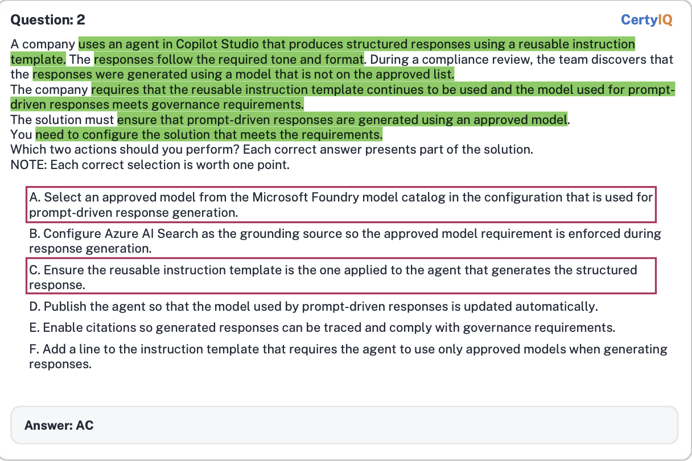

### 1. Extracted Question Summary

* **Scenario:** A company uses a Microsoft Copilot Studio agent that generates structured responses via a reusable instruction template (AI prompt) matching a required tone and format. A compliance review reveals that the underlying generative model used for these prompt-driven responses is not on the company's approved list. You must ensure the existing reusable instruction template remains in use while enforcing that prompt-driven responses are generated using an approved model.

* **Question:** Which two actions should you perform? (Each correct answer presents part of the solution.)

* **Options:**
* **A.** Select an approved model from the Microsoft Foundry model catalog in the configuration that is used for prompt-driven response generation.

* **B.** Configure Azure AI Search as the grounding source so the approved model requirement is enforced during response generation.

* **C.** Ensure the reusable instruction template is the one applied to the agent that generates the structured response.

* **D.** Publish the agent so that the model used by prompt-driven responses is updated automatically.

* **E.** Enable citations so generated responses can be traced and comply with governance requirements.

* **F.** Add a line to the instruction template that requires the agent to use only approved models when generating responses.

* **Visible Answer in Screenshot:** `Answer: AC`

---

### 2. Correct Answer

* A: Select an approved model from the Microsoft Foundry model catalog in the configuration that is used for prompt-driven response generation.

* C: Ensure the reusable instruction template is the one applied to the agent that generates the structured response.

---

### 3. Verification of Visible Selection / Community Key

* **Correct.** The visible key (`AC`) accurately identifies the two architectural actions required: explicitly binding the approved model from the Microsoft Foundry (formerly Azure AI Foundry) model catalog to the prompt configuration (**A**), and ensuring that specific configured prompt/instruction template is the one bound to the agent (**C**).

---

### 4. Official Microsoft Justification

* **Model Selection for Custom Prompts (AI Builder / Copilot Studio):** In Microsoft Copilot Studio (covered under the **AB-620T00** curriculum for creating custom prompts and extending agents with Microsoft Foundry models), reusable instruction templates are implemented as **Custom Prompts** (AI prompts). Within the prompt builder settings, makers can override the default managed model by connecting to and selecting a specific model from the **Microsoft Foundry model catalog** (such as a specific GPT or third-party enterprise-approved deployment) so that every invocation of that prompt strictly executes against the governed model (**A**).

* **Prompt-to-Agent Binding:** Because custom prompts are standalone, reusable assets across Power Platform and Copilot Studio, configuring the model on the prompt asset alone does not take effect unless that exact prompt/instruction template is actively referenced and invoked as an action/tool within the target Copilot Studio agent (**C**).

---

### 5. Distractor Analysis (Why Others Are Wrong)

* **B:** Azure AI Search is a **knowledge/grounding data source** used for Retrieval-Augmented Generation (RAG); grounding controls *what data* the agent retrieves, not *which foundation model* processes the prompt.

* **D:** Publishing an agent pushes existing configurations to live channels; it does not automatically swap or govern underlying foundation models.

* **E:** Enabling citations improves transparency and source attribution for grounding data, but it has no mechanism to restrict or select which LLM generates the response.

* **F:** Natural language system instructions cannot dynamically change the underlying inference endpoint or model deployment at runtime; model selection is an infrastructure/configuration property, not a prompt-engineering directive.

---

### 6. Exam Keyword / Trap Alert

* **Keywords:** *"reusable instruction template"* = **Custom Prompt**; *"approved list / governance requirements"* + *"prompt-driven responses"* = **Microsoft Foundry model catalog** selection.
* **Trap:** Do not fall for prompt-injection/instruction-based governance (**F**) or RAG grounding sources (**B**) when a question asks how to enforce which **LLM/model** is used—model governance in Copilot Studio is always controlled via model selection settings (Microsoft Foundry / generative AI model settings), never via prompt text or knowledge sources.

## Q3

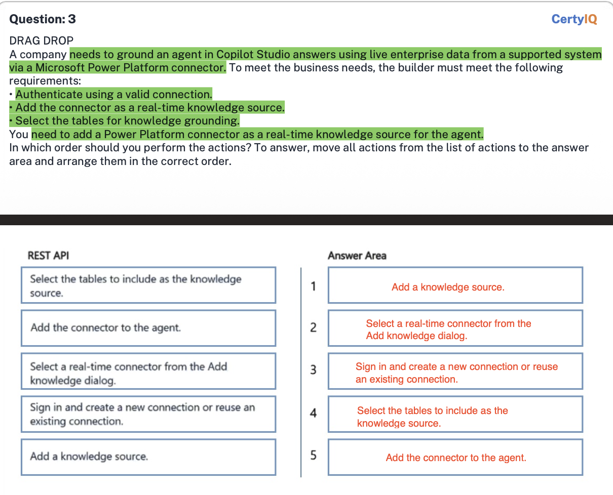

### 1. Extracted Question Summary

* **Scenario:** A company needs to ground a Microsoft Copilot Studio agent using live enterprise data from a supported system via a Microsoft Power Platform connector. The builder must authenticate using a valid connection, add the connector as a real-time knowledge source, and select the tables for knowledge grounding.

* **Question (Drag and Drop):** In which order should you perform the actions? Move all actions from the list of actions to the answer area and arrange them in the correct order.

* **Available Actions (Left Column):**
* Select the tables to include as the knowledge source.

* Add the connector to the agent.

* Select a real-time connector from the Add knowledge dialog.

* Sign in and create a new connection or reuse an existing connection.

* Add a knowledge source.

---

### 2. Correct Answer

* **Position 1:** **Add a knowledge source.**

* **Position 2:** **Select a real-time connector from the Add knowledge dialog.**

* **Position 3:** **Sign in and create a new connection or reuse an existing connection.**

* **Position 4:** **Select the tables to include as the knowledge source.**

* **Position 5:** **Add the connector to the agent.**

---

### 4. Official Microsoft Justification

* **Real-Time Connector Knowledge Configuration Flow (`AB-620T00` — Add knowledge sources to an agent):** In Microsoft Copilot Studio, connecting live enterprise data without copying/ingesting it into Dataverse uses **Real-time connectors** (such as Salesforce, ServiceNow, Zendesk, or Azure SQL Server). The wizard enforces a strict sequential UI workflow:

1. **Initiate Knowledge Creation:** Inside the agent's **Knowledge** page (or Overview -> Knowledge section), you start by selecting **+ Add knowledge** (`Add a knowledge source`).

2. **Choose Connector Type:** In the **Add knowledge** dialog, you browse or search under the enterprise/real-time connectors section and select the target real-time connector (`Select a real-time connector from the Add knowledge dialog`).

3. **Authenticate Connection:** Before Copilot Studio can inspect the schema or metadata of the external source, you must establish an authenticated session (`Sign in and create a new connection or reuse an existing connection`).

4. **Scope the Schema:** Once connected, the wizard queries the live system and prompts you to choose which specific tables/objects the agent is permitted to query at runtime (`Select the tables to include as the knowledge source`).

5. **Finalize & Save:** Finally, you confirm the configuration and click **Add** (or **Add to agent**) to bind the real-time knowledge source to the agent (`Add the connector to the agent`).

---

### 5. Distractor Analysis (Why Others Are Wrong)

* Because this is a **sequencing (Drag-and-Drop) question** requiring all five actions, every block is used; the primary failure mode is misordering steps 3, 4, and 5:
* **Selecting tables before authenticating:** Impossible in the Copilot Studio UI—the table picker cannot enumerate external tables until a valid connection is authenticated in Step 3.

* **Adding the connector to the agent before selecting tables:** In real-time connector setup, table selection happens *inside* the configuration modal *before* the final **Add** button commits the knowledge source to the agent.

---

### 6. Exam Keyword / Trap Alert

* **Keywords:** *"ground an agent... using live enterprise data"* + *"Power Platform connector"* + *"real-time knowledge source"*.

* **Trap:** Do not confuse **Real-time connectors** (which query live data at runtime without data ingestion and require selecting tables during setup) with **Dataverse / SharePoint / Uploaded files** or **Connector Actions (Tools)** (which execute read/write operations inside topics or generative orchestration rather than acting as passive knowledge grounding). Always remember the UI sequence: **Open Add Knowledge → Pick Connector → Authenticate → Pick Tables → Add to Agent**.

## Q7

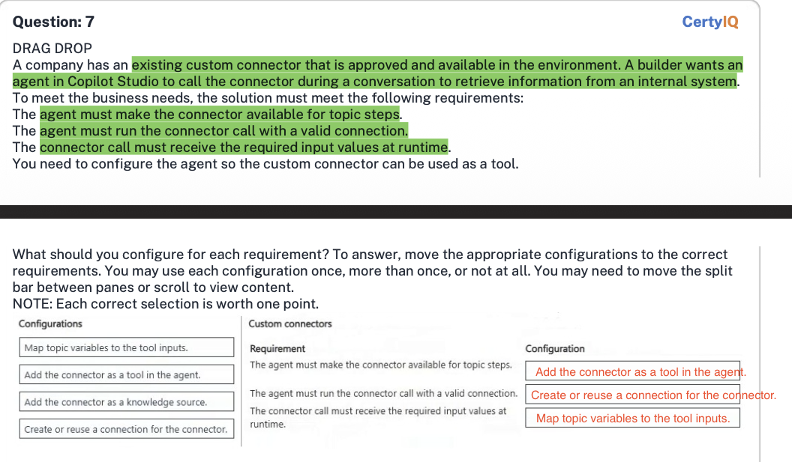

### 1. Extracted Question Summary

* **Scenario:** A company has an existing, approved custom connector available in the environment. A builder wants a Copilot Studio agent to call this connector during a conversation to retrieve information from an internal system.

* **Task:** Match each business requirement to the correct configuration step so the custom connector can be used as a tool:

* **Requirement 1:** The agent must make the connector available for topic steps.

* **Requirement 2:** The agent must run the connector call with a valid connection.

* **Requirement 3:** The connector call must receive the required input values at runtime.

* **Available Configurations (Draggable Options):**
* Map topic variables to the tool inputs.

* Add the connector as a tool in the agent.

* Add the connector as a knowledge source.

* Create or reuse a connection for the connector.

---

### 2. Correct Answer

* **The agent must make the connector available for topic steps:** **Add the connector as a tool in the agent.**

* **The agent must run the connector call with a valid connection:** **Create or reuse a connection for the connector.**

* **The connector call must receive the required input values at runtime:** **Map topic variables to the tool inputs.**

---

### 4. Official Microsoft Justification

* **Adding Custom Connectors as Tools:** Per Microsoft Copilot Studio documentation (and the AB-620T00 *Extend Microsoft Copilot Studio agents with tools and connectors* learning path), custom connectors in the Power Platform environment are exposed to an agent by adding them under the **Tools** (formerly Actions) section of the agent. Once added as a tool, the connector action becomes selectable inside topic authoring nodes ("Add a tool") as well as available for generative orchestration.
* **Connection Management:** Connectors require an authenticated connection reference (either user-provided credentials at runtime or maker-provided shared connections) to execute API calls against internal or external systems. Configuring or selecting an existing connection satisfies the authentication and execution requirement.
* **Input Parameter Binding:** When invoking a connector tool deterministically inside a topic step, the topic must pass conversational context or collected user data into the connector's defined request parameters. This is achieved by binding **topic variables** (or global/system variables) directly to the tool's input properties.

---

### 5. Distractor Analysis (Why Others Are Wrong)

* **Add the connector as a knowledge source:** Knowledge sources (such as SharePoint, Dataverse, public websites, or uploaded files) are used for Retrieval-Augmented Generation (RAG) to ground generative answers in unstructured/semi-structured data. Custom connectors execute API operations and are configured as **Tools**, not knowledge sources.

---

### 6. Exam Keyword / Trap Alert

* **Keyword Alert:** Watch for the distinction between **"retrieve information via API/connector"** (which uses **Tools** and **variable mapping**) versus **"grounding responses in enterprise data"** (which uses **Knowledge sources**).
* **Prompt Note on your Gem Instructions:** Your updated Gem instructions look sharp! Notice one tiny typo in `# Role & Purpose` (`AB - 100` instead of `AB - 620`), and keep in mind that if you paste both new Gem instructions *and* a question in the same chat turn, the model will follow the schema—just update `AB - 100` to `AB - 620` when saving it into your Gem settings.

## Q8

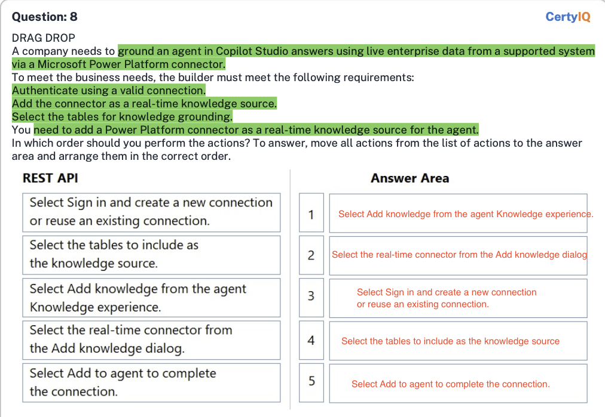

### 1. Extracted Question Summary

* **Scenario:** A company needs to ground a Copilot Studio agent's answers using live enterprise data from a supported system via a Microsoft Power Platform connector.

* **Requirements:**
* Authenticate using a valid connection.

* Add the connector as a real-time knowledge source.

* Select the tables for knowledge grounding.

* **Task:** Arrange all five actions in the exact chronological order required to add a Power Platform connector as a real-time knowledge source:

* Select Sign in and create a new connection or reuse an existing connection.

* Select the tables to include as the knowledge source.

* Select Add knowledge from the agent Knowledge experience.

* Select the real-time connector from the Add knowledge dialog.

* Select Add to agent to complete the connection.

---

### 2. Correct Answer

1. **Select Add knowledge from the agent Knowledge experience.**

2. **Select the real-time connector from the Add knowledge dialog.**

3. **Select Sign in and create a new connection or reuse an existing connection.**

4. **Select the tables to include as the knowledge source.**

5. **Select Add to agent to complete the connection.**

---

### 4. Official Microsoft Justification

* **Real-Time Knowledge Connectors Workflow:** According to the official Microsoft Copilot Studio documentation (*Add real-time knowledge with connectors* under the AB-620T00 *Add knowledge to Microsoft Copilot Studio agents* module), Power Platform connectors (such as Salesforce, ServiceNow, Zendesk, or Azure SQL) allow an agent to query live enterprise records directly at runtime without duplicating or indexing the data into Dataverse.
* **Exact UI Sequence:**
1. **Initiate:** In Copilot Studio, open the agent's **Knowledge** page (or the Knowledge section on the Overview page) and select **+ Add knowledge**.

2. **Choose Source:** In the **Add knowledge** dialog, select the target real-time connector (e.g., ServiceNow, Salesforce, etc.).

3. **Authenticate:** Copilot Studio cannot query available objects/tables until an authenticated session exists, so you must immediately **Sign in** to create a new connection or select an existing connection.

4. **Scope Data:** Once authenticated, the connector surfaces the underlying objects/tables from the target system, allowing you to **select the specific tables** to include for grounding.

5. **Finalize:** Confirm the configuration by selecting **Add to agent**.

---

### 5. Distractor Analysis (Why Others Are Wrong)

* Because this is an **ordered sequence** question using all five options, there are no unused distractors; however, the primary logical trap is reversing **Step 3 (Authenticate)** and **Step 4 (Select tables)**. You cannot browse or select tables from an external enterprise system before establishing a valid authenticated connection.

---

### 6. Exam Keyword / Trap Alert

* **Keyword Alert:** Notice how Question 7 tested **Custom Connectors as Tools** (executing actions/API calls), whereas Question 8 tests **Power Platform Connectors as Real-Time Knowledge Sources** (grounding generative answers in live external tables without data ingestion). Always remember the UI dependency chain: **Add Knowledge → Pick Connector → Authenticate → Pick Tables → Add to Agent**.

## Q9

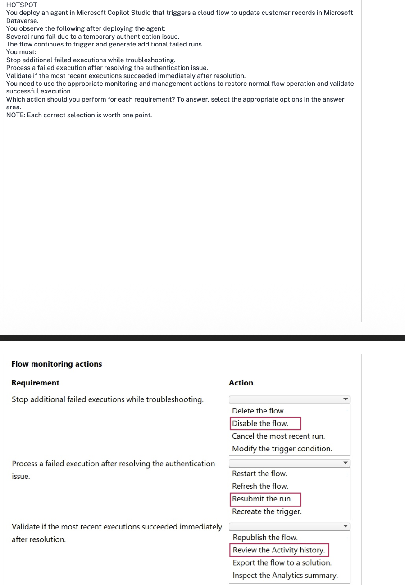

### 1. Extracted Question Summary

* **Scenario:** You deploy an agent in Microsoft Copilot Studio that triggers a Power Automate cloud flow to update customer records in Microsoft Dataverse. Several runs fail due to a temporary authentication issue, and the flow continues to trigger and generate additional failed runs.

* **Task:** Select the appropriate monitoring and management action from each dropdown list for the following three requirements:

* **Requirement 1:** Stop additional failed executions while troubleshooting.

* *Options:* Delete the flow | Disable the flow | Cancel the most recent run | Modify the trigger condition.

* **Requirement 2:** Process a failed execution after resolving the authentication issue.

* *Options:* Restart the flow | Refresh the flow | Resubmit the run | Recreate the trigger.

* **Requirement 3:** Validate if the most recent executions succeeded immediately after resolution.

* *Options:* Republish the flow | Review the Activity history | Export the flow to a solution | Inspect the Analytics summary.

---

### 2. Correct Answer

* **Stop additional failed executions while troubleshooting:** **Disable the flow.**

* **Process a failed execution after resolving the authentication issue:** **Resubmit the run.**

* **Validate if the most recent executions succeeded immediately after resolution:** **Review the Activity history.**

---

### 3. Verification of Visible Selection / Community Key

* **Correct:** All three red-boxed selections visible in the screenshot (**Disable the flow**, **Resubmit the run**, and **Review the Activity history**) accurately align with Microsoft Power Automate and Copilot Studio operational lifecycle management.

---

### 4. Official Microsoft Justification

* **Turning Off (Disabling) a Cloud Flow:** Per Microsoft Power Automate and Copilot Studio administration guidance (AB-620T00 *Manage and monitor agents and flows*), turning off (**disabling**) a flow immediately prevents new trigger invocations from creating additional queued or failed runs while preserving the flow definition, connections, and run history during troubleshooting.
* **Resubmitting Failed Flow Runs:** When a cloud flow fails due to a transient error or expired connection/authentication issue, fixing the connection reference allows you to **resubmit** the specific failed run from its run history, replaying the exact original trigger payload without requiring the user or agent to re-initiate the conversation.
* **Real-Time Run Validation:** In Copilot Studio (under the **Activity** map/history) and Power Automate (**28-day run history**), recent executions and their real-time status (*Succeeded*, *Failed*, *Running*) appear immediately, whereas aggregated **Analytics** dashboards experience data ingestion latency and are designed for long-term telemetry trends rather than immediate post-fix verification.

---

### 5. Distractor Analysis (Why Others Are Wrong)

* **Requirement 1 Distractors:**
* *Delete the flow:* Permanently destroys the flow and its run history rather than pausing it for troubleshooting.

* *Cancel the most recent run:* Only aborts a single currently executing instance; new triggers will continue firing.

* *Modify the trigger condition:* Unnecessarily alters business logic when the flow itself is valid and only needs to be paused.

* **Requirement 2 Distractors:**
* *Restart the flow / Refresh the flow:* Not valid Power Automate actions for replaying a specific historical execution payload.

* *Recreate the trigger:* Unnecessary and destructive; the trigger itself was not broken.

* **Requirement 3 Distractors:**
* *Republish the flow:* Cloud flows are turned on/off, not published like Copilot Studio agents.

* *Export the flow to a solution:* Used for Application Lifecycle Management (ALM), not runtime monitoring.

* *Inspect the Analytics summary:* Subject to reporting latency and displays aggregated metrics rather than immediate per-run execution validation.

---

### 6. Exam Keyword / Trap Alert

* **Keyword Alert:** Contrast **"validate immediately after resolution"** (which always points to **Activity history / Run history**) against **"identify usage trends or deflection rates over time"** (which points to **Analytics**). Also remember that in Power Automate, re-running a failed payload is specifically termed **Resubmit**.

## Q10

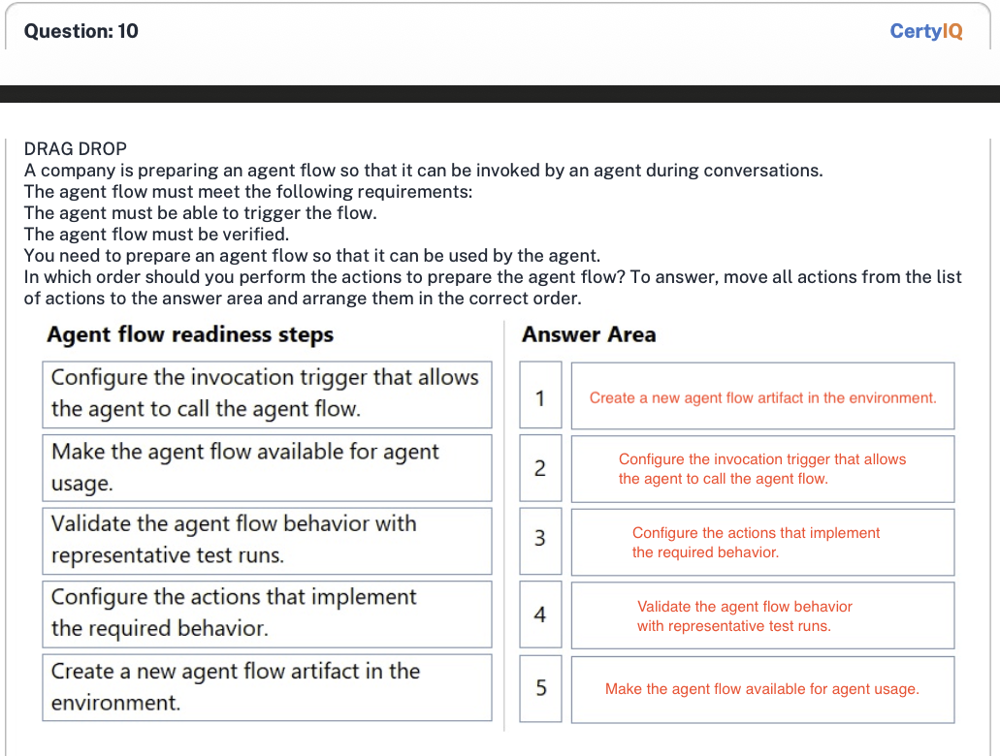

### 1. Extracted Question Summary

* **Scenario:** A company is preparing an **agent flow** in Microsoft Copilot Studio so that it can be invoked by an agent during conversations.

* **Requirements:**
* The agent must be able to trigger the flow.

* The agent flow must be verified.

* **Task:** Arrange all five actions in the exact chronological order required to prepare the agent flow for agent usage:

* Configure the invocation trigger that allows the agent to call the agent flow.

* Make the agent flow available for agent usage.

* Validate the agent flow behavior with representative test runs.

* Configure the actions that implement the required behavior.

* Create a new agent flow artifact in the environment.

---

### 2. Correct Answer

1. **Create a new agent flow artifact in the environment.**

2. **Configure the invocation trigger that allows the agent to call the agent flow.**

3. **Configure the actions that implement the required behavior.**

4. **Validate the agent flow behavior with representative test runs.**

5. **Make the agent flow available for agent usage.**

---

### 4. Official Microsoft Justification

* **Agent Flows Authoring & Lifecycle (AB-620T00):** In Microsoft Copilot Studio (*Build agent flows* / *Extend agents with tools and flows*), native **agent flows** follow a strict deterministic build-test-publish lifecycle before an agent can invoke them in topics or via generative orchestration:
1. **Provision the Artifact:** You first create the new agent flow inside Copilot Studio (under **Flows** / **Tools** → **New agent flow**), which provisions the flow artifact within the Power Platform environment.

2. **Define the Trigger:** Every flow must start with a trigger—specifically **"When an agent calls the flow"** (with defined input parameters)—so Copilot Studio knows how to invoke it.

3. **Author the Logic:** Next, you add the intermediate connectors, data operations, and the final **"Respond to the agent"** action to implement the required business behavior.

4. **Test & Verify:** Before exposing a flow to live or authored agent paths, you run representative test executions in the flow designer to verify input/output schemas and runtime behavior.

5. **Publish / Make Available:** Finally, you **Publish** the agent flow so it transitions from draft state to an active tool available for selection inside the agent.

---

### 5. Distractor Analysis (Why Others Are Wrong)

* Because this is an **ordered sequence** question using all five items, none of the options are unused distractors. The main ordering traps to avoid are:

* **Configuring actions before the trigger:** In the flow designer canvas, the invocation trigger sits at the root of the flow definition and defines the input schema that downstream actions consume.

* **Making the flow available before testing:** Copilot Studio requires an agent flow to be valid and verified before publishing it for live agent consumption.

---

### 6. Exam Keyword / Trap Alert

* **Keyword Alert:** Pay attention to the native Copilot Studio terminology **"agent flow"** (as distinct from general Power Automate cloud flows). Agent flows are built directly within Copilot Studio using the **"When an agent calls the flow"** trigger and **"Respond to the agent"** action, and they must be explicitly **published** (made available) after testing before the agent can use them.

## Q11

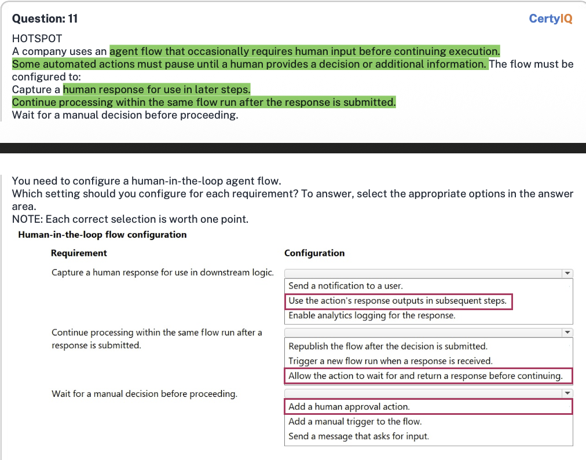

### 1. Extracted Question Summary

* **Scenario:** A company is preparing an **agent flow** in Microsoft Copilot Studio so that it can be invoked by an agent during conversations.

* **Requirements:**
* The agent must be able to trigger the flow.

* The agent flow must be verified.

* **Task:** Arrange all five actions in the exact chronological order required to prepare the agent flow for agent usage:

* Configure the invocation trigger that allows the agent to call the agent flow.

* Make the agent flow available for agent usage.

* Validate the agent flow behavior with representative test runs.

* Configure the actions that implement the required behavior.

* Create a new agent flow artifact in the environment.

---

### 2. Correct Answer

1. **Create a new agent flow artifact in the environment.**

2. **Configure the invocation trigger that allows the agent to call the agent flow.**

3. **Configure the actions that implement the required behavior.**

4. **Validate the agent flow behavior with representative test runs.**

5. **Make the agent flow available for agent usage.**

---

### 4. Official Microsoft Justification

* **Agent Flows Authoring & Lifecycle (AB-620T00):** In Microsoft Copilot Studio (*Build agent flows* / *Extend agents with tools and flows*), native **agent flows** follow a strict deterministic build-test-publish lifecycle before an agent can invoke them in topics or via generative orchestration:
1. **Provision the Artifact:** You first create the new agent flow inside Copilot Studio (under **Flows** / **Tools** → **New agent flow**), which provisions the flow artifact within the Power Platform environment.

2. **Define the Trigger:** Every flow must start with a trigger—specifically **"When an agent calls the flow"** (with defined input parameters)—so Copilot Studio knows how to invoke it.

3. **Author the Logic:** Next, you add the intermediate connectors, data operations, and the final **"Respond to the agent"** action to implement the required business behavior.

4. **Test & Verify:** Before exposing a flow to live or authored agent paths, you run representative test executions in the flow designer to verify input/output schemas and runtime behavior.

5. **Publish / Make Available:** Finally, you **Publish** the agent flow so it transitions from draft state to an active tool available for selection inside the agent.

---

### 5. Distractor Analysis (Why Others Are Wrong)

* Because this is an **ordered sequence** question using all five items, none of the options are unused distractors. The main ordering traps to avoid are:

* **Configuring actions before the trigger:** In the flow designer canvas, the invocation trigger sits at the root of the flow definition and defines the input schema that downstream actions consume.

* **Making the flow available before testing:** Copilot Studio requires an agent flow to be valid and verified before publishing it for live agent consumption.

---

### 6. Exam Keyword / Trap Alert

* **Keyword Alert:** Pay attention to the native Copilot Studio terminology **"agent flow"** (as distinct from general Power Automate cloud flows). Agent flows are built directly within Copilot Studio using the **"When an agent calls the flow"** trigger and **"Respond to the agent"** action, and they must be explicitly **published** (made available) after testing before the agent can use them.

## Q12

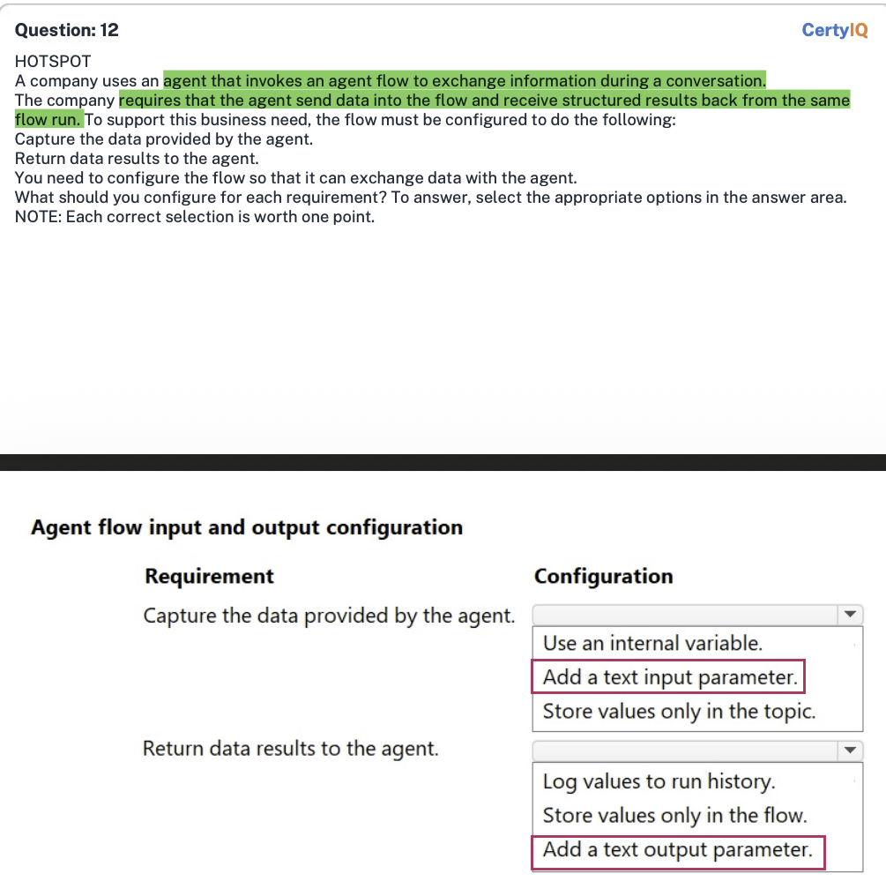

### 1. Extracted Question Summary

* **Scenario:** A company is preparing an **agent flow** in Microsoft Copilot Studio so that it can be invoked by an agent during conversations.

* **Requirements:**
* The agent must be able to trigger the flow.

* The agent flow must be verified.

* **Task:** Arrange all five actions in the exact chronological order required to prepare the agent flow for agent usage:

* Configure the invocation trigger that allows the agent to call the agent flow.

* Make the agent flow available for agent usage.

* Validate the agent flow behavior with representative test runs.

* Configure the actions that implement the required behavior.

* Create a new agent flow artifact in the environment.

---

### 2. Correct Answer

1. **Create a new agent flow artifact in the environment.**

2. **Configure the invocation trigger that allows the agent to call the agent flow.**

3. **Configure the actions that implement the required behavior.**

4. **Validate the agent flow behavior with representative test runs.**

5. **Make the agent flow available for agent usage.**

---

### 4. Official Microsoft Justification

* **Agent Flows Authoring & Lifecycle (AB-620T00):** In Microsoft Copilot Studio (*Build agent flows* / *Extend agents with tools and flows*), native **agent flows** follow a strict deterministic build-test-publish lifecycle before an agent can invoke them in topics or via generative orchestration:
1. **Provision the Artifact:** You first create the new agent flow inside Copilot Studio (under **Flows** / **Tools** → **New agent flow**), which provisions the flow artifact within the Power Platform environment.

2. **Define the Trigger:** Every flow must start with a trigger—specifically **"When an agent calls the flow"** (with defined input parameters)—so Copilot Studio knows how to invoke it.

3. **Author the Logic:** Next, you add the intermediate connectors, data operations, and the final **"Respond to the agent"** action to implement the required business behavior.

4. **Test & Verify:** Before exposing a flow to live or authored agent paths, you run representative test executions in the flow designer to verify input/output schemas and runtime behavior.

5. **Publish / Make Available:** Finally, you **Publish** the agent flow so it transitions from draft state to an active tool available for selection inside the agent.

---

### 5. Distractor Analysis (Why Others Are Wrong)

* Because this is an **ordered sequence** question using all five items, none of the options are unused distractors. The main ordering traps to avoid are:

* **Configuring actions before the trigger:** In the flow designer canvas, the invocation trigger sits at the root of the flow definition and defines the input schema that downstream actions consume.

* **Making the flow available before testing:** Copilot Studio requires an agent flow to be valid and verified before publishing it for live agent consumption.

---

### 6. Exam Keyword / Trap Alert

* **Keyword Alert:** Pay attention to the native Copilot Studio terminology **"agent flow"** (as distinct from general Power Automate cloud flows). Agent flows are built directly within Copilot Studio using the **"When an agent calls the flow"** trigger and **"Respond to the agent"** action, and they must be explicitly **published** (made available) after testing before the agent can use them.

## Q13

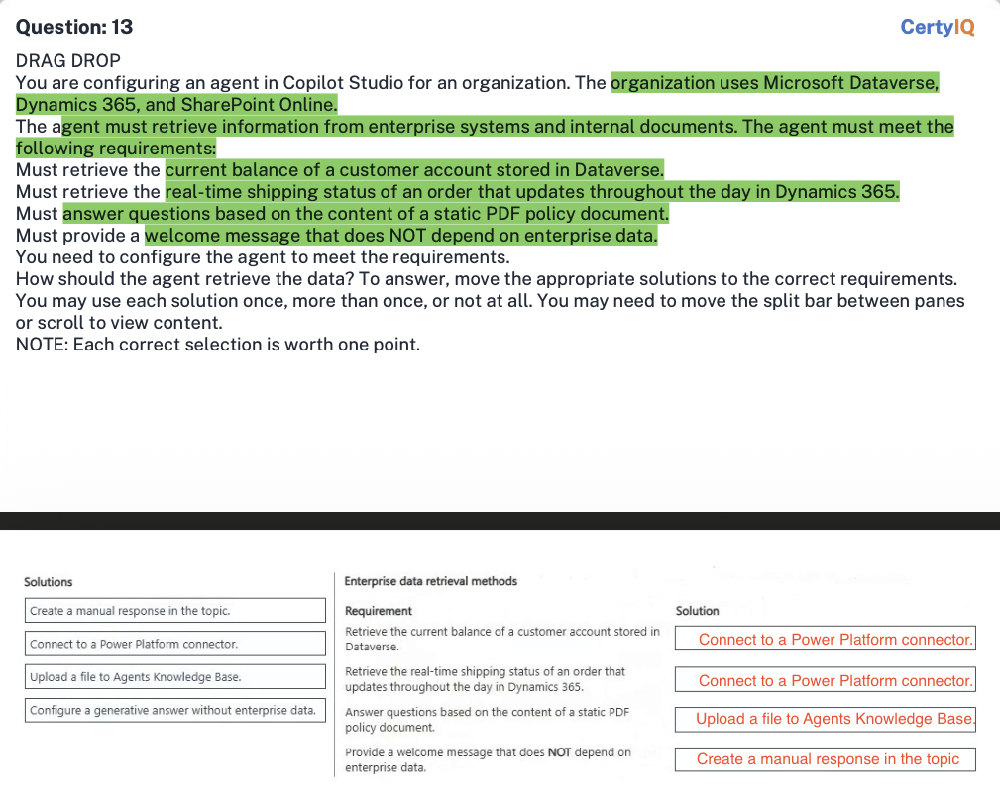

### 1. Extracted Question Summary

* **Scenario:** You are configuring a Copilot Studio agent for an organization that uses Microsoft Dataverse, Dynamics 365, and SharePoint Online. The agent must retrieve information from enterprise systems and internal documents while meeting four specific requirements:

* **Requirement 1:** Retrieve the current balance of a customer account stored in Dataverse.

* **Requirement 2:** Retrieve the real-time shipping status of an order that updates throughout the day in Dynamics 365.

* **Requirement 3:** Answer questions based on the content of a static PDF policy document.

* **Requirement 4:** Provide a welcome message that does NOT depend on enterprise data.

* **Available Solutions (Draggable Options — may be used once, more than once, or not at all):**
* Create a manual response in the topic.

* Connect to a Power Platform connector.

* Upload a file to Agents Knowledge Base.

* Configure a generative answer without enterprise data.

---

### 2. Correct Answer

* Retrieve the current balance of a customer account stored in Dataverse: Connect to a Power Platform connector.

* Retrieve the real-time shipping status of an order that updates throughout the day in Dynamics 365: Connect to a Power Platform connector.

* Answer questions based on the content of a static PDF policy document: Upload a file to Agents Knowledge Base.

* Provide a welcome message that does NOT depend on enterprise data: Create a manual response in the topic.

---

### 4. Official Microsoft Justification

* **Structured & Real-Time Enterprise Record Retrieval:** Per Microsoft Copilot Studio architecture (AB-620T00 *Add knowledge to Microsoft Copilot Studio agents* and *Extend agents with tools and connectors*), retrieving exact field-level values (such as a customer account balance in Dataverse or frequently changing order shipping statuses in Dynamics 365) requires querying live operational tables via a **Power Platform connector** (either as a real-time knowledge connector or a deterministic connector tool) so the agent reads up-to-the-second records without ingestion lag.
* **Static Unstructured Documents (RAG):** For static policy documents (like a PDF), uploading the file directly to the **Agent's Knowledge Base** automatically chunks, indexes, and stores the document in Dataverse for Retrieval-Augmented Generation (RAG) grounding.
* **Deterministic System Greetings:** Standard welcome messages are handled out-of-the-box by the system **Conversation Start** topic using a deterministic **Message node (manual response in the topic)**, ensuring fast, predictable, zero-hallucination greetings without invoking generative AI or external data sources.

---

### 5. Distractor Analysis (Why Others Are Wrong)

* Configure a generative answer without enterprise data: Using general LLM world knowledge (classic data) to generate a welcome message introduces unnecessary latency, token consumption, and non-deterministic phrasing when a static, authored topic message is required.

* Upload a file to Agents Knowledge Base (for Dataverse/Dynamics 365): Uploaded files are static snapshots and cannot reflect live account balances or intraday shipping status updates in transactional systems.

---

### 6. Exam Keyword / Trap Alert

* **Keyword Alert:** Note the prompt rule *"You may use each solution once, more than once, or not at all"*—this is your cue that **Connect to a Power Platform connector** applies to *both* Dataverse and Dynamics 365 live record lookups. Also distinguish **"static PDF"** (Uploaded file knowledge) from **"welcome message"** (Manual response in the Conversation Start topic).

## Q14

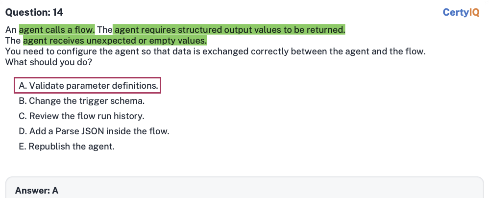

### 1. Extracted Question Summary

* **Scenario:** An agent calls a flow and requires structured output values to be returned, but the agent receives unexpected or empty values. You need to configure the agent so that data is exchanged correctly between the agent and the flow.

* **Options:**
* **A.** Validate parameter definitions.

* **B.** Change the trigger schema.

* **C.** Review the flow run history.

* **D.** Add a Parse JSON inside the flow.

* **E.** Republish the agent.

---

### 2. Correct Answer

* **A: Validate parameter definitions.**

---

### 3. Verification of Visible Selection / Community Key

* **Correct:** The red box and bottom key (`Answer: A`) are **Correct** because receiving unexpected or empty structured values from a flow indicates a contract mismatch in the defined input/output parameter names, data types, or response mappings between the agent and the flow's return action.

---

### 4. Official Microsoft Justification

* **Agent-Flow Data Exchange & Output Schemas (AB-620T00):** Per Microsoft Copilot Studio documentation (*Call a flow as an action / Build agent flows* under AB-620T00), bidirectional data exchange between an agent and a flow relies on strictly typed parameter contracts:
* **Inputs** are defined on the trigger (*When an agent calls the flow* / *Run a flow from Copilot*).
* **Outputs** are defined on the final response action (*Respond to the agent* / *Respond to Copilot*), where each output parameter has an explicit **name**, **data type** (Text, Number, Boolean, Table/Object), and **mapped value**.

* When an agent receives empty or unexpected structured values despite the flow running, it occurs because the parameter definitions (names, expected types, or output variable bindings) exposed by the flow do not match what the agent topic or generative orchestrator expects to consume. Validating and aligning these parameter definitions resolves the data-exchange mismatch.

---

### 5. Distractor Analysis (Why Others Are Wrong)

* **B. Change the trigger schema:** The trigger schema governs *inputs sent from the agent into the flow*, whereas the problem specifically states the agent requires *structured output values to be returned* from the flow.

* **C. Review the flow run history:** Run history is a diagnostic/monitoring step to inspect past executions, not a configuration action that fixes data exchange between the agent and the flow.

* **D. Add a Parse JSON inside the flow:** Parsing JSON internally inside the flow manipulates intermediate flow variables, but it will still fail to return structured values to the agent unless the flow's output parameter definitions on the *Respond to the agent* step are properly configured.

* **E. Republish the agent:** Republishing pushes existing agent configurations to channels; it will not repair broken or unmapped output parameter definitions.

---

### 6. Exam Keyword / Trap Alert

* **Keyword Alert:** Pay close attention to the direction of data flow: **"structured output values to be returned"** points to the **output parameter definitions** on the *Respond to the agent* action rather than the **trigger schema** (which handles inputs). Also distinguish **"configure the agent so data is exchanged"** (configuration fix: **validate parameter definitions**) from **"troubleshoot why a run failed"** (diagnostic step: **review run history**).

## Q15
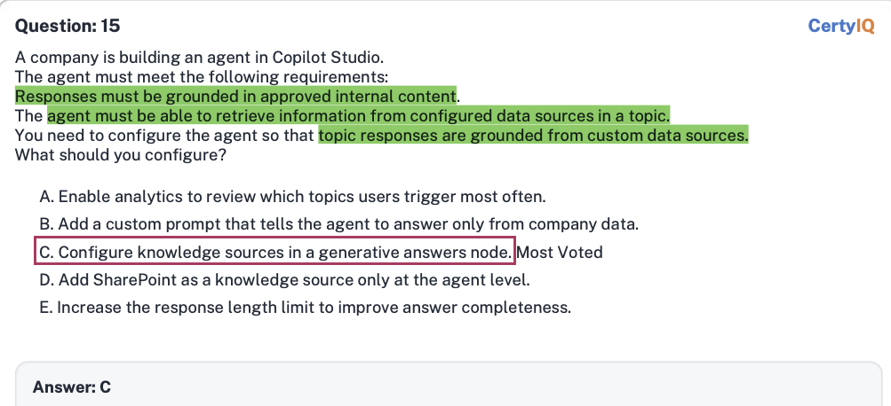

### 1. Extracted Question Summary

* **Scenario:** A company is building an agent in Copilot Studio. The agent must meet two requirements:

* Responses must be grounded in approved internal content.

* The agent must be able to retrieve information from configured data sources in a topic.

* **Goal:** Configure the agent so that topic responses are grounded from custom data sources.

* **Options:**
* **A.** Enable analytics to review which topics users trigger most often.

* **B.** Add a custom prompt that tells the agent to answer only from company data.

* **C.** Configure knowledge sources in a generative answers node.

* **D.** Add SharePoint as a knowledge source only at the agent level.

* **E.** Increase the response length limit to improve answer completeness.

---

### 2. Correct Answer

* **C: Configure knowledge sources in a generative answers node.**

---

### 3. Verification of Visible Selection / Community Key

* **Correct:** The red box, "Most Voted" tag, and bottom key (`Answer: C`) are **Correct** because scoping retrieval to specific approved internal/custom sources inside an individual topic is controlled directly within the **Create generative answers** node.

---

### 4. Official Microsoft Justification

* **Topic-Level Generative Answers & Knowledge Scoping (AB-620T00):** Per Microsoft Copilot Studio documentation (*Generative answers node* / *Add knowledge to Microsoft Copilot Studio agents* under AB-620T00), while knowledge sources added at the **agent level** apply broadly across generative orchestration and the fallback *Conversational boosting* topic, a **Create generative answers** node inside a specific topic allows makers to configure dedicated, topic-scoped knowledge sources (such as specific SharePoint URLs, uploaded files, Dataverse tables, or custom data via Power Automate/Azure OpenAI On Your Data).
* Furthermore, within the **Create generative answers** node properties (**Data source** settings), makers can disable *"Search only selected sources"* vs. *"Allow the AI to use its own general knowledge"*, strictly enforcing that topic responses are grounded exclusively in approved internal/custom data sources without falling back to ungrounded LLM knowledge.

---

### 5. Distractor Analysis (Why Others Are Wrong)

* **A. Enable analytics to review which topics users trigger most often:** Analytics provides post-conversation telemetry and usage metrics; it does not ground responses or connect data sources.

* **B. Add a custom prompt that tells the agent to answer only from company data:** Prompt instructions alone cannot connect to or retrieve records from internal data repositories without configured knowledge sources.

* **D. Add SharePoint as a knowledge source only at the agent level:** The requirement explicitly states the agent must retrieve information from configured data sources **in a topic** and ground **topic responses** from custom data sources—relying *only* on agent-level SharePoint fails both the topic-level requirement and custom data source scope.

* **E. Increase the response length limit to improve answer completeness:** Token/character length limits only affect verbosity, not retrieval grounding or source configuration.

---

### 6. Exam Keyword / Trap Alert

* **Keyword Alert:** Contrast **"in a topic"** / **"topic responses are grounded from custom data sources"** (which points to configuring data sources inside a **Create generative answers** node) against **"across all topics / agent-wide fallback"** (which points to **agent-level Knowledge** and the **Conversational boosting** system topic).

## Q16

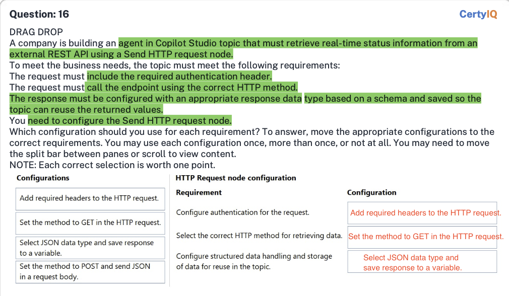

### 1. Extracted Question Summary

* **Scenario:** A company is building a Copilot Studio topic that must retrieve real-time status information from an external REST API using a **Send HTTP request** node.

* **Business Needs & Target Requirements:**
* **Requirement 1:** Configure authentication for the request (the request must include the required authentication header).

* **Requirement 2:** Select the correct HTTP method for retrieving data (the request must call the endpoint using the correct HTTP method).

* **Requirement 3:** Configure structured data handling and storage of data for reuse in the topic (the response must be configured with an appropriate response data type based on a schema and saved so the topic can reuse the returned values).

* **Available Configurations (Draggable Options):**
* Add required headers to the HTTP request.

* Set the method to GET in the HTTP request.

* Select JSON data type and save response to a variable.

* Set the method to POST and send JSON in a request body.

---

### 2. Correct Answer

* **Configure authentication for the request:** **Add required headers to the HTTP request.**

* **Select the correct HTTP method for retrieving data:** **Set the method to GET in the HTTP request.**

* **Configure structured data handling and storage of data for reuse in the topic:** **Select JSON data type and save response to a variable.**

---

### 4. Official Microsoft Justification

* **Send HTTP Request Node Configuration (AB-620T00):** Per Microsoft Copilot Studio documentation (*Make HTTP requests* under the AB-620T00 *Extend Microsoft Copilot Studio agents with tools and connectors* learning path), the **Send HTTP request** node enables makers to directly invoke external REST endpoints inside a topic:
* **Headers & Authentication:** Under **Headers and body** (Select **Edit**), makers add key-value HTTP headers—such as `Authorization: Bearer <token>` or `Ocp-Apim-Subscription-Key`—to supply required API authentication credentials.

* **HTTP Method Selection:** Standard REST semantics dictate using **GET** when retrieving read-only status information from an endpoint without modifying server state.

* **Response Data Type & Variable Binding:** To parse structured payloads downstream in the topic, you configure the **Response data type** (selecting **From sample data** or **Record / Table** JSON schema) and assign the output to a **Save response as** topic variable so individual properties can be referenced via Power Fx or message nodes.

---

### 5. Distractor Analysis (Why Others Are Wrong)

* **Set the method to POST and send JSON in a request body:** `POST` with a JSON request body is used to submit or create new resources on an API endpoint, whereas the scenario explicitly requires *retrieving* real-time status information.

---

### 6. Exam Keyword / Trap Alert

* **Keyword Alert:** Match **"retrieve real-time status information"** directly to **GET** (not **POST**), and remember that in Copilot Studio's **Send HTTP request** node, parsing structured JSON requires explicitly selecting the **JSON/Record response data type** and binding it to a **topic variable**.

## Q17

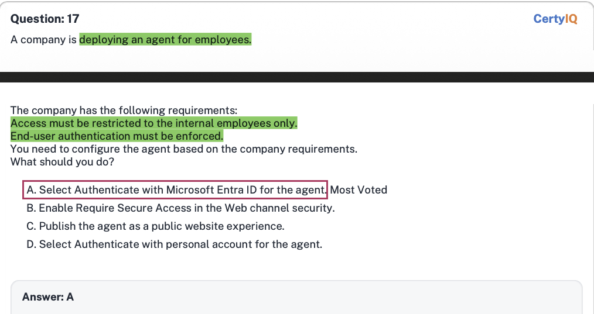

### 1. Extracted Question Summary

* **Scenario:** A company is deploying a Copilot Studio agent for its employees.

* **Requirements:**
* Access must be restricted to internal employees only.

* End-user authentication must be enforced.

* **Options:**
* **A.** Select Authenticate with Microsoft Entra ID for the agent.

* **B.** Enable Require Secure Access in the Web channel security.

* **C.** Publish the agent as a public website experience.

* **D.** Select Authenticate with personal account for the agent.

---

### 2. Correct Answer

* **A: Select Authenticate with Microsoft Entra ID for the agent.**

---

### 3. Verification of Visible Selection / Community Key

* **Correct:** The red box, "Most Voted" label, and bottom key (`Answer: A`) are **Correct** because **Authenticate with Microsoft Entra ID** is the built-in Copilot Studio authentication mode that restricts agent access exclusively to authenticated users within your organization's Microsoft Entra tenant.

---

### 4. Official Microsoft Justification

* **End-User Authentication in Copilot Studio (AB-620T00):** Per Microsoft Copilot Studio documentation (*Configure user authentication* under the AB-620T00 *Manage and secure Microsoft Copilot Studio agents* module), Copilot Studio provides three primary authentication configurations under **Settings → Security → Authentication**:
* **No authentication:** Allows any anonymous user with the link/channel access to interact with the agent.
* **Authenticate with Microsoft (Entra ID):** The default and standard configuration for internal employee-facing agents (such as those deployed to Microsoft Teams, SharePoint, or internal apps). It automatically authenticates users against the tenant's **Microsoft Entra ID** without requiring custom OAuth2 app registration, strictly enforcing identity verification and restricting access to internal organizational accounts.
* **Authenticate manually:** Used for external/customer-facing scenarios requiring generic OAuth2 providers (such as Azure AD B2C / Entra External ID, Okta, or Google) or custom scopes.

---

### 5. Distractor Analysis (Why Others Are Wrong)

* **B. Enable Require Secure Access in the Web channel security:** Web channel security (generating a secret key or signed token to embed the webchat widget on an authenticated site) only secures the webchat channel embed token against unauthorized hosting—it does not enforce organizational end-user authentication across channels or restrict access to internal Entra ID employees.

* **C. Publish the agent as a public website experience:** Publishing to a public demo/live website allows unauthenticated external visitors to access the agent, violating both requirements.

* **D. Select Authenticate with personal account for the agent:** Copilot Studio's built-in option authenticates against organizational **Microsoft Entra ID** work/school accounts rather than consumer Microsoft personal accounts, which would fail to restrict access to internal employees.

---

### 6. Exam Keyword / Trap Alert

* **Keyword Alert:** Pair **"deploying an agent for employees"** + **"restricted to internal employees only"** + **"end-user authentication"** directly with **Authenticate with Microsoft Entra ID** (formerly *Authenticate with Microsoft*). Save **Authenticate manually (Generic OAuth 2)** for scenarios involving external customers or third-party identity providers.

## Q18

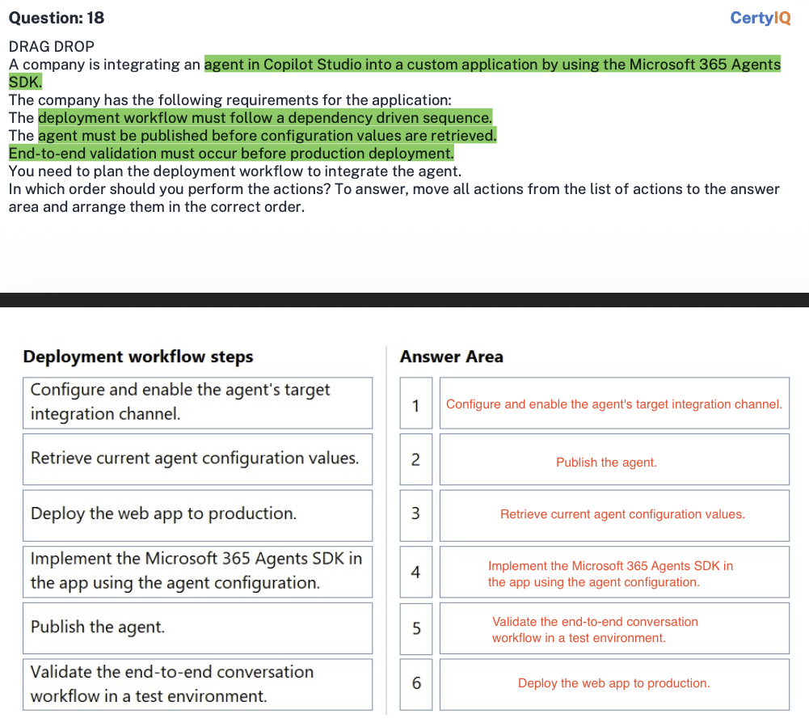

### 1. Extracted Question Summary

* **Scenario:** A company is integrating a Copilot Studio agent into a custom application using the **Microsoft 365 Agents SDK**.

* **Requirements:**
* The deployment workflow must follow a dependency-driven sequence.

* The agent must be published before configuration values are retrieved.

* End-to-end validation must occur before production deployment.

* **Task:** Arrange all six deployment workflow steps in the exact chronological order:

* Configure and enable the agent's target integration channel.

* Retrieve current agent configuration values.

* Deploy the web app to production.

* Implement the Microsoft 365 Agents SDK in the app using the agent configuration.

* Publish the agent.

* Validate the end-to-end conversation workflow in a test environment.

---

### 2. Correct Answer

1. **Configure and enable the agent's target integration channel.**

2. **Publish the agent.**

3. **Retrieve current agent configuration values.**

4. **Implement the Microsoft 365 Agents SDK in the app using the agent configuration.**

5. **Validate the end-to-end conversation workflow in a test environment.**

6. **Deploy the web app to production.**

---

### 4. Official Microsoft Justification

* **Integrating Copilot Studio Agents via Microsoft 365 Agents SDK (AB-620T00):** Per Microsoft Copilot Studio and Microsoft 365 Agents SDK integration documentation (*Publish and deploy agents to custom apps* under the AB-620T00 *Deploy and manage Microsoft Copilot Studio agents* module), connecting a custom application to a Copilot Studio agent follows a strict dependency chain:
1. **Enable Target Channel:** In Copilot Studio (**Channels**), configure and enable the target custom application / Web / Direct Line channel and authentication settings before publishing.

2. **Publish the Agent:** You must explicitly **Publish** the agent so the newly enabled channel configuration and agent runtime definitions go live and generate active connection metadata (explicitly reinforced by the prompt requirement: *"The agent must be published before configuration values are retrieved"*).

3. **Retrieve Configuration Values:** Once published, copy the live agent configuration parameters (such as Environment ID, Agent Identifier / Schema Name, Tenant ID, and Token Endpoint / Connection String) from the channel configuration pane.

4. **Implement SDK in Custom App:** Configure your application's `appsettings.json` / environment variables with those retrieved parameters and initialize the **Microsoft 365 Agents SDK** client to route messages to the Copilot Studio endpoint.

5. **Test End-to-End:** Run end-to-end conversational validation in a staging/test environment to verify token acquisition, message turn handling, and adaptive card rendering before production release.

6. **Deploy to Production:** Promote the validated custom web application to production.

---

### 5. Distractor Analysis (Why Others Are Wrong)

* Because this is an **ordered sequence** question utilizing all six steps, there are no unused distractors. The primary ordering traps to avoid are:

* **Retrieving configuration values before publishing:** The prompt explicitly states *"The agent must be published before configuration values are retrieved"*, and in Copilot Studio, channel endpoints/connection strings require a published agent state to be active.

* **Deploying to production before end-to-end validation:** Violates both standard ALM practices and the explicit requirement that *"End-to-end validation must occur before production deployment"*.

---

### 6. Exam Keyword / Trap Alert

* **Keyword Alert:** Look closely at the explicit constraint clues embedded in the prompt—**"published before configuration values are retrieved"** and **"end-to-end validation must occur before production deployment"**—and remember that **enabling the channel** must always precede **publishing** so the channel settings are included in the published snapshot.

## Q19

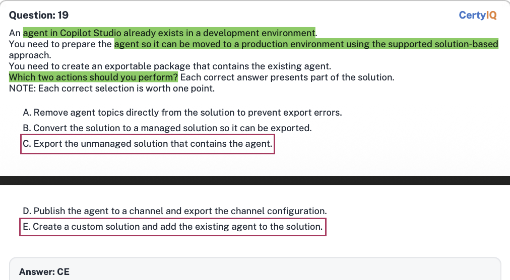

### 1. Extracted Question Summary

* **Scenario:** An agent in Copilot Studio already exists in a development environment. You need to prepare the agent so it can be moved to a production environment using the supported solution-based Application Lifecycle Management (ALM) approach by creating an exportable package containing the existing agent.

* **Task:** Select **two** actions that each present part of the solution:

* **A.** Remove agent topics directly from the solution to prevent export errors.

* **B.** Convert the solution to a managed solution so it can be exported.

* **C.** Export the unmanaged solution that contains the agent.

* **D.** Publish the agent to a channel and export the channel configuration.

* **E.** Create a custom solution and add the existing agent to the solution.

---

### 2. Correct Answer

* **C: Export the unmanaged solution that contains the agent.**

* **E: Create a custom solution and add the existing agent to the solution.**

---

### 3. Verification of Visible Selection / Community Key

* **Correct:** The red boxes and bottom key (`Answer: CE`) are **Correct** because Power Platform solution-based ALM requires placing the existing agent inside a custom unmanaged solution in the development environment and then exporting that unmanaged solution (selecting **Managed** during the export wizard for downstream production deployment).

---

### 4. Official Microsoft Justification

* **Solution-Based ALM for Copilot Studio Agents (AB-620T00):** Per Microsoft Copilot Studio and Power Platform ALM documentation (*Export and import agents using solutions* under the AB-620T00 *Deploy and manage Microsoft Copilot Studio agents* module), agents created outside a custom solution reside in the environment's **Common Data Services Default Solution**, which cannot be exported directly.
* **Two-Step Packaging Workflow:**
1. **Package into a Custom Unmanaged Solution (E):** Create a new custom unmanaged solution (with a custom publisher) in the development environment and use **Add existing → Agent** to include the agent along with its dependent subcomponents (topics, knowledge, tools/flows, and connection references).

2. **Export the Unmanaged Solution (C):** Export that unmanaged solution package from the development environment. During the export dialog, you choose the target package type (**Managed** for production environments) to generate the `.zip` deployment artifact.

---

### 5. Distractor Analysis (Why Others Are Wrong)

* **A. Remove agent topics directly from the solution to prevent export errors:** Topics are core subcomponents of the agent; removing them strips away the agent's conversational logic rather than preparing a complete exportable package.

* **B. Convert the solution to a managed solution so it can be exported:** In Power Platform, you never convert a development solution to managed in place—solutions in development always remain **unmanaged**, and you select **Managed** as an *export option* when generating the `.zip` file.

* **D. Publish the agent to a channel and export the channel configuration:** Publishing a channel exposes the agent to end users in the current environment; it does not package or migrate the agent definition across environments.

---

### 6. Exam Keyword / Trap Alert

* **Keyword Alert:** Watch out for the classic Power Platform ALM distractor **"Convert the solution to a managed solution"**—you **export an unmanaged solution** (choosing *Managed* during the export wizard), you never convert a dev solution in place.

## Q20

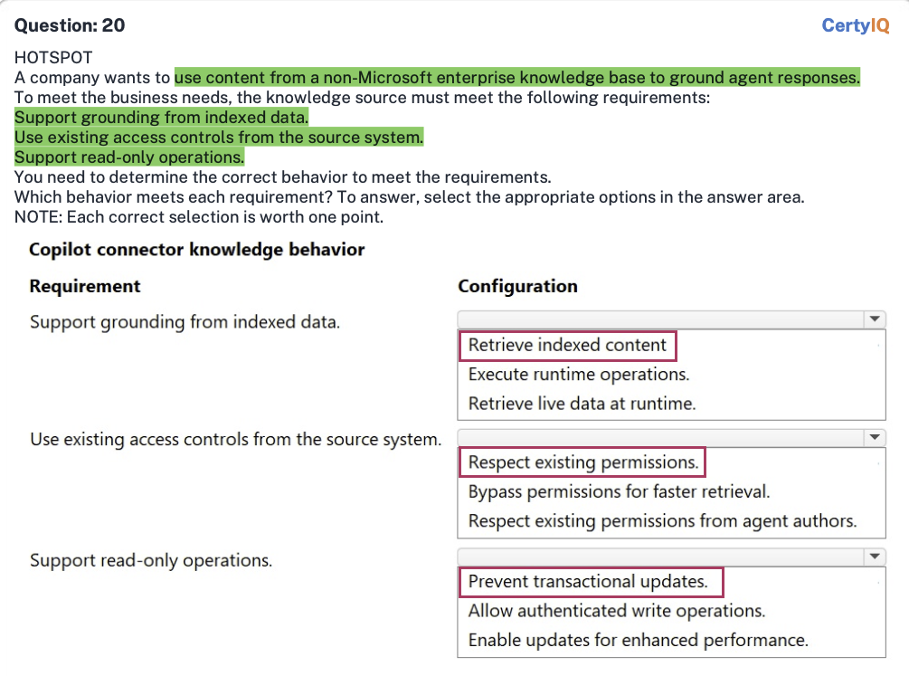

### 1. Extracted Question Summary

* **Scenario:** A company wants to use content from a non-Microsoft enterprise knowledge base to ground agent responses. The knowledge source (identified in the answer header as a **Copilot connector**) must meet three requirements:

* **Requirement 1:** Support grounding from indexed data.

* *Options:* Retrieve indexed content | Execute runtime operations | Retrieve live data at runtime.

* **Requirement 2:** Use existing access controls from the source system.

* *Options:* Respect existing permissions | Bypass permissions for faster retrieval | Respect existing permissions from agent authors.

* **Requirement 3:** Support read-only operations.

* *Options:* Prevent transactional updates | Allow authenticated write operations | Enable updates for enhanced performance.

---

### 2. Correct Answer

* **Support grounding from indexed data:** **Retrieve indexed content**

* **Use existing access controls from the source system:** **Respect existing permissions**

* **Support read-only operations:** **Prevent transactional updates**

---

### 3. Verification of Visible Selection / Community Key

* **Correct:** All three red-boxed selections visible in the screenshot (**Retrieve indexed content**, **Respect existing permissions**, and **Prevent transactional updates**) are **Correct** because Microsoft 365 Copilot connectors (formerly Graph connectors) ingest external enterprise content into the Microsoft Graph semantic index, enforce source-system ACLs at query time, and operate strictly as read-only knowledge sources.

---

### 4. Official Microsoft Justification

* **Microsoft 365 Copilot Connectors as Knowledge Sources (AB-620T00):** Per Microsoft Copilot Studio documentation (*Add Microsoft 365 Copilot connectors as knowledge sources* under the AB-620T00 *Add knowledge to Microsoft Copilot Studio agents* module), Microsoft 365 Copilot connectors bring external non-Microsoft data (such as Confluence, Jira, ServiceNow knowledge articles, or custom external repositories) into the Microsoft Graph index:
* **Indexed Retrieval:** Unlike real-time Power Platform connectors that query live tables on the fly, Copilot connectors crawl and ingest external content into the Microsoft Graph index so the agent retrieves semantically indexed chunks for RAG grounding.
* **Security Trimming (Source ACLs):** During ingestion, Copilot connectors synchronize Access Control Lists (ACLs) from the external system and map them to Microsoft Entra ID identities, ensuring the agent strictly respects the signed-in user's existing source-system permissions at retrieval time.
* **Read-Only Grounding:** Knowledge sources are strictly read-only retrieval mechanisms used to ground generative answers; any create, update, or delete (transactional) mutations must be implemented separately via **Tools / Actions** or **Agent Flows**.

---

### 5. Distractor Analysis (Why Others Are Wrong)

* **Requirement 1 Distractors:**
* *Execute runtime operations:* Describes **Tools / Actions**, not knowledge grounding.

* *Retrieve live data at runtime:* Describes **Real-time Power Platform connectors** (e.g., querying live Dataverse or Dynamics 365 records without indexing), whereas Microsoft 365 Copilot connectors rely on pre-indexed Graph content.

* **Requirement 2 Distractors:**
* *Bypass permissions for faster retrieval:* Violates enterprise security trimming and the explicit requirement to use existing access controls.

* *Respect existing permissions from agent authors:* Security trimming enforces the **end-user's** permissions at runtime, not the maker/author's permissions.

* **Requirement 3 Distractors:**
* *Allow authenticated write operations / Enable updates for enhanced performance:* Knowledge sources are read-only; transactional write/update operations require dedicated connector actions or flows.

---

### 6. Exam Keyword / Trap Alert

* **Keyword Alert:** Distinguish **Microsoft 365 Copilot connectors** (which **retrieve indexed content** from non-Microsoft knowledge bases with **source-system ACL security trimming**) from **Power Platform real-time connectors** (which **retrieve live data at runtime** without indexing) and **Tools** (which perform **transactional updates**).

## Q21

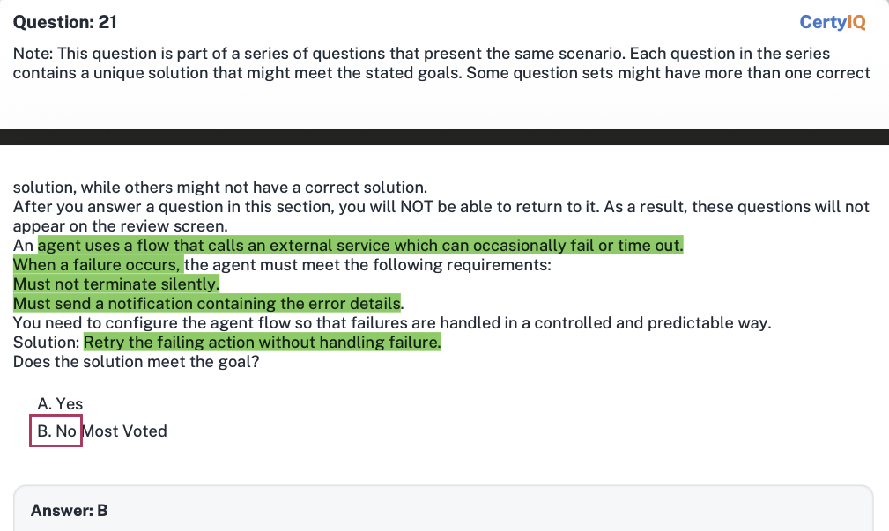

### 1. Extracted Question Summary

* **Scenario (Repeated Scenario Series):** An agent uses an agent flow that calls an external service which can occasionally fail or time out. When a failure occurs, the flow must:

* Not terminate silently.

* Send a notification containing the error details.

* **Proposed Solution:** Retry the failing action without handling failure.

* **Options:**
* **A.** Yes

* **B.** No

---

### 2. Correct Answer

* **B: No**

---

### 3. Verification of Visible Selection / Community Key

* **Correct:** The red box, "Most Voted" indicator, and bottom key (`Answer: B`) are **Correct** because merely configuring a retry policy without explicit error-handling branches neither captures error details nor sends a notification if all retry attempts fail.

---

### 4. Official Microsoft Justification

* **Error Handling in Agent Flows (AB-620T00):** Per Microsoft Copilot Studio and Power Automate documentation (*Handle errors in flows / Build reliable agent flows* under `[https://learn.microsoft.com/en-us/training/courses/ab-620t00](https://learn.microsoft.com/en-us/training/courses/ab-620t00)`), a **Retry policy** on an action only instructs the runtime to re-attempt transient HTTP failures (such as `408`, `429`, or `5xx`) a specified number of times before failing.
* If the external service remains down or times out past the retry threshold, the action still transitions to a **Failed** status and terminates the flow execution without sending any custom notification unless an explicit failure branch is configured using **Configure run after** (selecting *has failed*, *has timed out*, or *is skipped*)—typically implemented via a `Try / Catch` Scope pattern that extracts error details (via `result()` or `outputs()`) and dispatches an alert or responds gracefully to the agent.

---

### 5. Distractor Analysis (Why Others Are Wrong)

* **A. Yes:** Retrying an action handles transient blips, but *"without handling failure"* explicitly leaves the flow without a fallback/catch path to capture error details or send a notification when retries are exhausted.

---

### 6. Exam Keyword / Trap Alert

* **Keyword Alert:** In **"Does the solution meet the goal?"** repeated-scenario questions, look for missing pieces across *all* bulleted requirements—here, **"without handling failure"** fails both **"must not terminate silently"** and **"must send a notification containing the error details"** (which requires **Configure run after** on a failure branch).

## Q22

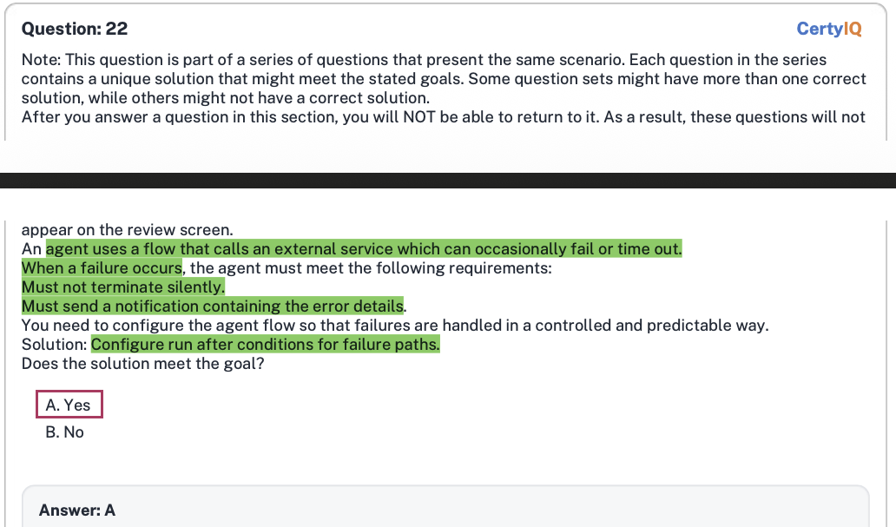

### 1. Extracted Question Summary

* **Scenario (Repeated Scenario Series):** An agent uses a flow that calls an external service which can occasionally fail or time out. When a failure occurs, the flow must:

* Not terminate silently.

* Send a notification containing the error details.

* **Proposed Solution:** Configure run after conditions for failure paths.

* **Options:**
* **A.** Yes

* **B.** No

---

### 2. Correct Answer

* **A: Yes**

---

### 3. Verification of Visible Selection / Community Key

* **Correct:** The red box around **A. Yes** and the bottom key (`Answer: A`) are **Correct** because configuring **Run after** conditions for failure paths (`has failed`, `has timed out`, `is skipped`) prevents silent termination and enables downstream notification actions to capture and send the error details.

---

### 4. Official Microsoft Justification

* **Controlled Exception Handling via Configure Run After (AB-620T00):** Per Microsoft Copilot Studio and Power Automate documentation (*Handle errors in flows / Build reliable agent flows* under `[https://learn.microsoft.com/en-us/training/courses/ab-620t00](https://learn.microsoft.com/en-us/training/courses/ab-620t00)`), by default, every action in a flow executes only when the preceding action succeeds (`is successful`), causing the entire flow to halt immediately on unhandled errors or timeouts.
* Configuring **Run after** settings on a dedicated error-handling action or Scope (selecting **has failed** and **has timed out**) intercepts the failure path cleanly, allows the flow to extract diagnostic error metadata (such as HTTP status codes and error messages via `outputs()` or `result()`), dispatches the required notification, and returns a controlled response to the Copilot Studio agent rather than terminating silently.

---

### 5. Distractor Analysis (Why Others Are Wrong)

* **B. No:** Incorrect, because **Configure run after** on failure paths is the exact native Power Automate / Copilot Studio agent flow mechanism designed to catch timeouts/failures, prevent silent termination, and execute notification logic.

---

### 6. Exam Keyword / Trap Alert

* **Keyword Alert:** Directly contrast **Question 21** (*"Retry the failing action without handling failure"* → **No**) with **Question 22** (*"Configure run after conditions for failure paths"* → **Yes**). Whenever a flow requirement specifies **preventing silent termination** and **sending error notifications on failure/timeout**, **Configure run after** is the canonical Microsoft solution.

* *(Quick note on your pasted Gem Instructions: You still have `AB - 100` in line 2 of `# Role & Purpose`—just remember to change that to `AB - 620` if you're updating your AB-620 Gem!)*

## Q23

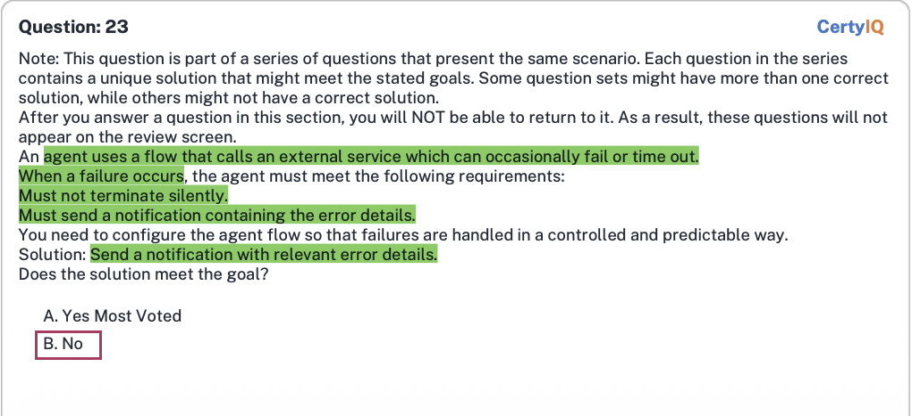

### 1. Extracted Question Summary

* **Scenario (Repeated Scenario Series):** An agent uses a flow that calls an external service which can occasionally fail or time out. When a failure occurs, the agent must:

* Not terminate silently.

* Send a notification containing the error details.

* **Goal:** Configure the agent flow so that failures are handled in a controlled and predictable way.

* **Proposed Solution:** Send a notification with relevant error details.

* **Options:**
* **A.** Yes

* **B.** No

---

### 2. Correct Answer

* **B: No**

---

### 3. Verification of Visible Selection / Community Key

* **Correct (Red Box) / Incorrect (Community "Most Voted"):** The red box around **B. No** is **Correct** (and the community "Most Voted" tag on *A. Yes* is **Incorrect**) because simply adding a notification action to the main flow branch will never execute when the preceding external service call fails or times out unless **Configure run after** failure conditions are explicitly configured.

---

### 4. Official Microsoft Justification

* **Flow Execution Control & Run After Dependencies (AB-620T00):** Per Microsoft Copilot Studio and Power Automate documentation (*Handle errors in flows / Build reliable agent flows* under `[https://learn.microsoft.com/en-us/training/courses/ab-620t00](https://learn.microsoft.com/en-us/training/courses/ab-620t00)`), every sequential action in a flow defaults to a **Run after → is successful** dependency on the preceding step.
* If you merely place a *"Send a notification with relevant error details"* action in the flow without configuring failure execution paths (**Configure run after** set to *has failed* and *has timed out*), any failure or timeout in the external service call immediately aborts the flow at the failing node, skips the notification action completely, and causes the flow to terminate silently.

---

### 5. Distractor Analysis (Why Others Are Wrong)

* **A. Yes:** This is a classic circular-wording trap—the solution merely restates the second bullet requirement (*"Send a notification with relevant error details"*) while omitting the actual architectural mechanism (**Configure run after** on failure paths) required to prevent silent termination and trigger that notification on failure.

---

### 6. Exam Keyword / Trap Alert

* **Keyword Alert:** In Microsoft's 3-question repeated scenario sets (Questions 21–23), **only Question 22** (*"Configure run after conditions for failure paths"*) solves the problem. Beware of dumps where community voters click **Yes** simply because the proposed solution echoes a phrase from the prompt—if the error-handling trigger (**Configure run after**) is missing, the notification step will never run!

## Q27

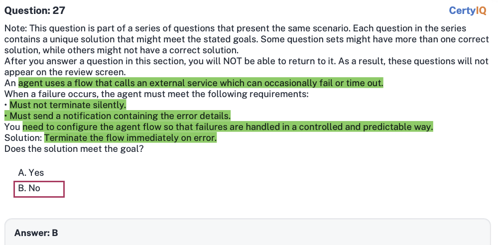

### 1. Extracted Question Summary

* **Scenario (Repeated Scenario Series):** An agent uses a flow that calls an external service which can occasionally fail or time out. When a failure occurs, the agent must meet the following requirements:

* Must not terminate silently.

* Must send a notification containing the error details.

* **Goal:** Configure the agent flow so that failures are handled in a controlled and predictable way.

* **Proposed Solution:** Terminate the flow immediately on error.

* **Options:**
* **A.** Yes

* **B.** No

---

### 2. Correct Answer

* **B: No**

---

### 3. Verification of Visible Selection / Community Key

* **Correct:** The red box around **B. No** and the bottom key (`Answer: B`) are **Correct** because terminating the flow immediately on error halts execution without capturing error details or sending any notification, directly violating both stated requirements.

---

### 4. Official Microsoft Justification

* **Controlled Exception Handling in Agent Flows (AB-620T00):** Per Microsoft Copilot Studio and Power Automate documentation (*Handle errors in flows / Build reliable agent flows* under `[https://learn.microsoft.com/en-us/training/courses/ab-620t00](https://learn.microsoft.com/en-us/training/courses/ab-620t00)`), using a **Terminate** control action immediately halts all subsequent steps in the flow run (marking it as *Failed*, *Cancelled*, or *Succeeded*).
* Because execution stops instantly at the **Terminate** step, no downstream notification action runs, no error details are sent, and the agent receives an abrupt failure rather than a controlled, predictable error-handling path (which requires **Configure run after** conditions set to *has failed* and *has timed out* leading into a notification action).

---

### 5. Distractor Analysis (Why Others Are Wrong)

* **A. Yes:** Immediately terminating the flow causes the exact silent/abrupt failure the requirements explicitly forbid (*"Must not terminate silently"* and *"Must send a notification containing the error details"*).

---

### 6. Exam Keyword / Trap Alert

* **Keyword Alert:** Across this entire repeated-scenario series (Questions 21, 22, 23, and 27), only **Configure run after conditions for failure paths** meets the goal. Any proposed solution that skips **Configure run after**—whether retrying without handling failure, adding a notification step without a failure path, or terminating immediately—is always **No**.

## Q28

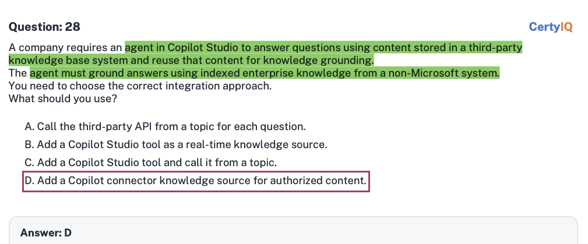

### 1. Extracted Question Summary

* **Scenario:** A company requires a Copilot Studio agent to answer questions using content stored in a third-party knowledge base system and reuse that content for knowledge grounding. The agent must ground answers using **indexed enterprise knowledge** from a **non-Microsoft system**.

* **Options:**
* **A.** Call the third-party API from a topic for each question.

* **B.** Add a Copilot Studio tool as a real-time knowledge source.

* **C.** Add a Copilot Studio tool and call it from a topic.

* **D.** Add a Copilot connector knowledge source for authorized content.

---

### 2. Correct Answer

* **D: Add a Copilot connector knowledge source for authorized content.**

---

### 3. Verification of Visible Selection / Community Key

* **Correct:** The red box around **D** and the bottom key (`Answer: D`) are **Correct** because Microsoft 365 Copilot connectors (formerly Microsoft Graph connectors) specifically ingest and index external non-Microsoft knowledge base content into Microsoft Graph with permission trimming for RAG grounding.

---

### 4. Official Microsoft Justification

* **Indexed External Knowledge via Copilot Connectors (AB-620T00):** Per Microsoft Copilot Studio documentation (*Add Microsoft 365 Copilot connectors as knowledge sources* under `[https://learn.microsoft.com/en-us/training/courses/ab-620t00](https://learn.microsoft.com/en-us/training/courses/ab-620t00)`), **Microsoft 365 Copilot connectors** crawl, ingest, and index content from external non-Microsoft repositories (such as Confluence, ServiceNow Knowledge, Jira, or custom third-party systems) directly into the Microsoft Graph semantic index.
* Once configured in the Microsoft 365 admin center and attached as a **Knowledge source** in Copilot Studio, the agent reuses that indexed enterprise content for Retrieval-Augmented Generation (RAG) grounding while enforcing the end user's source-system permissions (security trimming).

---

### 5. Distractor Analysis (Why Others Are Wrong)

* **A. Call the third-party API from a topic for each question:** Manually calling a REST API on every turn bypasses semantic indexing, requires bespoke topic orchestration, and does not provide built-in RAG knowledge grounding.

* **B. Add a Copilot Studio tool as a real-time knowledge source:** Copilot Studio **Tools** execute actions/operations rather than acting as knowledge sources, and real-time connectors query live operational tables rather than **indexed** knowledge bases.

* **C. Add a Copilot Studio tool and call it from a topic:** Tools are designed for transactional tasks or deterministic API calls inside a topic, not for indexing and grounding generative answers against an enterprise knowledge base.

---

### 6. Exam Keyword / Trap Alert

* **Keyword Alert:** Whenever you see **"indexed enterprise knowledge from a non-Microsoft / third-party system"**, the answer is always a **Microsoft 365 Copilot connector** (formerly Graph connector) added as a **Knowledge source**—never a *Tool* or a *real-time connector*. *(Note: Also remember to change `AB - 100` to `AB - 620` in your saved Gem instructions!)*

## Q29

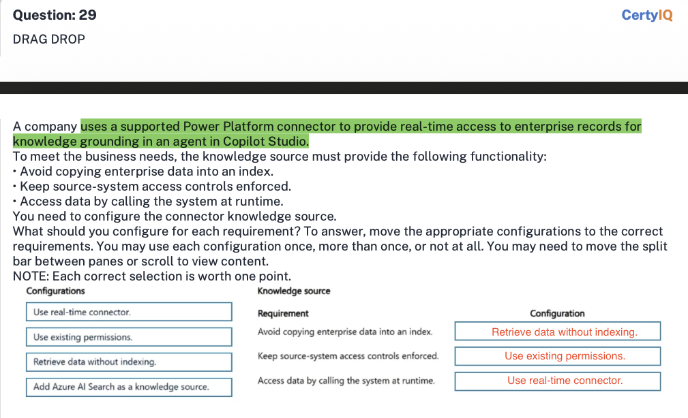

### 1. Extracted Question Summary

* **Scenario:** A company uses a supported Power Platform connector to provide real-time access to enterprise records for knowledge grounding in a Copilot Studio agent.

* **Task:** Match each business requirement to the appropriate configuration option:

* **Requirement 1:** Avoid copying enterprise data into an index.

* **Requirement 2:** Keep source-system access controls enforced.

* **Requirement 3:** Access data by calling the system at runtime.

* **Available Configurations (Draggable Options — may be used once, more than once, or not at all):**
* Use real-time connector.

* Use existing permissions.

* Retrieve data without indexing.

* Add Azure AI Search as a knowledge source.

---

### 2. Correct Answer

* **Avoid copying enterprise data into an index:** **Retrieve data without indexing.**

* **Keep source-system access controls enforced:** **Use existing permissions.**

* **Access data by calling the system at runtime:** **Use real-time connector.**

---

### 4. Official Microsoft Justification

* **Real-Time Power Platform Knowledge Connectors (AB-620T00):** Per Microsoft Copilot Studio documentation (*Add real-time knowledge with connectors* under `[https://learn.microsoft.com/en-us/training/courses/ab-620t00](https://learn.microsoft.com/en-us/training/courses/ab-620t00)`), real-time Power Platform connectors (such as Salesforce, ServiceNow, Zendesk, Dynamics 365, and Azure SQL) ground agent responses directly against live operational tables without ingesting, duplicating, or indexing records into Dataverse or Microsoft Graph:
* **Zero Data Ingestion / No Indexing:** Unlike Microsoft 365 Copilot connectors (which crawl and index content into Microsoft Graph) or uploaded files (which index into Dataverse), real-time Power Platform connectors **retrieve data without indexing**, keeping enterprise records in their system of record.

* **Delegated User Permissions:** When end users interact with the agent, the connector authenticates using the user's connection credentials and **uses existing permissions** enforced natively by the source system's role-based access controls.

* **Live Runtime Queries:** Rather than querying cached snapshots, the agent **uses a real-time connector** to execute live API queries against the target tables at conversation runtime.

---

### 5. Distractor Analysis (Why Others Are Wrong)

* **Add Azure AI Search as a knowledge source:** Azure AI Search requires ingesting and indexing enterprise data into a dedicated search index—which directly violates the requirement to *"Avoid copying enterprise data into an index"*.

---

### 6. Exam Keyword / Trap Alert

* **Keyword Alert:** Directly contrast **Question 20 / 28** (*Microsoft 365 Copilot connectors* → **indexed** external content in Microsoft Graph) with **Question 29** (*Power Platform real-time connectors* → **retrieve data without indexing** by calling the live system at **runtime**).

## Q30

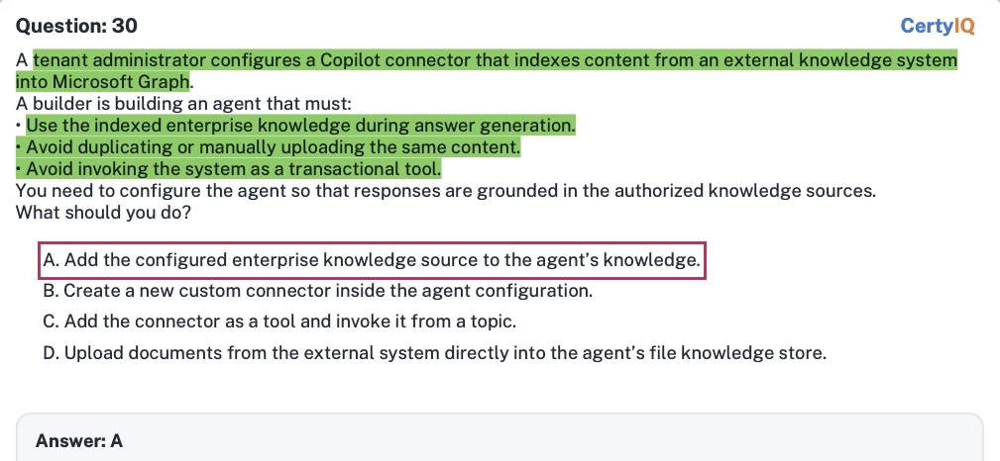

### 1. Extracted Question Summary

* **Scenario:** A tenant administrator configures a Microsoft 365 Copilot connector that indexes content from an external knowledge system into Microsoft Graph. A builder is creating a Copilot Studio agent that must:

* Use the indexed enterprise knowledge during answer generation.

* Avoid duplicating or manually uploading the same content.

* Avoid invoking the system as a transactional tool.

* **Goal:** Configure the agent so that responses are grounded in the authorized knowledge sources.

* **Options:**
* **A.** Add the configured enterprise knowledge source to the agent's knowledge.

* **B.** Create a new custom connector inside the agent configuration.

* **C.** Add the connector as a tool and invoke it from a topic.

* **D.** Upload documents from the external system directly into the agent's file knowledge store.

---

### 2. Correct Answer

* **A: Add the configured enterprise knowledge source to the agent's knowledge.**

---

### 3. Verification of Visible Selection / Community Key

* **Correct:** The red box around **A** and the bottom key (`Answer: A`) are **Correct** because tenant-configured Microsoft 365 Copilot connectors (Microsoft Graph connectors) are surfaced directly in Copilot Studio's **Add knowledge** dialog for seamless RAG grounding without duplicating files or building transactional tools.

---

### 4. Official Microsoft Justification

* **Consuming Tenant-Indexed Copilot Connectors in Copilot Studio (AB-620T00):** Per Microsoft Copilot Studio documentation (*Add Microsoft 365 Copilot connectors as knowledge sources* under `[https://learn.microsoft.com/en-us/training/courses/ab-620t00](https://learn.microsoft.com/en-us/training/courses/ab-620t00)`), once a Microsoft 365 administrator creates and indexes an external data connection into Microsoft Graph via the Microsoft 365 admin center, that connection becomes available across the tenant.
* Makers simply open their agent's **Knowledge** section in Copilot Studio, select **+ Add knowledge**, and choose the configured **Microsoft 365 Copilot connector** connection. This enables the agent to ground generative answers in the pre-indexed Microsoft Graph content with automatic source-level ACL security trimming, zero content duplication, and no transactional tool execution.

---

### 5. Distractor Analysis (Why Others Are Wrong)

* **B. Create a new custom connector inside the agent configuration:** Custom connectors are Power Platform REST API wrappers used to execute transactional actions/operations, not to consume pre-indexed Microsoft Graph content.

* **C. Add the connector as a tool and invoke it from a topic:** Directly violates the explicit requirement to *"Avoid invoking the system as a transactional tool"*.

* **D. Upload documents from the external system directly into the agent's file knowledge store:** Directly violates the explicit requirement to *"Avoid duplicating or manually uploading the same content"*.

---

### 6. Exam Keyword / Trap Alert

* **Keyword Alert:** When a scenario specifies that a **tenant administrator already indexed external content into Microsoft Graph via a Copilot connector**, simply attach it under the agent's **Knowledge** experience—never re-upload files or wrap it as a transactional tool. *(Tip: In your pasted Gem instructions, remember to change `AB - 100` to `AB - 620` if you are updating your AB-620 Gem!)*

## Q31

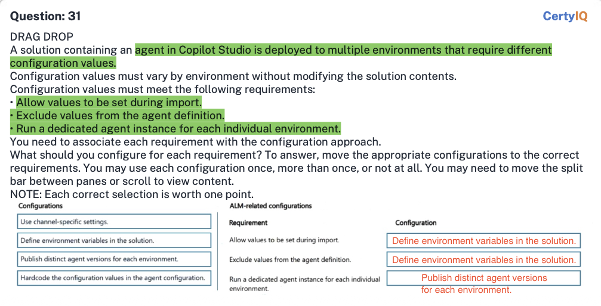

### 1. Extracted Question Summary

* **Scenario:** A Power Platform solution containing a Copilot Studio agent is deployed to multiple environments (such as Dev, Test, and Prod) that require different configuration values. Configuration values must vary by environment without modifying the solution contents.

* **Task:** Associate each ALM-related requirement with the appropriate configuration approach:

* **Requirement 1:** Allow values to be set during import.

* **Requirement 2:** Exclude values from the agent definition.

* **Requirement 3:** Run a dedicated agent instance for each individual environment.

* **Available Configurations (Draggable Options — may be used once, more than once, or not at all):**
* Use channel-specific settings.

* Define environment variables in the solution.

* Publish distinct agent versions for each environment.

* Hardcode the configuration values in the agent configuration.

---

### 2. Correct Answer

* **Allow values to be set during import:** **Define environment variables in the solution.**

* **Exclude values from the agent definition:** **Define environment variables in the solution.**

* **Run a dedicated agent instance for each individual environment:** **Publish distinct agent versions for each environment.**

---

### 4. Official Microsoft Justification

* **Environment Variables & Solution ALM in Copilot Studio (AB-620T00):** Per Microsoft Copilot Studio and Power Platform ALM documentation (*Use environment variables in solutions / Deploy agents across environments* under `[https://learn.microsoft.com/en-us/training/courses/ab-620t00](https://learn.microsoft.com/en-us/training/courses/ab-620t00)`), **environment variables** are the standard mechanism for parameterizing agent settings (such as external API endpoints, SharePoint site URLs, or Dataverse parameters) across environments without breaking managed solution integrity:
* **Prompted During Solution Import:** When a solution containing environment variables is imported into a target environment (and the "Current Value" is cleared prior to export), the Power Platform import wizard automatically prompts the administrator to supply environment-specific values during import.

* **Decoupled from Agent Definition:** Environment variables store their values externally in Dataverse (`Environment Variable Definition` and `Environment Variable Value` tables) rather than embedding static strings inside the agent's YAML/topic definition, keeping the underlying managed solution components unmodified.

* **Per-Environment Agent Lifecycle & Publishing:** Importing a solution into each Power Platform environment creates a separate, isolated runtime instance of that agent in that environment; each environment's agent instance must be independently **published** to activate its environment-specific runtime and channels.

---

### 5. Distractor Analysis (Why Others Are Wrong)

* **Hardcode the configuration values in the agent configuration:** Hardcoding embeds static values directly into the agent definition, forcing unmanaged customizations in target environments and violating the core ALM rule (*"vary by environment without modifying the solution contents"*).

* **Use channel-specific settings:** Channel settings (such as Microsoft Teams, Web, or Direct Line) govern how end users connect to an agent on a given surface, not how ALM solution deployments parameterize configuration values during import or decouple them from the agent definition.

---

### 6. Exam Keyword / Trap Alert

* **Keyword Alert:** Notice the explicit exam instruction *"You may use each configuration once, more than once, or not at all"*—both **"Allow values to be set during import"** and **"Exclude values from the agent definition"** map to **Define environment variables in the solution**. Whenever an ALM question mentions varying configuration values across environments without editing a managed solution, **Environment Variables** are always the answer.

## Q32

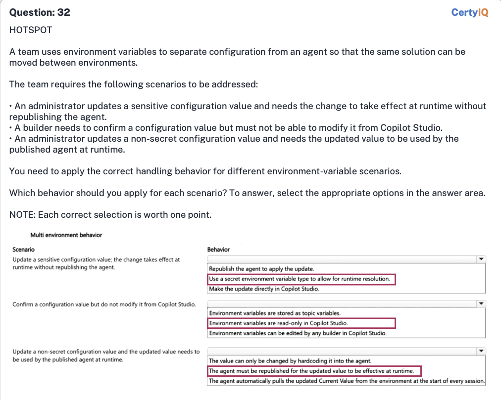

### 1. Extracted Question Summary

* **Scenario:** A team uses environment variables to separate configuration from an agent in Copilot Studio so the same solution can move between environments.

* **Task:** Select the appropriate handling behavior from each dropdown for three multi-environment scenarios:

* **Scenario 1:** Update a sensitive configuration value; the change takes effect at runtime without republishing the agent.

* *Options:* Republish the agent to apply the update | Use a secret environment variable type to allow for runtime resolution | Make the update directly in Copilot Studio.

* **Scenario 2:** Confirm a configuration value but do not modify it from Copilot Studio.

* *Options:* Environment variables are stored as topic variables | Environment variables are read-only in Copilot Studio | Environment variables can be edited by any builder in Copilot Studio.

* **Scenario 3:** Update a non-secret configuration value and the updated value needs to be used by the published agent at runtime.

* *Options:* The value can only be changed by hardcoding it into the agent | The agent must be republished for the updated value to be effective at runtime | The agent automatically pulls the updated Current Value from the environment at the start of every session.

---

### 2. Correct Answer

* Update a sensitive configuration value; the change takes effect at runtime without republishing the agent: Use a secret environment variable type to allow for runtime resolution.

* Confirm a configuration value but do not modify it from Copilot Studio: Environment variables are read-only in Copilot Studio.

* Update a non-secret configuration value and the updated value needs to be used by the published agent at runtime: The agent must be republished for the updated value to be effective at runtime.

---

### 3. Verification of Visible Selection / Community Key

* **Correct:** All three red-boxed selections visible in the screenshot (**Use a secret environment variable type to allow for runtime resolution**, **Environment variables are read-only in Copilot Studio**, and **The agent must be republished for the updated value to be effective at runtime**) are **Correct** because they accurately reflect how Copilot Studio caches standard environment variable values at publish time while resolving Azure Key Vault-backed secret environment variables dynamically at runtime.

---

### 4. Official Microsoft Justification

* **Environment Variables Behavior in Copilot Studio (AB-620T00):** Per Microsoft Copilot Studio documentation (*Use environment variables in Copilot Studio* under `[https://learn.microsoft.com/en-us/training/courses/ab-620t00](https://learn.microsoft.com/en-us/training/courses/ab-620t00)`), Copilot Studio handles non-secret and secret environment variables differently:
* **Secret Environment Variables (Azure Key Vault):** Secret environment variables reference secrets stored in Azure Key Vault and are resolved dynamically at runtime—meaning rotating or updating a secret value in Key Vault takes effect immediately without requiring you to republish the agent.
* **Read-Only Visibility in Copilot Studio:** Makers can view and select existing environment variables inside Copilot Studio (e.g., in topic nodes or Power Fx formulas) to confirm their configuration, but environment variables are **read-only** within Copilot Studio and must be created or modified in the Power Apps / Power Platform solution interface.
* **Non-Secret Environment Variables Caching:** Standard (non-secret) environment variable values are snapshot-cached into the agent's published definition when published; therefore, after an administrator updates a non-secret environment variable's *Current Value* in the solution, **the agent must be republished** for the updated value to take effect at runtime.

---

### 5. Distractor Analysis (Why Others Are Wrong)

* **Scenario 1 Distractors:**
* *Republish the agent to apply the update:* Directly contradicts the requirement *"without republishing the agent"*.

* *Make the update directly in Copilot Studio:* Environment variables cannot be edited inside Copilot Studio.

* **Scenario 2 Distractors:**
* *Environment variables are stored as topic variables:* Environment variables are Dataverse solution components (`Environment Variable Definition` / `Value`), not local topic variables.

* *Environment variables can be edited by any builder in Copilot Studio:* False—they are strictly read-only in the Copilot Studio authoring canvas.

* **Scenario 3 Distractors:**
* *The value can only be changed by hardcoding it into the agent:* Defeats the entire purpose of environment variables.

* *The agent automatically pulls the updated Current Value from the environment at the start of every session:* Standard non-secret environment variables are cached at publish time and do **not** refresh dynamically per session without republishing.

---

### 6. Exam Keyword / Trap Alert

* **Keyword Alert:** Memorize the critical Copilot Studio runtime distinction: **Secret (Azure Key Vault) environment variables** update at runtime **without republishing**, whereas **non-secret environment variables** require **republishing the agent** before updated values take effect.

## Q33

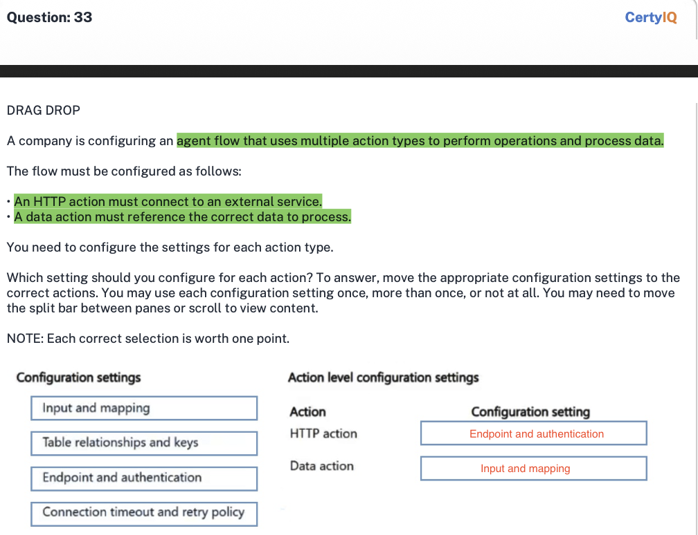

### 1. Extracted Question Summary

* **Scenario:** A company is configuring an agent flow that uses multiple action types to perform operations and process data:

* An **HTTP action** must connect to an external service.

* A **data action** must reference the correct data to process.

* **Task:** Match each action type to its required action-level configuration setting:

* **Target 1:** HTTP action

* **Target 2:** Data action

* **Available Configuration Settings (Draggable Options — may be used once, more than once, or not at all):**
* Input and mapping

* Table relationships and keys

* Endpoint and authentication

* Connection timeout and retry policy

---

### 2. Correct Answer

* **HTTP action:** **Endpoint and authentication**

* **Data action:** **Input and mapping**

---

### 4. Official Microsoft Justification

* **Action-Level Configuration in Agent Flows (AB-620T00):** Per Microsoft Copilot Studio and Power Automate documentation (*Build agent flows / Configure actions* under `[https://learn.microsoft.com/en-us/training/courses/ab-620t00](https://learn.microsoft.com/en-us/training/courses/ab-620t00)`), each action node inside an agent flow exposes distinct configuration properties tailored to its operational role:
* **HTTP Action Connectivity:** To connect to an external REST service, the HTTP action requires specifying the target **URI (endpoint)**, HTTP method, headers, and **authentication** parameters (such as OAuth, API Key, Basic, or Active Directory OAuth) so the external service accepts and authorizes the request.

* **Data Action Reference & Transformation:** Data operations (such as *Compose*, *Parse JSON*, *Select*, or *Filter array*) rely on **input and mapping** parameters—referencing dynamic content or expressions from upstream trigger/action outputs and mapping fields into the target structure for downstream consumption.

---

### 5. Distractor Analysis (Why Others Are Wrong)

* **Table relationships and keys:** Pertains to Microsoft Dataverse data modeling (1:N, N:1, N:N relationships and alternate keys), not configuring an HTTP connection or referencing data inside a flow's data action.

* **Connection timeout and retry policy:** Governs resilience and transient error handling (configured under an action's *Settings* pane), rather than establishing external service connectivity or referencing input data.

---

### 6. Exam Keyword / Trap Alert

* **Keyword Alert:** Match **"connect to an external service"** on an HTTP action directly to **Endpoint and authentication**, and **"reference the correct data to process"** on a data action to **Input and mapping** (dynamic content/expression binding). *(Note: Also remember to update `AB - 100` to `AB - 620` in your saved Gem instructions!)*

## Q34

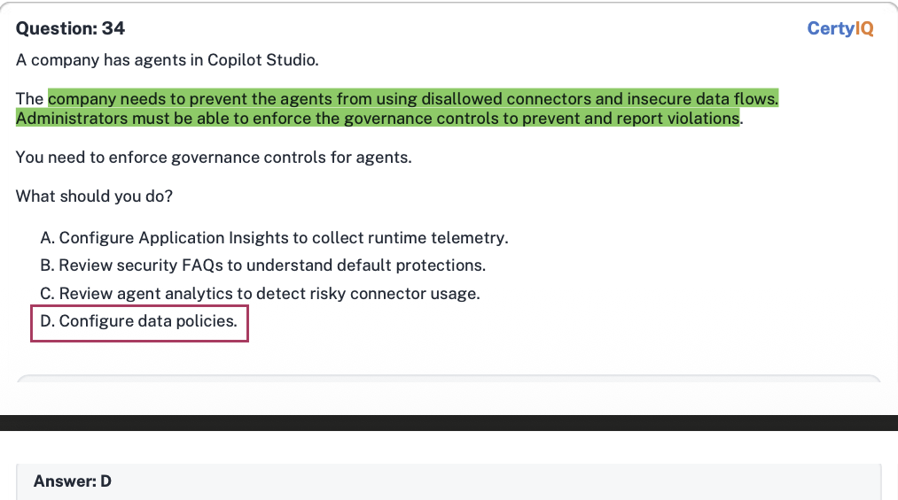

### 1. Extracted Question Summary

* **Scenario:** A company has agents in Copilot Studio and needs to prevent them from using disallowed connectors and insecure data flows. Administrators must be able to enforce governance controls to prevent and report violations.

* **Options:**
* **A.** Configure Application Insights to collect runtime telemetry.

* **B.** Review security FAQs to understand default protections.

* **C.** Review agent analytics to detect risky connector usage.

* **D.** Configure data policies.

---

### 2. Correct Answer

* **D: Configure data policies.**

---

### 3. Verification of Visible Selection / Community Key

* **Correct:** The red box around **D** and the bottom key (`Answer: D`) are **Correct** because Power Platform Data Loss Prevention (DLP) policies—now referred to as **data policies** in the Power Platform admin center—enforce tenant- and environment-level guardrails that block disallowed connectors, prevent cross-boundary data exfiltration, and surface policy violations to administrators.

---

### 4. Official Microsoft Justification

* **Governance & Data Policies for Copilot Studio (AB-620T00):** Per Microsoft Copilot Studio and Power Platform governance documentation (*Manage data loss prevention (DLP) / data policies for Copilot Studio* under `[https://learn.microsoft.com/en-us/training/courses/ab-620t00](https://learn.microsoft.com/en-us/training/courses/ab-620t00)`), administrators configure **data policies** in the Power Platform admin center to govern how Copilot Studio agents connect to data sources, tools, channels, and external services.
* Data policies classify connectors into **Business**, **Non-business**, and **Blocked** groups—preventing unauthorized connectors from executing, blocking insecure data sharing across connector boundaries (for example, preventing an internal Dataverse connector from sharing data with an external social media or unapproved HTTP connector), and flagging or blocking non-compliant agents while reporting policy violations to admins.

---

### 5. Distractor Analysis (Why Others Are Wrong)

* **A. Configure Application Insights to collect runtime telemetry:** Application Insights collects custom diagnostic logs and conversation telemetry for monitoring, but it does not enforce preventative governance guardrails or block disallowed connectors.

* **B. Review security FAQs to understand default protections:** Reading documentation provides informational awareness only and does not configure or enforce any tenant/environment controls.

* **C. Review agent analytics to detect risky connector usage:** Analytics is passive, retrospective usage reporting (e.g., deflection rates and session outcomes) rather than an active governance enforcement mechanism.

---

### 6. Exam Keyword / Trap Alert

* **Keyword Alert:** Whenever an exam scenario asks how administrators **prevent disallowed connectors**, **block insecure data flows**, or **enforce governance controls** across Copilot Studio agents, the answer is always **Configure data policies** (Power Platform DLP policies). *(Note: Remember to change `AB - 100` to `AB - 620` in your saved Gem instructions!)*

## Q35

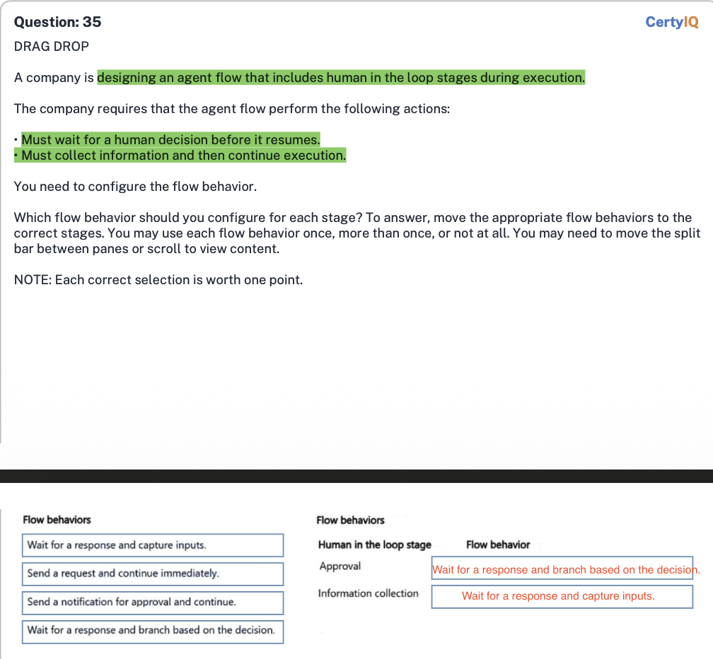

### 1. Extracted Question Summary

* **Scenario:** A company is designing an agent flow that includes **human-in-the-loop (HITL)** stages during execution. The flow must:

* Wait for a human decision before it resumes.

* Collect information and then continue execution.

* **Task:** Match each human-in-the-loop stage to the appropriate flow behavior:

* **Target 1:** Approval

* **Target 2:** Information collection

* **Available Flow Behaviors (Draggable Options — may be used once, more than once, or not at all):**
* Wait for a response and capture inputs.

* Send a request and continue immediately.

* Send a notification for approval and continue.

* Wait for a response and branch based on the decision.

---

### 2. Correct Answer

* **Approval:** **Wait for a response and branch based on the decision.**

* **Information collection:** **Wait for a response and capture inputs.**

---

### 4. Official Microsoft Justification

* **Human-in-the-Loop (HITL) Patterns in Agent Flows (AB-620T00):** Per Microsoft Copilot Studio and Power Automate documentation (*Add human-in-the-loop approvals and input collection in agent flows* under `[https://learn.microsoft.com/en-us/training/courses/ab-620t00](https://learn.microsoft.com/en-us/training/courses/ab-620t00)`), agent flows support asynchronous human intervention using **Approvals** and **Post Adaptive Card and wait for a response** actions:
* **Approval Stage (`Start and wait for an approval`):** Suspends flow execution until the designated reviewer submits an **Approve** or **Reject** decision, then evaluates the `Outcome` property via a **Condition** action to branch downstream execution paths accordingly.

* **Information Collection Stage (`Post card in a chat or channel` / `Send email with options` and wait):** Pauses the flow until the user submits required form fields or structured inputs, captures those output values into flow variables, and resumes downstream processing.

---

### 5. Distractor Analysis (Why Others Are Wrong)

* **Send a request and continue immediately:** Asynchronous fire-and-forget actions (such as *Create an approval* without waiting, or posting a standard notification) do not pause execution, violating both requirements to wait for a decision or collect information before resuming.

* **Send a notification for approval and continue:** Sending a passive notification without waiting does not block execution for a human decision and cannot branch on an approval outcome.

---

### 6. Exam Keyword / Trap Alert

* **Keyword Alert:** Any human-in-the-loop stage requiring a decision or input before resuming must use a **"wait for a response"** behavior—match **Approval** with **branch based on the decision** and **Information collection** with **capture inputs**. *(Note: Also remember to change `AB - 100` to `AB - 620` in your saved Gem instructions!)*

## Q36

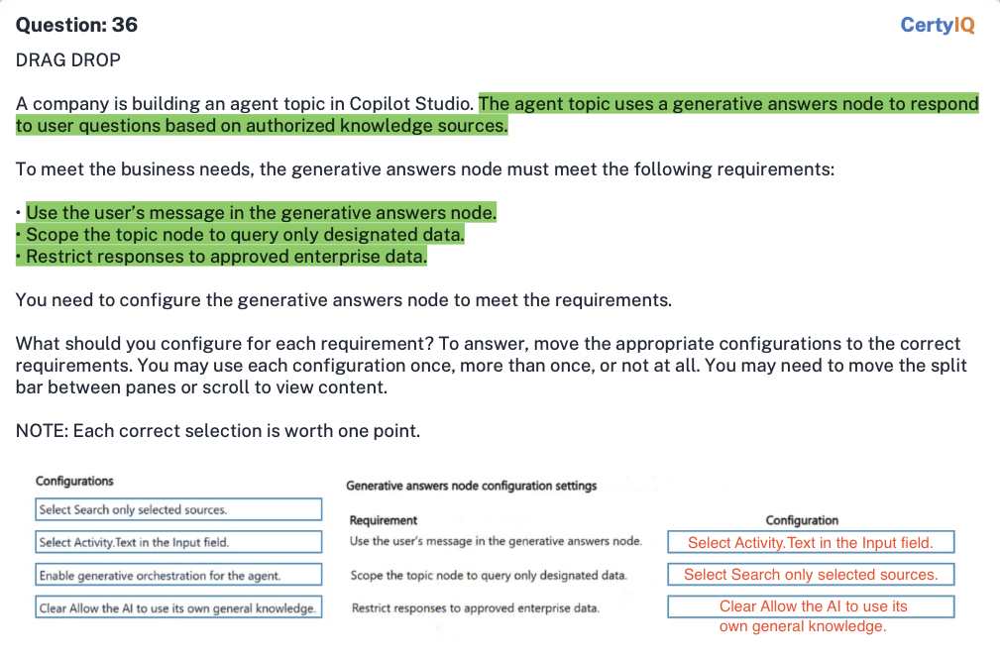

### 1. Extracted Question Summary

* **Scenario:** A company is building an agent topic in Copilot Studio that uses a **Create generative answers** node to respond to user questions based on authorized knowledge sources.

* **Task:** Match each business requirement to the appropriate **Generative answers node configuration setting**:

* **Requirement 1:** Use the user's message in the generative answers node.

* **Requirement 2:** Scope the topic node to query only designated data.

* **Requirement 3:** Restrict responses to approved enterprise data.

* **Available Configurations (Draggable Options — may be used once, more than once, or not at all):**
* Select Search only selected sources.

* Select Activity.Text in the Input field.

* Enable generative orchestration for the agent.

* Clear Allow the AI to use its own general knowledge.

---

### 2. Correct Answer

* Use the user's message in the generative answers node: Select Activity.Text in the Input field.

* Scope the topic node to query only designated data: Select Search only selected sources.

* Restrict responses to approved enterprise data: Clear Allow the AI to use its own general knowledge.

---

### 4. Official Microsoft Justification

* **Generative Answers Node Properties (AB-620T00):** Per Microsoft Copilot Studio documentation (*Generative answers node / Add knowledge to Microsoft Copilot Studio agents* under `[https://learn.microsoft.com/en-us/training/courses/ab-620t00](https://learn.microsoft.com/en-us/training/courses/ab-620t00)`), the **Create generative answers** node exposes specific input and data-source scoping controls:
* **Query Input (`Input` property):** Binding the system variable `System.Activity.Text` (or `Activity.Text`) passes the user's verbatim incoming utterance directly into the generative answers node as the search query.

* **Topic-Level Knowledge Scoping (`Search only selected sources`):** Under the node's **Data source** properties, enabling **Search only selected sources** restricts retrieval exclusively to the specific knowledge sources explicitly configured on that node, ignoring broader agent-level knowledge sources.

* **Preventing Ungrounded LLM Fallback (`Allow the AI to use its own general knowledge`):** Clearing/disabling **Allow the AI to use its own general knowledge** prevents the underlying model from answering out of its pre-trained parametric weights when approved enterprise sources lack an answer, strictly enforcing enterprise-grounded responses.

---

### 5. Distractor Analysis (Why Others Are Wrong)

* Enable generative orchestration for the agent: Generative orchestration is an agent-wide routing mode that determines how the agent dynamically selects topics, tools, and knowledge across turns; it does not configure input bindings or source restrictions inside an individual topic's **Create generative answers** node.

---

### 6. Exam Keyword / Trap Alert

* **Keyword Alert:** Memorize the exact three controls inside a **Create generative answers** node: **`Activity.Text`** = passes the user's query; **`Search only selected sources`** = scopes retrieval strictly to node-level sources (excluding agent-level sources); and **clearing `Allow the AI to use its own general knowledge**` = blocks ungrounded LLM fallback answers.

## Q37

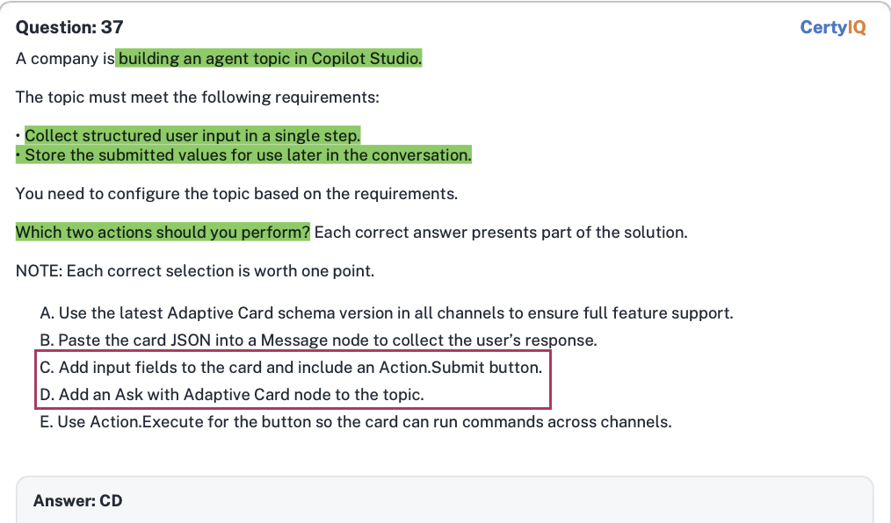

### 1. Extracted Question Summary

* **Scenario:** A company is building an agent topic in Copilot Studio that must collect structured user input in a single step and store the submitted values for reuse later in the conversation.

* **Task:** Select **two** actions that each present part of the solution:

* **A.** Use the latest Adaptive Card schema version in all channels to ensure full feature support.

* **B.** Paste the card JSON into a Message node to collect the user's response.

* **C.** Add input fields to the card and include an Action.Submit button.

* **D.** Add an Ask with Adaptive Card node to the topic.

* **E.** Use Action.Execute for the button so the card can run commands across channels.

---

### 2. Correct Answer

* **C: Add input fields to the card and include an Action.Submit button.**

* **D: Add an Ask with Adaptive Card node to the topic.**

---

### 3. Verification of Visible Selection / Community Key

* **Correct:** The bottom key (`Answer: CD`) is **Correct** because interactive data collection via Adaptive Cards in Copilot Studio requires using an **Ask with Adaptive Card** node paired with an Adaptive Card payload containing `Input.*` fields and an `Action.Submit` action so Copilot Studio automatically binds the submitted JSON properties to topic output variables.

---

### 4. Official Microsoft Justification

* **Interactive Adaptive Cards in Copilot Studio (AB-620T00):** Per Microsoft Copilot Studio documentation (*Ask with Adaptive Cards* under `[https://learn.microsoft.com/en-us/training/courses/ab-620t00](https://learn.microsoft.com/en-us/training/courses/ab-620t00)`), there is a strict distinction between *displaying* a read-only card and *collecting structured user input*:
* **Ask with Adaptive Card Node (D):** Adding an **Ask with Adaptive Card** node pauses topic execution, renders the interactive card, waits for user submission, and automatically generates typed output topic variables corresponding to every input `id` defined in the card JSON.

* **Input Elements & Action.Submit (C):** To gather structured fields in a single form submission, the Adaptive Card JSON must define input controls (such as `Input.Text`, `Input.Number`, `Input.Date`, or `Input.ChoiceSet`) with unique `id` properties alongside an `Action.Submit` button that serializes and returns those field values back to the Copilot Studio runtime.

---

### 5. Distractor Analysis (Why Others Are Wrong)

* **A. Use the latest Adaptive Card schema version in all channels to ensure full feature support:** Different channels (such as Microsoft Teams, Web, or Slack) support specific Adaptive Card schema versions (typically v1.3–v1.5); using the newest unsupported schema version can cause cards to fail rendering rather than enabling input capture.

* **B. Paste the card JSON into a Message node to collect the user's response:** A **Message** node with an Adaptive Card attachment is display-only—it does not pause for submission or generate output variables to store user inputs.

* **E. Use Action.Execute for the button so the card can run commands across channels:** Copilot Studio's **Ask with Adaptive Card** node relies on `Action.Submit` to capture form inputs into topic variables; `Action.Execute` is used for Universal Actions in Microsoft Teams/Outlook bot framework handlers rather than standard Copilot Studio topic variable binding.

---

### 6. Exam Keyword / Trap Alert

* **Keyword Alert:** Always pair **"collect structured user input"** + **"store submitted values"** with **Ask with Adaptive Card** + **`Action.Submit`**—never a **Message node** (which is display-only). *(Also note: in your pasted Gem instructions, line 2 still says `AB - 100`—update that to `AB - 620` if you're saving this into your AB-620 Gem!)*

## Q44

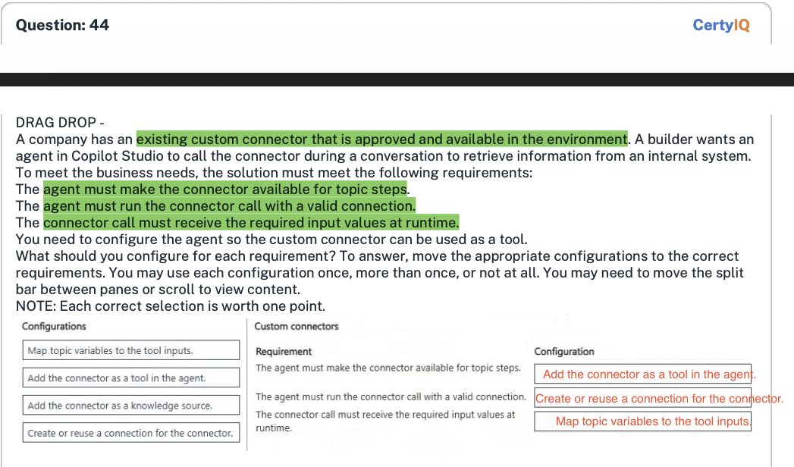

### 1. Extracted Question Summary

* **Scenario (Question 44 — duplicate of Question 7):** A company has an existing custom connector that is approved and available in the environment. A builder wants an agent in Copilot Studio to call the connector during a conversation to retrieve information from an internal system.

* **Task:** Configure the agent so the custom connector can be used as a tool by matching each requirement to its corresponding configuration:

* **Requirement 1:** The agent must make the connector available for topic steps.

* **Requirement 2:** The agent must run the connector call with a valid connection.

* **Requirement 3:** The connector call must receive the required input values at runtime.

* **Available Configurations (Draggable Options — may be used once, more than once, or not at all):**
* Map topic variables to the tool inputs.

* Add the connector as a tool in the agent.

* Add the connector as a knowledge source.

* Create or reuse a connection for the connector.

---

### 2. Correct Answer

* **The agent must make the connector available for topic steps:** **Add the connector as a tool in the agent.**

* **The agent must run the connector call with a valid connection:** **Create or reuse a connection for the connector.**

* **The connector call must receive the required input values at runtime:** **Map topic variables to the tool inputs.**

---

### 4. Official Microsoft Justification

* **Exposing Custom Connectors as Tools (AB-620T00):** Per Microsoft Copilot Studio documentation (*Extend Microsoft Copilot Studio agents with tools and connectors* under `[https://learn.microsoft.com/en-us/training/courses/ab-620t00](https://learn.microsoft.com/en-us/training/courses/ab-620t00)`), custom connectors available in the Power Platform environment must first be added under the agent's **Tools** (formerly Actions) section before they can be invoked inside topic authoring nodes or via generative orchestration.
* **Connection Authentication:** Every connector tool requires an active connection reference (created new or reused from existing connections, configured for either end-user or maker credentials) to authenticate and execute API calls against internal systems.
* **Runtime Parameter Mapping:** When invoking a tool deterministically inside a topic step, the maker maps **topic variables** (or global/system variables) directly to the connector operation's defined input parameters so values collected during the conversation are passed dynamically at runtime.

---

### 5. Distractor Analysis (Why Others Are Wrong)

* **Add the connector as a knowledge source:** Knowledge sources are used for Retrieval-Augmented Generation (RAG) over unstructured or tabular knowledge repositories (such as SharePoint, Dataverse, or Microsoft 365 Copilot connectors), whereas custom REST API connectors are configured as **Tools** to execute deterministic API operations.

---

### 6. Exam Keyword / Trap Alert

* **Keyword Alert:** This is an exact CertyIQ repeat of Question 7—always match **"available for topic steps"** to **Add the connector as a tool**, **"valid connection"** to **Create or reuse a connection**, and **"required input values at runtime"** to **Map topic variables to the tool inputs**. *(Note: Also remember to change `AB - 100` to `AB - 620` in your saved Gem instructions!)*

## Q45

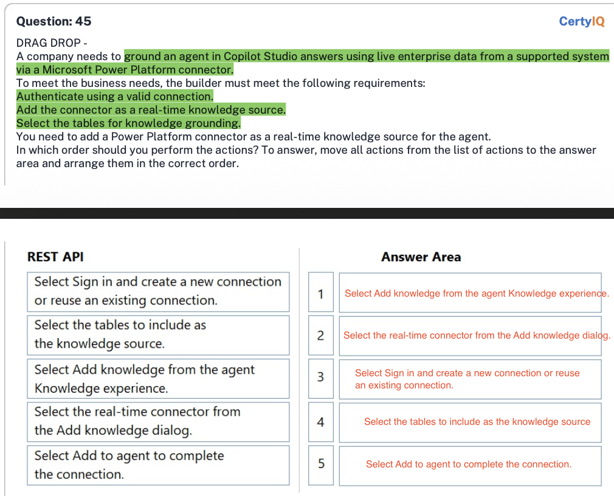

### 1. Extracted Question Summary

* **Scenario (Question 45 — duplicate of Question 8):** A company needs to ground a Copilot Studio agent's answers using live enterprise data from a supported system via a Microsoft Power Platform connector.

* **Requirements:**
* Authenticate using a valid connection.

* Add the connector as a real-time knowledge source.

* Select the tables for knowledge grounding.

* **Task:** Arrange all five actions in the exact chronological order required to add a Power Platform connector as a real-time knowledge source:

* Select Sign in and create a new connection or reuse an existing connection.

* Select the tables to include as the knowledge source.

* Select Add knowledge from the agent Knowledge experience.

* Select the real-time connector from the Add knowledge dialog.

* Select Add to agent to complete the connection.

---

### 2. Correct Answer

1. **Select Add knowledge from the agent Knowledge experience.**

2. **Select the real-time connector from the Add knowledge dialog.**

3. **Select Sign in and create a new connection or reuse an existing connection.**

4. **Select the tables to include as the knowledge source.**

5. **Select Add to agent to complete the connection.**

---

### 4. Official Microsoft Justification

* **Real-Time Knowledge Connectors UI Flow (AB-620T00):** Per Microsoft Copilot Studio documentation (*Add real-time knowledge with connectors* under `[https://learn.microsoft.com/en-us/training/courses/ab-620t00](https://learn.microsoft.com/en-us/training/courses/ab-620t00)`), adding a supported Power Platform connector (such as Salesforce, ServiceNow, Zendesk, or Azure SQL) as a real-time knowledge source follows a strict dependency-driven sequence:
1. **Initiate:** Open the agent's **Knowledge** section and select **+ Add knowledge**.

2. **Select Connector:** Choose the target real-time Power Platform connector from the **Add knowledge** dialog.

3. **Authenticate:** Select **Sign in** to create a new authenticated connection or reuse an existing connection reference.

4. **Scope Tables:** Once authenticated, browse the exposed objects and **select the specific tables** to include for real-time RAG grounding.

5. **Finalize:** Confirm by selecting **Add to agent**.

---

### 5. Distractor Analysis (Why Others Are Wrong)

* Because this is an **ordered sequence** question using all five items, there are no unused distractors; however, the main ordering trap is placing **Select the tables** before **Select Sign in and create a new connection**—you must authenticate first before Copilot Studio can query and display available tables from the external system.

---

### 6. Exam Keyword / Trap Alert

* **Keyword Alert:** Memorize the exact 5-step UI sequence: **Add Knowledge → Pick Connector → Authenticate → Pick Tables → Add to Agent**. *(Also note: In your pasted Gem instructions, line 2 still says `AB - 100`—update that to `AB - 620` if you're saving this into your AB-620 Gem!)*

## Q46

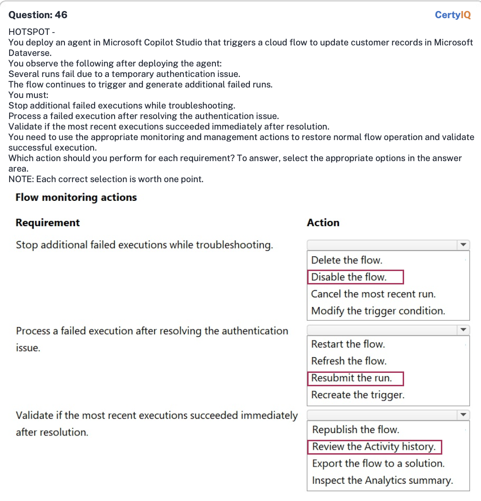

### 1. Extracted Question Summary

* **Scenario (Question 46 — duplicate of Question 9):** You deploy a Copilot Studio agent that triggers a cloud flow to update customer records in Microsoft Dataverse. Several runs fail due to a temporary authentication issue, and the flow continues to trigger and generate additional failed runs.

* **Task:** Select the appropriate monitoring and management action from each dropdown list for three requirements:

* **Requirement 1:** Stop additional failed executions while troubleshooting.

* *Options:* Delete the flow | Disable the flow | Cancel the most recent run | Modify the trigger condition.

* **Requirement 2:** Process a failed execution after resolving the authentication issue.

* *Options:* Restart the flow | Refresh the flow | Resubmit the run | Recreate the trigger.

* **Requirement 3:** Validate if the most recent executions succeeded immediately after resolution.

* *Options:* Republish the flow | Review the Activity history | Export the flow to a solution | Inspect the Analytics summary.

---

### 2. Correct Answer

* **Stop additional failed executions while troubleshooting:** **Disable the flow.**

* **Process a failed execution after resolving the authentication issue:** **Resubmit the run.**

* **Validate if the most recent executions succeeded immediately after resolution:** **Review the Activity history.**

---

### 3. Verification of Visible Selection / Community Key

* **Correct:** All three red-boxed selections visible in the screenshot (**Disable the flow**, **Resubmit the run**, and **Review the Activity history**) are **Correct** because turning off a flow prevents new trigger invocations during troubleshooting, resubmitting replays the failed run payload, and Activity/run history surfaces real-time execution statuses without analytics ingestion delay.

---

### 4. Official Microsoft Justification

* **Monitoring and Managing Agent Flows (AB-620T00):** Per Microsoft Copilot Studio and Power Automate administration documentation (*Monitor and manage agents and flows* under `[https://learn.microsoft.com/en-us/training/courses/ab-620t00](https://learn.microsoft.com/en-us/training/courses/ab-620t00)`), operational recovery from transient connection/authentication failures follows three distinct actions:
* **Turn Off (Disable) the Flow:** Turning off a cloud flow halts new trigger invocations immediately while keeping the flow metadata, connection references, and historical run logs intact during remediation.
* **Resubmit Failed Runs:** Once the underlying connection or authentication token is repaired, **resubmitting** a failed execution from the 28-day run history replays the exact original trigger payload without requiring end users to re-trigger the agent.
* **Real-Time Activity / Run History Inspection:** Copilot Studio's **Activity** tab and Power Automate's **Run history** display execution outcomes (*Succeeded*, *Failed*, *Running*) immediately upon completion, whereas **Analytics** dashboards aggregate telemetry asynchronously and are not suited for immediate post-fix verification.

---

### 5. Distractor Analysis (Why Others Are Wrong)

* **Requirement 1 Distractors:**
* *Delete the flow:* Permanently destroys the flow definition and run history.

* *Cancel the most recent run:* Only stops a single in-flight instance while future triggers continue firing.

* *Modify the trigger condition:* Unnecessarily alters business logic when the flow only needs to be temporarily paused.

* **Requirement 2 Distractors:**
* *Restart the flow / Refresh the flow:* Not valid Power Automate mechanisms for replaying a specific failed execution payload.

* *Recreate the trigger:* Destructive and unnecessary since the trigger itself is valid.

* **Requirement 3 Distractors:**
* *Republish the flow:* Flows are turned on/off rather than published like Copilot Studio agents.

* *Export the flow to a solution:* Used for ALM packaging/migration, not runtime verification.

* *Inspect the Analytics summary:* Subject to data ingestion latency and provides aggregated metrics rather than immediate per-run verification.

---

### 6. Exam Keyword / Trap Alert

* **Keyword Alert:** Always contrast **"validate immediately after resolution"** (which maps to **Activity history / Run history**) against **"analyze usage or deflection trends"** (which maps to **Analytics**), and remember that re-running a failed flow instance is specifically called **Resubmit**. *(Note: Also remember to change `AB - 100` to `AB - 620` in line 2 of your saved Gem instructions!)*

## Q47

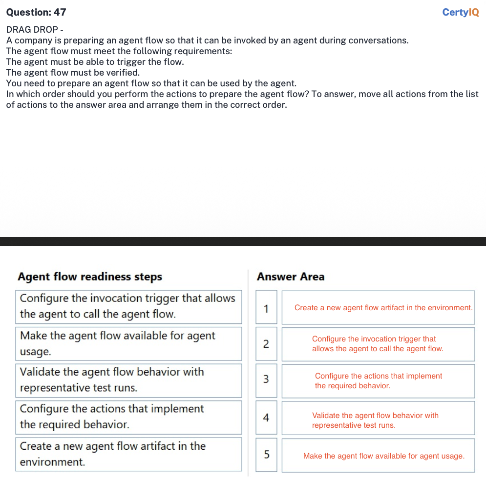

### 1. Extracted Question Summary

* **Scenario (Question 47 — duplicate of Question 10):** A company is preparing an agent flow so that it can be invoked by an agent during conversations.

* **Requirements:**
* The agent must be able to trigger the flow.

* The agent flow must be verified.

* **Task:** Arrange all five agent flow readiness steps in the exact chronological order required to prepare the flow for agent usage:

* Configure the invocation trigger that allows the agent to call the agent flow.

* Make the agent flow available for agent usage.

* Validate the agent flow behavior with representative test runs.

* Configure the actions that implement the required behavior.

* Create a new agent flow artifact in the environment.

---

### 2. Correct Answer

1. **Create a new agent flow artifact in the environment.**

2. **Configure the invocation trigger that allows the agent to call the agent flow.**

3. **Configure the actions that implement the required behavior.**

4. **Validate the agent flow behavior with representative test runs.**

5. **Make the agent flow available for agent usage.**

---

### 4. Official Microsoft Justification

* **Agent Flow Authoring & Readiness Lifecycle (AB-620T00):** Per Microsoft Copilot Studio documentation (*Build agent flows / Extend agents with tools and flows* under `[https://learn.microsoft.com/en-us/training/courses/ab-620t00](https://learn.microsoft.com/en-us/training/courses/ab-620t00)`), native **agent flows** follow a strict deterministic build-test-publish lifecycle before an agent can invoke them in topics or via generative orchestration:
1. **Create Artifact:** Provision the new agent flow inside Copilot Studio (**Flows** / **Tools** → **New agent flow**), creating the flow definition in the Power Platform environment.

2. **Configure Trigger:** Define the root invocation trigger (**"When an agent calls the flow"**) along with its expected input parameters.

3. **Configure Actions:** Author the intermediate connector/data operations and the final **"Respond to the agent"** action to implement the required business behavior.

4. **Validate via Test Runs:** Execute representative test runs in the flow designer to verify input/output schemas and error-free execution.

5. **Publish / Make Available:** Publish the validated agent flow so it becomes active and selectable as a tool within the agent.

---

### 5. Distractor Analysis (Why Others Are Wrong)

* Because this is an **ordered sequence** question utilizing all five items, there are no unused distractors. The main ordering traps to avoid are configuring actions before defining the root trigger's input contract, or publishing the flow before running validation tests.

---

### 6. Exam Keyword / Trap Alert

* **Keyword Alert:** Memorize the deterministic build lifecycle for Copilot Studio **agent flows**: **Create Artifact → Configure Trigger → Configure Actions → Validate with Test Runs → Make Available (Publish)**. *(Note on your pasted Gem instructions: Line 2 still says `AB - 100`—update that to `AB - 620` if you are saving this into your AB-620 Gem!)*

## Q48

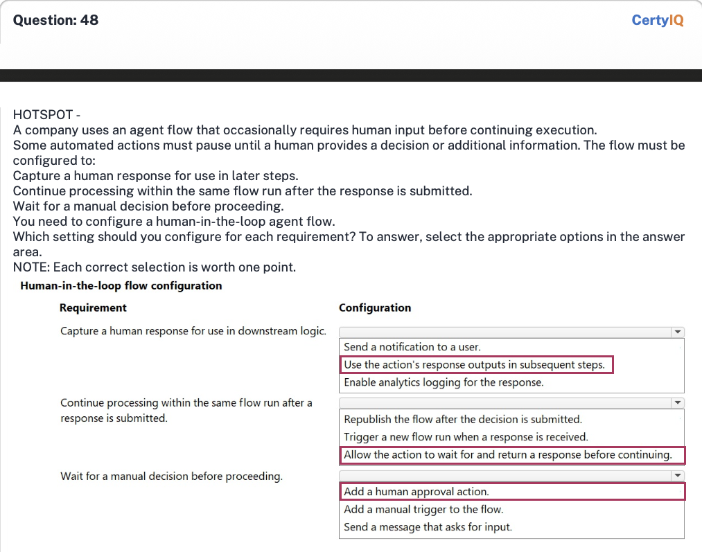

### 1. Extracted Question Summary

* **Scenario (Question 48 — Hotspot):** A company uses an agent flow that occasionally requires human input before continuing execution. Some automated actions must pause until a human provides a decision or additional information.

* **Task:** Select the appropriate configuration from each dropdown for three human-in-the-loop requirements:

* **Requirement 1:** Capture a human response for use in downstream logic.

* *Options:* Send a notification to a user | Use the action's response outputs in subsequent steps | Enable analytics logging for the response.

* **Requirement 2:** Continue processing within the same flow run after a response is submitted.

* *Options:* Republish the flow after the decision is submitted | Trigger a new flow run when a response is received | Allow the action to wait for and return a response before continuing.

* **Requirement 3:** Wait for a manual decision before proceeding.

* *Options:* Add a human approval action | Add a manual trigger to the flow | Send a message that asks for input.

---

### 2. Correct Answer

* **Capture a human response for use in downstream logic:** **Use the action's response outputs in subsequent steps.**

* **Continue processing within the same flow run after a response is submitted:** **Allow the action to wait for and return a response before continuing.**

* **Wait for a manual decision before proceeding:** **Add a human approval action.**

---

### 3. Verification of Visible Selection / Community Key

* **Correct:** All three red-boxed selections visible in the screenshot (**Use the action's response outputs in subsequent steps**, **Allow the action to wait for and return a response before continuing**, and **Add a human approval action**) are **Correct** because human-in-the-loop (HITL) actions pause the active flow instance synchronously until a user submits an approval decision or Adaptive Card input, exposing those response properties as dynamic outputs for downstream steps in the same run.

---

### 4. Official Microsoft Justification

* **Human-in-the-Loop Orchestration in Agent Flows (AB-620T00):** Per Microsoft Copilot Studio and Power Automate documentation (*Build agent flows with human-in-the-loop approvals and input collection* under `[https://learn.microsoft.com/en-us/training/courses/ab-620t00](https://learn.microsoft.com/en-us/training/courses/ab-620t00)`), asynchronous human interactions inside a single flow execution rely on stateful wait-and-resume actions:
* **Dynamic Output Binding:** When a user responds to an approval request or Adaptive Card input prompt, the action emits structured output properties (such as `Outcome`, `Comments`, `Responses`, or card field values) that subsequent actions reference via dynamic content or expressions to drive conditional branching and downstream logic.

* **Single-Run Suspension & Resumption:** Actions such as **Start and wait for an approval** or **Post card in a chat or channel (and wait for a response)** dehydrate and pause the current flow run state until the response arrives, continuing seamlessly within the **same** flow execution instance rather than spawning a separate run.

* **Human Approval Gates:** Adding a dedicated **Approval** action creates a formal decision gate that blocks downstream execution until an authorized reviewer approves or rejects the request.

---

### 5. Distractor Analysis (Why Others Are Wrong)

* **Requirement 1 Distractors:**
* *Send a notification to a user:* One-way outbound notifications do not capture user responses or return data to downstream actions.

* *Enable analytics logging for the response:* Analytics records telemetry for reporting, not runtime variable data for downstream flow logic.

* **Requirement 2 Distractors:**
* *Republish the flow after the decision is submitted:* Republishing is a design-time deployment operation and has nothing to do with resuming an in-flight run.

* *Trigger a new flow run when a response is received:* Spawning a separate flow run breaks state continuity and violates the requirement to continue within the **same** flow run.

* **Requirement 3 Distractors:**
* *Add a manual trigger to the flow:* A manual trigger initiates a flow from the start; an agent flow is triggered by the agent and needs an mid-flow **approval action** to pause for a human decision.

* *Send a message that asks for input:* Sending a standard message without a *"wait for a response"* card/approval action continues immediately without pausing for a manual decision.

---

### 6. Exam Keyword / Trap Alert

* **Keyword Alert:** Whenever an agent flow requires human intervention mid-execution, look for **"wait for and return a response"** (keeps state in the **same flow run**), **"approval action"** (enforces a manual decision gate), and **"response outputs"** (passes captured values to downstream steps). *(Quick note on your pasted Gem instructions: Line 2 still says `AB - 100`—update that to `AB - 620` if you are saving this into your AB-620 Gem!)*

## Q49

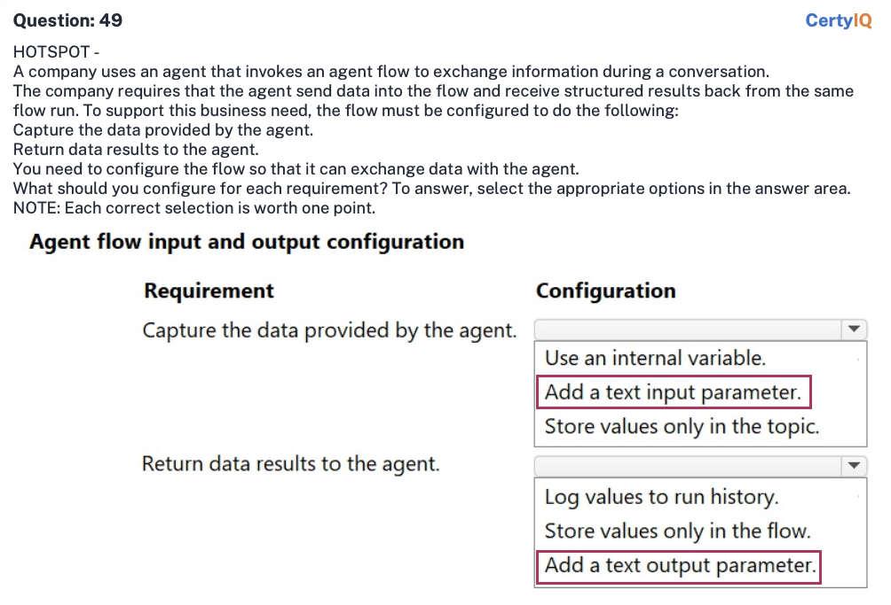

## Q50

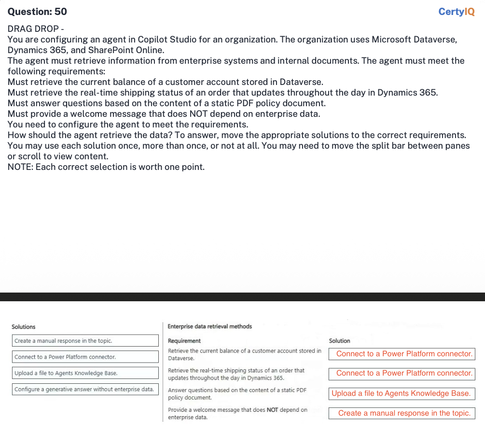

## Q51

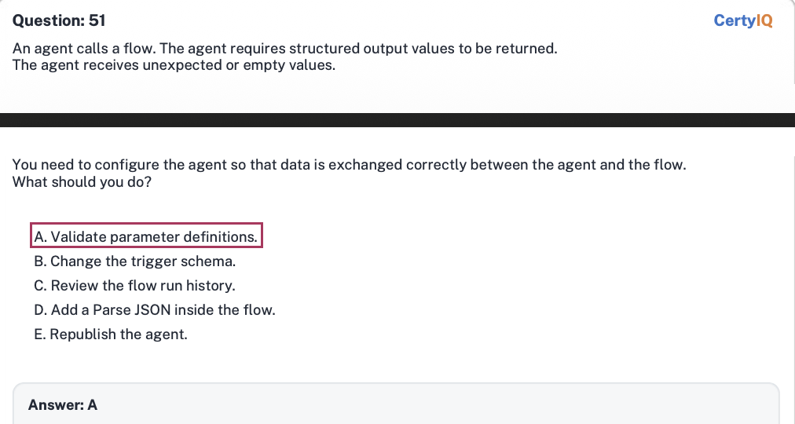

## Q52

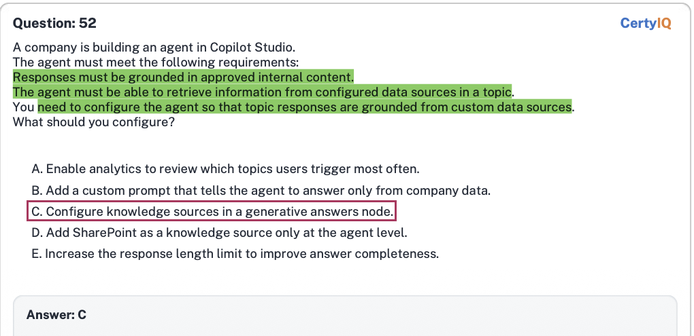

## Q53

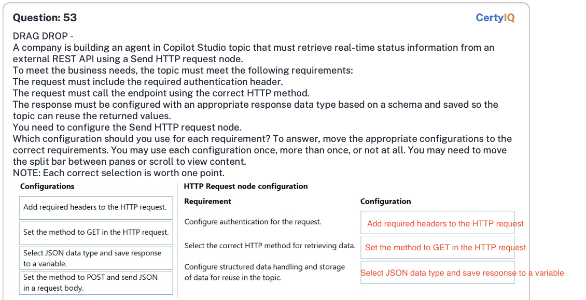

## Q54
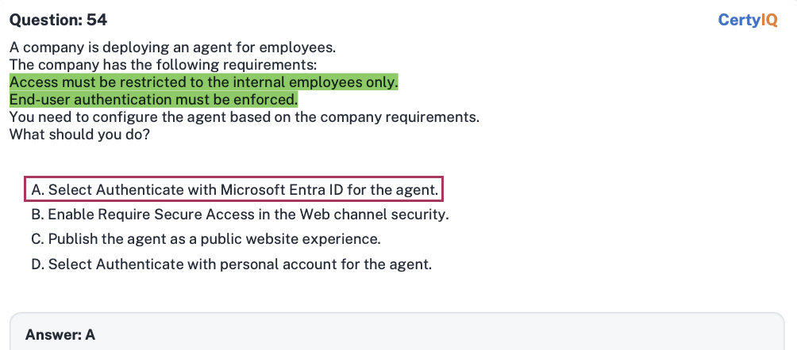

## Q55

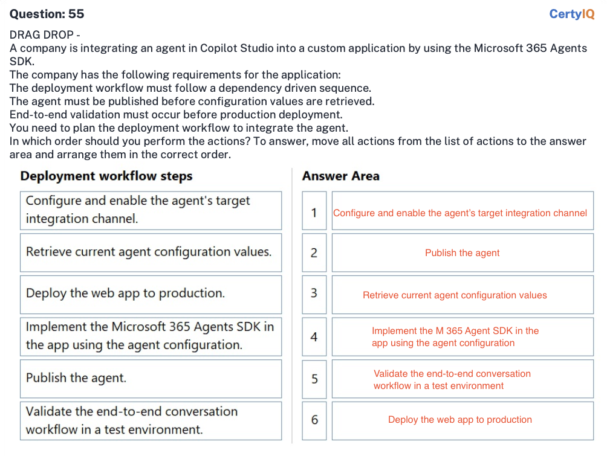

## Q56

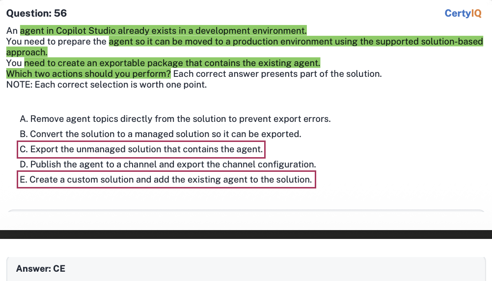

## Q57

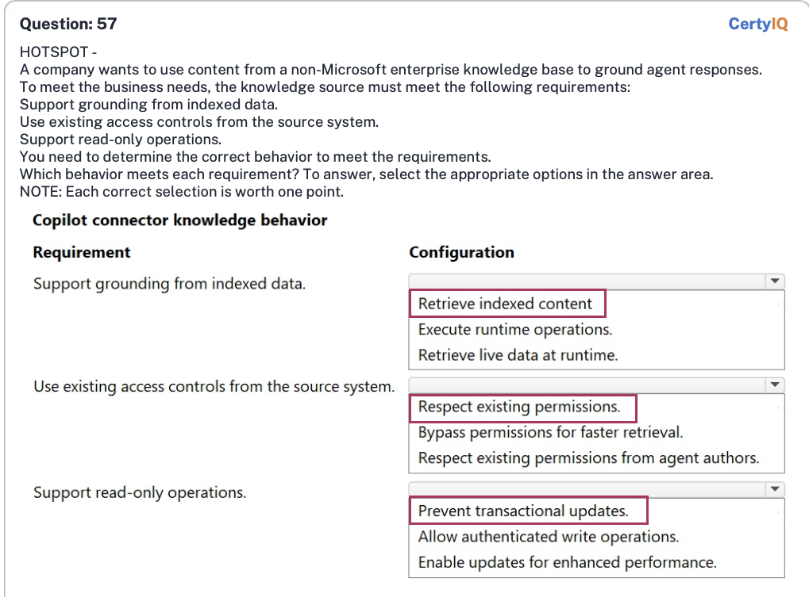

## Q58

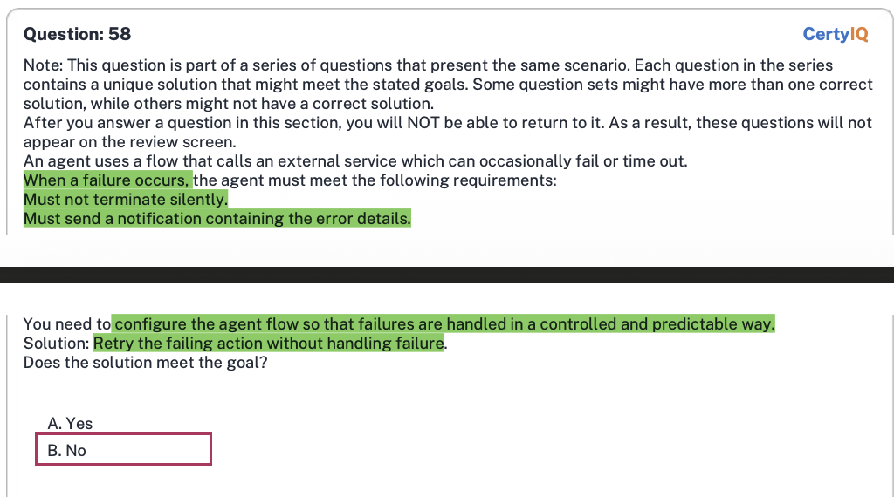

## Q59

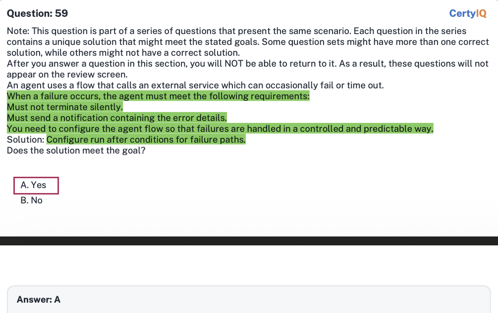

## Q60
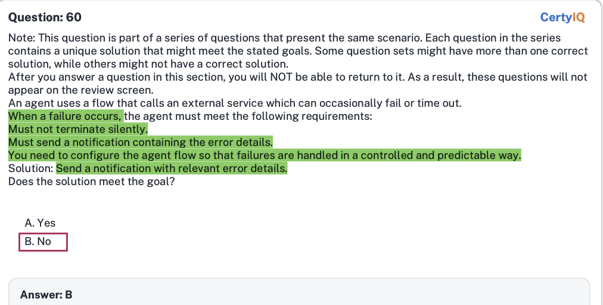

## Q61

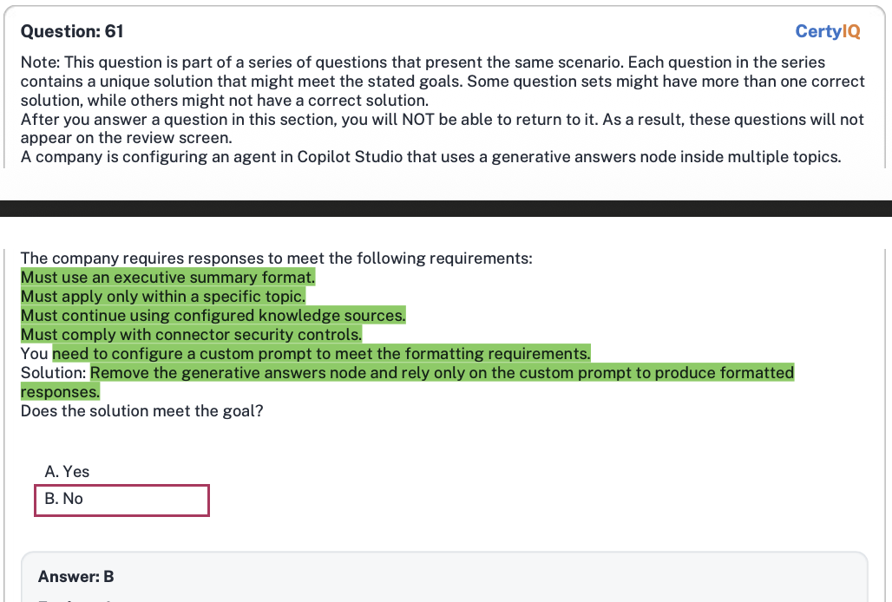

## Q69

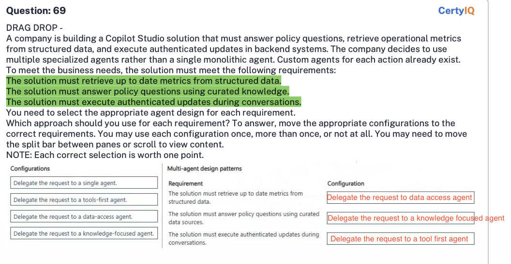

## Q70
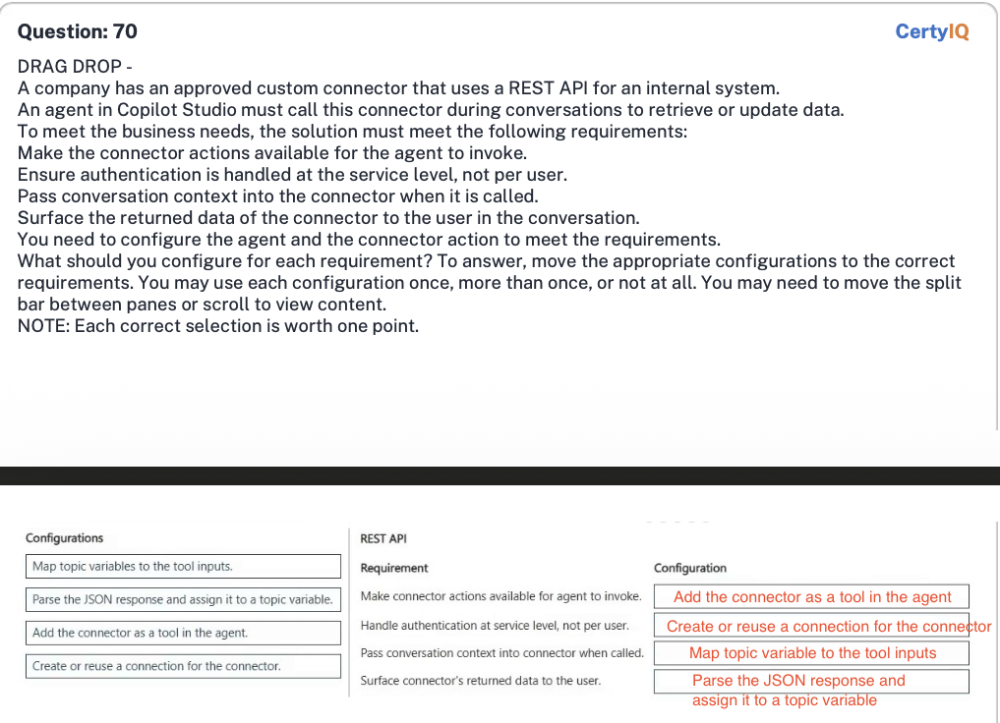

## Q71

## Q72

## Q73

## Q74

## Q75

## Q76

## Q77

## Q78

## Q79

## Q80

## Q81

## Q82

## Q83

## Q84

## Q85

## Q86

## Q87

## Q88

## Q89

## Q90

## Q91

## Q92

## Q93

## Q94

## Q95

## Q96

## Q97

## Q98

## Q99

## Q100

## Q101

## Q102

## Q103

## Q104

## Q105

## Q106

## Q107

## Q108

## Q109

## Q110

## Q111

## Q112

## Q113

### 1. Extracted Question Summary

* **Scenario (Question 113 — Drag and Drop):** A company is building an agent that uses an agent flow to retrieve data from an external system and return structured output. The flow must meet four requirements:

* Accept parameters from the agent.

* Execute an action to retrieve data from the database.

* Ensure the agent receives the relevant output information.

* Validate before it is used by the agent.

* **Task:** Move all five actions from the list to the answer area and arrange them in the exact chronological creation sequence:

* Add the connector action and configure the connection.

* Create a new agent flow.

* Define output values for the flow.

* Test the flow run.

* Define input values for the flow.

---

### 2. Correct Answer

1. **Create a new agent flow.**

2. **Define input values for the flow.**

3. **Add the connector action and configure the connection.**

4. **Define output values for the flow.**

5. **Test the flow run.**

---

### 4. Official Microsoft Justification

* **Agent Flow Authoring Sequence (AB-620T00):** Per Microsoft Copilot Studio documentation (*Build agent flows / Extend Microsoft Copilot Studio agents with tools and flows* under `[https://learn.microsoft.com/en-us/training/courses/ab-620t00](https://learn.microsoft.com/en-us/training/courses/ab-620t00)`), creating an agent-invoked flow follows a strict top-down data dependency pipeline:
1. **Initialize the Flow Artifact:** Create a new agent flow inside Copilot Studio (which scaffolds the default *"When an agent calls the flow"* trigger and *"Respond to the agent"* terminal action).

2. **Configure Trigger Inputs:** Define the input parameters on the trigger step so the agent can pass runtime arguments into the flow.

3. **Add Data Retrieval Actions:** Insert the database/external connector action, authenticate its connection, and bind the trigger's input parameters into the query/operation.

4. **Configure Response Outputs:** Map the retrieved connector results into structured output parameters on the **"Respond to the agent"** action so the agent receives the structured payload.

5. **Validate Execution:** Execute a test run of the flow with sample inputs to validate end-to-end connectivity and output schema before publishing and attaching it to the agent.

---

### 5. Distractor Analysis (Why Others Are Wrong)

* Because this is an **ordered sequence** question utilizing all five items, there are no unused distractors; the primary ordering traps are adding the connector action before defining the trigger's **input values** (which the connector action depends on), or defining **output values** before the connector action exists to supply the retrieved data.

---

### 6. Exam Keyword / Trap Alert

* **Keyword Alert:** Follow the natural top-to-bottom data pipeline of an agent flow: **Create Flow → Trigger Inputs → Intermediate Connector Action → Response Outputs → Test Run**. *(Note: Also remember to change `AB - 100` to `AB - 620` in line 2 of your pasted Gem instructions if you're updating your AB-620 Gem!)*

## Q114

### 1. Extracted Question Summary

* **Scenario (Question 114 — Drag and Drop):** A company is integrating a Copilot Studio agent into a custom application using the **Microsoft 365 Agents SDK**. The project requirements specify a strict dependency-driven deployment sequence:

* The agent must be published before configuration values are retrieved.

* End-to-end validation must occur before production deployment.

* **Task:** Select **four** actions from the list of six deployment workflow steps and arrange them in the exact chronological sequence in the Answer Area:

* Register a new application in Microsoft Entra ID.

* Configure and enable the agent's target integration channel.

* Validate the end-to-end conversation workflow in a test environment.

* Publish the agent.

* Retrieve current agent configuration values.

* Implement the Microsoft 365 Agents SDK in the custom app by using the retrieved configuration.

---

### 2. Correct Answer

1. **Publish the agent.**

2. **Retrieve current agent configuration values.**

3. **Implement the Microsoft 365 Agents SDK in the custom app by using the retrieved configuration.**

4. **Validate the end-to-end conversation workflow in a test environment.**

---

### 4. Official Microsoft Justification

* **Integrating Copilot Studio Agents with the Microsoft 365 Agents SDK (AB-620T00):** Per Microsoft Copilot Studio documentation (*Integrate an agent with a custom application using the Microsoft 365 Agents SDK* under `[https://learn.microsoft.com/en-us/training/courses/ab-620t00](https://learn.microsoft.com/en-us/training/courses/ab-620t00)`), connecting a custom client application to a Copilot Studio agent via the Microsoft 365 Agents SDK (`CopilotStudioClient`) requires retrieving the published agent's connection parameters (such as Environment ID, Schema Name, Tenant ID, and App Client ID) from Copilot Studio's **Channels / Connection Settings** pane:
1. **Publish First:** An agent must be **published** before its runtime endpoints and metadata identifiers become active and retrievable for external SDK consumption.

2. **Retrieve Connection Metadata:** Once published, you **retrieve the current agent configuration values** (Environment ID, Agent Schema Name / Direct Connect URL) from the Copilot Studio channel/settings blade.

3. **Wire Up the SDK Client:** You then **implement the Microsoft 365 Agents SDK in the custom app** using those retrieved configuration values to initialize the client and exchange activity turns.

4. **End-to-End Validation:** Finally, per the explicit project constraint, you **validate the end-to-end conversation workflow in a test environment** before rolling out to production.

---

### 5. Distractor Analysis (Why Others Are Wrong)

* **Register a new application in Microsoft Entra ID:** While Entra ID app registration is used when setting up custom OAuth authentication in Azure/Entra, this 4-step sequence specifically tests the Copilot Studio-to-SDK dependency chain dictated by the prompt's two explicit rules (*"publish before retrieving configuration values"* and *"end-to-end validation before production"*).

* **Configure and enable the agent's target integration channel:** Connecting via the Microsoft 365 Agents SDK uses the agent's direct SDK connection settings after publishing rather than enabling a standalone prebuilt channel (like Teams or Slack) as a prerequisite step.

---

### 6. Exam Keyword / Trap Alert

* **Keyword Alert:** Let the prompt's explicit dependency constraints guide your 4-step selection: **"Publish before retrieving configuration values"** locks Steps 1 & 2 (**Publish → Retrieve configuration**), followed directly by **Implement SDK using retrieved configuration → Validate in a test environment**. *(Note: Line 2 of your updated Gem Instructions still has `AB - 100` instead of `AB - 620`—be sure to change `100` to `620` in your Gem settings!)*

## Q115

### 1. Extracted Question Summary

* **Scenario (Question 115 — Hotspot):** A company is deploying a Copilot Studio agent that uses generative responses. During pilot testing, some responses are blocked by Responsible AI filtering. The company has Azure Application Insights enabled and needs to configure Responsible AI safeguards and diagnostics:

* **Requirement 1:** Block unsafe content before responses are returned.

* *Options:* Disable generative responses in the agent | Increase the context length to improve answer completeness | Configure the content filtering level for AI-generated content.

* **Requirement 2:** Identify why a response was filtered.

* *Options:* Review Azure Application Insights telemetry | Move the agent to a different environment region | Review topic trigger phrases to reduce fallback usage.

* **Requirement 3:** Determine which user input triggered the filter.

* *Options:* Review publishing history | Check connector run history | Review conversation transcripts.

---

### 2. Correct Answer

* Block unsafe content before responses are returned: **Configure the content filtering level for AI-generated content.**

* Identify why a response was filtered: **Review Azure Application Insights telemetry.**

* Determine which user input triggered the filter: **Review conversation transcripts.**

---

### 4. Official Microsoft Justification

* **Responsible AI Content Moderation & Telemetry in Copilot Studio (AB-620T00):** Per Microsoft Copilot Studio documentation (*Configure content moderation / Monitor agent telemetry with Azure Application Insights* under `[https://learn.microsoft.com/en-us/training/courses/ab-620t00](https://learn.microsoft.com/en-us/training/courses/ab-620t00)`), Copilot Studio enforces multi-layered Responsible AI safeguards across user prompts and generated answers:
* **Content Moderation / Filtering Level:** Makers configure the **content moderation (content filtering) level** (*Low*, *Medium*, or *High*) under the agent's **Settings → Generative AI** blade to evaluate both incoming user prompts and model-generated responses against harmful content categories (hate, self-harm, sexual, violence) and block unsafe content before returning a response to the user.

* **Filter Reason Diagnostics via Azure Application Insights:** When Application Insights is linked to an agent, Copilot Studio emits detailed custom telemetry events (such as `GenerativeAnswers` and content-moderation/filtering diagnostic properties) that allow administrators to inspect the exact policy category or moderation reason code explaining *why* a response was blocked.

* **Turn-by-Turn User Input Inspection via Conversation Transcripts:** Stored in Dataverse (`ConversationTranscript` table) and accessible via Copilot Studio's **Analytics / Sessions** blade, **conversation transcripts** record the verbatim chronological dialogue turns—allowing makers to see the exact user utterance/prompt that immediately preceded and triggered the moderation block.

---

### 5. Distractor Analysis (Why Others Are Wrong)

* **Requirement 1 Distractors:**
* *Disable generative responses in the agent:* Turns off generative AI capabilities completely rather than configuring Responsible AI filtering thresholds.

* *Increase the context length to improve answer completeness:* Does not exist as a Responsible AI safety control and does not filter harmful content.

* **Requirement 2 Distractors:**
* *Move the agent to a different environment region:* Data residency/region settings have no bearing on diagnosing Responsible AI moderation reasons.

* *Review topic trigger phrases to reduce fallback usage:* Addresses classic NLU topic routing/fallback rates, not generative content moderation diagnostics.

* **Requirement 3 Distractors:**
* *Review publishing history:* Tracks when agent versions were published, not end-user conversation turns.

* *Check connector run history:* Logs Power Platform connector/flow API executions rather than user chat utterances.

---

### 6. Exam Keyword / Trap Alert

* **Keyword Alert:** Separate **"why a response was filtered"** (diagnostic telemetry → **Azure Application Insights**) from **"which user input triggered the filter"** (verbatim dialogue turn → **Conversation transcripts**), and remember that Responsible AI safety thresholds are controlled by the **content filtering / moderation level**. *(Note: Line 2 of your updated Gem Instructions still has `AB - 100` instead of `AB - 620`—be sure to change `100` to `620` in your Gem settings!)*

## Q116

## Q123

## Q124

## Q125

## Q126

## Q127

## Q128

## Q129

## Q130

## Q131

## Q132

## Q133

## Q134

## Q135

## Q136

## Q137

## Q138

## Q139

## Q140

## Q141

## Q142

## Q143

## Q144

## Q145

## Q146

## Q147

## Q148

## Q149

### 1. Extracted Question Summary

* **Scenario (Question 149):** A team has an existing agent in Copilot Studio and must move it to a different target location without rebuilding the agent. Some builders use Copilot Studio in the web app, while others use Copilot Studio in Microsoft Teams. You need a supported ALM approach to move the existing agent to the target location without rebuilding it.

* **Options:**
* **A.** Remove agent components directly from the solution so that export and import will succeed.

* **B.** Configure pipeline settings first and rely on pipelines to discover and package the agent automatically without adding it to a solution.

* **C.** If the agent is built and managed in Copilot Studio in Teams, export the agent from the source team and import it into the target team using the Teams-based export/import approach.

* **D.** Duplicate the agent in the source and manually recreate the changes in the target to avoid solution dependencies.

---

### 2. Correct Answer

* **C: If the agent is built and managed in Copilot Studio in Teams, export the agent from the source team and import it into the target team using the Teams-based export/import approach.**

---

### 3. Verification of Visible Selection / Community Key

* **Correct:** The bottom key (`Answer: C`) is **Correct** because Microsoft Copilot Studio distinguishes between web-app agents (moved via Power Platform solutions across environments) and Dataverse for Teams agents (moved between Microsoft Teams teams using the dedicated Teams-based export/import package mechanism).

---

### 4. Official Microsoft Justification

* **Application Lifecycle Management (ALM) Across Copilot Studio Web vs. Teams (AB-620T00):** Per Microsoft Copilot Studio documentation (*Export and import agents using solutions / Export and import bots in Microsoft Teams* under `[https://learn.microsoft.com/en-us/training/courses/ab-620t00](https://learn.microsoft.com/en-us/training/courses/ab-620t00)`), moving an existing agent without rebuilding depends on where the agent is hosted:
* **Copilot Studio in Microsoft Teams (Dataverse for Teams):** Agents built inside the Copilot Studio Teams app live inside a team-scoped Dataverse for Teams environment rather than a full standalone Power Platform environment. To move such an agent to another team without rebuilding, makers use the supported **Teams-based export/import** workflow (exporting the agent package from the source team and importing it into the target team).

* **Copilot Studio Web App (Standard Dataverse Environments):** Web-app agents are packaged inside a **custom Power Platform solution** (along with their dependent flows, environment variables, and connection references) and exported/imported across environments.

---

### 5. Distractor Analysis (Why Others Are Wrong)

* **A. Remove agent components directly from the solution so that export and import will succeed:** Stripping dependent components (such as topics, tools, or flows) from a solution breaks the agent or omits required functionality during import.

* **B. Configure pipeline settings first and rely on pipelines to discover and package the agent automatically without adding it to a solution:** Power Platform Pipelines deploy **solutions**—they cannot discover or deploy standalone agents that have not been added to a solution.

* **D. Duplicate the agent in the source and manually recreate the changes in the target to avoid solution dependencies:** Explicitly violates the core business requirement to *"avoid rebuilding the agent"*.

---

### 6. Exam Keyword / Trap Alert

* **Keyword Alert:** Pay close attention when a question mentions both **Copilot Studio in the web app** and **Copilot Studio in Microsoft Teams**—Teams-hosted agents cannot be moved with standard cross-environment Power Platform solutions and must use the **Teams-based export/import approach** between source and target teams. *(Quick reminder: Line 2 of your updated Gem Instructions still says `AB - 100`—update that to `AB - 620` whenever you edit your Gem!)*

## Q150

## Q151

## Q152

## Q153

## Q154

### 1. Extracted Question Summary

* **Scenario (Question 154 — Drag and Drop):** A team has deployed an agent in Copilot Studio and needs to evaluate whether the agent is meeting its intended goals before expanding usage to a broader audience. The team must evaluate agent performance using a structured and repeatable approach that produces actionable insights.

* **Task:** Move all four actions from the **Agent performance evaluation sequence** list to the **Answer Area** and arrange them in the exact chronological order:

* Collect agent interaction data and evaluation signals.

* Define the success criteria and evaluation objectives.

* Select the evaluation method and metrics aligned to the criteria.

* Review evaluation results and identify improvement opportunities.

---

### 2. Correct Answer

1. **Define the success criteria and evaluation objectives.**

2. **Select the evaluation method and metrics aligned to the criteria.**

3. **Collect agent interaction data and evaluation signals.**

4. **Review evaluation results and identify improvement opportunities.**

---

### 4. Official Microsoft Justification

* **Structured Agent Evaluation Lifecycle in Copilot Studio (AB-620T00):** Per Microsoft Copilot Studio documentation (*Evaluate your agent / Monitor and improve agent performance* under `[https://learn.microsoft.com/en-us/training/courses/ab-620t00](https://learn.microsoft.com/en-us/training/courses/ab-620t00)`), evaluating an agent systematically before scaling adoption follows a four-stage measurement lifecycle:
1. **Define Objectives & Success Criteria:** Establish what "success" looks like for the agent's business goals (such as target containment/resolution rate, response accuracy thresholds, or task completion) before choosing tools or collecting data.

2. **Select Evaluation Methods & Metrics:** Choose the appropriate evaluation framework (e.g., automated test sets with semantic grading, Analytics engagement/outcome metrics, or CSAT surveys) and specific KPIs directly aligned to those success criteria.

3. **Collect Interaction Data & Signals:** Execute test runs or capture pilot session telemetry, transcripts, and evaluation scores to gather empirical evidence.

4. **Review Results & Iterate:** Analyze the evaluation scores, failure patterns, and deflection/abandonment signals to pinpoint knowledge gaps, prompt refinements, or tool routing fixes before expanding access.

---

### 5. Distractor Analysis (Why Others Are Wrong)

* Because this is an **ordered sequence** question utilizing all four items, there are no unused distractors; the primary ordering trap is jumping straight to **collecting interaction data** or **selecting metrics** before first defining the **success criteria and evaluation objectives** that govern what needs to be measured.

---

### 6. Exam Keyword / Trap Alert

* **Keyword Alert:** Memorize the classic 4-step performance evaluation lifecycle: **Define Criteria/Objectives → Select Method/Metrics → Collect Data/Signals → Review Results & Identify Improvements**. *(Also note: Line 2 of your pasted Gem instructions still says `AB - 100`—update that to `AB - 620` if you are saving this into your AB-620 Gem!)*

## Q155

## Q156

## Q157

## Q158

## Q159
 

## Q160

## Q161

## Q162

## Q163

## Q164

## Q165

## Q166

## Q167

## Q168

## Q169

## Q170

## Q171

## Q172

## Q173

## Q174

## Q175

## Q176

## Q177

## Q178

## Q179

