# Question Answers

## Q2

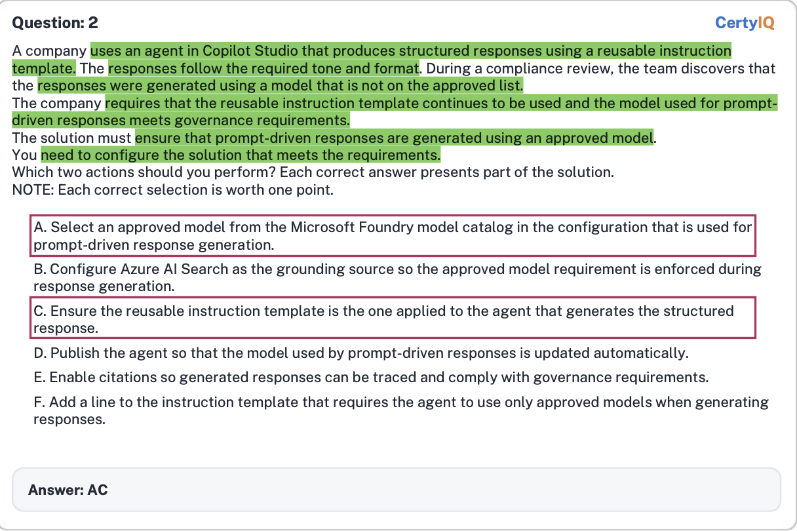

### 1. Extracted Question Summary

* **Scenario:** A company uses a Microsoft Copilot Studio agent that generates structured responses via a reusable instruction template (AI prompt) matching a required tone and format. A compliance review reveals that the underlying generative model used for these prompt-driven responses is not on the company's approved list. You must ensure the existing reusable instruction template remains in use while enforcing that prompt-driven responses are generated using an approved model.

* **Question:** Which two actions should you perform? (Each correct answer presents part of the solution.)

* **Options:**
* **A.** Select an approved model from the Microsoft Foundry model catalog in the configuration that is used for prompt-driven response generation.

* **B.** Configure Azure AI Search as the grounding source so the approved model requirement is enforced during response generation.

* **C.** Ensure the reusable instruction template is the one applied to the agent that generates the structured response.

* **D.** Publish the agent so that the model used by prompt-driven responses is updated automatically.

* **E.** Enable citations so generated responses can be traced and comply with governance requirements.

* **F.** Add a line to the instruction template that requires the agent to use only approved models when generating responses.

* **Visible Answer in Screenshot:** `Answer: AC`

---

### 2. Correct Answer

* A: Select an approved model from the Microsoft Foundry model catalog in the configuration that is used for prompt-driven response generation.

* C: Ensure the reusable instruction template is the one applied to the agent that generates the structured response.

---

### 3. Verification of Visible Selection / Community Key

* **Correct.** The visible key (`AC`) accurately identifies the two architectural actions required: explicitly binding the approved model from the Microsoft Foundry (formerly Azure AI Foundry) model catalog to the prompt configuration (**A**), and ensuring that specific configured prompt/instruction template is the one bound to the agent (**C**).

---

### 4. Official Microsoft Justification

* **Model Selection for Custom Prompts (AI Builder / Copilot Studio):** In Microsoft Copilot Studio (covered under the **AB-620T00** curriculum for creating custom prompts and extending agents with Microsoft Foundry models), reusable instruction templates are implemented as **Custom Prompts** (AI prompts). Within the prompt builder settings, makers can override the default managed model by connecting to and selecting a specific model from the **Microsoft Foundry model catalog** (such as a specific GPT or third-party enterprise-approved deployment) so that every invocation of that prompt strictly executes against the governed model (**A**).

* **Prompt-to-Agent Binding:** Because custom prompts are standalone, reusable assets across Power Platform and Copilot Studio, configuring the model on the prompt asset alone does not take effect unless that exact prompt/instruction template is actively referenced and invoked as an action/tool within the target Copilot Studio agent (**C**).

---

### 5. Distractor Analysis (Why Others Are Wrong)

* **B:** Azure AI Search is a **knowledge/grounding data source** used for Retrieval-Augmented Generation (RAG); grounding controls *what data* the agent retrieves, not *which foundation model* processes the prompt.

* **D:** Publishing an agent pushes existing configurations to live channels; it does not automatically swap or govern underlying foundation models.

* **E:** Enabling citations improves transparency and source attribution for grounding data, but it has no mechanism to restrict or select which LLM generates the response.

* **F:** Natural language system instructions cannot dynamically change the underlying inference endpoint or model deployment at runtime; model selection is an infrastructure/configuration property, not a prompt-engineering directive.

---

### 6. Exam Keyword / Trap Alert

* **Keywords:** *"reusable instruction template"* = **Custom Prompt**; *"approved list / governance requirements"* + *"prompt-driven responses"* = **Microsoft Foundry model catalog** selection.
* **Trap:** Do not fall for prompt-injection/instruction-based governance (**F**) or RAG grounding sources (**B**) when a question asks how to enforce which **LLM/model** is used—model governance in Copilot Studio is always controlled via model selection settings (Microsoft Foundry / generative AI model settings), never via prompt text or knowledge sources.

## Q3

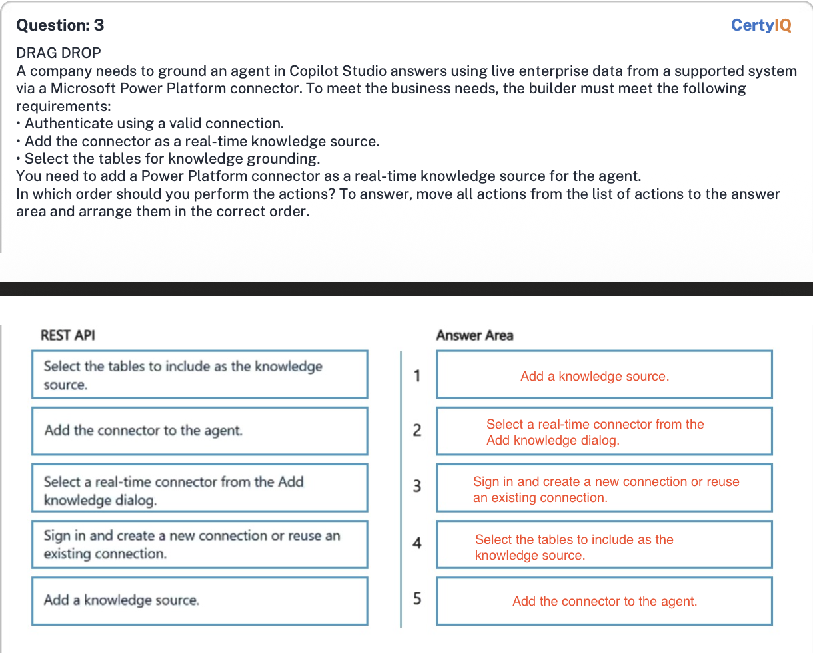

### 1. Extracted Question Summary

* **Scenario:** A company needs to ground a Microsoft Copilot Studio agent using live enterprise data from a supported system via a Microsoft Power Platform connector. The builder must authenticate using a valid connection, add the connector as a real-time knowledge source, and select the tables for knowledge grounding.

* **Question (Drag and Drop):** In which order should you perform the actions? Move all actions from the list of actions to the answer area and arrange them in the correct order.

* **Available Actions (Left Column):**
* Select the tables to include as the knowledge source.

* Add the connector to the agent.

* Select a real-time connector from the Add knowledge dialog.

* Sign in and create a new connection or reuse an existing connection.

* Add a knowledge source.

---

### 2. Correct Answer

* **Position 1:** **Add a knowledge source.**

* **Position 2:** **Select a real-time connector from the Add knowledge dialog.**

* **Position 3:** **Sign in and create a new connection or reuse an existing connection.**

* **Position 4:** **Select the tables to include as the knowledge source.**

* **Position 5:** **Add the connector to the agent.**

---

### 4. Official Microsoft Justification

* **Real-Time Connector Knowledge Configuration Flow (`AB-620T00` — Add knowledge sources to an agent):** In Microsoft Copilot Studio, connecting live enterprise data without copying/ingesting it into Dataverse uses **Real-time connectors** (such as Salesforce, ServiceNow, Zendesk, or Azure SQL Server). The wizard enforces a strict sequential UI workflow:

1. **Initiate Knowledge Creation:** Inside the agent's **Knowledge** page (or Overview -> Knowledge section), you start by selecting **+ Add knowledge** (`Add a knowledge source`).

2. **Choose Connector Type:** In the **Add knowledge** dialog, you browse or search under the enterprise/real-time connectors section and select the target real-time connector (`Select a real-time connector from the Add knowledge dialog`).

3. **Authenticate Connection:** Before Copilot Studio can inspect the schema or metadata of the external source, you must establish an authenticated session (`Sign in and create a new connection or reuse an existing connection`).

4. **Scope the Schema:** Once connected, the wizard queries the live system and prompts you to choose which specific tables/objects the agent is permitted to query at runtime (`Select the tables to include as the knowledge source`).

5. **Finalize & Save:** Finally, you confirm the configuration and click **Add** (or **Add to agent**) to bind the real-time knowledge source to the agent (`Add the connector to the agent`).

---

### 5. Distractor Analysis (Why Others Are Wrong)

* Because this is a **sequencing (Drag-and-Drop) question** requiring all five actions, every block is used; the primary failure mode is misordering steps 3, 4, and 5:
* **Selecting tables before authenticating:** Impossible in the Copilot Studio UI—the table picker cannot enumerate external tables until a valid connection is authenticated in Step 3.

* **Adding the connector to the agent before selecting tables:** In real-time connector setup, table selection happens *inside* the configuration modal *before* the final **Add** button commits the knowledge source to the agent.

---

### 6. Exam Keyword / Trap Alert

* **Keywords:** *"ground an agent... using live enterprise data"* + *"Power Platform connector"* + *"real-time knowledge source"*.

* **Trap:** Do not confuse **Real-time connectors** (which query live data at runtime without data ingestion and require selecting tables during setup) with **Dataverse / SharePoint / Uploaded files** or **Connector Actions (Tools)** (which execute read/write operations inside topics or generative orchestration rather than acting as passive knowledge grounding). Always remember the UI sequence: **Open Add Knowledge → Pick Connector → Authenticate → Pick Tables → Add to Agent**.

## Q4

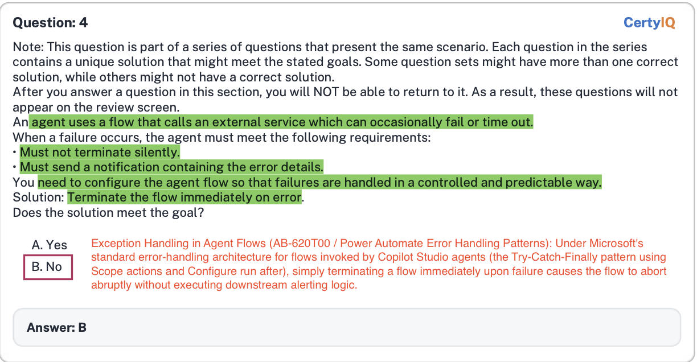

### 1. Extracted Question Summary

* **Scenario:** An agent uses a flow (agent flow / Power Automate cloud flow) that calls an external service capable of occasional failures or timeouts. When a failure occurs, the agent must not terminate silently and must send a notification containing the error details.

* **Proposed Solution:** Terminate the flow immediately on error.

* **Question:** Does the solution meet the goal?

* **Options:**
* **A.** Yes

* **B.** No

* **Visible Answer in Screenshot:** `Answer: B`

---

### 2. Correct Answer

* **B: No**

---

### 3. Verification of Visible Selection / Community Key

* **Correct.** The visible key (`B`) is accurate because terminating the flow immediately on error halts execution without capturing exception metadata or sending the required error notification.

---

### 4. Official Microsoft Justification

* **Exception Handling in Agent Flows (`AB-620T00` / Power Automate Error Handling Patterns):** Under Microsoft's standard error-handling architecture for flows invoked by Copilot Studio agents (the **Try-Catch-Finally** pattern using **Scope** actions and **Configure run after**), simply terminating a flow immediately upon failure causes the flow to abort abruptly without executing downstream alerting logic.
* **Meeting Both Requirements:** To prevent silent termination and send a notification with error details, you must wrap the external service call in a **Try** Scope, add a parallel/subsequent **Catch** Scope configured via **Configure run after** (`has failed` / `has timed out`), extract the failure payload using `result('Try')`, send the notification, and optionally return structured error outputs back to the Copilot Studio agent before terminating gracefully.

---

### 5. Distractor Analysis (Why Others Are Wrong)

* **A (Yes):** Incorrect because an immediate `Terminate` action on error halts the run instantly—skipping any notification action and failing to capture or pass along the diagnostic error details required by the scenario.

---

### 6. Exam Keyword / Trap Alert

* **Keywords:** *"must not terminate silently"* + *"send a notification containing the error details"* + *"handled in a controlled and predictable way"*.

* **Trap:** In Microsoft "Does the solution meet the goal?" series questions, any proposed solution that merely calls **Terminate** without a **Scope** + **Configure run after** error-handling branch will always fail notification/recovery requirements.

## Q5

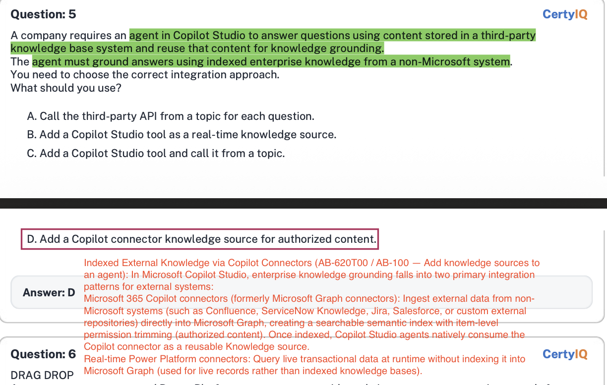

### 1. Extracted Question Summary

* **Scenario:** A company requires a Microsoft Copilot Studio agent to answer questions using content stored in a third-party knowledge base system and reuse that content for knowledge grounding. Specifically, the agent must ground answers using **indexed enterprise knowledge from a non-Microsoft system**. You need to choose the correct integration approach.

* **Question:** What should you use?

* **Options:**
* **A.** Call the third-party API from a topic for each question.

* **B.** Add a Copilot Studio tool as a real-time knowledge source.

* **C.** Add a Copilot Studio tool and call it from a topic.

* **D.** Add a Copilot connector knowledge source for authorized content.

* **Visible Answer in Screenshot:** `Answer: D`

---

### 2. Correct Answer

* **D: Add a Copilot connector knowledge source for authorized content.**

---

### 3. Verification of Visible Selection / Community Key

* **Correct.** The visible key (`D`) is accurate because **Microsoft 365 Copilot connectors** (formerly Microsoft Graph connectors) specifically ingest and **index** external, non-Microsoft enterprise content into the Microsoft Graph semantic index while honoring Access Control Lists (ACLs) for authorized grounding.

---

### 4. Official Microsoft Justification

* **Indexed External Knowledge via Copilot Connectors (`AB-620T00` / `AB-100` — Add knowledge sources to an agent):** In Microsoft Copilot Studio, enterprise knowledge grounding falls into two primary integration patterns for external systems:
1. **Microsoft 365 Copilot connectors (formerly Microsoft Graph connectors):** Ingest external data from non-Microsoft systems (such as Confluence, ServiceNow Knowledge, Jira, Salesforce, or custom external repositories) directly into Microsoft Graph, creating a **searchable semantic index** with item-level permission trimming (**authorized content**). Once indexed, Copilot Studio agents natively consume the Copilot connector as a reusable **Knowledge source**.
2. **Real-time Power Platform connectors:** Query live transactional data at runtime without indexing it into Microsoft Graph (used for live records rather than indexed knowledge bases).

* Because the scenario explicitly mandates **"indexed enterprise knowledge from a non-Microsoft system"** for reusable knowledge grounding, adding a **Copilot connector** as a knowledge source (**D**) is the exact architectural pattern prescribed by Microsoft Learn.

---

### 5. Distractor Analysis (Why Others Are Wrong)

* **A:** Calling a third-party REST API manually inside a topic for every question bypasses Copilot Studio's native generative orchestration and semantic RAG indexing, requiring custom orchestration and manual token/payload parsing per turn.

* **B:** Copilot Studio **tools** (actions/connectors/flows) execute discrete operational tasks or real-time queries rather than functioning as an **indexed** enterprise knowledge base source.

* **C:** Explicitly invoking a tool inside a deterministic topic is designed for imperative workflow execution (e.g., creating a ticket or updating a record), not passive, indexed knowledge grounding across user queries.

---

### 6. Exam Keyword / Trap Alert

* **Keywords:** *"indexed enterprise knowledge from a non-Microsoft system"* + *"authorized content"* = **Copilot connector** (formerly Microsoft Graph connector).

* **Trap:** Distinguish carefully between **Copilot connectors** (**indexed** external content ingested into Microsoft Graph with ACL security trimming) and **Real-time Power Platform connectors** (**live, unindexed** operational data queried on demand). Whenever an exam prompt mentions **"indexed"** third-party content, the answer is always a **Copilot connector**.

### 1. Does the First Pattern (Copilot Connectors) Support CRUD Operations?

* **Correct—it does NOT support CRUD operations.**
* **Microsoft 365 Copilot connectors** (formerly Microsoft Graph connectors) are strictly **read-only semantic ingestion pipelines**. They crawl external repositories on a schedule, copy the content and ACLs into the Microsoft Graph semantic index, and expose that index to the agent purely for **RAG (Retrieval-Augmented Generation)** grounding. They have zero write-back or transactional execution capability.

---

### 2. Does the Second Pattern (Power Platform Connectors) Support CRUD?

* **Yes—with an important architectural distinction between *Knowledge* and *Tools (Actions)*:**
* **When added under `Knowledge` (Real-time Knowledge Source):** The connector operates in **read-only query mode**. Copilot Studio indexes only the table/column metadata and translates natural-language user questions into live read queries at runtime (respecting row-level/user-level permissions) without moving data. You cannot perform Create, Update, or Delete operations through the `Knowledge` abstraction.
* **When added under `Tools` (formerly Actions) or invoked via Agent Flows:** This is where **full CRUD (Create, Read, Update, Delete)** happens. Because it uses the exact same underlying Power Platform connector infrastructure, adding connector operations as **Tools** (for generative orchestration) or calling them inside **Topics / Agent Flows** enables full transactional write-backs (e.g., creating a ServiceNow ticket, updating a Salesforce Opportunity, or inserting a SQL row).

| Capability / Dimension | Pattern 1: M365 Copilot Connectors | Pattern 2A: Power Platform Connector as **Knowledge** | Pattern 2B: Power Platform Connector as **Tool / Flow** |
| --- | --- | --- | --- |
| **Primary Purpose** | Indexed semantic search & Q&A | Live, zero-copy read grounding | Transactional execution & orchestration |
| **CRUD Support** | **Read-only** (from Graph index) | **Read-only** (live query at runtime) | **Full CRUD** (Create, Read, Update, Delete) |
| **Data Movement** | Copied into Microsoft Graph index | None (metadata indexed; data queried live) | None (API payload passed per action) |
| **Security Context** | Crawled ACLs enforced in Graph | End-user connection identity at runtime | End-user or Maker/Service Principal connection |

---

### 3. Are All 1,500+ Power Platform Connectors Available?

* **For `Tools` / `Agent Flows` (CRUD & Actions): Yes.** You have access to the full catalog of **1,400–1,500+ standard and premium Power Platform connectors** (plus Custom Connectors and MCP servers) used across Power Apps and Power Automate.
* **For `Real-Time Knowledge Sources`: No—only a curated subset is supported.** To act as a *Knowledge* source (where the LLM automatically generates structured queries against tables without you building explicit tool parameters), the connector must expose tabular/entity metadata that Copilot Studio's query planner understands.
* **Supported Real-Time Knowledge Connectors:**
* **Enterprise CRM & ITSM:** Salesforce, ServiceNow, Zendesk, Dynamics 365
* **Databases & Data Warehouses:** Azure SQL Server, SQL Server (on-premises via gateway), Oracle Database, PostgreSQL, MySQL, Azure Databricks, Snowflake, BigQuery
* **ERP & Line-of-Business:** SAP ERP, Workday, Jira, Confluence (Cloud/Server), Azure DevOps

---

### 4. Exam Tip (AB-620 / AB-100)

* When an exam scenario asks for **grounded Q&A** on tabular/live enterprise data without copying data, choose **Power Platform Connector → Knowledge**.
* When an exam scenario asks the agent to **modify, create, submit, or update records** (CRUD) in an external system, choose **Power Platform Connector → Tool (Action)** or **Agent Flow**—never a Knowledge source.

## Q7

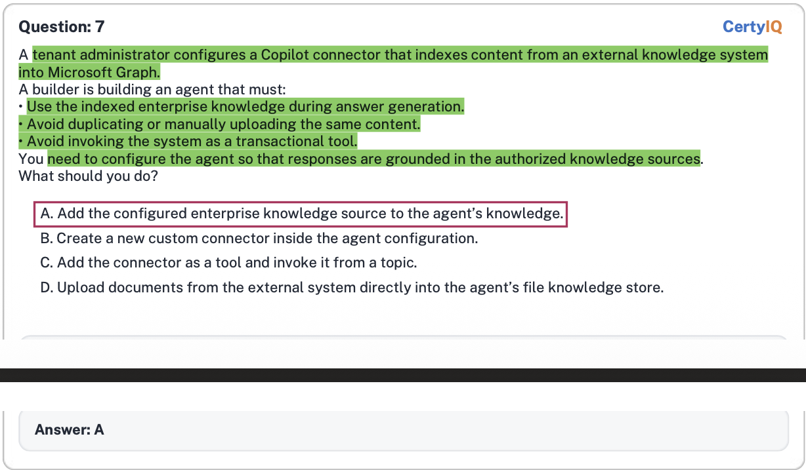

### 1. Extracted Question Summary

* **Scenario:** A tenant administrator has already configured a **Copilot connector** that indexes content from an external knowledge system into Microsoft Graph. A builder is creating an agent that must use this indexed enterprise knowledge during answer generation, avoid duplicating or manually uploading the same content, and avoid invoking the system as a transactional tool.

* **Question:** You need to configure the agent so that responses are grounded in the authorized knowledge sources. What should you do?

* **Options:**
* **A.** Add the configured enterprise knowledge source to the agent's knowledge.

* **B.** Create a new custom connector inside the agent configuration.

* **C.** Add the connector as a tool and invoke it from a topic.

* **D.** Upload documents from the external system directly into the agent's file knowledge store.

* **Visible Markings / Answer in Screenshot:** Option **A** is boxed in red and `Answer: A` is displayed at the bottom.

---

### 2. Correct Answer

* **A: Add the configured enterprise knowledge source to the agent's knowledge.**

---

### 3. Verification of Visible Selection / Community Key

* **Correct.** Both the red box around Option **A** and the visible key (`Answer: A`) are accurate because once a tenant administrator indexes an external repository into Microsoft Graph via a Copilot connector, the agent builder simply attaches that existing enterprise knowledge source under the agent's **Knowledge** configuration.

---

### 4. Official Microsoft Justification

* **Enterprise Knowledge Grounding & Copilot Connectors (`AB-620T00` — Integrate and extend agents in Copilot Studio > Connect to enterprise knowledge sources):** Under Microsoft's governance model, **Microsoft 365 Copilot connectors** (formerly Microsoft Graph connectors) are configured and crawled at the tenant level by an administrator in the Microsoft 365 admin center, indexing external content alongside its native Access Control Lists (ACLs) into Microsoft Graph.
* Once indexed, agent makers consume that connection directly in Copilot Studio by selecting **Knowledge → + Add knowledge** and choosing the configured enterprise knowledge source (`Add the configured enterprise knowledge source to the agent's knowledge`). This provides zero-duplication, ACL-trimmed semantic RAG grounding across generative answers without invoking transactional API calls.

---

### 5. Distractor Analysis (Why Others Are Wrong)

* **B:** Creating a new custom connector builds a Power Platform REST API wrapper for live transactional actions, redundantly bypassing the Microsoft Graph index already provisioned by the tenant administrator.

* **C:** Adding the connector as a **Tool** and invoking it inside a topic executes imperative/transactional operations, which directly violates the explicit constraint to *"Avoid invoking the system as a transactional tool"*.

* **D:** Manually uploading files into the agent's Dataverse-backed file knowledge store violates the requirement to *"Avoid duplicating or manually uploading the same content"* and strips away dynamic synchronization and ACL permission trimming.

---

### 6. Exam Keyword / Trap Alert

* **Keywords:** *"tenant administrator configures a Copilot connector that indexes content... into Microsoft Graph"* + *"Avoid duplicating or manually uploading"* + *"Avoid invoking the system as a transactional tool"*.

* **Trap:** Always separate **Admin** vs. **Maker** responsibilities and **Knowledge** vs. **Tools** abstractions—Admins provision and index Copilot connectors into Microsoft Graph, while Makers attach them under **Knowledge** (never as a **Tool** or manual file upload).

## Q8

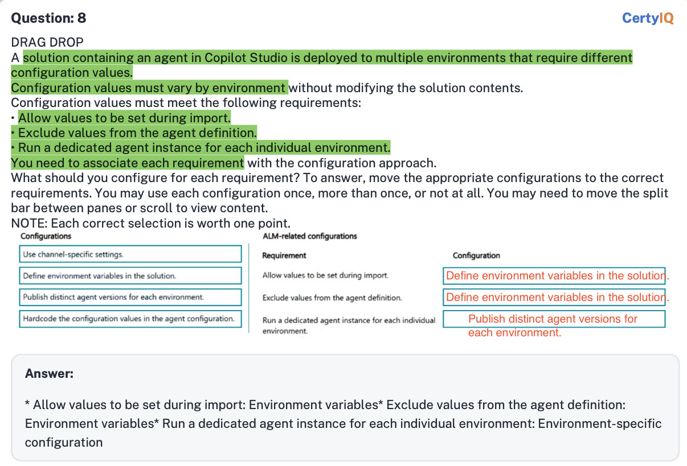

### 1. Extracted Question Summary

* **Scenario:** A Power Platform solution containing a Microsoft Copilot Studio agent is deployed across multiple environments (e.g., Dev, Test, Prod) that require different configuration values without modifying the underlying solution contents.

* **Question (Drag and Drop):** Associate each ALM-related requirement with its appropriate configuration approach (options on the left may be used once, more than once, or not at all).

* **Available Configurations (Left Column):**
* Use channel-specific settings.

* Define environment variables in the solution.

* Publish distinct agent versions for each environment.

* Hardcode the configuration values in the agent configuration.

* **Target Requirements (Right Table):**
1. Allow values to be set during import.

2. Exclude values from the agent definition.

3. Run a dedicated agent instance for each individual environment.

* **Visible Answer in Screenshot:**
* Allow values to be set during import: Environment variables

* Exclude values from the agent definition: Environment variables

* Run a dedicated agent instance for each individual environment: Environment-specific configuration *(Note: paraphrases the left-pane box)*

---

### 2. Correct Answer

* **Allow values to be set during import:** **Define environment variables in the solution.**

* **Exclude values from the agent definition:** **Define environment variables in the solution.**

* **Run a dedicated agent instance for each individual environment:** **Publish distinct agent versions for each environment.**

---

### 3. Verification of Visible Selection / Community Key

* **Partially Flawed / Paraphrased Key:** The first two mappings in the screenshot's visible key (`Define environment variables in the solution`) are **Correct**, while the third line writes `"Environment-specific configuration"`—which does not match any exact drag-and-drop block on the left and should map to **Publish distinct agent versions for each environment**.

---

### 4. Official Microsoft Justification

* **Application Lifecycle Management (ALM) with Environment Variables (`AB-620T00` — Manage and govern agents in Copilot Studio / Power Platform ALM):**
* **Setting values at import & decoupling from agent definition:** In Power Platform and Copilot Studio solutions, **Environment Variables** store keys and default/current values separately from the component definition (topics, actions, or knowledge pointers). When exporting a managed solution from Dev and importing it into Test or Prod, the import wizard prompts for environment-specific values (`Allow values to be set during import`) while keeping those values decoupled from the core agent schema (`Exclude values from the agent definition`) so managed layers are never customized.

* **Dedicated per-environment agent runtime:** Importing a solution into separate Power Platform environments creates an isolated Dataverse bot instance in each target environment, which must be **published** in that environment to activate a dedicated, live agent instance (`Publish distinct agent versions for each environment`).

---

### 5. Distractor Analysis (Why Others Are Wrong)

* **Use channel-specific settings:** Channel settings control front-end deployment endpoints (such as Microsoft Teams, web chat, or custom websites) and authentication behavior per channel rather than ALM environment separation.

* **Hardcode the configuration values in the agent configuration:** Hardcoding values embeds them directly inside the agent's definition, forcing manual edits after deployment—which introduces unmanaged solution layers and violates the requirement to vary values without modifying solution contents.

---

### 6. Exam Keyword / Trap Alert

* **Keywords:** *"vary by environment without modifying the solution contents"* + *"set during import"* + *"Exclude values from the agent definition"* = **Environment variables**.

* **Trap:** Always notice the standard Microsoft drag-and-drop rule *"You may use each configuration once, more than once, or not at all"*—on AB-620 ALM questions, **Define environment variables in the solution** is frequently the correct answer for multiple rows simultaneously.

## Q15

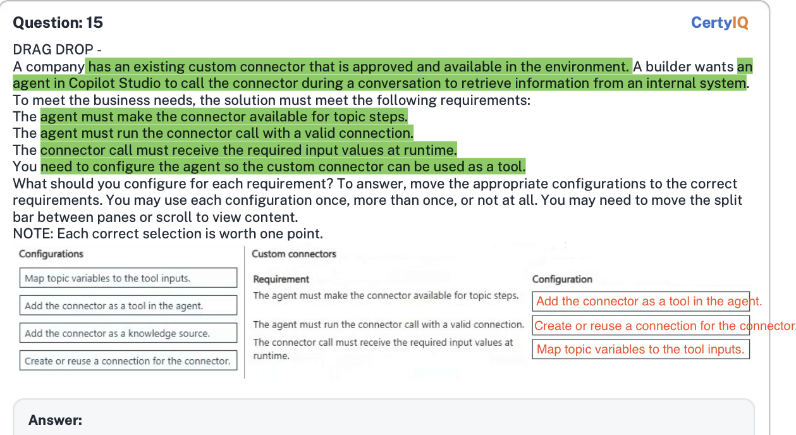

### 1. Extracted Question Summary

* **Scenario:** A company has an existing, approved custom connector available in its Power Platform environment. A builder wants a Microsoft Copilot Studio agent to invoke this custom connector during a conversation to retrieve information from an internal system.

* **Question (Drag and Drop):** Associate each requirement with its appropriate configuration so the custom connector can be used as a tool (configurations on the left may be used once, more than once, or not at all).

* **Available Configurations (Left Column):**
* Map topic variables to the tool inputs.

* Add the connector as a tool in the agent.

* Add the connector as a knowledge source.

* Create or reuse a connection for the connector.

* **Target Requirements (Right Table):**
1. The agent must make the connector available for topic steps.

2. The agent must run the connector call with a valid connection.

3. The connector call must receive the required input values at runtime.

---

### 2. Correct Answer

* **The agent must make the connector available for topic steps:** **Add the connector as a tool in the agent.**

* **The agent must run the connector call with a valid connection:** **Create or reuse a connection for the connector.**

* **The connector call must receive the required input values at runtime:** **Map topic variables to the tool inputs.**

---

### 4. Official Microsoft Justification

* **Extending Agents with Custom Connectors as Tools (`AB-620T00` — Integrate and extend agents in Copilot Studio / Add tools to custom agents):** In Microsoft Copilot Studio, custom connectors expose REST API operations that can be registered as **Tools** (formerly called Actions) for either generative orchestration or deterministic topic execution:
1. **Exposing to Topics (`Add the connector as a tool in the agent`):** Before an individual topic node (`Call an action` / tool node) can invoke a custom connector operation, the connector action must first be added and enabled as a **Tool** within the agent configuration.

2. **Authentication (`Create or reuse a connection for the connector`):** Power Platform connectors require an authenticated connection reference (either user-provided at runtime or maker-provided) so the runtime engine can authorize API requests against the internal system.

3. **Runtime Parameter Binding (`Map topic variables to the tool inputs`):** When invoking the tool inside a topic step, input parameters defined by the custom connector's OpenAPI schema must be bound to dynamic **Topic** or **Global variables** captured during the conversation so the API call receives its required payload at runtime.

---

### 5. Distractor Analysis (Why Others Are Wrong)

* **Add the connector as a knowledge source:** Knowledge sources are designed for passive, read-only RAG grounding across indexed or tabular repositories rather than imperative, parameterized REST API tool invocations inside topic steps.

---

### 6. Exam Keyword / Trap Alert

* **Keywords:** *"custom connector"* + *"available for topic steps"* + *"used as a tool"* + *"required input values at runtime"*.

* **Trap:** Always distinguish between **Tools** (parameterized connector/API operations invoked in topics or generative orchestration that require **connection** setup and **input variable mapping**) and **Knowledge sources** (passive retrieval grounding without topic input mapping).

## Q16

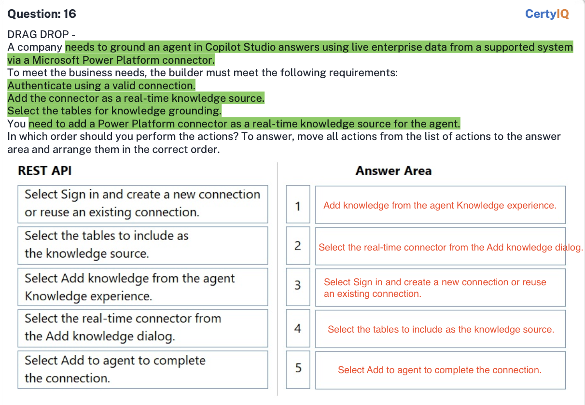

### 1. Extracted Question Summary

* **Scenario:** A company needs to ground a Microsoft Copilot Studio agent using live enterprise data from a supported system via a Microsoft Power Platform connector. The builder must authenticate using a valid connection, add the connector as a real-time knowledge source, and select the tables for knowledge grounding.

* **Question (Drag and Drop):** In which order should you perform the actions? Move all actions from the list of actions to the answer area and arrange them in the correct order.

* **Available Actions (Left Column):**
* Select Sign in and create a new connection or reuse an existing connection.

* Select the tables to include as the knowledge source.

* Select Add knowledge from the agent Knowledge experience.

* Select the real-time connector from the Add knowledge dialog.

* Select Add to agent to complete the connection.

---

### 2. Correct Answer

* **Position 1:** **Select Add knowledge from the agent Knowledge experience.**

* **Position 2:** **Select the real-time connector from the Add knowledge dialog.**

* **Position 3:** **Select Sign in and create a new connection or reuse an existing connection.**

* **Position 4:** **Select the tables to include as the knowledge source.**

* **Position 5:** **Select Add to agent to complete the connection.**

---

### 4. Official Microsoft Justification

* **Real-Time Connector Knowledge Configuration Flow (`AB-620T00` — Integrate and extend agents in Copilot Studio > Connect to enterprise knowledge sources):** In Microsoft Copilot Studio, connecting live enterprise data without copying it into Dataverse uses **Real-time connectors** (such as Salesforce, ServiceNow, Zendesk, or Azure SQL Server). The configuration wizard enforces a strict sequential UI workflow:
1. **Initiate Knowledge Setup:** Inside the agent's **Knowledge** page, begin by clicking **+ Add knowledge** (`Select Add knowledge from the agent Knowledge experience`).

2. **Pick the Connector:** In the **Add knowledge** dialog, select the target enterprise connector (`Select the real-time connector from the Add knowledge dialog`).

3. **Authenticate Session:** Before Copilot Studio can inspect the external system's schema, authenticate (`Select Sign in and create a new connection or reuse an existing connection`).

4. **Scope the Tables:** Once connected, the wizard queries the live metadata and prompts you to select which specific tables/entities the agent may query at runtime (`Select the tables to include as the knowledge source`).

5. **Commit to Agent:** Confirm the configuration and commit it to the agent (`Select Add to agent to complete the connection`).

---

### 5. Distractor Analysis (Why Others Are Wrong)

* Because this is a **sequencing (Drag-and-Drop) question** using all five blocks, the primary error mode is misordering steps 3, 4, and 5:
* **Selecting tables before signing in:** Impossible in Copilot Studio—the schema browser cannot enumerate external tables until a valid connection is established in Step 3.

* **Selecting `Add to agent` before selecting tables:** Table selection occurs inside the setup modal *prior* to clicking the final **Add to agent** button that saves the knowledge source.

---

### 6. Exam Keyword / Trap Alert

* **Keywords:** *"ground an agent... using live enterprise data"* + *"Power Platform connector"* + *"real-time knowledge source"*.

* **Trap:** Always lock in the exact five-step UI sequence for real-time knowledge connectors: **Open Add Knowledge → Pick Connector → Authenticate Connection → Pick Tables → Add to Agent**.

## Q17

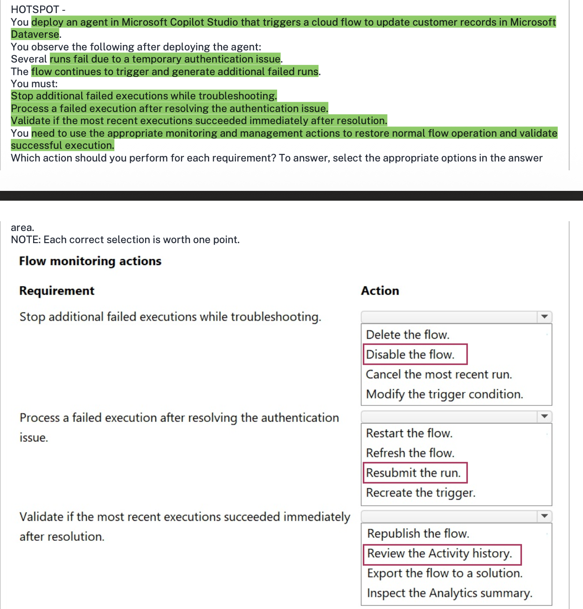

### 1. Extracted Question Summary

* **Scenario:** You deploy an agent in Microsoft Copilot Studio that triggers a cloud flow (agent flow) to update customer records in Microsoft Dataverse. Several runs fail due to a temporary authentication issue, and the flow continues to trigger and generate additional failed runs. You must stop additional failed executions while troubleshooting, process a failed execution after resolving the authentication issue, and validate whether the most recent executions succeeded immediately after resolution.

* **Question (Hotspot / Drop-down):** Select the appropriate monitoring and management action for each requirement:

* **Requirement 1:** Stop additional failed executions while troubleshooting.

* *Options:* Delete the flow. | Disable the flow. | Cancel the most recent run. | Modify the trigger condition.

* **Requirement 2:** Process a failed execution after resolving the authentication issue.

* *Options:* Restart the flow. | Refresh the flow. | Resubmit the run. | Recreate the trigger.

* **Requirement 3:** Validate if the most recent executions succeeded immediately after resolution.

* *Options:* Republish the flow. | Review the Activity history. | Export the flow to a solution. | Inspect the Analytics summary.

---

### 2. Correct Answer

* **Stop additional failed executions while troubleshooting:** **Disable the flow.**

* **Process a failed execution after resolving the authentication issue:** **Resubmit the run.**

* **Validate if the most recent executions succeeded immediately after resolution:** **Review the Activity history.**

---

### 4. Official Microsoft Justification

* **Agent Flow Monitoring & Run Management (`AB-620T00` — Manage and govern agents in Copilot Studio / Monitor agent flows and run history):**
1. **Halting new triggers during incident remediation (`Disable the flow`):** Turning off (**Disabling**) a cloud/agent flow prevents any new trigger invocations from starting while you repair broken connection references or authentication tokens, without destroying the flow definition or its historical run logs.

2. **Replaying failed payloads (`Resubmit the run`):** Once the authentication connection is repaired and the flow is re-enabled, Power Automate and Copilot Studio agent flow management allow makers to select a previously failed run instance and click **Resubmit**, which replays the exact original trigger payload through the updated flow logic.

3. **Immediate run-level verification (`Review the Activity history`):** In Copilot Studio (under the agent's **Activity** tab) and Power Automate run history, **Activity history** provides near-real-time, execution-by-execution status (`Succeeded` / `Failed`) and step-level inputs/outputs immediately after a run completes.

---

### 5. Distractor Analysis (Why Others Are Wrong)

* **Requirement 1 Distractors:**
* *Delete the flow:* Permanently destroys the flow and its run history, making it impossible to recover or resubmit failed runs.

* *Cancel the most recent run:* Only aborts a single currently executing (`Running`) instance; it does not stop new runs from triggering.

* *Modify the trigger condition:* Alters business logic rather than temporarily pausing execution during maintenance.

* **Requirement 2 Distractors:**
* *Restart the flow / Refresh the flow / Recreate the trigger:* None of these replay historical trigger payloads from a failed run instance.

* **Requirement 3 Distractors:**
* *Inspect the Analytics summary:* Aggregated analytics dashboards are designed for macro-level historical trends (CSAT, deflection rates, error rates over days/weeks) and incur reporting latency—they are not used to verify an individual execution *immediately* after resolution.

* *Republish the flow / Export the flow to a solution:* Packaging and deployment actions that provide no runtime execution status.

---

### 6. Exam Keyword / Trap Alert

* **Keywords:** *"Stop additional failed executions"* = **Disable the flow**; *"Process a failed execution after resolving"* = **Resubmit the run**; *"succeeded immediately after resolution"* = **Activity history**.

* **Trap:** Do not confuse **Activity history** (real-time, individual session/run execution logs for immediate troubleshooting) with **Analytics** (aggregated, delayed telemetry dashboards for long-term performance monitoring).

## Q18

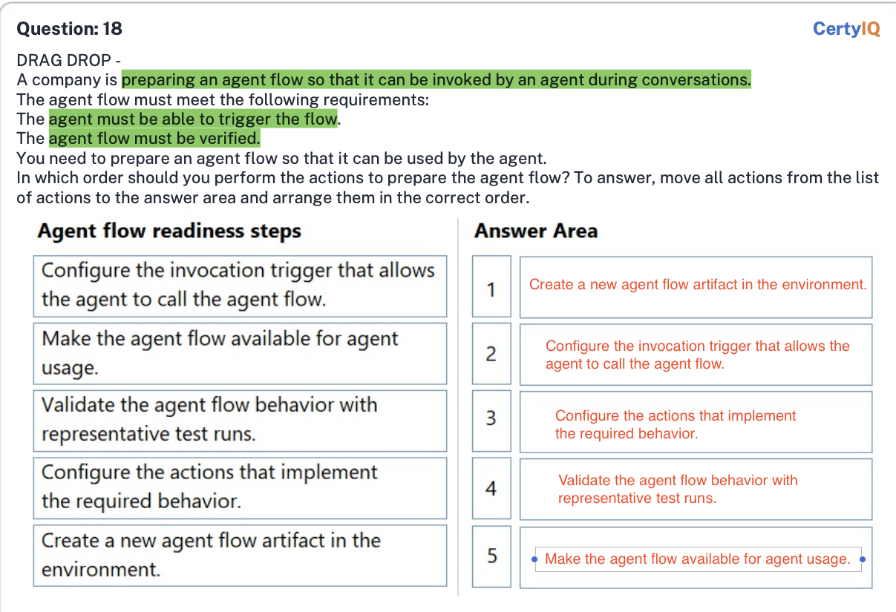

### 1. Extracted Question Summary

* **Scenario:** A company is preparing an agent flow so that it can be invoked by an agent during conversations. The agent must be able to trigger the flow, and the agent flow must be verified.

* **Question (Drag and Drop):** In which order should you perform the actions to prepare the agent flow? Move all actions from the list of actions to the answer area and arrange them in the correct order.

* **Available Actions (`Agent flow readiness steps`):**
* Configure the invocation trigger that allows the agent to call the agent flow.

* Make the agent flow available for agent usage.

* Validate the agent flow behavior with representative test runs.

* Configure the actions that implement the required behavior.

* Create a new agent flow artifact in the environment.

---

### 2. Correct Answer

* **Position 1:** **Create a new agent flow artifact in the environment.**

* **Position 2:** **Configure the invocation trigger that allows the agent to call the agent flow.**

* **Position 3:** **Configure the actions that implement the required behavior.**

* **Position 4:** **Validate the agent flow behavior with representative test runs.**

* **Position 5:** **Make the agent flow available for agent usage.**

---

### 4. Official Microsoft Justification

* **Agent Flow Authoring & Readiness Lifecycle (`AB-620T00` — Create and manage agent flows in Microsoft Copilot Studio):** Building a deterministic workflow (agent flow) that a Copilot Studio agent can invoke follows a strict end-to-end engineering lifecycle:
1. **Provision the Artifact (`Create a new agent flow artifact in the environment`):** You first create the agent flow resource within your Power Platform environment (either directly from Copilot Studio's **Flows** experience or within a solution).

2. **Define the Entry Point (`Configure the invocation trigger that allows the agent to call the agent flow`):** Every agent-invoked flow must begin with the **"When an agent calls the flow"** trigger (`Run a flow from Copilot`) and define its typed input parameters so the agent can pass runtime values.

3. **Build the Execution Logic (`Configure the actions that implement the required behavior`):** Inside the flow designer, you add the connector operations, data transformations, conditions, and the final **"Respond to the agent"** (`Respond to Copilot`) action.

4. **Verify Before Release (`Validate the agent flow behavior with representative test runs`):** Before exposing the flow to an agent, you save and run representative test executions to verify inputs, outputs, and error-handling behavior.

5. **Publish & Enable (`Make the agent flow available for agent usage`):** Finally, you **Publish** (turn on) the verified agent flow so it becomes selectable as a Tool/Action inside Copilot Studio topics or generative orchestration.

---

### 5. Distractor Analysis (Why Others Are Wrong)

* Because this is a **sequencing (Drag-and-Drop) question** requiring all five steps, the primary failure modes involve misordering the build-test-publish lifecycle:
* **Configuring actions before the trigger:** In the Power Automate / Copilot Studio flow designer, the trigger defines the incoming dynamic schema (`triggerBody()`) that downstream actions consume—the trigger is always configured first.

* **Making the flow available before validating:** Best practice and the explicit prompt requirement (*"The agent flow must be verified"*) require running representative test runs *prior* to publishing/enabling the flow for live agent usage.

---

### 6. Exam Keyword / Trap Alert

* **Keywords:** *"preparing an agent flow so that it can be invoked by an agent"* + *"able to trigger the flow"* + *"must be verified"*.

* **Trap:** Follow the standard software engineering lifecycle enforced by the Copilot Studio designer: **Create Artifact → Configure Trigger → Configure Actions → Validate/Test → Publish/Make Available**.

## Q19
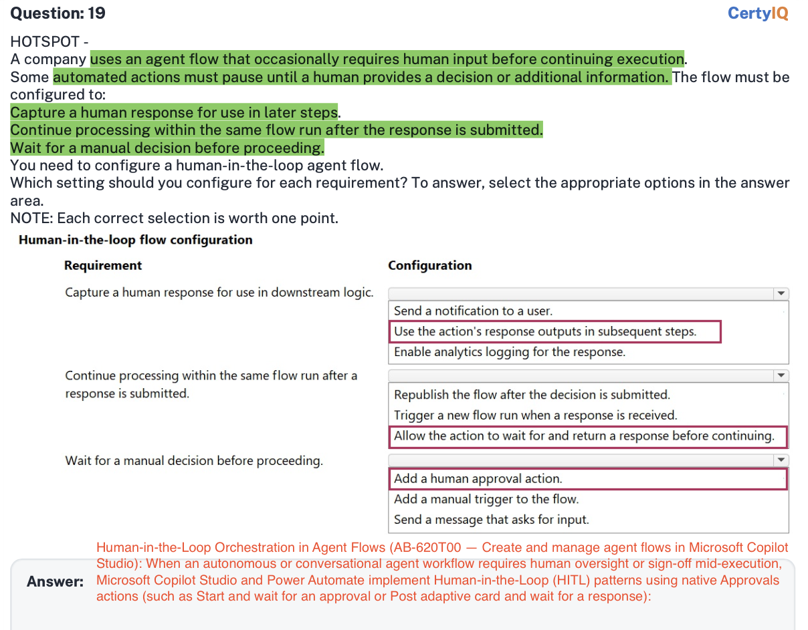

### 1. Extracted Question Summary

* **Scenario:** A company uses an agent flow that occasionally requires human input before continuing execution. Automated actions must pause until a human provides a decision or additional information, capturing the human response for later steps, continuing processing within the same flow run after submission, and waiting for a manual decision before proceeding.

* **Question (Hotspot / Drop-down):** Select the appropriate human-in-the-loop flow configuration for each requirement:

* **Requirement 1:** Capture a human response for use in downstream logic.

* *Options:* Send a notification to a user. | Use the action's response outputs in subsequent steps. | Enable analytics logging for the response.

* **Requirement 2:** Continue processing within the same flow run after a response is submitted.

* *Options:* Republish the flow after the decision is submitted. | Trigger a new flow run when a response is received. | Allow the action to wait for and return a response before continuing.

* **Requirement 3:** Wait for a manual decision before proceeding.

* *Options:* Add a human approval action. | Add a manual trigger to the flow. | Send a message that asks for input.

---

### 2. Correct Answer

* **Capture a human response for use in downstream logic:** **Use the action's response outputs in subsequent steps.**

* **Continue processing within the same flow run after a response is submitted:** **Allow the action to wait for and return a response before continuing.**

* **Wait for a manual decision before proceeding:** **Add a human approval action.**

---

### 4. Official Microsoft Justification

* **Human-in-the-Loop Orchestration in Agent Flows (`AB-620T00` — Create and manage agent flows in Microsoft Copilot Studio):** When an autonomous or conversational agent workflow requires human oversight or sign-off mid-execution, Microsoft Copilot Studio and Power Automate implement **Human-in-the-Loop (HITL)** patterns using native **Approvals** actions (such as *Start and wait for an approval* or *Post adaptive card and wait for a response*):
1. **Consuming Decision Data (`Use the action's response outputs in subsequent steps`):** Wait-for-response actions expose structured dynamic content outputs (such as `Outcome` — Approve/Reject, `Responses Comments`, or Adaptive Card form fields) that downstream conditions and actions reference directly.

2. **Synchronous Suspension Within a Single Run (`Allow the action to wait for and return a response before continuing`):** Using a combined **"Start and wait"** / **"wait for a response"** action dehydrates and pauses the current flow instance without terminating it, automatically resuming execution within that *exact same flow run* once the human submits their response.

3. **Gating Execution on Human Sign-Off (`Add a human approval action`):** Inserting a **human approval action** blocks downstream execution paths until an assigned reviewer explicitly approves, rejects, or submits a decision.

---

### 5. Distractor Analysis (Why Others Are Wrong)

* **Requirement 1 Distractors:**
* *Send a notification to a user:* One-way outbound delivery that neither waits for nor captures return data.

* *Enable analytics logging for the response:* Records telemetry for reporting dashboards rather than passing runtime variables to downstream flow actions.

* **Requirement 2 Distractors:**
* *Republish the flow after the decision is submitted:* Design-time deployment operation unrelated to runtime execution state.

* *Trigger a new flow run when a response is received:* Splits execution across two separate, stateless flow runs instead of continuing within the *same* flow run.

* **Requirement 3 Distractors:**
* *Add a manual trigger to the flow:* Defines how a flow is initially started (`Manually trigger a flow`), not how an in-progress flow pauses mid-run.

* *Send a message that asks for input:* Sends a non-blocking message without enforcing a formal approval gate or pausing flow execution.

---

### 6. Exam Keyword / Trap Alert

* **Keywords:** *"human-in-the-loop"* + *"pause until a human provides a decision"* + *"same flow run"* = **Human approval / wait-for-response action** + **response outputs**.

* **Trap:** Never select options that *"trigger a new flow run"* when a requirement specifies continuing within the **same flow run**—the core value of Power Automate/Copilot Studio **"Start and wait"** approval actions is stateful suspension and resumption inside a single run instance.

## Q20

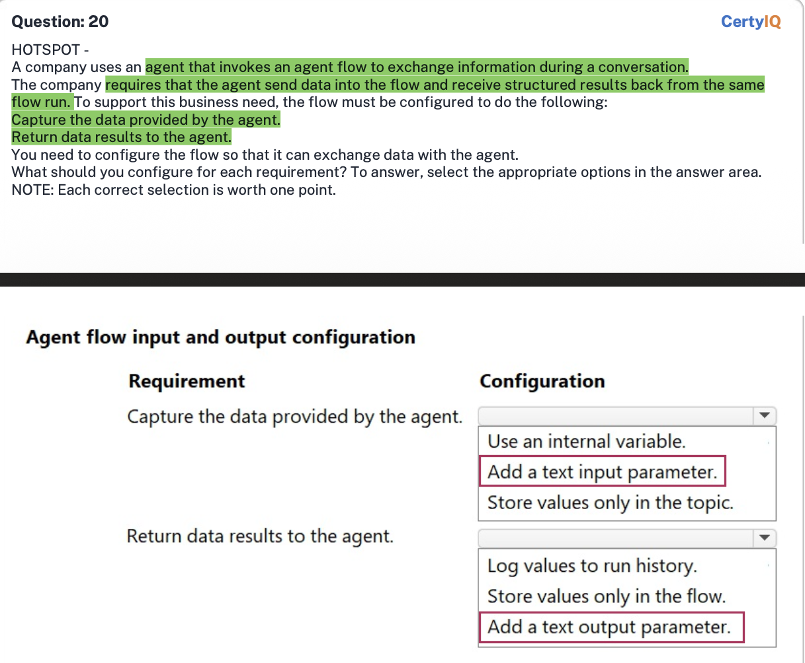

### 1. Extracted Question Summary

* **Scenario:** A company uses an agent in Microsoft Copilot Studio that invokes an agent flow to exchange information during a conversation. The company requires the agent to send data into the flow and receive structured results back from the same flow run.

* **Question (Hotspot / Drop-down):** Select the appropriate configuration for each requirement so the flow can exchange data with the agent:

* **Requirement 1:** Capture the data provided by the agent.

* *Options:* Use an internal variable. | Add a text input parameter. | Store values only in the topic.

* **Requirement 2:** Return data results to the agent.

* *Options:* Log values to run history. | Store values only in the flow. | Add a text output parameter.

---

### 2. Correct Answer

* **Capture the data provided by the agent:** **Add a text input parameter.**

* **Return data results to the agent:** **Add a text output parameter.**

---

### 4. Official Microsoft Justification

* **Bidirectional Data Exchange in Agent Flows (`AB-620T00` — Create and manage agent flows in Microsoft Copilot Studio):** When a Copilot Studio agent invokes an agent flow (via a topic node or generative orchestration), synchronous two-way data exchange relies on typed contract parameters defined on the flow's boundary actions:
1. **Receiving Data from the Agent (`Add a text input parameter`):** On the **"When an agent calls the flow"** trigger (`Run a flow from Copilot`), makers define typed **input parameters** (Text, Number, Yes/No, File, etc.) that appear as input fields in the Copilot Studio topic/tool interface, allowing topic variables or LLM-extracted slot values to be passed into the flow.

2. **Returning Results to the Agent (`Add a text output parameter`):** On the terminal **"Respond to the agent"** (`Respond to Copilot`) action, makers define typed **output parameters** that serialize structured results back to the calling agent session within the same run, automatically binding them to output variables in the topic or returning them to the generative orchestrator.

---

### 5. Distractor Analysis (Why Others Are Wrong)

* **Requirement 1 Distractors:**
* *Use an internal variable:* Flow-scoped variables (`Initialize variable`) are private to the flow run and are never exposed on the trigger schema for the calling agent to populate.

* *Store values only in the topic:* Keeping values isolated inside topic variables without binding them to flow trigger input parameters prevents the flow from ever receiving the data.

* **Requirement 2 Distractors:**
* *Log values to run history:* Run history is an administrative telemetry log for makers/admins; the conversational agent runtime cannot read run history logs to continue a live conversation.

* *Store values only in the flow:* Values kept solely inside internal flow variables are discarded when the flow finishes unless explicitly mapped to the **Respond to the agent** output schema.

---

### 6. Exam Keyword / Trap Alert

* **Keywords:** *"send data into the flow"* = **input parameter** on the agent trigger; *"receive structured results back from the same flow run"* = **output parameter** on the response action.

* **Trap:** Internal variables (whether topic-scoped or flow-scoped) never cross the boundary between Copilot Studio and an agent flow—data crosses strictly through **trigger input parameters** and **response output parameters**.

## Q21

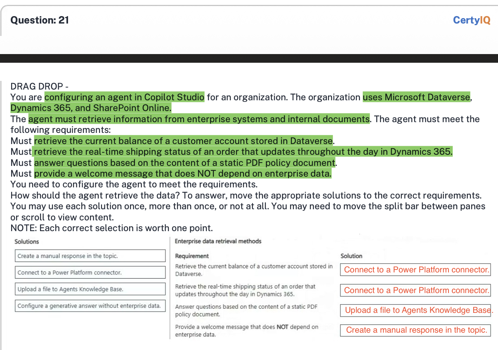

### 1. Extracted Question Summary

* **Scenario:** You are configuring an agent in Microsoft Copilot Studio for an organization using Microsoft Dataverse, Dynamics 365, and SharePoint Online. The agent must retrieve information from enterprise systems and internal documents while meeting four specific requirements.

* **Question (Drag and Drop):** Associate each requirement with the appropriate enterprise data retrieval solution (each solution on the left may be used once, more than once, or not at all).

* **Available Solutions (Left Column):**
* Create a manual response in the topic.

* Connect to a Power Platform connector.

* Upload a file to Agents Knowledge Base.

* Configure a generative answer without enterprise data.

* **Target Requirements (Right Table):**
1. Retrieve the current balance of a customer account stored in Dataverse.

2. Retrieve the real-time shipping status of an order that updates throughout the day in Dynamics 365.

3. Answer questions based on the content of a static PDF policy document.

4. Provide a welcome message that does NOT depend on enterprise data.

---

### 2. Correct Answer

* **Retrieve the current balance of a customer account stored in Dataverse:** **Connect to a Power Platform connector.**

* **Retrieve the real-time shipping status of an order that updates throughout the day in Dynamics 365:** **Connect to a Power Platform connector.**

* **Answer questions based on the content of a static PDF policy document:** **Upload a file to Agents Knowledge Base.**

* **Provide a welcome message that does NOT depend on enterprise data:** **Create a manual response in the topic.**

---

### 4. Official Microsoft Justification

* **Enterprise Data Retrieval & Grounding Architecture (`AB-620T00` — Integrate and extend agents in Copilot Studio):**
1. **Live Dataverse & Dynamics 365 Transactional Records (`Connect to a Power Platform connector`):** When retrieving live, frequently changing structured records—such as a customer's current account balance in Dataverse or intraday order shipping statuses in Dynamics 365—Copilot Studio relies on **Power Platform connectors** (either as real-time knowledge connectors or connector tools/actions) to query live transactional endpoints at runtime without stale indexing delays.

2. **Static Unstructured Documents (`Upload a file to Agents Knowledge Base`):** For static reference files like a PDF policy document that do not require live transactional API queries, uploading the file directly into the agent's **Knowledge** store ingests and chunks the document into Dataverse for native Retrieval-Augmented Generation (RAG) grounding.

3. **Deterministic System Greetings (`Create a manual response in the topic`):** Standard greetings like the built-in **Conversation Start** system topic require predictable, deterministic messaging that executes immediately without invoking an LLM or querying enterprise knowledge bases—implemented using a standard **Send a message** node (`Create a manual response in the topic`).

---

### 5. Distractor Analysis (Why Others Are Wrong)

* **Configure a generative answer without enterprise data:** Relying on general pretrained LLM world knowledge (`Allow the AI to use its own general knowledge`) is inappropriate for an organization's deterministic **welcome message**, where exact brand wording and greeting consistency are required rather than non-deterministic generative text.

---

### 6. Exam Keyword / Trap Alert

* **Keywords:** *"current balance... in Dataverse"* & *"real-time shipping status... in Dynamics 365"* = **Power Platform connector** (reused twice); *"static PDF policy document"* = **Upload a file to Agents Knowledge Base**; *"welcome message that does NOT depend on enterprise data"* = **Create a manual response in the topic**.

* **Trap:** Do not hesitate to reuse **Connect to a Power Platform connector** for both Dataverse and Dynamics 365 rows—the rubric explicitly notes *"You may use each solution once, more than once, or not at all"*, and both live operational queries share the same connector pattern.

## Q22

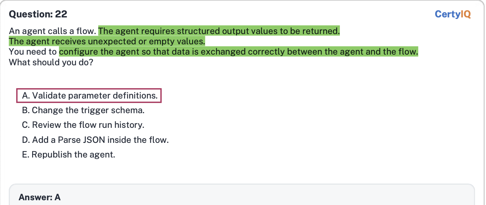

### 1. Extracted Question Summary

* **Scenario:** An agent calls a flow and requires structured output values to be returned, but the agent receives unexpected or empty values. You need to configure the agent so that data is exchanged correctly between the agent and the flow.

* **Question:** What should you do?

* **Options:**
* **A.** Validate parameter definitions.

* **B.** Change the trigger schema.

* **C.** Review the flow run history.

* **D.** Add a Parse JSON inside the flow.

* **E.** Republish the agent.

* **Visible Answer in Screenshot:** `Answer: A`

---

### 2. Correct Answer

* **A: Validate parameter definitions.**

---

### 3. Verification of Visible Selection / Community Key

* **Correct.** The visible key (`A`) is accurate because unexpected or empty return values between a Copilot Studio agent and an invoked flow occur when the output parameter definitions (names, data types, and variable mappings on the **Respond to the agent** action and the calling topic/tool node) are misaligned or unconfigured.

---

### 4. Official Microsoft Justification

* **Agent-to-Flow Input/Output Contract (`AB-620T00` — Create and manage agent flows in Microsoft Copilot Studio):** When a Copilot Studio agent invokes an agent flow or Power Automate cloud flow, data exchange relies on a strongly typed parameter contract across two boundary points:
1. **Flow Output Schema (`Respond to the agent` / `Respond to Copilot`):** Every returned field must have a properly defined parameter name, expected primitive/object data type, and populated dynamic value expression.
2. **Agent Tool/Topic Variable Mapping:** Inside Copilot Studio, the calling action/tool node binds those declared output parameters to typed topic or global variables. If parameter names change, data types mismatch (e.g., returning an array/object into a scalar text parameter without serialization), or outputs are left unmapped after modifying a flow, the agent receives empty or malformed values—requiring you to **validate and refresh the parameter definitions** (`Validate parameter definitions`).

---

### 5. Distractor Analysis (Why Others Are Wrong)

* **B:** Changing the **trigger schema** controls *input* values sent *from* the agent *into* the flow (`When an agent calls the flow`), not the structured *output* values returned *from* the flow back to the agent.

* **C:** Reviewing run history is a diagnostic inspection step that shows past execution logs, whereas the question asks what configuration change you should perform so data is exchanged properly.

* **D:** Adding a `Parse JSON` action deserializes payloads *inside* the flow's internal execution context, but it does not expose or fix the boundary parameter contract returned to Copilot Studio unless the **Respond to the agent** output parameter definitions match.

* **E:** Republishing pushes existing configurations to live channels without correcting underlying parameter mismatches.

---

### 6. Exam Keyword / Trap Alert

* **Keywords:** *"structured output values to be returned"* + *"receives unexpected or empty values"* + *"data is exchanged correctly between the agent and the flow"* = **Validate parameter definitions**.

* **Trap:** Do not confuse **trigger schema** (flow *inputs*) with **output parameter definitions** (flow *outputs* returned via `Respond to the agent`).

## Q23

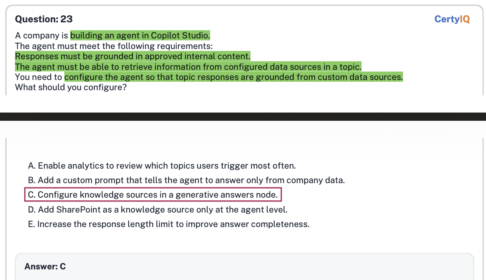

### 1. Extracted Question Summary

* **Scenario:** A company is building an agent in Microsoft Copilot Studio whose responses must be grounded in approved internal content and retrieve information from configured data sources within a topic. You need to configure the agent so that topic responses are grounded from custom data sources.

* **Question:** What should you configure?

* **Options:**
* **A.** Enable analytics to review which topics users trigger most often.

* **B.** Add a custom prompt that tells the agent to answer only from company data.

* **C.** Configure knowledge sources in a generative answers node.

* **D.** Add SharePoint as a knowledge source only at the agent level.

* **E.** Increase the response length limit to improve answer completeness.

* **Visible Markings / Answer in Screenshot:** Option **C** is boxed in red and `Answer: C` is shown at the bottom.

---

### 2. Correct Answer

* **C: Configure knowledge sources in a generative answers node.**

---

### 3. Verification of Visible Selection / Community Key

* **Correct.** Both the red box around **C** and `Answer: C` are accurate because adding a **Create generative answers** node inside a topic and binding specific **knowledge sources** (or custom data sources) to that node grounds that topic's responses exclusively in the configured approved sources.

---

### 4. Official Microsoft Justification

* **Topic-Level Generative Answers Grounding (`AB-620T00` — Integrate and extend agents in Copilot Studio / Use generative answers in topics):** In Microsoft Copilot Studio, knowledge grounding can be scoped at two levels:
1. **Agent-level Knowledge:** Applies globally across the agent (e.g., via the **Conversational boosting** system fallback topic or generative orchestration).
2. **Topic-level `Create generative answers` node:** When a specific topic must retrieve and synthesize answers from targeted or custom internal data sources—including SharePoint, Dataverse, uploaded files, public websites, or **Custom data** (such as Azure OpenAI On Your Data / custom JSON variable arrays returned from an API or agent flow)—makers insert a **Create generative answers** node directly inside the topic canvas and configure its **Data sources** property (`Configure knowledge sources in a generative answers node`), optionally disabling agent-level knowledge search for that specific node so responses stay strictly scoped to approved internal content.

---

### 5. Distractor Analysis (Why Others Are Wrong)

* **A:** Analytics provides historical telemetry on topic trigger frequency and session outcomes; it does not ground runtime responses in internal data sources.

* **B:** Natural language system instructions/prompts cannot connect the agent to internal enterprise repositories or index custom data sources for Retrieval-Augmented Generation (RAG).

* **D:** Adding SharePoint *only* at the agent level fails the requirement to configure topic-specific grounding from custom data sources inside a topic (and does not isolate that topic's retrieval to custom data).

* **E:** Adjusting token/response length controls verbosity rather than connecting or grounding responses in approved internal knowledge sources.

---

### 6. Exam Keyword / Trap Alert

* **Keywords:** *"retrieve information from configured data sources in a topic"* + *"topic responses are grounded from custom data sources"* = **Configure knowledge sources in a generative answers node**.

* **Trap:** Notice the contrast between **agent-level knowledge** (Option D) and **topic-level generative answers node** (Option C)—whenever a question specifically emphasizes grounding **topic responses** or **custom data sources** inside a topic, the **Create generative answers** node is the exact Copilot Studio mechanism.

## Q24

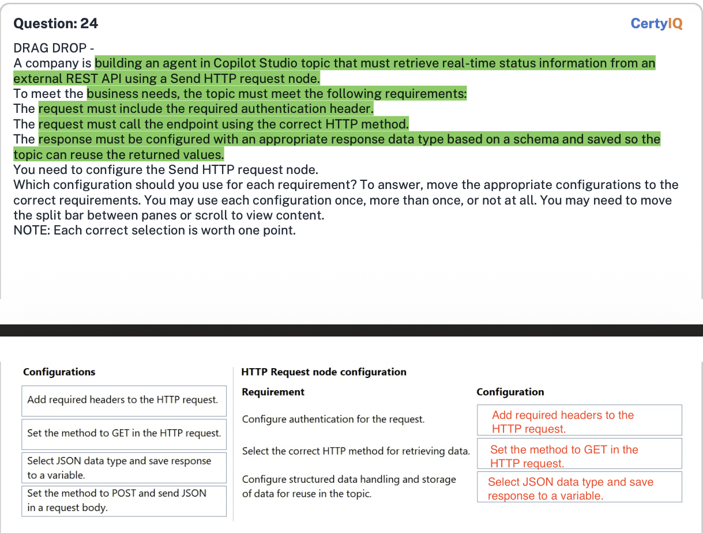

### 1. Extracted Question Summary

* **Scenario:** A company is building a Microsoft Copilot Studio topic that retrieves real-time status information from an external REST API using a **Send HTTP request** node. The request must include the required authentication header, call the endpoint using the proper HTTP method for retrieving data, and parse/save the structured response based on a schema so the topic can reuse the returned values.

* **Question (Drag and Drop):** Move the appropriate configurations on the left to match the three **HTTP Request node configuration** requirements on the right (configurations may be used once, more than once, or not at all).

* **Available Configurations (Left Column):**
* Add required headers to the HTTP request.

* Set the method to GET in the HTTP request.

* Select JSON data type and save response to a variable.

* Set the method to POST and send JSON in a request body.

* **Target Requirements (Right Table):**
1. Configure authentication for the request.

2. Select the correct HTTP method for retrieving data.

3. Configure structured data handling and storage of data for reuse in the topic.

---

### 2. Correct Answer

* **Configure authentication for the request:** **Add required headers to the HTTP request.**

* **Select the correct HTTP method for retrieving data:** **Set the method to GET in the HTTP request.**

* **Configure structured data handling and storage of data for reuse in the topic:** **Select JSON data type and save response to a variable.**

---

### 4. Official Microsoft Justification

* **Topic HTTP Request Node Configuration (`AB-620T00` / `AB-100` — Integrate and extend agents in Copilot Studio / Make HTTP requests in topics):** Inside a Copilot Studio topic, the **Send HTTP request** node allows makers to call RESTful endpoints directly without creating a custom connector or Power Automate flow:
1. **Header-Based Authentication (`Add required headers to the HTTP request`):** When calling external REST APIs that expect API keys, Bearer tokens, or custom authorization schemes, makers expand **Headers and body** on the **Send HTTP request** node and add key-value pairs (such as `Authorization: Bearer <token>` or `x-api-key`).

2. **Idempotent Data Retrieval (`Set the method to GET in the HTTP request`):** Standard REST semantics dictate using the **GET** HTTP verb when retrieving read-only status information from a resource endpoint.

3. **Schema-Typed Parsing & Variable Persistence (`Select JSON data type and save response to a variable`):** In the node's **Response data type** setting, selecting **From sample data** or **JSON** automatically infers a strongly typed Record/Table schema from a sample JSON payload and stores the parsed object in a **Topic** or **Global** variable so downstream nodes (such as *Send a message* or *Condition*) can reference individual properties via dot notation.

---

### 5. Distractor Analysis (Why Others Are Wrong)

* **Set the method to POST and send JSON in a request body:** `POST` with a JSON request body is used for submitting/creating resources or executing RPC-style mutations, whereas the scenario explicitly requires retrieving read-only real-time status data (`GET`).

---

### 6. Exam Keyword / Trap Alert

* **Keywords:** *"Send HTTP request node"* + *"authentication header"* + *"retrieve real-time status information"* (`GET`) + *"response data type based on a schema and saved"* (`JSON` + variable).

* **Trap:** Always map **"retrieving"** data on a REST HTTP node to **GET** (never `POST`), and remember that Copilot Studio's HTTP node natively parses **JSON** schemas directly into strongly typed variables without needing a separate `Parse JSON` step.

## Q25

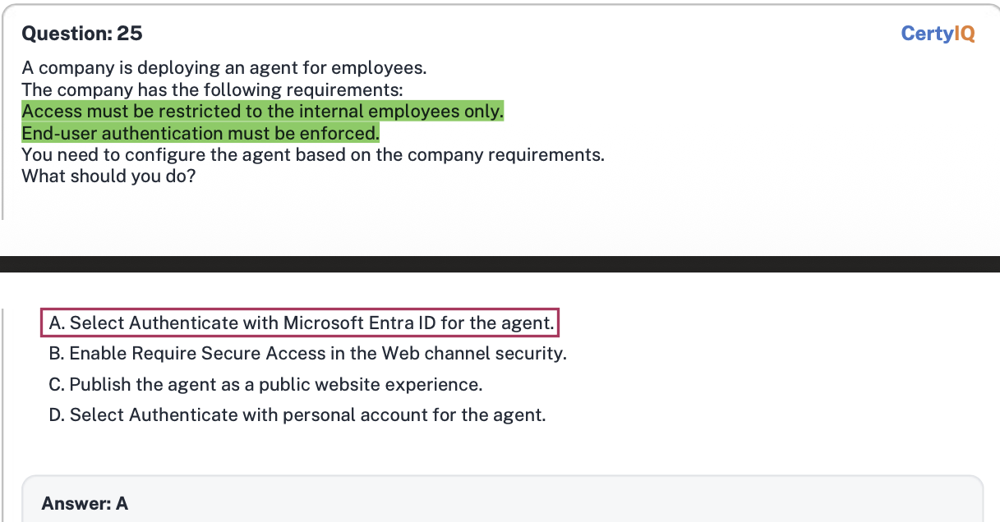

### 1. Extracted Question Summary

* **Scenario:** A company is deploying an agent for employees where access must be restricted to internal employees only and end-user authentication must be enforced.

* **Question:** You need to configure the agent based on the company requirements. What should you do?

* **Options:**
* **A.** Select Authenticate with Microsoft Entra ID for the agent.

* **B.** Enable Require Secure Access in the Web channel security.

* **C.** Publish the agent as a public website experience.

* **D.** Select Authenticate with personal account for the agent.

* **Visible Answer in Screenshot:** `Answer: A`

---

### 2. Correct Answer

* **A: Select Authenticate with Microsoft Entra ID for the agent.**

---

### 3. Verification of Visible Selection / Community Key

* **Correct.** The visible key (`A`) is accurate because **Authenticate with Microsoft Entra ID** is the built-in Copilot Studio authentication mode that enforces tenant-level sign-in and restricts agent access strictly to internal organizational users.

---

### 4. Official Microsoft Justification

* **End-User Authentication & Tenant Isolation (`AB-620T00` — Manage and govern agents in Copilot Studio > Configure user authentication):** Under **Settings → Security → Authentication** in Microsoft Copilot Studio, makers choose among three authentication models:
1. **No authentication:** Anyone with the link/channel access can chat anonymously.
2. **Authenticate with Microsoft Entra ID (default for internal/Teams agents):** Automatically authenticates users against the organization's **Microsoft Entra ID** tenant using single sign-on (SSO) in Microsoft Teams or organizational channels, ensuring only authenticated internal employees in the tenant can access the agent and populating system user variables (`User.Id`, `User.DisplayName`, `User.PrincipalName`).

3. **Authenticate manually:** Used when configuring custom OAuth 2.0 / generic identity providers or external customer-facing portals.

* Selecting **Authenticate with Microsoft Entra ID** directly satisfies both tenant-level employee restriction and mandatory end-user authentication without requiring custom app registration overhead.

---

### 5. Distractor Analysis (Why Others Are Wrong)

* **B:** Web channel security (`Require secured access` / Direct Line secret/token exchange) secures the communication channel between a hosting web app and Copilot Studio so unauthorized websites cannot embed the bot, but it does not authenticate individual end users against the corporate directory.

* **C:** Publishing the agent to a public website experience exposes it to external/anonymous visitors, violating the requirement to restrict access to internal employees only.

* **D:** Personal Microsoft accounts (MSA, e.g., `@outlook.com` / `@hotmail.com`) represent consumer identities outside the enterprise tenant and are not supported as the enterprise employee restriction mechanism in Copilot Studio.

---

### 6. Exam Keyword / Trap Alert

* **Keywords:** *"restricted to the internal employees only"* + *"End-user authentication must be enforced"* = **Authenticate with Microsoft Entra ID**.

* **Trap:** Do not confuse **Web channel security / Direct Line token exchange** (Option B, which protects the *embedding channel* from unauthorized host domains) with **User Authentication via Microsoft Entra ID** (Option A, which verifies *who the employee is* at runtime).

## Q26

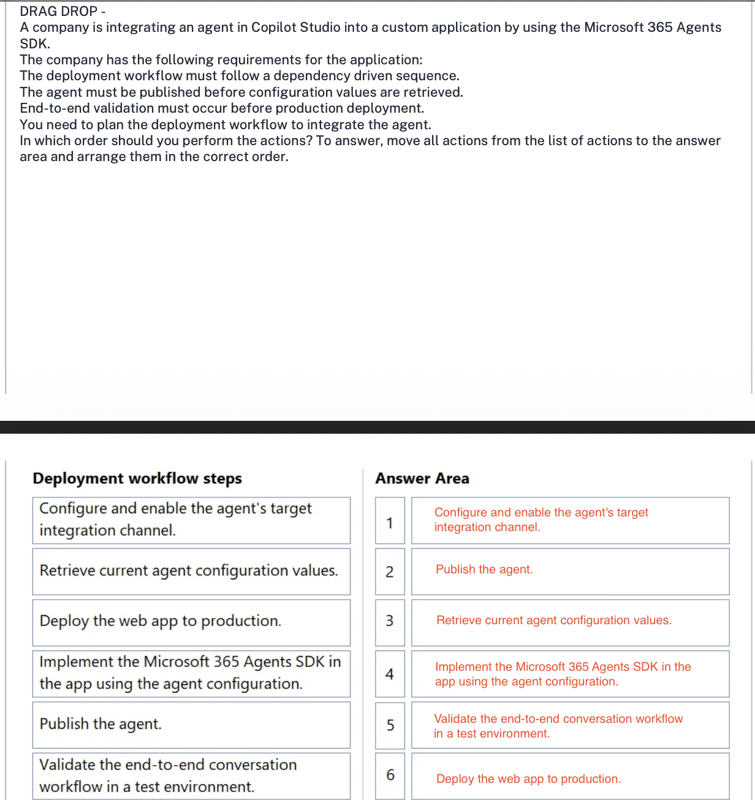

### 1. Extracted Question Summary

* **Scenario:** A company is integrating a Copilot Studio agent into a custom application using the **Microsoft 365 Agents SDK**. The deployment workflow must follow a dependency-driven sequence: the agent must be published before configuration values are retrieved, and end-to-end validation must occur before production deployment.

* **Question (Drag and Drop):** In which order should you perform the actions? Move all actions from the list of actions (`Deployment workflow steps`) to the `Answer Area` and arrange them in the correct order.

* **Available Actions (Left Column):**
* Configure and enable the agent's target integration channel.

* Retrieve current agent configuration values.

* Deploy the web app to production.

* Implement the Microsoft 365 Agents SDK in the app using the agent configuration.

* Publish the agent.

* Validate the end-to-end conversation workflow in a test environment.

---

### 2. Correct Answer

* **Position 1:** **Configure and enable the agent's target integration channel.**

* **Position 2:** **Publish the agent.**

* **Position 3:** **Retrieve current agent configuration values.**

* **Position 4:** **Implement the Microsoft 365 Agents SDK in the app using the agent configuration.**

* **Position 5:** **Validate the end-to-end conversation workflow in a test environment.**

* **Position 6:** **Deploy the web app to production.**

---

### 4. Official Microsoft Justification

* **Custom Application Integration with Microsoft 365 Agents SDK (`AB-620T00` / `AB-100` — Integrate and extend agents in Copilot Studio / Embed agents using the Microsoft 365 Agents SDK):** Connecting a custom client application to a Copilot Studio agent via the **Microsoft 365 Agents SDK** enforces a strict dependency chain across the Copilot Studio portal and application code:
1. **Channel Activation (`Configure and enable the agent's target integration channel`):** In Copilot Studio under **Channels**, you must first configure and enable the target channel (such as Direct Line / Custom website / Native SDK endpoint) before the runtime endpoints and connection metadata become active.

2. **Runtime Endpoint Provisioning (`Publish the agent`):** Publishing the agent compiles the latest topics, knowledge, and channel settings into the live runtime service—explicitly mandated prior to retrieving configuration values.

3. **Metadata Extraction (`Retrieve current agent configuration values`):** Once published, you copy the connection parameters (such as the Token Endpoint URL, Direct Line secret, or `CopilotStudioClientSettings` schema/environment/agent identifiers) from the channel configuration pane.

4. **SDK Integration (`Implement the Microsoft 365 Agents SDK in the app using the agent configuration`):** Developers instantiate the `CopilotStudioClient` / Microsoft 365 Agents SDK inside the custom web application and inject the retrieved configuration values and authentication provider.

5. **Pre-Production Verification (`Validate the end-to-end conversation workflow in a test environment`):** Before releasing to users, the integrated app and agent are tested end-to-end in a staging/test environment to confirm token exchange, turn handling, and tool execution.

6. **Production Release (`Deploy the web app to production`):** After successful validation, the custom web application is promoted to production.

---

### 5. Distractor Analysis (Why Others Are Wrong)

* Because this is a **six-step sequencing (Drag-and-Drop) question** requiring all items to be ordered, the primary failure mode is inverting steps 1–3:
* **Retrieving configuration values before configuring the channel and publishing:** The SDK connection parameters/token endpoints are either unavailable or inactive for external client calls until the target channel is enabled and the agent is published.

* **Implementing the SDK before retrieving configuration values:** The SDK client cannot be configured to target the specific Copilot Studio agent without first obtaining the agent's environment/bot identifiers or token endpoint.

---

### 6. Exam Keyword / Trap Alert

* **Keywords:** *"Microsoft 365 Agents SDK"* + *"dependency driven sequence"* + *"agent must be published before configuration values are retrieved"* + *"End-to-end validation must occur before production deployment"*.

* **Trap:** Do not place **Publish the agent** at the end right before production deployment—when integrating external apps via SDK or channels, you must **Configure Channel → Publish Agent → Retrieve Config Values** *before* writing/configuring the SDK client code.

## Q27

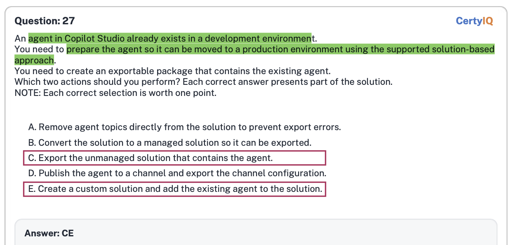

### 1. Extracted Question Summary

* **Scenario:** An agent in Microsoft Copilot Studio already exists in a development environment. You need to prepare the agent so it can be moved to a production environment using the supported solution-based approach by creating an exportable package that contains the existing agent.

* **Question:** Which two actions should you perform? (Each correct answer presents part of the solution.)

* **Options:**
* **A.** Remove agent topics directly from the solution to prevent export errors.

* **B.** Convert the solution to a managed solution so it can be exported.

* **C.** Export the unmanaged solution that contains the agent.

* **D.** Publish the agent to a channel and export the channel configuration.

* **E.** Create a custom solution and add the existing agent to the solution.

* **Visible Markings / Answer in Screenshot:** Options **C** and **E** are boxed in red, and `Answer: CE` is shown at the bottom.

---

### 2. Correct Answer

* **C: Export the unmanaged solution that contains the agent.**

* **E: Create a custom solution and add the existing agent to the solution.**

---

### 3. Verification of Visible Selection / Community Key

* **Correct.** Both the red boxes around **C** and **E** and the visible key (`Answer: CE`) are accurate because in Power Platform / Copilot Studio ALM, an existing agent created outside a custom solution must first be added to an unmanaged custom solution (**E**) and then exported from the development environment (**C**)—choosing **Managed** during the export wizard—for production deployment.

---

### 4. Official Microsoft Justification

* **Solution-Based ALM for Copilot Studio Agents (`AB-620T00` — Manage and govern agents in Copilot Studio / Export and import agents using solutions):** Under Microsoft's standard Power Platform Application Lifecycle Management (ALM) model, agents created directly in the Copilot Studio maker portal initially reside in the environment's **Common Data Services Default Solution** (which cannot be exported).
* To promote an existing agent from Development to Production:
1. **Containerize the Agent (`Create a custom solution and add the existing agent to the solution`):** Create a dedicated unmanaged custom solution (associated with a custom publisher) and select **Add existing → Agent** (along with required subcomponents such as topics, knowledge, flows, and environment variables).

2. **Package for Deployment (`Export the unmanaged solution that contains the agent`):** Export that unmanaged solution from the development environment—selecting the **Managed** package output type during the export step so it can be cleanly imported into Production.

---

### 5. Distractor Analysis (Why Others Are Wrong)

* **A:** Removing agent topics from the solution strips core conversational logic out of the deployment package and breaks agent functionality in Production.

* **B:** In Power Platform, you never "convert" a development solution into a managed solution in place; solutions remain **unmanaged** inside the development environment and are packaged as **Managed** at the moment of export.

* **D:** Exporting channel settings alone does not package the agent's underlying Dataverse components (bot definition, topics, knowledge sources, or tools) for cross-environment ALM migration.

---

### 6. Exam Keyword / Trap Alert

* **Keywords:** *"already exists in a development environment"* + *"supported solution-based approach"* + *"exportable package"* = **Create a custom solution and add the existing agent** (**E**) + **Export the unmanaged solution** (**C**).

* **Trap:** Do not get tricked by Option **B** (*"Convert the solution to a managed solution"*)—in Power Platform ALM, source environments always hold **unmanaged** solutions, and you export that unmanaged solution (selecting *Managed* in the export dialog) rather than converting the dev copy.

## Q28

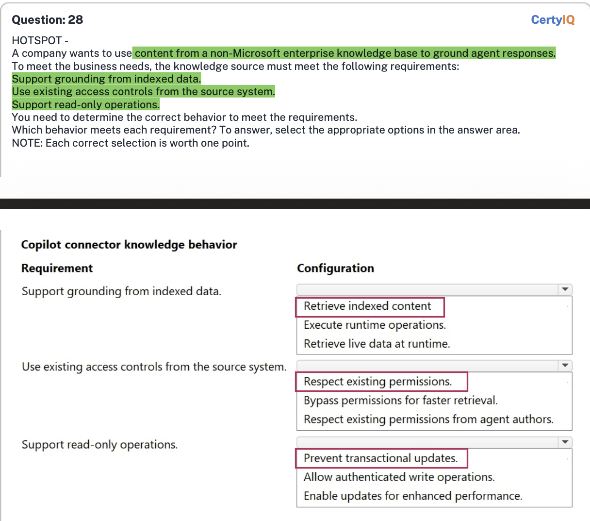

### 1. Extracted Question Summary

* **Scenario:** A company wants to use content from a non-Microsoft enterprise knowledge base to ground agent responses. The knowledge source must support grounding from indexed data, use existing access controls from the source system, and support read-only operations.

* **Question (Hotspot / Drop-down):** Select the appropriate **Copilot connector knowledge behavior** configuration for each requirement:

* **Requirement 1:** Support grounding from indexed data.

* *Options:* Retrieve indexed content | Execute runtime operations. | Retrieve live data at runtime.

* **Requirement 2:** Use existing access controls from the source system.

* *Options:* Respect existing permissions. | Bypass permissions for faster retrieval. | Respect existing permissions from agent authors.

* **Requirement 3:** Support read-only operations.

* *Options:* Prevent transactional updates. | Allow authenticated write operations. | Enable updates for enhanced performance.

---

### 2. Correct Answer

* **Support grounding from indexed data:** **Retrieve indexed content**

* **Use existing access controls from the source system:** **Respect existing permissions.**

* **Support read-only operations:** **Prevent transactional updates.**

---

### 4. Official Microsoft Justification

* **Copilot Connector Architecture & Security Trimming (`AB-620T00` — Integrate and extend agents in Copilot Studio > Connect to enterprise knowledge sources):** Microsoft 365 Copilot connectors (formerly Microsoft Graph connectors) ingest external, non-Microsoft repository content into the Microsoft Graph semantic index on a scheduled crawl:
1. **Indexed Semantic Grounding (`Retrieve indexed content`):** Unlike real-time Power Platform connectors that query live transactional databases on demand, Copilot connectors pre-index external documents and articles into Microsoft Graph so the agent retrieves grounded passages directly from the semantic index.

2. **End-User ACL Enforcement (`Respect existing permissions.`):** During ingestion, Copilot connectors synchronize item-level Access Control Lists (ACLs) from the external system into Microsoft Graph, enforcing security trimming against the **signed-in end user's** identity at query time so users only receive answers grounded in documents they are authorized to view.

3. **Read-Only Knowledge Abstraction (`Prevent transactional updates.`):** Copilot connectors operate strictly as read-only knowledge ingestion pipelines for Retrieval-Augmented Generation (RAG) and cannot execute write-backs, record mutations, or CRUD transactions against the source system.

---

### 5. Distractor Analysis (Why Others Are Wrong)

* **Requirement 1 Distractors:**
* *Execute runtime operations:* Describes **Tools (Actions)** or **Agent Flows**, not indexed knowledge retrieval.

* *Retrieve live data at runtime:* Describes **Real-time Power Platform connectors** (e.g., ServiceNow/SQL live table queries), whereas Copilot connectors query pre-indexed Microsoft Graph content.

* **Requirement 2 Distractors:**
* *Bypass permissions for faster retrieval:* Violates Microsoft Graph security trimming and enterprise data governance.

* *Respect existing permissions from agent authors:* Security trimming evaluates the **end user's** permissions at runtime, never the agent author's/maker's permissions.

* **Requirement 3 Distractors:**
* *Allow authenticated write operations / Enable updates for enhanced performance:* Copilot connectors are strictly read-only knowledge sources and do not perform write/update operations on source repositories.

---

### 6. Exam Keyword / Trap Alert

* **Keywords:** *"non-Microsoft enterprise knowledge base"* + *"indexed data"* + *"existing access controls"* + *"read-only operations"* = **Retrieve indexed content**, **Respect existing permissions**, and **Prevent transactional updates**.

* **Trap:** Watch out for *"Respect existing permissions from agent authors"*—Microsoft Graph security trimming ALWAYS evaluates the **end user's** ACLs at query time, never the maker/author's permissions.

## Q29

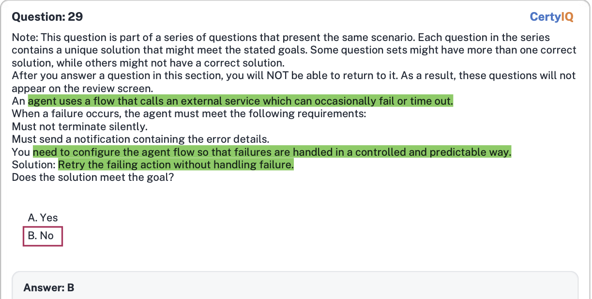

### 1. Extracted Question Summary

* **Scenario:** An agent uses a flow that calls an external service capable of occasional failures or timeouts. When a failure occurs, the agent must not terminate silently and must send a notification containing the error details.

* **Proposed Solution:** Retry the failing action without handling failure.

* **Question:** Does the solution meet the goal?

* **Options:**
* **A.** Yes

* **B.** No

* **Visible Markings / Answer in Screenshot:** Option **B** is boxed in red and `Answer: B` is displayed at the bottom.

---

### 2. Correct Answer

* **B: No**

---

### 3. Verification of Visible Selection / Community Key

* **Correct.** Both the red box around **B** and the visible key (`Answer: B`) are accurate because merely configuring a retry policy without explicit exception-handling logic still allows exhausted retries to fail silently without capturing error details or sending the required notification.

---

### 4. Official Microsoft Justification

* **Controlled Exception Handling in Agent Flows (`AB-620T00` — Create and manage agent flows in Microsoft Copilot Studio / Power Automate Error Handling Patterns):** While configuring a **Retry policy** (such as exponential or fixed-interval retries) on an HTTP or connector action mitigates transient network glitches, retries alone do not constitute a complete error-handling architecture when persistent timeouts or service outages occur.
* Under Microsoft's standard **Try-Catch** exception-handling pattern for agent flows, you must wrap the external call in a **Scope** (`Try`), pair it with a subsequent **Scope** (`Catch`) configured via **Configure run after** (`has failed` / `has timed out`), extract the failure metadata via `result('Try')`, and execute a notification action—otherwise, once all retry attempts are exhausted, the flow fails silently without alerting operators or returning structured error context to the agent.

---

### 5. Distractor Analysis (Why Others Are Wrong)

* **A (Yes):** Incorrect because retrying an action *"without handling failure"* provides no mechanism to capture exception payloads or dispatch a notification once the retry attempts fail.

---

### 6. Exam Keyword / Trap Alert

* **Keywords:** *"Must not terminate silently"* + *"send a notification containing the error details"* + *"without handling failure"* = **No (B)**.

* **Trap:** In Microsoft's repeated-scenario `"Does the solution meet the goal?"` series, only the variant that implements a **Scope / Configure run after (`has failed` / `has timed out`)** branch paired with a notification action will ever answer **Yes**—solutions relying solely on `Terminate` or `Retry policy` without failure handling always answer **No**.

## Q30
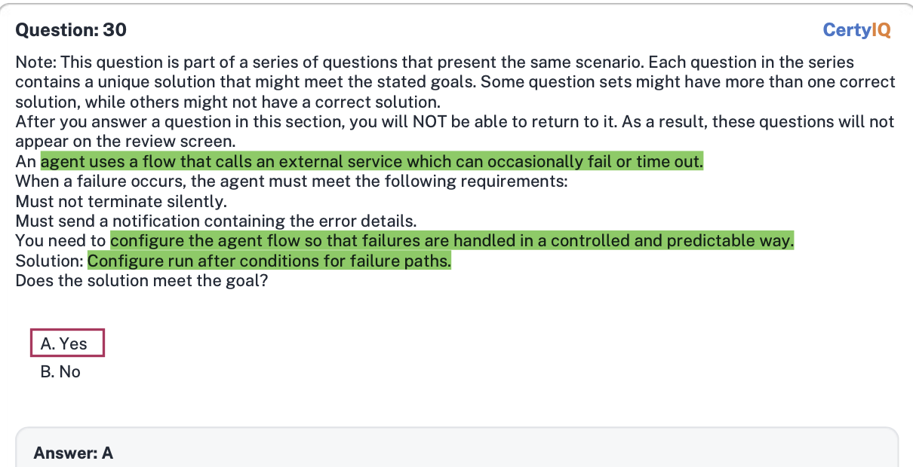

### 1. Extracted Question Summary

* **Scenario:** An agent uses a flow that calls an external service which can occasionally fail or time out. When a failure occurs, the agent must not terminate silently and must send a notification containing the error details.

* **Proposed Solution:** Configure run after conditions for failure paths.

* **Question:** Does the solution meet the goal?

* **Options:**
* **A.** Yes

* **B.** No

* **Visible Markings / Answer in Screenshot:** Option **A** is boxed in red and `Answer: A` is displayed at the bottom.

---

### 2. Correct Answer

* **A: Yes**

---

### 3. Verification of Visible Selection / Community Key

* **Correct.** Both the red box around **A** and the visible key (`Answer: A`) are accurate because configuring **Configure run after** conditions (`has failed`, `has timed out`, `is skipped`) creates explicit failure-handling branches that prevent silent termination and allow downstream notification actions to send detailed error payloads.

---

### 4. Official Microsoft Justification

* **Controlled Exception Handling in Agent Flows (`AB-620T00` — Create and manage agent flows in Microsoft Copilot Studio / Power Automate Error Handling):** Under Microsoft's standard exception-handling pattern for agent flows and cloud flows, makers wrap risky external connector or HTTP calls inside a **Scope** (or target action) and attach a parallel or sequential error-handling branch configured via **Settings → Configure run after** (selecting **Has failed** and **Has timed out**).
* By activating **Configure run after** conditions on the failure path, the flow intercepts runtime exceptions rather than aborting silently, extracts diagnostic metadata (via `result('Scope')` or `actions('ActionName')`), dispatches the required error notification, and returns controlled error context back to the calling Copilot Studio agent.

---

### 5. Distractor Analysis (Why Others Are Wrong)

* **B (No):** Incorrect because **Configure run after** is the exact built-in Power Automate / Copilot Studio agent flow mechanism designed to route execution along failure/timeout paths so notifications with error details can execute reliably.

---

### 6. Exam Keyword / Trap Alert

* **Keywords:** *"must not terminate silently"* + *"send a notification containing the error details"* + *"Configure run after conditions for failure paths"* = **Yes (A)**.

* **Trap:** Contrast this question (`Question 30`) directly with `Question 4` (*"Terminate the flow immediately on error"* → **No**) and `Question 29` (*"Retry the failing action without handling failure"* → **No**)—in Microsoft's repeated-scenario series, **Configure run after** is the specific architectural feature that satisfies controlled failure handling.

## Q31

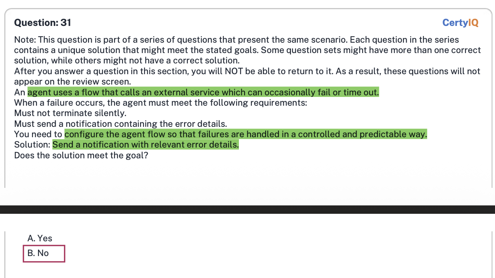

### 1. Extracted Question Summary

* **Scenario:** An agent uses a flow that calls an external service which can occasionally fail or time out. When a failure occurs, the agent must not terminate silently and must send a notification containing the error details. You need to configure the agent flow so that failures are handled in a controlled and predictable way.

* **Proposed Solution:** Send a notification with relevant error details.

* **Question:** Does the solution meet the goal?

* **Options:**
* **A.** Yes

* **B.** No

* **Visible Markings in Screenshot:** Option **B** (`No`) is boxed in red.

---

### 2. Correct Answer

* **B: No**

---

### 3. Verification of Visible Selection / Community Key

* **Correct.** The red box around **B (`No`)** is accurate because adding a notification action alone without configuring **Configure run after** (`has failed` / `has timed out`) conditions means the notification step is skipped by default whenever the preceding external service call fails or times out.

---

### 4. Official Microsoft Justification

* **Controlled Exception Handling in Agent Flows (`AB-620T00` — Create and manage agent flows in Microsoft Copilot Studio / Power Automate Run-After Execution Behavior):** By default in Microsoft Power Automate and Copilot Studio agent flows, every subsequent action has its **Configure run after** property set exclusively to **Is successful**.
* Consequently, if you simply place a notification action (e.g., *Send an email* or *Post message in a chat or channel*) after an external HTTP/connector action without modifying **Configure run after** to trigger on **Has failed** and **Has timed out** (typically paired with a **Scope** block and `result()` expression), the flow automatically skips the notification action and terminates silently upon failure—failing both requirements.

---

### 5. Distractor Analysis (Why Others Are Wrong)

* **A (Yes):** Incorrect because an unconfigured notification action placed sequentially after a failing action will never execute when an error or timeout occurs unless **Configure run after** failure paths are explicitly enabled.

---

### 6. Exam Keyword / Trap Alert

* **Keywords:** *"Must not terminate silently"* + *"send a notification containing the error details"* + *"Solution: Send a notification with relevant error details"* (missing `Configure run after`) = **No (B)**.

* **Trap:** Do not get fooled by solutions that mention the desired outcome (*"Send a notification with relevant error details"*) while omitting the underlying control-flow mechanism (**Configure run after** on failure paths)—in Power Automate / Copilot Studio agent flows, downstream actions are skipped on failure unless `runAfter` is explicitly configured.

## Q32
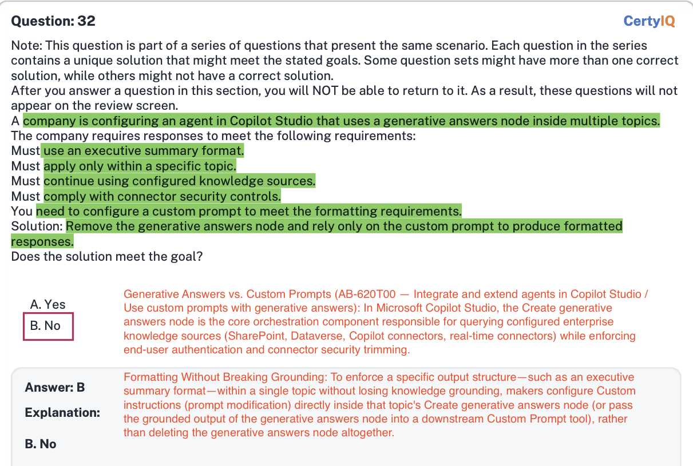

### 1. Extracted Question Summary

* **Scenario:** A company is configuring an agent in Copilot Studio that uses a generative answers node inside multiple topics. Responses must use an executive summary format, apply only within a specific topic, continue using configured knowledge sources, and comply with connector security controls. You need to configure a custom prompt to meet the formatting requirements.

* **Proposed Solution:** Remove the generative answers node and rely only on the custom prompt to produce formatted responses.

* **Question:** Does the solution meet the goal?

* **Options:**
* **A.** Yes

* **B.** No

* **Visible Markings / Answer in Screenshot:** Option **B** (`No`) is boxed in red and `Answer: B` is displayed at the bottom.

---

### 2. Correct Answer

* **B: No**

---

### 3. Verification of Visible Selection / Community Key

* **Correct.** Both the red box around **B** and `Answer: B` are accurate because removing the **Create generative answers** node strips away the agent's native Retrieval-Augmented Generation (RAG) grounding pipeline across its configured enterprise knowledge sources and connector ACL security controls.

---

### 4. Official Microsoft Justification

* **Generative Answers vs. Custom Prompts (`AB-620T00` — Integrate and extend agents in Copilot Studio / Use custom prompts with generative answers):** In Microsoft Copilot Studio, the **Create generative answers** node is the core orchestration component responsible for querying configured enterprise knowledge sources (SharePoint, Dataverse, Copilot connectors, real-time connectors) while enforcing end-user authentication and connector security trimming.
* **Formatting Without Breaking Grounding:** To enforce a specific output structure—such as an *executive summary format*—within a single topic without losing knowledge grounding, makers configure **Custom instructions** (prompt modification) directly inside that topic's **Create generative answers** node (or pass the grounded output of the generative answers node into a downstream Custom Prompt tool), rather than deleting the generative answers node altogether.

---

### 5. Distractor Analysis (Why Others Are Wrong)

* **A (Yes):** Incorrect because a standalone custom prompt without the generative answers node cannot natively retrieve and ground answers from the agent's configured knowledge sources or enforce connector-level security controls—violating the *"continue using configured knowledge sources"* and *"comply with connector security controls"* requirements.

---

### 6. Exam Keyword / Trap Alert

* **Keywords:** *"executive summary format"* + *"apply only within a specific topic"* + *"continue using configured knowledge sources"* + *"Remove the generative answers node"* = **No (B)**.

* **Trap:** Never remove a **Create generative answers** node when a question requires preserving **configured knowledge sources** and **connector security controls**—topic-specific formatting is applied *on* or *after* the generative answers node via custom instructions/prompts, never by replacing it.

## Q40
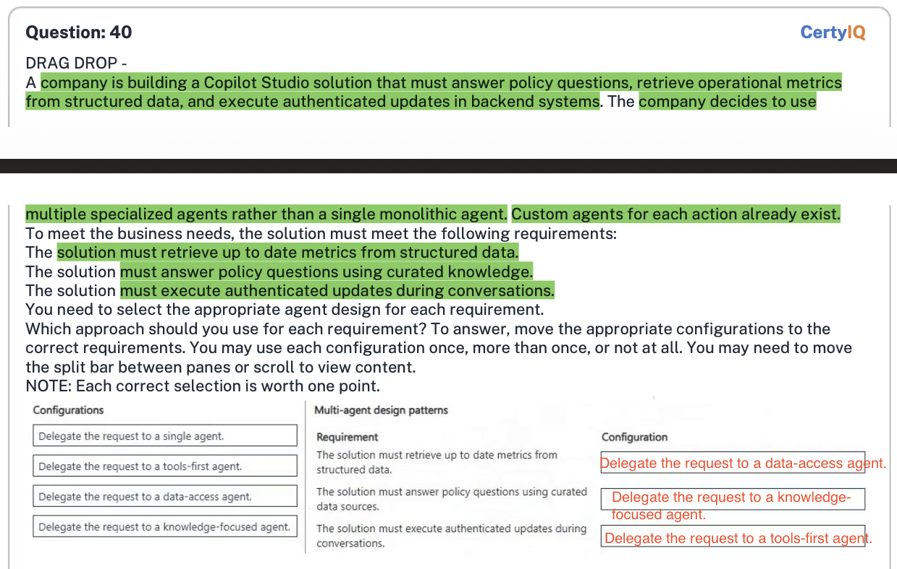

### 1. Extracted Question Summary

* **Scenario:** A company is building a Copilot Studio solution that must answer policy questions, retrieve operational metrics from structured data, and execute authenticated updates in backend systems using multiple specialized custom agents rather than a single monolithic agent.

* **Question (Drag and Drop):** Select the appropriate multi-agent design pattern for each requirement (configurations on the left may be used once, more than once, or not at all).

* **Available Configurations (Left Column):**
* Delegate the request to a single agent.

* Delegate the request to a tools-first agent.

* Delegate the request to a data-access agent.

* Delegate the request to a knowledge-focused agent.

* **Target Requirements (Right Table — `Multi-agent design patterns`):**
1. The solution must retrieve up to date metrics from structured data.

2. The solution must answer policy questions using curated data sources.

3. The solution must execute authenticated updates during conversations.

---

### 2. Correct Answer

* **The solution must retrieve up to date metrics from structured data:** **Delegate the request to a data-access agent.**

* **The solution must answer policy questions using curated data sources:** **Delegate the request to a knowledge-focused agent.**

* **The solution must execute authenticated updates during conversations:** **Delegate the request to a tools-first agent.**

---

### 4. Official Microsoft Justification

* **Multi-Agent Orchestration & Specialized Child/Connected Agents (`AB-620T00` / `AB-100` — Design multi-agent architectures in Microsoft Copilot Studio):** Rather than overloading a single monolithic agent with conflicting instructions, tools, and knowledge scopes, Microsoft recommends decomposing complex solutions into a primary orchestrator agent that delegates domain-specific intents to specialized sub-agents:
1. **Data-Access Agent (`Delegate the request to a data-access agent`):** Dedicated to querying real-time structured repositories (such as Dataverse, Azure SQL, Snowflake, or Fabric via real-time connectors) to retrieve live operational metrics without mixing transactional write actions into the prompt context.

2. **Knowledge-Focused Agent (`Delegate the request to a knowledge-focused agent`):** Grounded specifically in curated unstructured enterprise documentation (SharePoint libraries, uploaded policy PDFs, or Microsoft 365 Copilot connectors) for Retrieval-Augmented Generation (RAG) Q&A.

3. **Tools-First Agent (`Delegate the request to a tools-first agent`):** Configured with authenticated Power Platform connectors, custom connectors, agent flows, or MCP tools to execute parameterized CRUD operations and backend state mutations under the end user's authenticated context.

---

### 5. Distractor Analysis (Why Others Are Wrong)

* **Delegate the request to a single agent:** Explicitly contradicts the scenario's architectural decision to use *"multiple specialized agents rather than a single monolithic agent"*.

---

### 6. Exam Keyword / Trap Alert

* **Keywords:** *"up to date metrics from structured data"* = **data-access agent**; *"policy questions using curated data sources"* = **knowledge-focused agent**; *"execute authenticated updates"* = **tools-first agent**.

* **Trap:** Do not mix up **data-access** (read-only querying of live structured tables/metrics) with **tools-first** (authenticated write-backs, updates, and transactional execution).

## Q41

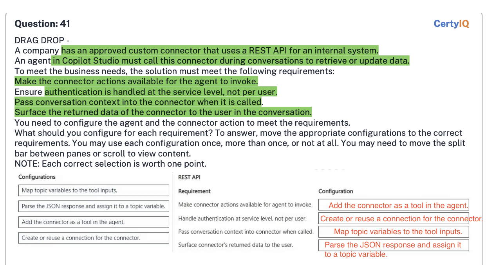

### 1. Extracted Question Summary

* **Scenario:** A company has an approved custom connector using a REST API for an internal system, and a Microsoft Copilot Studio agent must invoke it during conversations to retrieve or update data. The solution must make connector actions available for the agent to invoke, handle authentication at the service level rather than per user, pass conversation context into the connector when called, and surface the returned data to the user.

* **Question (Drag and Drop — Question 41):** Move the appropriate configurations on the left to match the four **REST API** requirements on the right (configurations may be used once, more than once, or not at all).

* **Available Configurations (Left Column):**
* Map topic variables to the tool inputs.

* Parse the JSON response and assign it to a topic variable.

* Add the connector as a tool in the agent.

* Create or reuse a connection for the connector.

* **Target Requirements (Right Table):**
1. Make connector actions available for agent to invoke.

2. Handle authentication at service level, not per user.

3. Pass conversation context into connector when called.

4. Surface connector's returned data to the user.

---

### 2. Correct Answer

* **Make connector actions available for agent to invoke:** **Add the connector as a tool in the agent.**

* **Handle authentication at service level, not per user:** **Create or reuse a connection for the connector.**

* **Pass conversation context into connector when called:** **Map topic variables to the tool inputs.**

* **Surface connector's returned data to the user:** **Parse the JSON response and assign it to a topic variable.**

---

### 4. Official Microsoft Justification

* **Custom Connector Tool Integration & Authentication (`AB-620T00` — Integrate and extend agents in Copilot Studio / Add tools to custom agents):** In Microsoft Copilot Studio, exposing REST API endpoints defined in a Power Platform custom connector for transactional retrieval and updates relies on four distinct configuration layers:
1. **Tool Registration (`Add the connector as a tool in the agent`):** Custom connector operations must be registered under the agent's **Tools** (formerly Actions) so either generative orchestration or deterministic topic nodes (`Call an action` / tool node) can invoke them.

2. **Service-Level Connection Binding (`Create or reuse a connection for the connector`):** Instead of prompting each end user to sign in individually (**End-user authentication**), configuring and binding a shared, pre-authenticated connection reference (**Maker-provided / service-level connection**) executes all connector calls under a single service identity.

3. **Input Parameter Binding (`Map topic variables to the tool inputs`):** Runtime conversational context (such as customer IDs, order numbers, or extracted slot entities) stored in **Topic** or **Global** variables is passed into the connector's OpenAPI request parameters via input mapping.

4. **Output Deserialization & Surfacing (`Parse the JSON response and assign it to a topic variable`):** Structured JSON payloads returned by the REST API are parsed according to the connector's response schema and stored in a **Topic variable**, enabling downstream **Send a message** nodes or Adaptive Cards to display the retrieved values to the user.

---

### 5. Distractor Analysis (Why Others Are Wrong)

* Because this is a one-to-one four-row Drag-and-Drop matrix where every configuration item on the left maps cleanly to a unique requirement on the right, errors stem solely from swapping rows:
* **Confusing `Map topic variables to the tool inputs` with `Parse the JSON response and assign it to a topic variable`:** Topic variables mapped to **tool inputs** handle *outbound* request context sent *to* the API, whereas parsing the JSON response into a topic variable handles *inbound* response data surfaced *back* to the user.

---

### 6. Exam Keyword / Trap Alert

* **Keywords:** *"actions available for agent to invoke"* = **Add the connector as a tool**; *"service level, not per user"* = **Create or reuse a connection**; *"Pass conversation context"* = **Map topic variables to the tool inputs**; *"Surface connector's returned data"* = **Parse the JSON response and assign it to a topic variable**.

* **Trap:** When an exam prompt specifies *"service level, not per user"* on a connector tool, it refers to binding a shared **maker-provided connection** (`Create or reuse a connection for the connector`) rather than requiring individual end-user OAuth sign-in prompts.

## Q42
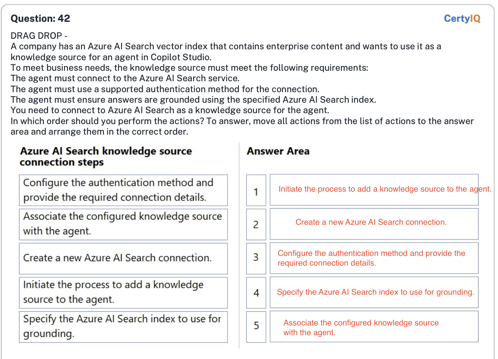

### 1. Extracted Question Summary

* **Scenario:** A company has an Azure AI Search vector index containing enterprise content and wants to use it as a knowledge source for an agent in Microsoft Copilot Studio. The knowledge source must connect to the Azure AI Search service, use a supported authentication method for the connection, and ensure answers are grounded using the specified Azure AI Search index.

* **Question (Drag and Drop — Question 42):** In which order should you perform the actions? Move all actions from `Azure AI Search knowledge source connection steps` to the `Answer Area` and arrange them in the correct order.

* **Available Actions (Left Column):**
* Configure the authentication method and provide the required connection details.

* Associate the configured knowledge source with the agent.

* Create a new Azure AI Search connection.

* Initiate the process to add a knowledge source to the agent.

* Specify the Azure AI Search index to use for grounding.

---

### 2. Correct Answer

* **Position 1:** **Initiate the process to add a knowledge source to the agent.**

* **Position 2:** **Create a new Azure AI Search connection.**

* **Position 3:** **Configure the authentication method and provide the required connection details.**

* **Position 4:** **Specify the Azure AI Search index to use for grounding.**

* **Position 5:** **Associate the configured knowledge source with the agent.**

---

### 4. Official Microsoft Justification

* **Azure AI Search Vector Index Grounding Workflow (`AB-620T00` — Integrate and extend agents in Copilot Studio / Connect to enterprise knowledge sources > Azure AI Search):** Integrating an existing Azure AI Search vector/semantic index as a knowledge source in Copilot Studio follows a strict sequential wizard flow:
1. **Start Knowledge Addition (`Initiate the process to add a knowledge source to the agent`):** Inside the agent's **Knowledge** experience, you click **+ Add knowledge** and select **Azure AI Search** from the enterprise data connectors list.

2. **Establish Connection Instance (`Create a new Azure AI Search connection`):** When no prior connection exists, you initiate creating a new Azure AI Search connection within the connector dialog.

3. **Authenticate & Configure Endpoint (`Configure the authentication method and provide the required connection details`):** You select a supported authentication method (such as **API Key** or **Microsoft Entra ID** integrated authentication) and enter the Azure AI Search endpoint URL and credentials.

4. **Target the Vector Index (`Specify the Azure AI Search index to use for grounding`):** Once authenticated against the search service, Copilot Studio queries the service and prompts you to select the specific vector/hybrid **index** containing your enterprise content.

5. **Bind to Agent (`Associate the configured knowledge source with the agent`):** Finally, you select **Add** / **Add to agent** to save and attach the configured Azure AI Search knowledge source to the agent.

---

### 5. Distractor Analysis (Why Others Are Wrong)

* Because this is a **five-step sequencing (Drag-and-Drop) question** requiring all items to be ordered, errors arise solely from misordering the dependency chain:
* **Specifying the index before configuring authentication/connection details:** Copilot Studio cannot enumerate available indexes on the Azure AI Search instance until the connection endpoint and authentication credentials are validated.

* **Associating the knowledge source before specifying the index:** The index selection occurs inside the modal *before* committing the knowledge source to the agent.

---

### 6. Exam Keyword / Trap Alert

* **Keywords:** *"Azure AI Search vector index"* + *"supported authentication method"* + *"grounded using the specified Azure AI Search index"*.

* **Trap:** Lock in the exact five-step dependency chain for external search/connector knowledge sources: **Initiate Add Knowledge → Create New Connection → Configure Auth & Connection Details → Specify Index → Associate with Agent**.

## Q43

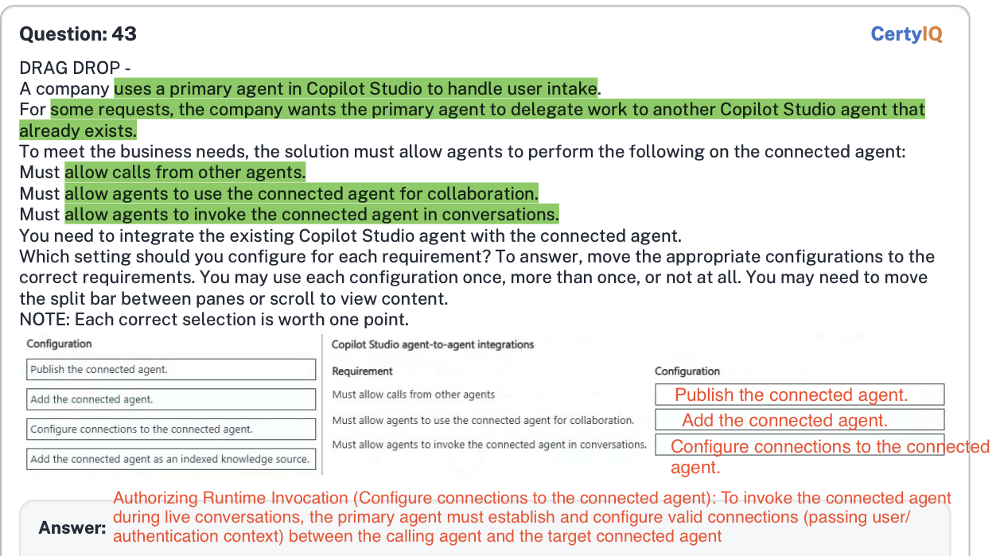

### 1. Extracted Question Summary

* **Scenario:** A company uses a primary agent in Microsoft Copilot Studio to handle user intake and wants it to delegate specific requests to another existing Copilot Studio agent. The solution must allow calls from other agents, allow agents to use the connected agent for collaboration, and allow agents to invoke the connected agent in conversations.

* **Question (Drag and Drop — Question 43):** Select the appropriate configuration for each **Copilot Studio agent-to-agent integrations** requirement (configurations on the left may be used once, more than once, or not at all).

* **Available Configurations (Left Column):**
* Publish the connected agent.

* Add the connected agent.

* Configure connections to the connected agent.

* Add the connected agent as an indexed knowledge source.

* **Target Requirements (Right Table):**
1. Must allow calls from other agents.

2. Must allow agents to use the connected agent for collaboration.

3. Must allow agents to invoke the connected agent in conversations.

---

### 2. Correct Answer

* **Must allow calls from other agents:** **Publish the connected agent.**

* **Must allow agents to use the connected agent for collaboration:** **Add the connected agent.**

* **Must allow agents to invoke the connected agent in conversations:** **Configure connections to the connected agent.**

---

### 4. Official Microsoft Justification

* **Multi-Agent Orchestration & Connected Agents (`AB-620T00` / `AB-100` — Connect and orchestrate multiple agents in Microsoft Copilot Studio):** When integrating an existing, independent Copilot Studio agent as a **Connected Agent** (agent-to-agent delegation), Copilot Studio requires three distinct setup steps across the secondary (connected) agent and the primary (orchestrator) agent:
1. **Exposing the Connected Agent (`Publish the connected agent`):** An existing agent cannot accept external agent-to-agent calls or be discovered/invoked until it has been **published** (and its settings allow being called by other agents).

2. **Registering for Multi-Agent Collaboration (`Add the connected agent`):** Inside the primary orchestrator agent's **Agents** section, the maker selects **+ Add an agent → Connect to an existing agent** (`Add the connected agent`) and defines its description/delegation instructions so the orchestrator knows when to collaborate with it.

3. **Authorizing Runtime Invocation (`Configure connections to the connected agent`):** To invoke the connected agent during live conversations, the primary agent must establish and configure valid **connections** (passing user/authentication context) between the calling agent and the target connected agent.

---

### 5. Distractor Analysis (Why Others Are Wrong)

* **Add the connected agent as an indexed knowledge source:** Connected agents are active conversational/orchestration delegates with their own topics, tools, and instructions—they are registered under **Agents** (multi-agent collaboration), never ingested as a static or indexed **Knowledge source**.

---

### 6. Exam Keyword / Trap Alert

* **Keywords:** *"delegate work to another Copilot Studio agent that already exists"* + *"connected agent"* + *"collaboration"* + *"invoke the connected agent in conversations"*.

* **Trap:** Always separate the three phases of **Connected Agents** in Copilot Studio: the target agent must be **published** to accept calls, **added** under the primary agent's **Agents** list for collaboration, and have its **connections configured** to invoke at runtime—never treat another agent as an *indexed knowledge source*.

## Q44

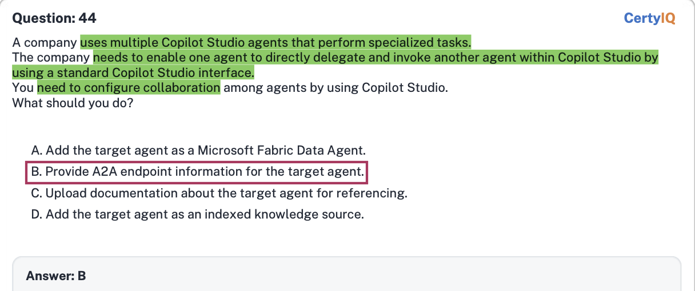

### 1. Extracted Question Summary

* **Scenario:** A company uses multiple Copilot Studio agents that perform specialized tasks and needs to enable one agent to directly delegate and invoke another agent within Copilot Studio by using a standard Copilot Studio interface. You need to configure collaboration among agents by using Copilot Studio.

* **Question (Question 44):** What should you do?

* **Options:**
* **A.** Add the target agent as a Microsoft Fabric Data Agent.

* **B.** Provide A2A endpoint information for the target agent.

* **C.** Upload documentation about the target agent for referencing.

* **D.** Add the target agent as an indexed knowledge source.

* **Visible Markings / Answer in Screenshot:** Option **B** is boxed in red and `Answer: B` is displayed at the bottom.

---

### 2. Correct Answer

* **B: Provide A2A endpoint information for the target agent.**

---

### 3. Verification of Visible Selection / Community Key

* **Correct.** Both the red box around **B** and `Answer: B` are accurate because Copilot Studio supports connecting external or cross-agent targets via the open **Agent-to-Agent (A2A)** protocol standard by supplying the target agent's A2A endpoint URL/configuration details in the **Add an agent** experience.

---

### 4. Official Microsoft Justification

* **Multi-Agent Collaboration & Agent-to-Agent (A2A) Protocol (`AB-620T00` / `AB-100` — Connect and orchestrate multiple agents in Microsoft Copilot Studio):** In Microsoft Copilot Studio, an orchestrator agent can delegate tasks to specialized external or remote agents using standardized protocols under **Agents → + Add an agent**:
* **Agent-to-Agent (A2A) Standard Integration (`Provide A2A endpoint information for the target agent`):** Alongside native Copilot Studio connected agents and Microsoft Fabric data agents, Copilot Studio natively supports the open **Agent-to-Agent (A2A)** protocol—allowing you to connect an agent by providing its **A2A endpoint information** (such as the agent card / endpoint URL and authentication details) so the primary orchestrator can discover the target agent's skills and invoke it over a standardized interface during conversations.

---

### 5. Distractor Analysis (Why Others Are Wrong)

* **A:** **Microsoft Fabric Data Agent** is specifically designed for natural-language Q&A over Microsoft Fabric data warehouses, lakehouses, and semantic models—not for general cross-agent task delegation in Copilot Studio.

* **C:** Uploading static documentation only provides passive text for Retrieval-Augmented Generation (RAG) grounding; it does not allow the primary agent to invoke or delegate live execution to another agent.

* **D:** Agents are active conversational/orchestration delegates registered under the **Agents** tab, never ingested as an indexed **Knowledge source**.

---

### 6. Exam Keyword / Trap Alert

* **Keywords:** *"directly delegate and invoke another agent"* + *"standard Copilot Studio interface"* + *"configure collaboration among agents"* = **Provide A2A endpoint information for the target agent**.

* **Trap:** Do not confuse **Fabric Data Agent** (Option A, strictly for querying Microsoft Fabric analytical data) or **Knowledge sources** (Options C/D, static RAG text) with **A2A (Agent-to-Agent) endpoint configuration** (Option B), which is the standardized protocol interface for delegating live requests between specialized agents.

## Q45

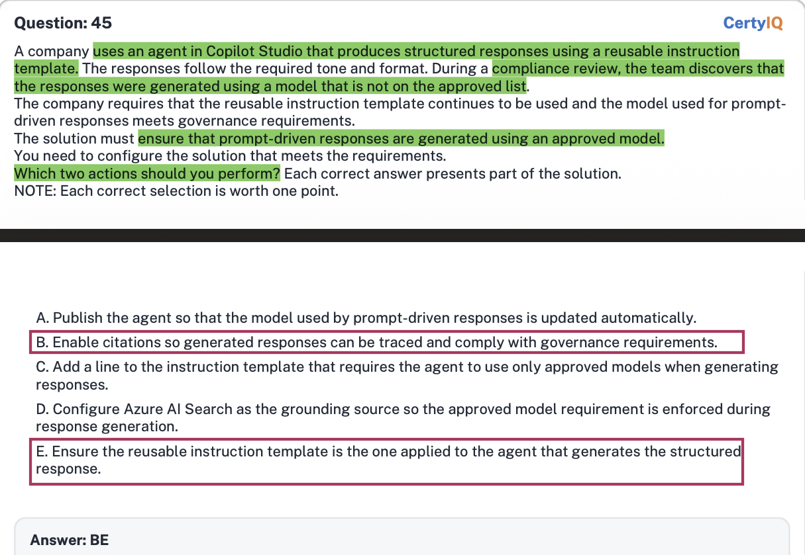

### 1. Extracted Question Summary

* **Scenario:** A company uses an agent in Microsoft Copilot Studio that produces structured responses using a reusable instruction template. During a compliance review, the team discovers that the responses were generated using a model not on the approved list. The solution must continue using the reusable instruction template and ensure prompt-driven responses are generated using an approved model meeting governance requirements.

* **Question (Question 45):** Which two actions should you perform? (Each correct answer presents part of the solution.)

* **Options:**
* **A.** Publish the agent so that the model used by prompt-driven responses is updated automatically.

* **B.** Enable citations so generated responses can be traced and comply with governance requirements.

* **C.** Add a line to the instruction template that requires the agent to use only approved models when generating responses.

* **D.** Configure Azure AI Search as the grounding source so the approved model requirement is enforced during response generation.

* **E.** Ensure the reusable instruction template is the one applied to the agent that generates the structured response.

* **Visible Answer in Screenshot:** `Answer: BE`

---

### 2. Correct Answer

* **B: Enable citations so generated responses can be traced and comply with governance requirements.**

* **E: Ensure the reusable instruction template is the one applied to the agent that generates the structured response.**

* *(Note on Model Governance in Copilot Studio: In the actual Copilot Studio / AI Builder Prompt Builder UI, selecting the specific underlying LLM model—such as GPT-4o vs. GPT-4o mini—is configured directly inside the prompt's **Model** dropdown and governed via Power Platform Admin Center / AI Builder model governance policies. Among the five constrained choices presented in this CertyIQ item, **B** and **E** are the only two valid configuration practices.)*

---

### 3. Verification of Visible Selection / Community Key

* **Disputed / Partially Flawed Question Pool (Matches Key `BE`):** The visible key (`BE`) reflects the only two valid Copilot Studio configuration practices among the five options—enforcing traceability/governance via citations (**B**) and verifying the correct reusable prompt/instruction template is bound to the agent (**E**)—while options A, C, and D describe technically impossible behaviors in Copilot Studio.

---

### 4. Official Microsoft Justification

* **Prompt Governance, Model Selection & Traceability (`AB-620T00` / `AB-100` — Manage and govern agents in Copilot Studio / Configure custom prompts):**
1. **Applying the Governed Reusable Prompt (`Ensure the reusable instruction template is the one applied to the agent`):** In Copilot Studio, reusable instruction templates are implemented as **Custom Prompts** (AI Builder / Copilot Studio Prompt Builder tools) where the maker explicitly selects the approved foundation model (e.g., GPT-4o) in the prompt's **Model** settings. Ensuring that the specific governed prompt template is bound to the agent/topic guarantees the prompt runs under that template's configured model and output schema rather than an unapproved default.

2. **Auditability & Governance Traceability (`Enable citations so generated responses can be traced`):** Enabling **citations** on generative/prompt-driven responses surfaces source attribution and provenance links directly in the response payload and conversation transcripts, satisfying compliance and auditability requirements during governance reviews.

---

### 5. Distractor Analysis (Why Others Are Wrong)

* **A:** Publishing an agent deploys current configurations to live channels; it does not automatically swap or upgrade the underlying LLM model configured inside a custom prompt.

* **C:** Natural-language text inside an instruction template/system prompt is processed *by* the LLM at inference time—it cannot dynamically switch which underlying foundation model endpoint executes the API call.

* **D:** **Azure AI Search** is a vector/hybrid retrieval knowledge index for Retrieval-Augmented Generation (RAG); configuring a search index controls *grounding data*, not which foundation LLM model generates the response.

---

### 6. Exam Keyword / Trap Alert

* **Keywords:** *"reusable instruction template"* + *"compliance review"* + *"governance requirements"* = **Enable citations** (**B**) + **Ensure the reusable instruction template is applied** (**E**).

* **Trap:** Never fall for distractors suggesting that writing natural-language text inside a prompt (**C**) or attaching a search index (**D**) can control which underlying LLM model executes—model selection is a metadata configuration on the prompt/agent, never controlled by prompt text or RAG indexes.

## Q46

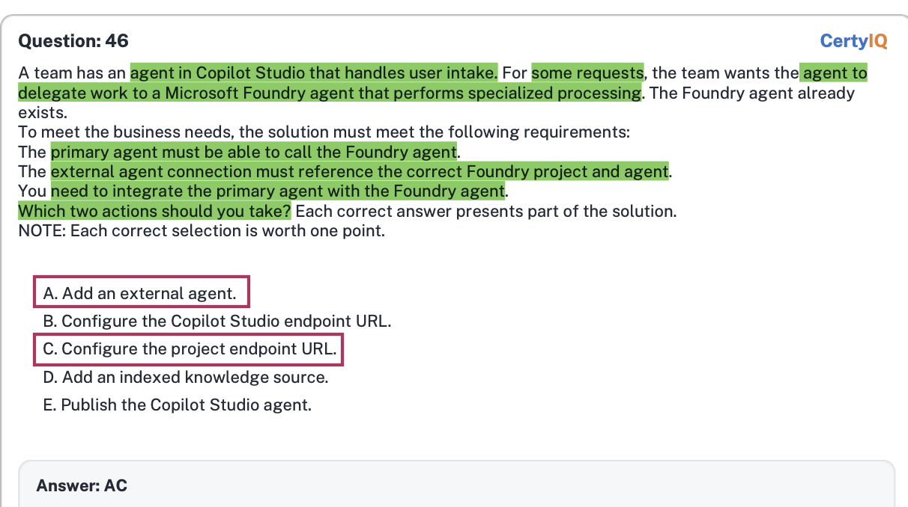

### 1. Extracted Question Summary

* **Scenario:** A team has a primary agent in Microsoft Copilot Studio that handles user intake and needs to delegate specialized processing requests to an existing **Microsoft Foundry** (Azure AI Foundry) agent. The primary agent must be able to call the Foundry agent, and the external agent connection must reference the correct Foundry project and agent.

* **Question (Question 46):** Which two actions should you take? (Each correct answer presents part of the solution.)

* **Options:**
* **A.** Add an external agent.

* **B.** Configure the Copilot Studio endpoint URL.

* **C.** Configure the project endpoint URL.

* **D.** Add an indexed knowledge source.

* **E.** Publish the Copilot Studio agent.

* **Visible Answer in Screenshot:** `Answer: AC`

---

### 2. Correct Answer

* **A: Add an external agent.**

* **C: Configure the project endpoint URL.**

---

### 3. Verification of Visible Selection / Community Key

* **Correct.** The visible key (`Answer: AC`) is accurate because connecting an external **Microsoft Foundry** agent to a primary Copilot Studio agent requires adding an external agent under the primary agent's **Agents** configuration (**A**) and specifying the Foundry **project endpoint URL** and agent ID (**C**).

---

### 4. Official Microsoft Justification

* **Connecting Microsoft Foundry Agents to Copilot Studio (`AB-620T00` / `AB-100` — Connect and orchestrate multiple agents in Microsoft Copilot Studio):** Copilot Studio supports native multi-agent delegation to pro-code agents built in **Microsoft Foundry** (Azure AI Foundry Agent Service):
1. **Registering the External Agent (`Add an external agent`):** Inside the primary Copilot Studio agent, navigate to **Agents → + Add an agent** and select **Connect to an external agent → Microsoft Foundry**.

2. **Binding the Foundry Project & Agent (`Configure the project endpoint URL`):** To establish the connection to the target Foundry agent, you enter the **Microsoft Foundry project endpoint URL** (found in the Foundry portal project overview) along with the target **Agent ID** and descriptive delegation instructions so the Copilot Studio orchestrator knows when to route requests to it.

---

### 5. Distractor Analysis (Why Others Are Wrong)

* **B:** Configuring a **Copilot Studio endpoint URL** applies when an *external* client application calls *into* Copilot Studio, whereas here Copilot Studio is calling *outbound* to a Microsoft Foundry project endpoint.

* **D:** External Foundry agents are active conversational/processing delegates configured under **Agents**, never ingested as static or indexed **Knowledge sources**.

* **E:** Publishing the primary Copilot Studio agent deploys it to end-user channels after configuration, rather than establishing the inbound integration link to the Microsoft Foundry project.

---

### 6. Exam Keyword / Trap Alert

* **Keywords:** *"delegate work to a Microsoft Foundry agent"* + *"external agent connection"* + *"reference the correct Foundry project and agent"* = **Add an external agent** (**A**) + **Configure the project endpoint URL** (**C**).

* **Trap:** Do not confuse **Copilot Studio endpoint URL** (Option B) with **project endpoint URL** (Option C)—when Copilot Studio invokes an external Microsoft Foundry agent, you always configure the **Foundry project endpoint URL**.

## Q47

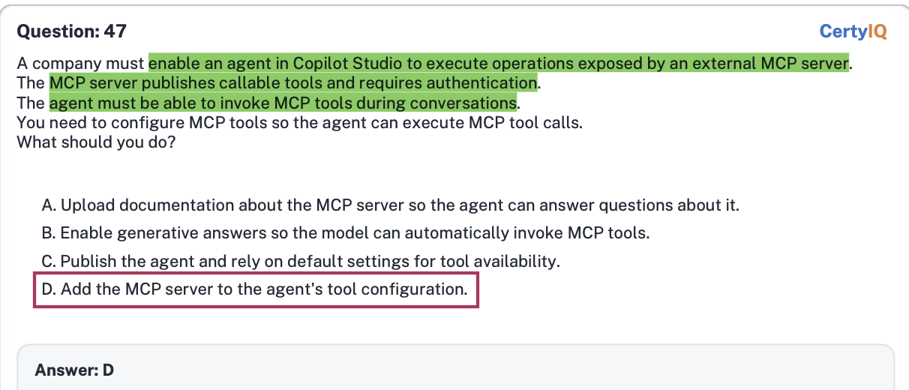

### 1. Extracted Question Summary

* **Scenario:** A company must enable an agent in Microsoft Copilot Studio to execute operations exposed by an external Model Context Protocol (MCP) server that publishes callable tools and requires authentication. The agent must be able to invoke MCP tools during conversations.

* **Question (Question 47):** You need to configure MCP tools so the agent can execute MCP tool calls. What should you do?

* **Options:**
* **A.** Upload documentation about the MCP server so the agent can answer questions about it.

* **B.** Enable generative answers so the model can automatically invoke MCP tools.

* **C.** Publish the agent and rely on default settings for tool availability.

* **D.** Add the MCP server to the agent's tool configuration.

* **Visible Answer in Screenshot:** `Answer: D`

---

### 2. Correct Answer

* **D: Add the MCP server to the agent's tool configuration.**

---

### 3. Verification of Visible Selection / Community Key

* **Correct.** The visible key (`Answer: D`) is accurate because Model Context Protocol (MCP) servers are integrated into Copilot Studio by registering the MCP server endpoint and authentication under the agent's **Tools** (`+ Add a tool → Model Context Protocol`), which dynamically exposes all tools published by that MCP server to the agent's orchestrator.

---

### 4. Official Microsoft Justification

* **Model Context Protocol (MCP) Integration in Copilot Studio (`AB-620T00` / `AB-100` — Integrate and extend agents in Copilot Studio / Extend your agent with Model Context Protocol):** Copilot Studio natively supports connecting to external **Model Context Protocol (MCP)** servers as reusable tool providers:
* **Tool Registration & Discovery (`Add the MCP server to the agent's tool configuration`):** When you add an MCP server under the agent's **Tools** section (via an MCP connector or MCP server URL and authentication configuration), Copilot Studio establishes a connection to the MCP server, dynamically discovers all callable tools (`tools/list`), schemas, and descriptions exposed by the server, and makes them invocable by the agent during conversations without manually wrapping each endpoint individually.

---

### 5. Distractor Analysis (Why Others Are Wrong)

* **A:** Uploading documentation adds static text to the agent's **Knowledge** base for Retrieval-Augmented Generation (RAG) Q&A; it does not register executable endpoints or allow the agent to invoke live MCP tool calls.

* **B:** Generative answers synthesize natural-language responses from grounded knowledge sources—they do not discover, authenticate against, or execute external MCP server tools.

* **C:** Publishing an agent deploys existing configurations to live channels; external MCP servers are never connected automatically via default settings unless explicitly added to the agent's **Tools** configuration.

---

### 6. Exam Keyword / Trap Alert

* **Keywords:** *"execute operations exposed by an external MCP server"* + *"publishes callable tools and requires authentication"* + *"invoke MCP tools during conversations"* = **Add the MCP server to the agent's tool configuration**.

* **Trap:** Always map **MCP (Model Context Protocol) servers** to the agent's **Tools** configuration (never **Knowledge** or **Generative answers**), as MCP is an open protocol specifically designed for dynamic tool discovery and execution.

## Q48

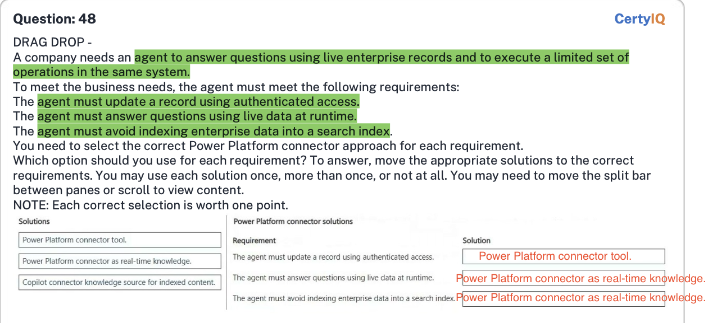

### 1. Extracted Question Summary

* **Scenario:** A company needs a Microsoft Copilot Studio agent to answer questions using live enterprise records and execute a limited set of operations in the same system. The agent must update a record using authenticated access, answer questions using live data at runtime, and avoid indexing enterprise data into a search index.

* **Question (Drag and Drop — Question 48):** Select the correct Power Platform connector approach for each requirement (solutions on the left may be used once, more than once, or not at all).

* **Available Solutions (Left Column):**
* Power Platform connector tool.

* Power Platform connector as real-time knowledge.

* Copilot connector knowledge source for indexed content.

* **Target Requirements (Right Table — `Power Platform connector solutions`):**
1. The agent must update a record using authenticated access.

2. The agent must answer questions using live data at runtime.

3. The agent must avoid indexing enterprise data into a search index.

---

### 2. Correct Answer

* **The agent must update a record using authenticated access:** **Power Platform connector tool.**

* **The agent must answer questions using live data at runtime:** **Power Platform connector as real-time knowledge.**

* **The agent must avoid indexing enterprise data into a search index:** **Power Platform connector as real-time knowledge.**

---

### 4. Official Microsoft Justification

* **Real-Time Power Platform Connector Knowledge vs. Connector Tools (`AB-620T00` — Integrate and extend agents in Copilot Studio > Connect to enterprise knowledge sources & Add tools):** In Microsoft Copilot Studio, Power Platform connectors serve two distinct architectural roles depending on whether the agent is performing read-only Retrieval-Augmented Generation (RAG) grounding or executing transactional write operations:
1. **Transactional Write / Update Operations (`Power Platform connector tool`):** Knowledge sources in Copilot Studio are strictly read-only. To create, update, or delete a record in an external enterprise system under authenticated access, you must add the connector's specific write operation as a **Tool** (formerly Action) so the orchestrator or topic can invoke the API mutation with typed input parameters.

2. **Live Runtime Querying Without Pre-Indexing (`Power Platform connector as real-time knowledge`):** Adding a Power Platform connector (such as Salesforce, ServiceNow, Zendesk, or Azure SQL) as **real-time knowledge** allows the agent to query live enterprise records directly at conversation runtime via API calls—ensuring responses always reflect up-to-the-second data while completely avoiding ingesting or indexing enterprise data into a Microsoft Graph or search index.

---

### 5. Distractor Analysis (Why Others Are Wrong)

* **Copilot connector knowledge source for indexed content:** Copilot connectors (formerly Microsoft Graph connectors) crawl and pre-index external enterprise data into the Microsoft Graph semantic search index on a scheduled basis—directly violating both the requirement to query **live data at runtime** and the requirement to **avoid indexing enterprise data into a search index**.

---

### 6. Exam Keyword / Trap Alert

* **Keywords:** *"update a record"* = **Power Platform connector tool**; *"live data at runtime"* + *"avoid indexing enterprise data"* = **Power Platform connector as real-time knowledge** (reused twice).

* **Trap:** Do not hesitate to assign **Power Platform connector as real-time knowledge** to both the second and third requirements—the rubric explicitly allows reusing a solution *"more than once"*, and real-time knowledge connectors satisfy both live runtime querying and zero search-index ingestion.

## Q49

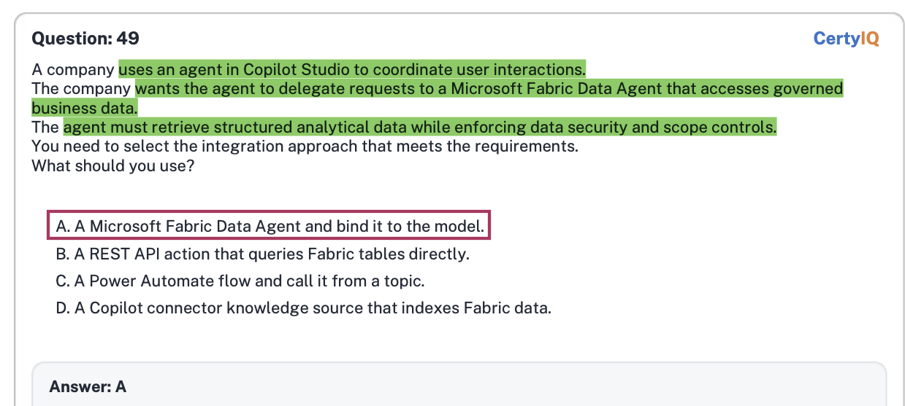

### 1. Extracted Question Summary

* **Scenario:** A company uses an agent in Microsoft Copilot Studio to coordinate user interactions and wants the agent to delegate requests to a **Microsoft Fabric Data Agent** that accesses governed business data. The agent must retrieve structured analytical data while enforcing data security and scope controls.

* **Question (Question 49):** You need to select the integration approach that meets the requirements. What should you use?

* **Options:**
* **A.** A Microsoft Fabric Data Agent and bind it to the model.

* **B.** A REST API action that queries Fabric tables directly.

* **C.** A Power Automate flow and call it from a topic.

* **D.** A Copilot connector knowledge source that indexes Fabric data.

* **Visible Answer in Screenshot:** `Answer: A`

---

### 2. Correct Answer

* **A: A Microsoft Fabric Data Agent and bind it to the model.**

---

### 3. Verification of Visible Selection / Community Key

* **Correct.** The visible key (`Answer: A`) is accurate because connecting a published **Microsoft Fabric Data Agent** directly under Copilot Studio's multi-agent/knowledge integration allows the primary Copilot Studio orchestrator to delegate analytical natural-language queries to Fabric while preserving OneLake security, row-level/object-level permissions, and curated schema scope.

---

### 4. Official Microsoft Justification

* **Microsoft Fabric Data Agent Integration (`AB-620T00` / `AB-100` — Connect and orchestrate multiple agents / Integrate Microsoft Fabric Data Agents in Copilot Studio):** In Microsoft Copilot Studio, makers can natively connect to a published **Microsoft Fabric Data Agent** (formerly AI Skill in Microsoft Fabric) via **Agents → + Add an agent → Microsoft Fabric** (or as a connected data agent):
* **Governed Analytical Delegation (`A Microsoft Fabric Data Agent and bind it to the model`):** Rather than duplicating analytical datasets or writing custom SQL/API wrappers, binding a Microsoft Fabric Data Agent to the Copilot Studio agent lets the generative orchestrator route analytical questions directly to Fabric. The Fabric Data Agent translates natural language into governed queries (SQL/DAX/KQL) over curated lakehouses, warehouses, or Power BI semantic models while strictly enforcing the signed-in user's Fabric permissions, row-level security (RLS), and the author's defined schema scope.

---

### 5. Distractor Analysis (Why Others Are Wrong)

* **B:** Calling a custom REST API to query raw Fabric tables bypasses the Fabric Data Agent's semantic reasoning, curated instructions, and built-in natural-language-to-query translation.

* **C:** Wrapping analytical queries inside a deterministic Power Automate flow requires hardcoding fixed query parameters and does not leverage dynamic generative delegation or Fabric's conversational data-agent scope controls.

* **D:** Microsoft 365 Copilot connectors crawl and ingest unstructured documents into the Microsoft Graph semantic index; they are not designed to copy/index structured analytical Fabric tables or execute dynamic analytical aggregations.

---

### 6. Exam Keyword / Trap Alert

* **Keywords:** *"delegate requests to a Microsoft Fabric Data Agent"* + *"governed business data"* + *"structured analytical data while enforcing data security and scope controls"* = **A Microsoft Fabric Data Agent and bind it to the model**.

* **Trap:** Never choose options that **index** structured analytical Fabric data into a search index (Option D) or bypass the Fabric Data Agent with raw table APIs (Option B)—native **Fabric Data Agent** binding preserves both Fabric's semantic scope and end-user security governance.

## Q50

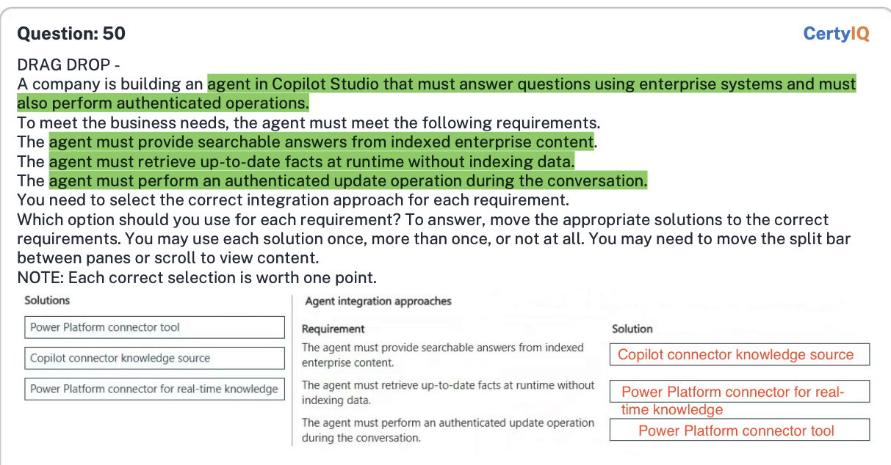

### 1. Extracted Question Summary

* **Scenario:** A company is building an agent in Microsoft Copilot Studio that must answer questions using enterprise systems and also perform authenticated operations. To meet the business needs, the agent must provide searchable answers from indexed enterprise content, retrieve up-to-date facts at runtime without indexing data, and perform an authenticated update operation during the conversation.

* **Question (Drag and Drop — Question 50):** Select the correct integration approach for each requirement by moving the appropriate solutions on the left to the corresponding requirements on the right (each solution may be used once, more than once, or not at all).

* **Available Solutions (Left Column):**
* Power Platform connector tool

* Copilot connector knowledge source

* Power Platform connector for real-time knowledge

* **Target Requirements (Right Table — `Agent integration approaches`):**
1. The agent must provide searchable answers from indexed enterprise content.

2. The agent must retrieve up-to-date facts at runtime without indexing data.

3. The agent must perform an authenticated update operation during the conversation.

---

### 2. Correct Answer

* **The agent must provide searchable answers from indexed enterprise content:** **Copilot connector knowledge source**

* **The agent must retrieve up-to-date facts at runtime without indexing data:** **Power Platform connector for real-time knowledge**

* **The agent must perform an authenticated update operation during the conversation:** **Power Platform connector tool**

---

### 4. Official Microsoft Justification

* **Knowledge Grounding vs. Transactional Tools Architecture (`AB-620T00` — Integrate and extend agents in Copilot Studio > Connect to enterprise knowledge sources & Add tools):** Microsoft Copilot Studio distinguishes three primary integration mechanisms based on data freshness, indexing model, and read/write capabilities:
1. **Pre-Indexed Enterprise Content (`Copilot connector knowledge source`):** Microsoft 365 Copilot connectors (formerly Microsoft Graph connectors) crawl external repositories and ingest content into the Microsoft Graph semantic search index on a scheduled basis, enabling Retrieval-Augmented Generation (RAG) grounding over indexed enterprise content with ACL security trimming.

2. **Zero-Index Runtime Queries (`Power Platform connector for real-time knowledge`):** Adding a Power Platform connector (such as ServiceNow, Salesforce, Dataverse, or Azure SQL) as **real-time knowledge** queries live enterprise endpoints directly at conversation runtime, returning up-to-date facts without duplicating or indexing records into a search index.

3. **Authenticated Write / Mutation Operations (`Power Platform connector tool`):** Knowledge sources in Copilot Studio are strictly read-only. To create, update, or delete records in a backend system during a conversation, makers add the connector's write operation as a **Tool** (formerly Action) so the orchestrator or topic can invoke the authenticated API operation with typed inputs.

---

### 5. Distractor Analysis (Why Others Are Wrong)

* Because this is a one-to-one three-row Drag-and-Drop matrix where every solution on the left maps uniquely to one requirement on the right, errors stem solely from misaligning the three architectural patterns:
* **Swapping `Copilot connector knowledge source` and `Power Platform connector for real-time knowledge`:** Copilot connectors always rely on pre-indexed Microsoft Graph ingestion (*indexed enterprise content*), whereas real-time Power Platform knowledge connectors query live APIs on demand (*without indexing data*).

* **Using either knowledge source option for an update operation:** Neither Copilot connectors nor real-time knowledge connectors can execute write-backs or state mutations—authenticated updates require a **Power Platform connector tool**.

---

### 6. Exam Keyword / Trap Alert

* **Keywords:** *"searchable answers from indexed enterprise content"* = **Copilot connector knowledge source**; *"up-to-date facts at runtime without indexing data"* = **Power Platform connector for real-time knowledge**; *"authenticated update operation"* = **Power Platform connector tool**.

* **Trap:** Always separate **read-only indexed RAG** (Copilot connector), **read-only live query RAG** (Power Platform real-time knowledge), and **read/write transactional execution** (Power Platform connector tool)—this three-way architectural distinction is a core `AB-620` / `AB-100` exam blueprint staple.

## Q51

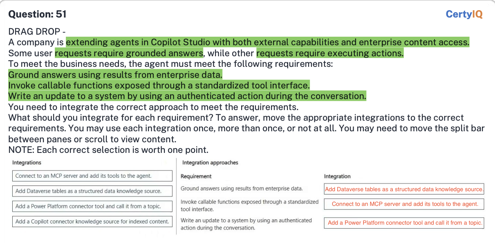

### 1. Extracted Question Summary

* **Scenario:** A company is extending agents in Microsoft Copilot Studio with both external capabilities and enterprise content access. Some user requests require grounded answers, while other requests require executing actions. To meet the business needs, the agent must ground answers using results from enterprise data, invoke callable functions exposed through a standardized tool interface, and write an update to a system by using an authenticated action during the conversation.

* **Question (Drag and Drop — Question 51):** Move the appropriate integrations from the left (`Integrations`) to match the three requirements under `Integration approaches` on the right (each integration may be used once, more than once, or not at all).

* **Available Integrations (Left Column):**
* Connect to an MCP server and add its tools to the agent.

* Add Dataverse tables as a structured data knowledge source.

* Add a Power Platform connector tool and call it from a topic.

* Add a Copilot connector knowledge source for indexed content.

* **Target Requirements (Right Table — `Integration approaches`):**
1. Ground answers using results from enterprise data.

2. Invoke callable functions exposed through a standardized tool interface.

3. Write an update to a system by using an authenticated action during the conversation.

---

### 2. Correct Answer

* **Ground answers using results from enterprise data:** **Add Dataverse tables as a structured data knowledge source.** *(Note: "Add a Copilot connector knowledge source for indexed content" is also a valid read-only knowledge mechanism, though Dataverse structured data knowledge directly maps to live enterprise tabular results.)*

* **Invoke callable functions exposed through a standardized tool interface:** **Connect to an MCP server and add its tools to the agent.**

* **Write an update to a system by using an authenticated action during the conversation:** **Add a Power Platform connector tool and call it from a topic.**

---

### 4. Official Microsoft Justification

* **Agent Extensibility & Knowledge Grounding Architecture (`AB-620T00` — Integrate and extend agents in Copilot Studio):** Microsoft Copilot Studio separates read-only Retrieval-Augmented Generation (RAG) knowledge grounding from open-protocol tool discovery and authenticated transactional actions:
1. **Structured Enterprise Knowledge Grounding (`Add Dataverse tables as a structured data knowledge source`):** Adding Dataverse tables as a structured knowledge source enables the agent to query enterprise records and ground generative responses directly in tabular business data while enforcing Dataverse role-based security.

2. **Standardized Protocol Tool Discovery (`Connect to an MCP server and add its tools to the agent`):** The **Model Context Protocol (MCP)** provides an open, standardized JSON-RPC interface (`tools/list` and `tools/call`) for exposing external callable functions. Registering an MCP server under the agent's **Tools** automatically imports and exposes its callable functions to the orchestrator.

3. **Authenticated Transactional Mutations (`Add a Power Platform connector tool and call it from a topic`):** Because knowledge sources are strictly read-only, writing or updating records in an external system requires adding a **Power Platform connector tool** (action) and invoking it within a conversation topic with authenticated connection parameters.

---

### 5. Distractor Analysis (Why Others Are Wrong)

* **Add a Copilot connector knowledge source for indexed content:** While Copilot connectors provide read-only RAG grounding over *pre-indexed* external content in Microsoft Graph, the question includes four left-hand items for three target slots; **Add Dataverse tables as a structured data knowledge source** directly represents querying structured enterprise records, whereas MCP and Power Platform connector tools exclusively handle standardized callable functions and authenticated write operations.

---

### 6. Exam Keyword / Trap Alert

* **Keywords:** *"callable functions exposed through a standardized tool interface"* = **Connect to an MCP server**; *"Write an update... authenticated action"* = **Add a Power Platform connector tool**; *"Ground answers using results from enterprise data"* = **Knowledge source (Dataverse tables)**.

* **Trap:** Always associate **"standardized tool interface"** and **"callable functions"** directly with **Model Context Protocol (MCP)** servers, and remember that **write/update** operations can never be fulfilled by any knowledge source option.

## Q52

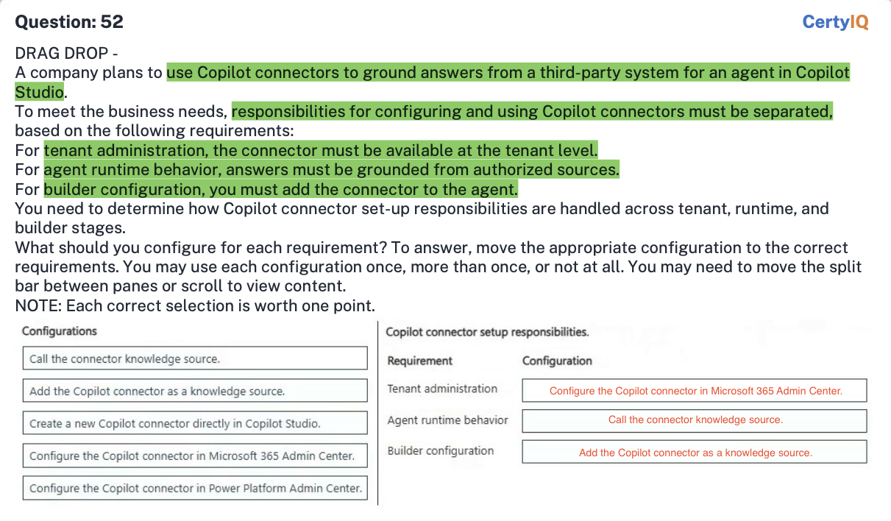

### 1. Extracted Question Summary

* **Scenario:** A company plans to use Copilot connectors to ground answers from a third-party system for an agent in Microsoft Copilot Studio, separating responsibilities across tenant administration (making the connector available at the tenant level), agent runtime behavior (grounding answers from authorized sources), and builder configuration (adding the connector to the agent).

* **Question (Drag and Drop — Question 52):** Move the appropriate configurations on the left (`Configurations`) to match the three stages under `Copilot connector setup responsibilities` on the right (each configuration may be used once, more than once, or not at all).

* **Available Configurations (Left Column):**
* Call the connector knowledge source.

* Add the Copilot connector as a knowledge source.

* Create a new Copilot connector directly in Copilot Studio.

* Configure the Copilot connector in Microsoft 365 Admin Center.

* Configure the Copilot connector in Power Platform Admin Center.

* **Target Requirements (Right Table — `Copilot connector setup responsibilities.`):**
1. Tenant administration

2. Agent runtime behavior

3. Builder configuration

---

### 2. Correct Answer

* **Tenant administration:** **Configure the Copilot connector in Microsoft 365 Admin Center.**

* **Agent runtime behavior:** **Call the connector knowledge source.**

* **Builder configuration:** **Add the Copilot connector as a knowledge source.**

---

### 4. Official Microsoft Justification

* **Microsoft 365 Copilot Connector Lifecycle & Role Separation (`AB-620T00` — Integrate and extend agents in Copilot Studio / Connect to enterprise knowledge sources):** Microsoft 365 Copilot connectors (formerly Microsoft Graph connectors) ingest external third-party content into the Microsoft Graph semantic index through a strict three-tier operational boundary:
1. **Tenant Administration (`Configure the Copilot connector in Microsoft 365 Admin Center`):** Global Administrators or Search Administrators provision, authenticate, map schemas, configure crawl schedules, and publish Copilot connectors at the tenant level inside the **Microsoft 365 Admin Center** (`Settings → Search & intelligence → Data sources` / Copilot connectors).

2. **Builder Configuration (`Add the Copilot connector as a knowledge source`):** Once the tenant administrator publishes the connection and grants availability, an agent maker/builder opens the agent in **Copilot Studio**, navigates to **Knowledge → + Add knowledge**, and attaches the pre-configured Copilot connector as a knowledge source.

3. **Agent Runtime Behavior (`Call the connector knowledge source`):** During live end-user conversations, the Copilot Studio orchestrator or generative answers node queries (`calls`) the attached Copilot connector knowledge source in Microsoft Graph, enforcing item-level Access Control Lists (ACLs) so responses are grounded exclusively in authorized documents.

---

### 5. Distractor Analysis (Why Others Are Wrong)

* **Create a new Copilot connector directly in Copilot Studio:** Copilot connectors (Microsoft Graph ingestion pipelines) are provisioned and indexed at the tenant level in the Microsoft 365 Admin Center rather than created from scratch inside the Copilot Studio canvas.

* **Configure the Copilot connector in Power Platform Admin Center:** Power Platform Admin Center manages environments, DLP policies, and Power Platform connectors, whereas Microsoft 365 Copilot connectors (Graph index sources) are configured and managed in the **Microsoft 365 Admin Center**.

---

### 6. Exam Keyword / Trap Alert

* **Keywords:** *"tenant administration"* = **Microsoft 365 Admin Center**; *"agent runtime behavior"* = **Call the connector knowledge source**; *"builder configuration"* = **Add the Copilot connector as a knowledge source**.

* **Trap:** Do not confuse **Microsoft 365 Admin Center** with **Power Platform Admin Center**—Microsoft 365 Copilot connectors (formerly Graph connectors) live in the **Microsoft 365 Admin Center** under Search & intelligence, not in Power Platform Admin Center.

## Q53

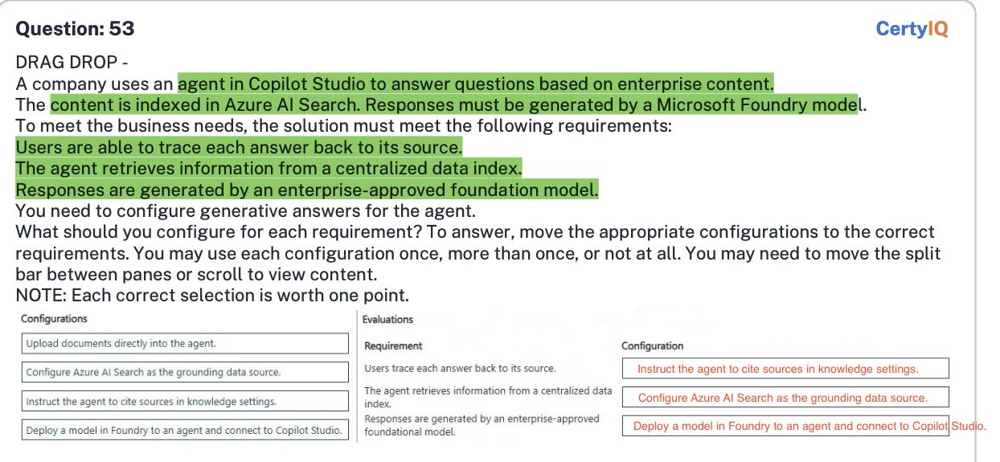

### 1. Extracted Question Summary

* **Scenario:** A company uses an agent in Microsoft Copilot Studio to answer questions based on enterprise content indexed in Azure AI Search, with responses generated by a Microsoft Foundry model. The solution must ensure users can trace each answer back to its source, the agent retrieves information from a centralized data index, and responses are generated by an enterprise-approved foundation model.

* **Question (Drag and Drop — Question 53):** Move the appropriate configurations from the left (`Configurations`) to match the three requirements under `Evaluations` on the right (each configuration may be used once, more than once, or not at all).

* **Available Configurations (Left Column):**
* Upload documents directly into the agent.

* Configure Azure AI Search as the grounding data source.

* Instruct the agent to cite sources in knowledge settings.

* Deploy a model in Foundry to an agent and connect to Copilot Studio.

* **Target Requirements (Right Table — `Evaluations`):**
1. Users trace each answer back to its source.

2. The agent retrieves information from a centralized data index.

3. Responses are generated by an enterprise-approved foundational model.

---

### 2. Correct Answer

* **Users trace each answer back to its source:** **Instruct the agent to cite sources in knowledge settings.**

* **The agent retrieves information from a centralized data index:** **Configure Azure AI Search as the grounding data source.**

* **Responses are generated by an enterprise-approved foundational model:** **Deploy a model in Foundry to an agent and connect to Copilot Studio.**

---

### 4. Official Microsoft Justification

* **Enterprise RAG Grounding, Source Citations & Microsoft Foundry Model Governance (`AB-620T00` / `AB-100` — Integrate and extend agents in Copilot Studio > Connect to enterprise knowledge sources & external agents):**
1. **Source Attribution & Citations (`Instruct the agent to cite sources in knowledge settings`):** Within Copilot Studio's knowledge and generative answers settings, enabling source citation ensures the orchestrator appends clickable inline citations/references pointing directly to the underlying retrieved records or documents so end users can verify answer provenance.

2. **Centralized Vector/Semantic Index Retrieval (`Configure Azure AI Search as the grounding data source`):** Connecting an existing **Azure AI Search** index under the agent's **Knowledge** sources allows Copilot Studio to execute Retrieval-Augmented Generation (RAG) queries against a centralized, enterprise-managed search index rather than isolated local file uploads.

3. **Custom Enterprise Foundation Model Execution (`Deploy a model in Foundry to an agent and connect to Copilot Studio`):** When an organization requires responses to be generated by a specific enterprise-approved foundation model hosted in **Microsoft Foundry** (Azure AI Foundry), makers deploy the approved model to a Foundry agent/project and connect that Foundry agent to Copilot Studio via **Agents → + Add an agent → Microsoft Foundry**.

---

### 5. Distractor Analysis (Why Others Are Wrong)

* **Upload documents directly into the agent:** Uploading individual files stores static copies inside Dataverse scoped strictly to that single agent, which contradicts the requirement to retrieve information from a **centralized data index** (Azure AI Search).

---

### 6. Exam Keyword / Trap Alert

* **Keywords:** *"trace each answer back to its source"* = **cite sources in knowledge settings**; *"centralized data index"* = **Configure Azure AI Search**; *"enterprise-approved foundational model"* + *"Microsoft Foundry"* = **Deploy a model in Foundry to an agent and connect to Copilot Studio**.

* **Trap:** Do not confuse **uploading documents directly into the agent** (isolated per-agent Dataverse file storage) with **Azure AI Search** (a shared, centralized enterprise search index).

## Q54

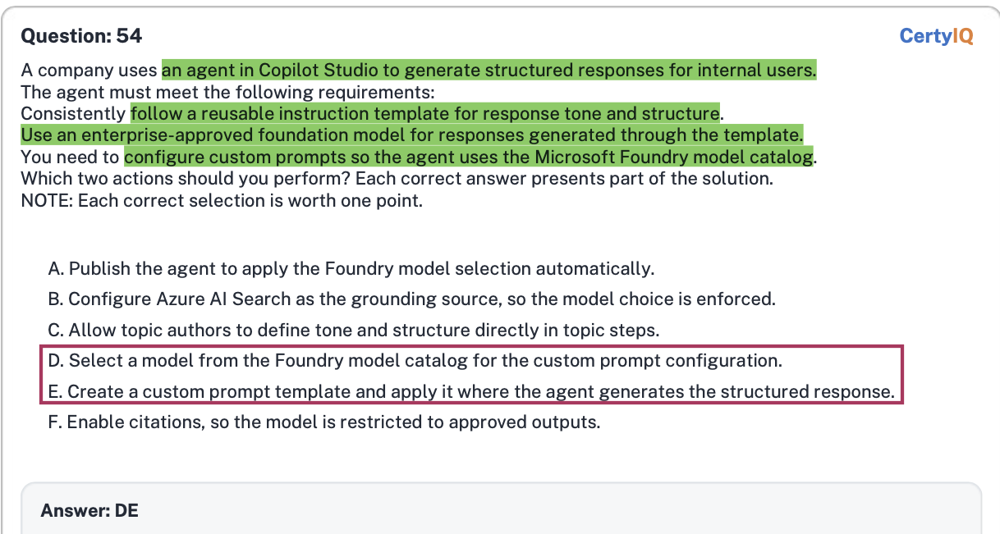

### 1. Extracted Question Summary

* **Scenario:** A company uses an agent in Microsoft Copilot Studio to generate structured responses for internal users. The agent must consistently follow a reusable instruction template for response tone and structure and use an enterprise-approved foundation model for responses generated through the template. You need to configure custom prompts so the agent uses the Microsoft Foundry model catalog.

* **Question (Question 54):** Which two actions should you perform? (Each correct answer presents part of the solution.)

* **Options:**
* **A.** Publish the agent to apply the Foundry model selection automatically.

* **B.** Configure Azure AI Search as the grounding source, so the model choice is enforced.

* **C.** Allow topic authors to define tone and structure directly in topic steps.

* **D.** Select a model from the Foundry model catalog for the custom prompt configuration.

* **E.** Create a custom prompt template and apply it where the agent generates the structured response.

* **F.** Enable citations, so the model is restricted to approved outputs.

* **Visible Answer in Screenshot:** `Answer: DE`

---

### 2. Correct Answer

* **D: Select a model from the Foundry model catalog for the custom prompt configuration.**

* **E: Create a custom prompt template and apply it where the agent generates the structured response.**

---

### 3. Verification of Visible Selection / Community Key

* **Correct.** The visible key (`Answer: DE`) is completely accurate because Copilot Studio **Custom Prompts** allow makers to define a reusable instruction and output structure template (**E**) while explicitly binding an enterprise-approved foundation model from the **Microsoft Foundry model catalog** (**D**) directly in the prompt's model selector.

---

### 4. Official Microsoft Justification

* **Custom Prompts & Microsoft Foundry Model Catalog Integration (`AB-620T00` — Integrate and extend agents in Copilot Studio / Create and configure custom prompts):** In Microsoft Copilot Studio, **Custom Prompts** (built via the Prompt Builder / AI Builder tool experience) serve as reusable, parameterized prompt templates that enforce consistent tone, formatting, and structured JSON/text outputs across topics and agents:
1. **Model Binding from Microsoft Foundry (`Select a model from the Foundry model catalog for the custom prompt configuration`):** Within the custom prompt editor's **Model** configuration dropdown, makers can select from enterprise-approved foundation models hosted in the **Microsoft Foundry** (Azure AI Foundry) model catalog rather than relying on an unmanaged default model.

2. **Reusable Template Creation & Application (`Create a custom prompt template and apply it where the agent generates the structured response`):** Defining a standalone **Custom Prompt** tool encapsulates the system instructions, tone, and output structure once, allowing you to invoke it consistently inside the agent's topics or orchestration flow wherever structured responses are generated.

---

### 5. Distractor Analysis (Why Others Are Wrong)

* **A:** Publishing an agent deploys existing configurations to live channels; it does not automatically assign or switch a custom prompt to a Microsoft Foundry catalog model.

* **B:** **Azure AI Search** provides vector/semantic Retrieval-Augmented Generation (RAG) indexing for grounding data—it has no control over which foundation LLM executes the prompt.

* **C:** Allowing individual topic authors to manually rewrite tone and structure ad hoc inside separate topic steps breaks consistency and violates the requirement for a **reusable instruction template**.

* **F:** Enabling citations adds source attribution links to grounded answers; it neither selects an enterprise-approved foundation model nor restricts model selection.

---

### 6. Exam Keyword / Trap Alert

* **Keywords:** *"reusable instruction template for response tone and structure"* + *"Microsoft Foundry model catalog"* = **Select a model from the Foundry model catalog** (**D**) + **Create a custom prompt template and apply it** (**E**).

* **Trap:** Notice how this question (`Question 54`) cleanly clarifies the exact Copilot Studio Prompt Builder architecture—unlike the flawed option set in `Question 45`, **Model selection** is an explicit dropdown configuration inside a **Custom Prompt**, never controlled by Azure AI Search, publishing, or citations.

## Q55

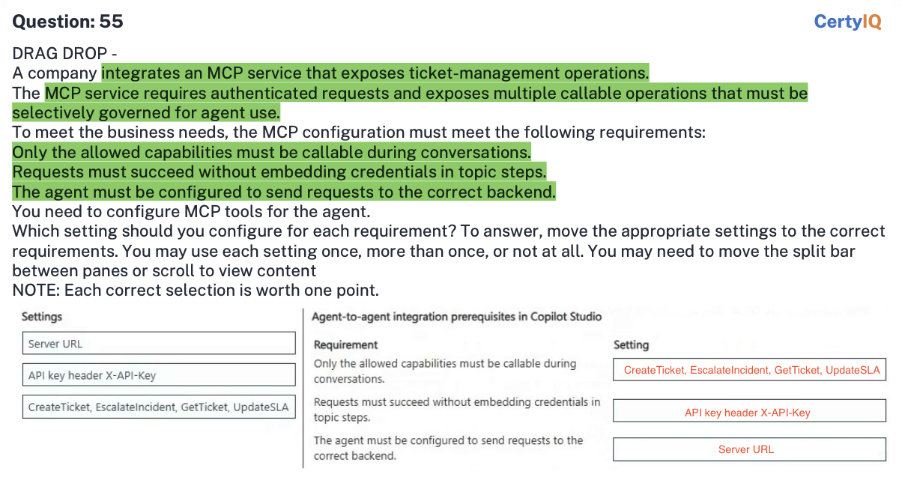

### 1. Extracted Question Summary

* **Scenario:** A company integrates a Model Context Protocol (MCP) service exposing ticket-management operations that requires authenticated requests and exposes multiple callable operations that must be selectively governed for agent use. The MCP configuration must ensure only allowed capabilities are callable during conversations, requests succeed without embedding credentials in topic steps, and the agent sends requests to the correct backend.

* **Question (Drag and Drop — Question 55):** Move the appropriate settings on the left (`Settings`) to match the three requirements on the right (each setting may be used once, more than once, or not at all).

* **Available Settings (Left Column):**
* Server URL

* API key header X-API-Key

* CreateTicket, EscalateIncident, GetTicket, UpdateSLA

* **Target Requirements (Right Table):**
1. Only the allowed capabilities must be callable during conversations.

2. Requests must succeed without embedding credentials in topic steps.

3. The agent must be configured to send requests to the correct backend.

---

### 2. Correct Answer

* **Only the allowed capabilities must be callable during conversations:** **CreateTicket, EscalateIncident, GetTicket, UpdateSLA**

* **Requests must succeed without embedding credentials in topic steps:** **API key header X-API-Key**

* **The agent must be configured to send requests to the correct backend:** **Server URL**

---

### 4. Official Microsoft Justification

* **Model Context Protocol (MCP) Server Governance & Tool Configuration (`AB-620T00` — Integrate and extend agents in Copilot Studio / Extend your agent with Model Context Protocol):** When onboarding an external MCP server into Microsoft Copilot Studio under **Tools → + Add a tool → Model Context Protocol**, makers configure three distinct properties to secure, route, and govern tool execution:
1. **Selective Tool Allow-Listing (`CreateTicket, EscalateIncident, GetTicket, UpdateSLA`):** Although an MCP server may advertise dozens of operations via `tools/list`, Copilot Studio allows makers to selectively enable or disable individual MCP tools on the connection—ensuring only explicitly approved operations (`CreateTicket`, `EscalateIncident`, `GetTicket`, `UpdateSLA`) can be invoked by the orchestrator during conversations.

2. **Connection-Level Credential Encapsulation (`API key header X-API-Key`):** Authentication secrets (such as custom API key headers like `X-API-Key` or OAuth credentials) are stored centrally within the Power Platform / Copilot Studio connector connection definition rather than hardcoded as plain-text variables inside individual conversation topic steps.

3. **Backend Endpoint Routing (`Server URL`):** The **Server URL** specifies the target MCP server endpoint (SSE or Streamable HTTP transport URI) to which Copilot Studio dispatches JSON-RPC tool discovery and execution requests.

---

### 5. Distractor Analysis (Why Others Are Wrong)

* Because this is a one-to-one three-row Drag-and-Drop matrix where every setting on the left maps uniquely to one requirement on the right, errors stem solely from misaligning the three configuration fields:
* **Confusing `API key header X-API-Key` with `Server URL`:** The header (`X-API-Key`) handles authentication without hardcoding secrets in topics, whereas the `Server URL` routes traffic to the proper backend host.

* **Misplacing the operation list (`CreateTicket, EscalateIncident, GetTicket, UpdateSLA`):** Explicit tool names define the permitted capability surface (`tools/list` filtering) rather than endpoint routing or authentication.

---

### 6. Exam Keyword / Trap Alert

* **Keywords:** *"Only the allowed capabilities must be callable"* = **CreateTicket, EscalateIncident, GetTicket, UpdateSLA** (explicit tool allow-list); *"without embedding credentials in topic steps"* = **API key header X-API-Key** (connection-level auth); *"send requests to the correct backend"* = **Server URL**.

* **Trap:** Ignore the mislabeled right-hand table header (`Agent-to-agent integration prerequisites in Copilot Studio`) in this CertyIQ screenshot—match the rows strictly against the MCP scenario requirements on the left and middle columns.

## Q56

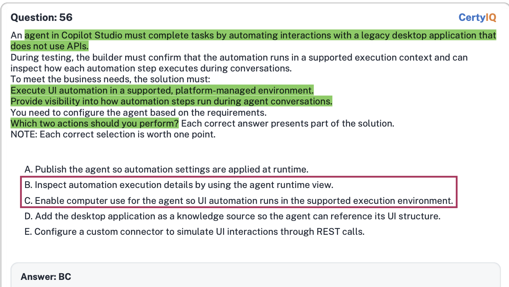

### 1. Extracted Question Summary

* **Scenario:** An agent in Microsoft Copilot Studio must complete tasks by automating interactions with a legacy desktop application that does not expose APIs. During testing, the builder must execute UI automation in a supported, platform-managed environment and have visibility into how each automation step runs during agent conversations.

* **Question (Question 56):** Which two actions should you perform? (Each correct answer presents part of the solution.)

* **Options:**
* **A.** Publish the agent so automation settings are applied at runtime.

* **B.** Inspect automation execution details by using the agent runtime view.

* **C.** Enable computer use for the agent so UI automation runs in the supported execution environment.

* **D.** Add the desktop application as a knowledge source so the agent can reference its UI structure.

* **E.** Configure a custom connector to simulate UI interactions through REST calls.

* **Visible Markings / Answer in Screenshot:** Options **B** and **C** are boxed in red and `Answer: BC` is displayed at the bottom.

---

### 2. Correct Answer

* **B: Inspect automation execution details by using the agent runtime view.**

* **C: Enable computer use for the agent so UI automation runs in the supported execution environment.**

---

### 3. Verification of Visible Selection / Community Key

* **Correct.** Both the red box around **B** and **C** and the visible key (`Answer: BC`) are accurate because **Computer Use** in Copilot Studio executes GUI-based interactions on desktop and web apps inside a platform-managed sandbox/hosted virtual machine environment (**C**), while the **agent runtime / activity map view** provides step-by-step execution traces, screenshots, and action reasoning during testing (**B**).

---

### 4. Official Microsoft Justification

* **Computer Use & UI Automation Observability (`AB-620T00` / `AB-100` — Integrate and extend agents in Copilot Studio / Automate UI tasks with Computer Use):** When an enterprise system lacks REST APIs or Power Platform connectors (such as a legacy desktop application), Microsoft Copilot Studio provides **Computer Use** (powered by Computer-Using Agents / CUA):
1. **Platform-Managed UI Execution (`Enable computer use for the agent so UI automation runs in the supported execution environment`):** Enabling **Computer Use** as a tool allows the agent to perceive graphical interfaces visually and execute mouse clicks, keystrokes, and window navigation inside a supported, Microsoft-hosted/managed Windows execution environment without requiring underlying API endpoints.

2. **Step-by-Step Execution Visibility (`Inspect automation execution details by using the agent runtime view`):** During testing and troubleshooting, makers use Copilot Studio's **Activity map / runtime view** to inspect each discrete UI automation action, screen state, decision rationale, and execution status in real time.

---

### 5. Distractor Analysis (Why Others Are Wrong)

* **A:** Publishing deploys the agent to end-user channels; it does not provision a UI automation runtime or provide step-by-step execution inspection during testing.

* **D:** Knowledge sources ingest static documents, web pages, or structured records for read-only Retrieval-Augmented Generation (RAG)—you cannot add an executable desktop binary as a knowledge source to drive UI clicks.

* **E:** Custom connectors wrap existing HTTP/REST APIs; the scenario explicitly states the legacy desktop application *"does not use APIs"*.

---

### 6. Exam Keyword / Trap Alert

* **Keywords:** *"legacy desktop application that does not use APIs"* + *"UI automation in a supported, platform-managed environment"* + *"visibility into how automation steps run"* = **Enable computer use** (**C**) + **agent runtime view** (**B**).

* **Trap:** Whenever an `AB-620` or `AB-100` scenario mentions automating a **desktop or web UI with no APIs**, immediately look for **Computer Use**—and remember that **Activity map / agent runtime view** is the standard Copilot Studio observability tool for inspecting step-by-step agent execution.

## Q57

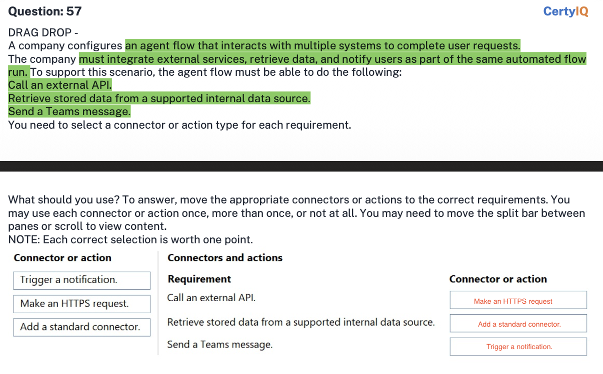

### 1. Extracted Question Summary

* **Scenario:** A company configures an agent flow in Microsoft Copilot Studio that interacts with multiple systems to complete user requests—integrating external services, retrieving data, and notifying users as part of the same automated flow run.

* **Question (Drag and Drop — Question 57):** Select a connector or action type for each requirement by moving the appropriate connectors or actions from the left (`Connector or action`) to match the three requirements under `Connectors and actions` on the right (each option may be used once, more than once, or not at all).

* **Available Options (Left Column — `Connector or action`):**
* Trigger a notification.

* Make an HTTPS request.

* Add a standard connector.

* **Target Requirements (Right Table — `Connectors and actions`):**
1. Call an external API.

2. Retrieve stored data from a supported internal data source.

3. Send a Teams message.

---

### 2. Correct Answer

* **Call an external API:** **Make an HTTPS request.**

* **Retrieve stored data from a supported internal data source:** **Add a standard connector.**

* **Send a Teams message:** **Trigger a notification.**

---

### 4. Official Microsoft Justification

* **Agent Flow Actions & Connector Categories (`AB-620T00` — Create and manage agent flows in Microsoft Copilot Studio / Integrate and extend agents):** Within Copilot Studio agent flows (and Power Automate cloud flows), makers combine built-in core actions with Power Platform connectors depending on the target system and communication pattern:
1. **Direct REST/HTTP Endpoints (`Make an HTTPS request`):** When invoking a generic or un-wrapped external REST API endpoint directly without a prebuilt connector, makers use the built-in **HTTP** action (`Make an HTTPS request`) to send `GET`/`POST`/`PUT` requests with custom headers, query parameters, and authentication.

2. **Supported Enterprise Repositories (`Add a standard connector`):** To query or retrieve stored records from supported Microsoft/enterprise data sources (such as SharePoint, Dataverse, Excel Online, or Planner), makers add the corresponding **standard connector** action (e.g., *Get items* or *List rows*).

3. **User Alerting & Messaging (`Trigger a notification`):** Sending proactive updates or alerts via Microsoft Teams (e.g., *Post message in a chat or channel*) or mobile push/email notifications uses notification actions to deliver structured messages back to users during or after flow execution.

---

### 5. Distractor Analysis (Why Others Are Wrong)

* Because this is a one-to-one three-row Drag-and-Drop matrix where every item on the left maps uniquely to one requirement on the right, errors stem solely from misaligning the three action categories:
* **Using `Add a standard connector` for a generic external API:** Generic external APIs without out-of-the-box connectors require `Make an HTTPS request` (or a custom connector), whereas supported internal data sources use built-in standard connectors.

* **Using `Make an HTTPS request` to send a Teams message:** Sending a Teams message relies on native notification/Teams messaging actions (`Trigger a notification`) rather than manually crafting raw Graph HTTP calls.

---

### 6. Exam Keyword / Trap Alert

* **Keywords:** *"Call an external API"* = **Make an HTTPS request**; *"supported internal data source"* = **Add a standard connector**; *"Send a Teams message"* = **Trigger a notification**.

* **Trap:** Do not overcomplicate straightforward action-mapping questions—match *"external API"* directly to **HTTPS request** and *"supported internal data source"* directly to **standard connector**.

## Q58

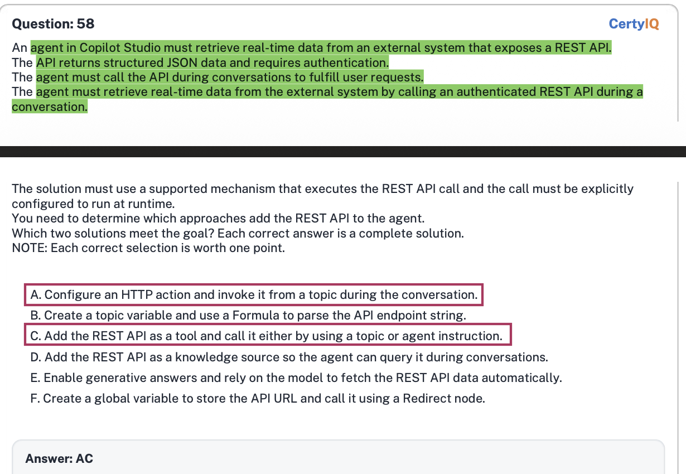

### 1. Extracted Question Summary

* **Scenario:** An agent in Microsoft Copilot Studio must retrieve real-time data from an external system exposing an authenticated REST API that returns structured JSON data. The solution must use a supported mechanism that executes the REST API call explicitly configured to run at runtime during conversations.

* **Question (Question 58):** Which two solutions meet the goal? (Each correct answer is a complete solution.)

* **Options:**
* **A.** Configure an HTTP action and invoke it from a topic during the conversation.

* **B.** Create a topic variable and use a Formula to parse the API endpoint string.

* **C.** Add the REST API as a tool and call it either by using a topic or agent instruction.

* **D.** Add the REST API as a knowledge source so the agent can query it during conversations.

* **E.** Enable generative answers and rely on the model to fetch the REST API data automatically.

* **F.** Create a global variable to store the API URL and call it using a Redirect node.

* **Visible Answer in Screenshot:** `Answer: AC`

---

### 2. Correct Answer

* **A: Configure an HTTP action and invoke it from a topic during the conversation.**

* **C: Add the REST API as a tool and call it either by using a topic or agent instruction.**

---

### 3. Verification of Visible Selection / Community Key

* **Correct.** The visible key (`Answer: AC`) is accurate because Copilot Studio supports executing authenticated runtime REST API calls either directly inside a conversation topic via the built-in **HTTP request** node (**A**) or by registering the REST API/custom connector under the agent's **Tools** for topic or orchestrator invocation (**C**).

---

### 4. Official Microsoft Justification

* **REST API Runtime Integration Patterns (`AB-620T00` — Integrate and extend agents in Copilot Studio / Add tools & HTTP requests):** Microsoft Copilot Studio provides two natively supported mechanisms to execute authenticated HTTP/REST API calls and parse structured JSON responses at runtime:
1. **Direct Topic-Level HTTP Action (`Configure an HTTP action and invoke it from a topic during the conversation`):** Inside a topic authoring canvas, makers can insert the built-in **Send an HTTP request** node (or an agent flow containing an HTTP action), configure headers/authentication and the JSON response schema, and map parsed values into topic variables.

2. **Reusable REST API Tool Registration (`Add the REST API as a tool and call it either by using a topic or agent instruction`):** Importing the REST API (via an OpenAPI specification / Power Platform custom connector or REST API tool registration) under the agent's **Tools** binds its authentication connection and typed input/output parameters so it can be invoked deterministically from a topic node or dynamically via generative orchestration.

---

### 5. Distractor Analysis (Why Others Are Wrong)

* **B:** Power Fx formulas manipulate variables in memory; they cannot make outbound network requests or authenticate against external REST endpoints.

* **D:** Raw REST API endpoints cannot be registered as a **Knowledge source**—knowledge sources only accept unstructured documents, websites, SharePoint, Dataverse, Azure AI Search, Copilot connectors, and prebuilt real-time Power Platform connectors.

* **E:** Generative answers synthesize responses from grounded knowledge sources; the model cannot automatically discover or execute unconfigured external REST APIs without an explicit HTTP action or registered tool.

* **F:** A **Redirect** node transfers conversation flow to another Copilot Studio topic—it cannot invoke external URLs or REST APIs.

---

### 6. Exam Keyword / Trap Alert

* **Keywords:** *"retrieve real-time data... REST API"* + *"structured JSON data and requires authentication"* + *"Each correct answer is a complete solution"* = **Configure an HTTP action** (**A**) + **Add the REST API as a tool** (**C**).

* **Trap:** Never associate a **Redirect** node (internal topic transfer) or a **Knowledge source** (never accepts raw REST APIs) with executing live REST endpoint calls.

## Q59

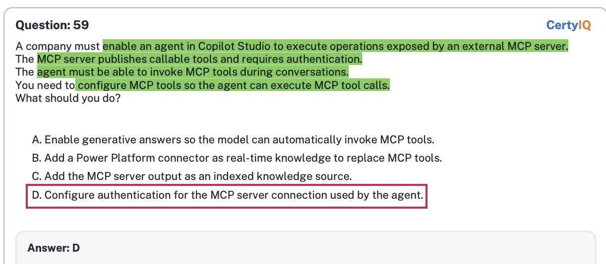

### 1. Extracted Question Summary

* **Scenario:** A company must enable an agent in Microsoft Copilot Studio to execute operations exposed by an external Model Context Protocol (MCP) server that publishes callable tools and requires authentication. The agent must be able to invoke MCP tools during conversations, and you need to configure MCP tools so the agent can execute MCP tool calls.

* **Question (Question 59):** What should you do?

* **Options:**
* **A.** Enable generative answers so the model can automatically invoke MCP tools.

* **B.** Add a Power Platform connector as real-time knowledge to replace MCP tools.

* **C.** Add the MCP server output as an indexed knowledge source.

* **D.** Configure authentication for the MCP server connection used by the agent.

* **Visible Markings / Answer in Screenshot:** Option **D** is boxed in red and `Answer: D` is displayed at the bottom.

---

### 2. Correct Answer

* **D: Configure authentication for the MCP server connection used by the agent.**

---

### 3. Verification of Visible Selection / Community Key

* **Correct.** Both the red box around **D** and the visible key (`Answer: D`) are accurate because an authenticated external MCP server will reject tool discovery and runtime tool execution calls unless valid credentials (such as API key headers or OAuth settings) are configured on the MCP server connection in Copilot Studio.

---

### 4. Official Microsoft Justification

* **Model Context Protocol (MCP) Connection & Authentication (`AB-620T00` — Integrate and extend agents in Copilot Studio / Extend your agent with Model Context Protocol):** When integrating an external MCP server under an agent's **Tools** (`+ Add a tool → Model Context Protocol`), Copilot Studio communicates with the server over SSE or Streamable HTTP transport to discover (`tools/list`) and invoke (`tools/call`) remote capabilities.
* **Connection-Level Security Binding (`Configure authentication for the MCP server connection used by the agent`):** Because the target MCP server enforces authentication, makers must configure and bind the required authentication parameters (such as an API key header or Microsoft Entra ID / OAuth 2.0 connection credentials) on the MCP server's Power Platform connection so runtime requests execute successfully during conversations.

---

### 5. Distractor Analysis (Why Others Are Wrong)

* **A:** Generative answers synthesize responses over grounded knowledge sources; enabling generative answers does not authenticate against or execute external MCP tool endpoints.

* **B:** A Power Platform connector configured as real-time knowledge performs read-only Retrieval-Augmented Generation (RAG) queries—it cannot execute transactional MCP tool operations or replace an MCP server's callable tools.

* **C:** MCP servers expose dynamic, callable runtime tools rather than static documents to be pre-indexed into a Microsoft Graph or search knowledge source.

---

### 6. Exam Keyword / Trap Alert

* **Keywords:** *"external MCP server"* + *"publishes callable tools and requires authentication"* + *"execute MCP tool calls"* = **Configure authentication for the MCP server connection** (**D**).

* **Trap:** Never map an **MCP server** to **Knowledge sources** or **Generative answers** (Options A, B, C)—MCP servers always belong under **Tools** and require an authenticated connection whenever the prompt states the server requires authentication.

## Q60

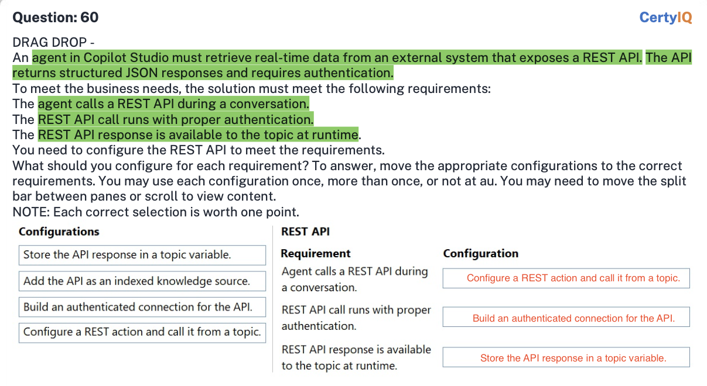

### 1. Extracted Question Summary

* **Scenario:** An agent in Microsoft Copilot Studio must retrieve real-time data from an external system exposing an authenticated REST API that returns structured JSON responses. The solution must ensure the agent calls the REST API during a conversation, runs the call with proper authentication, and makes the REST API response available to the topic at runtime.

* **Question (Drag and Drop — Question 60):** Move the appropriate configurations on the left (`Configurations`) to match the three requirements under `REST API` on the right (each configuration may be used once, more than once, or not at all).

* **Available Configurations (Left Column):**
* Store the API response in a topic variable.

* Add the API as an indexed knowledge source.

* Build an authenticated connection for the API.

* Configure a REST action and call it from a topic.

* **Target Requirements (Right Table — `REST API`):**
1. Agent calls a REST API during a conversation.

2. REST API call runs with proper authentication.

3. REST API response is available to the topic at runtime.

---

### 2. Correct Answer

* **Agent calls a REST API during a conversation:** **Configure a REST action and call it from a topic.**

* **REST API call runs with proper authentication:** **Build an authenticated connection for the API.**

* **REST API response is available to the topic at runtime:** **Store the API response in a topic variable.**

---

### 4. Official Microsoft Justification

* **REST API Tool & Action Architecture (`AB-620T00` / `AB-100` — Integrate and extend agents in Copilot Studio > Add tools & custom connectors):** Exposing and consuming a live external REST API inside Microsoft Copilot Studio relies on three core configuration components:
1. **Action / Tool Invocation (`Configure a REST action and call it from a topic`):** Registering the REST endpoint as a tool/action (via a custom connector or REST API tool) and placing a tool/action node inside a conversation topic enables the agent to execute the API request during live dialog flow.

2. **Connection Security (`Build an authenticated connection for the API`):** Authentication credentials (such as OAuth 2.0, API Key, or Microsoft Entra ID) are encapsulated inside a Power Platform connection reference bound to the connector/tool so runtime requests authenticate securely without hardcoding secrets inside topic nodes.

3. **Runtime Output Variable Binding (`Store the API response in a topic variable`):** Structured JSON output parameters returned by the REST action are mapped and deserialized into **Topic variables**, making the retrieved values immediately accessible to downstream condition branches, Power Fx formulas, and **Send a message** nodes at runtime.

---

### 5. Distractor Analysis (Why Others Are Wrong)

* **Add the API as an indexed knowledge source:** Raw REST API endpoints cannot be registered as an indexed knowledge source—knowledge sources handle read-only Retrieval-Augmented Generation (RAG) grounding over documents, websites, SharePoint, Dataverse, Azure AI Search, or Copilot connectors rather than live parameterized REST API calls.

---

### 6. Exam Keyword / Trap Alert

* **Keywords:** *"calls a REST API during a conversation"* = **Configure a REST action and call it from a topic**; *"proper authentication"* = **Build an authenticated connection**; *"response is available to the topic at runtime"* = **Store the API response in a topic variable**.

* **Trap:** Always reject **"indexed knowledge source"** when the scenario calls for executing live, parameterized REST API requests—raw APIs are always integrated as **Actions / Tools**, never as indexed knowledge.

## Q61

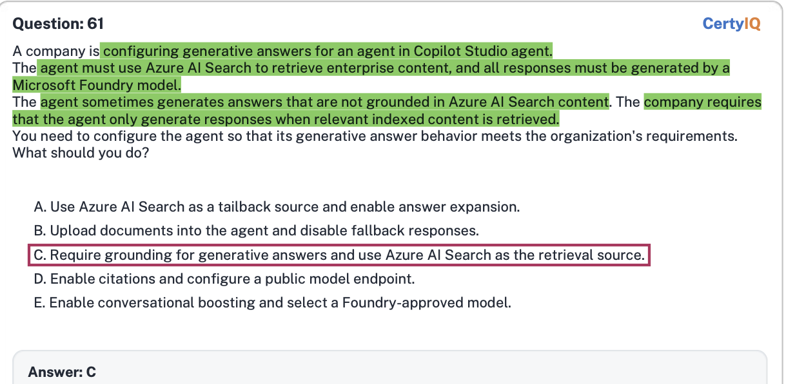

### 1. Extracted Question Summary

* **Scenario:** A company is configuring generative answers for an agent in Copilot Studio. The agent must use Azure AI Search to retrieve enterprise content, and all responses must be generated by a Microsoft Foundry model. Currently, the agent sometimes generates answers not grounded in Azure AI Search content, and the company requires that the agent only generate responses when relevant indexed content is retrieved.

* **Question (Question 61):** What should you do?

* **Options:**
* **A.** Use Azure AI Search as a tailback source and enable answer expansion.

* **B.** Upload documents into the agent and disable fallback responses.

* **C.** Require grounding for generative answers and use Azure AI Search as the retrieval source.

* **D.** Enable citations and configure a public model endpoint.

* **E.** Enable conversational boosting and select a Foundry-approved model.

* **Visible Answer in Screenshot:** `Answer: C`

---

### 2. Correct Answer

* **C: Require grounding for generative answers and use Azure AI Search as the retrieval source.**

---

### 3. Verification of Visible Selection / Community Key

* **Correct.** The visible key (`Answer: C`) is accurate because enforcing strict grounding (disabling general LLM parametric knowledge fallback when no matching search chunks meet the moderation/relevance threshold) while scoping retrieval exclusively to the **Azure AI Search** knowledge source prevents ungrounded answers.

---

### 4. Official Microsoft Justification

* **Strict Retrieval-Augmented Generation (RAG) Grounding & Knowledge Scoping (`AB-620T00` — Integrate and extend agents in Copilot Studio / Configure generative answers and knowledge sources):** By default, a Copilot Studio agent's generative orchestrator or **Create generative answers** node may fall back on the underlying LLM's general pre-trained knowledge when no enterprise search results match a user's query.
* **Enforcing Grounded-Only Responses (`Require grounding for generative answers and use Azure AI Search as the retrieval source`):** Under Microsoft Learn's generative answers configuration guidelines, disabling **Allow the AI to use its own general knowledge** (requiring strict grounding) and restricting the node's retrieval scope to the configured **Azure AI Search** knowledge source guarantees that the agent synthesizes responses exclusively when relevant indexed documents are retrieved, returning a fallback/no-answer prompt otherwise.

---

### 5. Distractor Analysis (Why Others Are Wrong)

* **A:** "Tailback source" and "answer expansion" are fabricated distractor terms, and expanding answers beyond retrieved search chunks directly violates the strict grounding requirement.

* **B:** Uploading static documents directly into the agent stores isolated copies in Dataverse rather than retrieving from the existing centralized **Azure AI Search** index specified in the scenario.

* **D:** Enabling citations adds source attribution links to responses, but it does not prevent the model from answering using ungrounded general knowledge when search retrieval returns no results; furthermore, configuring a public model endpoint violates enterprise Microsoft Foundry governance.

* **E:** Enabling conversational boosting / general AI knowledge allows the model to answer using its own ungrounded training data, which is the exact behavior causing the agent to generate ungrounded answers.

---

### 6. Exam Keyword / Trap Alert

* **Keywords:** *"only generate responses when relevant indexed content is retrieved"* + *"use Azure AI Search to retrieve enterprise content"* = **Require grounding for generative answers and use Azure AI Search as the retrieval source** (**C**).

* **Trap:** Always reject options that enable **general knowledge** or **answer expansion** when a prompt states the agent *"sometimes generates answers that are not grounded"*—strict RAG compliance requires turning **off** general LLM knowledge so only retrieved knowledge sources can ground responses.

## Q62

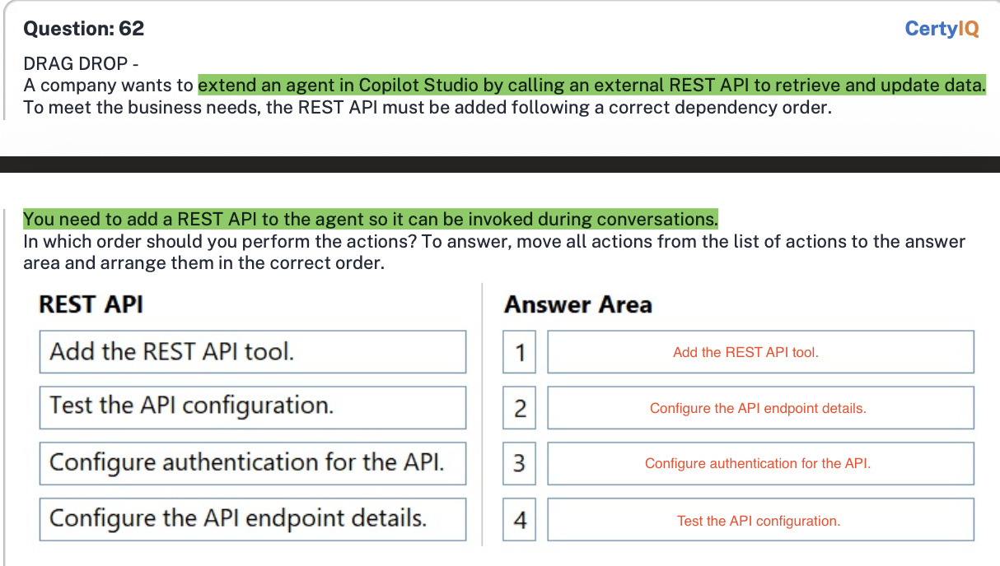

### 1. Extracted Question Summary

* **Scenario:** A company wants to extend an agent in Microsoft Copilot Studio by calling an external REST API to retrieve and update data, adding the REST API following a correct dependency order so it can be invoked during conversations.

* **Question (Drag and Drop — Question 62):** Arrange all four actions from the `REST API` list into the `Answer Area` in the correct execution order (1 through 4).

* **Available Actions (Left Column — `REST API`):**
* Add the REST API tool.

* Test the API configuration.

* Configure authentication for the API.

* Configure the API endpoint details.

---

### 2. Correct Answer

* **1:** **Add the REST API tool.**

* **2:** **Configure the API endpoint details.**

* **3:** **Configure authentication for the API.**

* **4:** **Test the API configuration.**

---

### 4. Official Microsoft Justification

* **REST API Tool Onboarding Workflow (`AB-620T00` — Integrate and extend agents in Copilot Studio / Add tools & REST APIs):** When registering a new REST API directly as a tool in Microsoft Copilot Studio (`Tools → + Add a tool → New tool → REST API`), the creation wizard enforces a strict sequential dependency pipeline:
1. **Initiate Tool Creation (`Add the REST API tool`):** You begin inside the agent's **Tools** page by selecting **+ Add a tool → New tool → REST API** to instantiate the tool definition container.

2. **Define Endpoint Metadata & Operations (`Configure the API endpoint details`):** Next, you supply the base endpoint URL, OpenAPI specification/operations, HTTP methods, and input/output parameter schemas so Copilot Studio knows the target host and payload contract.

3. **Bind Security Credentials (`Configure authentication for the API`):** Once the endpoint and operations are defined, you configure the required authentication type (API Key, OAuth 2.0, or No authentication) and establish the authenticated connection reference.

4. **Validate Execution (`Test the API configuration`):** Finally, you run a live test call against the configured endpoint and connection (or in the Copilot Studio test pane) to verify request serialization, authentication, and JSON response parsing before using the tool in topics or generative orchestration.

---

### 5. Distractor Analysis (Why Others Are Wrong)

* Because this is a sequential ordering question requiring all four actions, mistakes occur solely from misordering the wizard steps:
* **Testing before configuring endpoint details or authentication:** Any test request executed prior to defining the endpoint URL and binding authentication credentials will fail immediately.

* **Configuring authentication or endpoint details before adding the REST API tool:** Within the Copilot Studio REST API tool workflow, instantiating the REST API tool object comes first, followed by endpoint configuration, authentication binding, and validation testing.

---

### 6. Exam Keyword / Trap Alert

* **Keywords:** *"extend an agent... calling an external REST API"* + *"correct dependency order"* = **1. Add tool → 2. Endpoint details → 3. Authentication → 4. Test configuration**.

* **Trap:** Always place **Test the API configuration** as the final step (Step 4) and **Add the REST API tool** as the initiating step (Step 1), mirroring the exact left-to-right tabs of the Copilot Studio REST API tool wizard.

## Q63

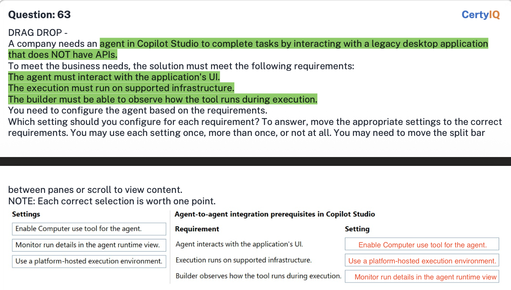

### 1. Extracted Question Summary

* **Scenario:** A company needs an agent in Microsoft Copilot Studio to complete tasks by interacting with a legacy desktop application that does NOT have APIs. To meet the business needs, the agent must interact with the application's UI, execute on supported infrastructure, and allow the builder to observe how the tool runs during execution.

* **Question (Drag and Drop — Question 63):** Move the appropriate settings from the left (`Settings`) to match the three requirements on the right (each setting may be used once, more than once, or not at all).

* **Available Settings (Left Column):**
* Enable Computer use tool for the agent.

* Monitor run details in the agent runtime view.

* Use a platform-hosted execution environment.

* **Target Requirements (Right Table):**
1. Agent interacts with the application's UI.

2. Execution runs on supported infrastructure.

3. Builder observes how the tool runs during execution.

---

### 2. Correct Answer

* **Agent interacts with the application's UI:** **Enable Computer use tool for the agent.**

* **Execution runs on supported infrastructure:** **Use a platform-hosted execution environment.**

* **Builder observes how the tool runs during execution:** **Monitor run details in the agent runtime view.**

---

### 4. Official Microsoft Justification

* **Computer Use Architecture, Hosted Execution & Runtime Observability (`AB-620T00` / `AB-100` — Integrate and extend agents in Copilot Studio / Automate UI tasks with Computer Use):** When automating legacy desktop or web interfaces that lack REST APIs or connectors, Microsoft Copilot Studio relies on **Computer Use** (powered by Computer-Using Agents / CUA):
1. **GUI Interaction (`Enable Computer use tool for the agent`):** Adding and enabling the **Computer use** tool equips the agent to visually interpret desktop application screens and execute mouse clicks, text entry, and window navigation directly on the user interface.

2. **Supported Infrastructure (`Use a platform-hosted execution environment`):** Computer Use executes UI automation sessions inside a Microsoft-managed, **platform-hosted execution environment** (sandboxed hosted Windows virtual infrastructure) rather than on an unmanaged local maker workstation, guaranteeing consistent OS dependencies, security isolation, and supported runtime infrastructure.

3. **Execution Observability (`Monitor run details in the agent runtime view`):** Builders inspect step-by-step UI actions, screen states, reasoning traces, and execution outcomes inside Copilot Studio's **agent runtime view / Activity map**.

---

### 5. Distractor Analysis (Why Others Are Wrong)

* Because this is a one-to-one three-row Drag-and-Drop matrix where every item on the left maps uniquely to one requirement on the right, errors stem solely from misaligning the three capabilities:
* **Swapping `Enable Computer use tool` and `Use a platform-hosted execution environment`:** Enabling the tool provides the GUI interaction capability, whereas the platform-hosted execution environment specifically satisfies the infrastructure requirement.

* **Misplacing `Monitor run details in the agent runtime view`:** Runtime view is exclusively an observability and debugging surface for the builder rather than an execution host or UI driver.

---

### 6. Exam Keyword / Trap Alert

* **Keywords:** *"interacts with the application's UI"* = **Enable Computer use tool**; *"supported infrastructure"* = **platform-hosted execution environment**; *"observes how the tool runs"* = **agent runtime view**.

* **Trap:** Ignore the mislabeled right-hand table header (`Agent-to-agent integration prerequisites in Copilot Studio`) in this CertyIQ screenshot—match the rows strictly against the Computer Use scenario requirements on the left and middle columns.

## Q64

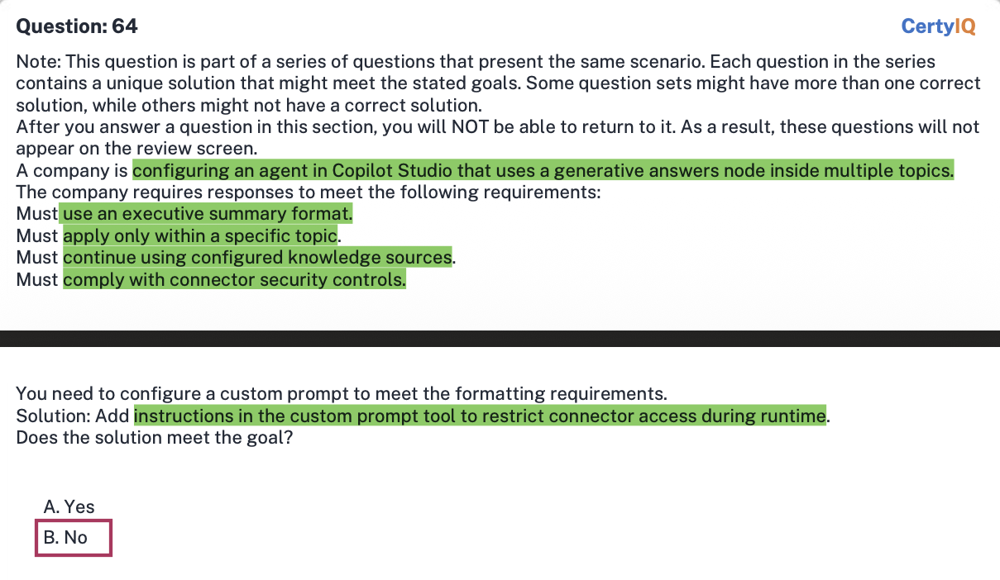

### 1. Extracted Question Summary

* **Scenario:** A company is configuring an agent in Microsoft Copilot Studio that uses a generative answers node inside multiple topics. Responses must use an executive summary format, apply only within a specific topic, continue using configured knowledge sources, and comply with connector security controls.

* **Proposed Solution (Question 64):** Add instructions in the custom prompt tool to restrict connector access during runtime.

* **Question:** Does the solution meet the goal?

* **Options:**
* **A.** Yes

* **B.** No

* **Visible Markings / Answer in Screenshot:** Option **B** is boxed in red and `Answer: B` is displayed at the bottom.

---

### 2. Correct Answer

* **B: No**

---

### 3. Verification of Visible Selection / Community Key

* **Correct.** Both the red box around **B** and `Answer: B` are accurate because natural-language instructions inside a custom prompt tool neither enforce connector security controls at runtime nor configure topic-scoped generative answers formatting.

---

### 4. Official Microsoft Justification

* **Topic-Scoped Custom Instructions & Connector Security Governance (`AB-620T00` / `AB-100` — Integrate and extend agents in Copilot Studio / Configure generative answers and security controls):**
1. **Security Controls Are Platform-Enforced, Not Prompt-Enforced:** Connector access, authentication boundaries, Data Loss Prevention (DLP) policies, and item-level Access Control Lists (ACLs) are enforced deterministically by the Power Platform and Microsoft Entra ID security layer—never via natural-language instructions inside a custom prompt tool.

2. **Topic-Scoped Formatting Requires Node-Level Custom Instructions:** To format generative answers as an executive summary strictly within a *single* topic while continuing to query configured knowledge sources, makers configure **Custom instructions** directly on that specific topic's **Create generative answers** node (rather than adding security-restriction text to a standalone custom prompt tool).

---

### 5. Distractor Analysis (Why Others Are Wrong)

* **A (Yes):** Incorrect because writing security directives inside a custom prompt tool does not enforce runtime connector security controls, nor does it bind the custom prompt's formatting behavior to the specific topic's generative answers node.

---

### 6. Exam Keyword / Trap Alert

* **Keywords:** *"instructions in the custom prompt tool to restrict connector access"* + *"apply only within a specific topic"* = **No** (**B**).

* **Trap:** In `AB-100` / `AB-620` repeated-scenario ("Yes/No") question series, always reject any proposed solution that claims **natural-language prompt text** can enforce **security or connector access controls**—security is always governed at the platform/connection layer, while topic-specific generative formatting belongs in the **Create generative answers** node's **Custom instructions**.

## Q65

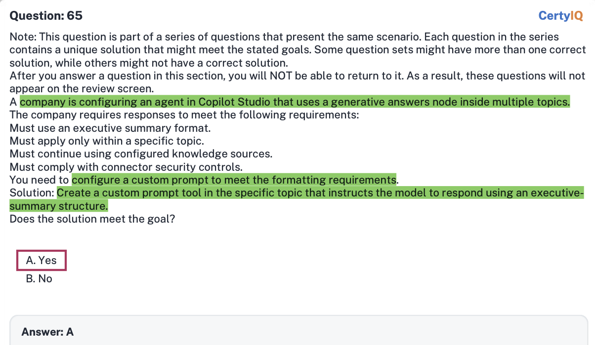

### 1. Extracted Question Summary

* **Scenario:** A company is configuring an agent in Microsoft Copilot Studio that uses a generative answers node inside multiple topics. Responses must use an executive summary format, apply only within a specific topic, continue using configured knowledge sources, and comply with connector security controls. You need to configure a custom prompt to meet the formatting requirements.

* **Proposed Solution (Question 65):** Create a custom prompt tool in the specific topic that instructs the model to respond using an executive-summary structure.

* **Question:** Does the solution meet the goal?

* **Options:**
* **A.** Yes

* **B.** No

* **Visible Answer in Screenshot:** `Answer: A`

---

### 2. Correct Answer

* **A: Yes**

---

### 3. Verification of Visible Selection / Community Key

* **Correct.** The visible key (`Answer: A`) is accurate because creating and invoking a custom prompt tool scoped to that specific topic formats the output into an executive-summary structure while leaving other topics unchanged and preserving the agent's underlying knowledge retrieval and connector security boundaries.

---

### 4. Official Microsoft Justification

* **Topic-Scoped Custom Prompts & Knowledge/Connector Governance (`AB-620T00` / `AB-100` — Integrate and extend agents in Copilot Studio > Create and configure custom prompts):**
1. **Topic-Isolated Structural Formatting (`Create a custom prompt tool in the specific topic that instructs the model to respond using an executive-summary structure`):** In Microsoft Copilot Studio, **Custom Prompts** (Prompt Builder tools) define reusable instruction templates that enforce consistent tone and output schemas (such as an executive summary). Invoking the custom prompt tool strictly inside the target topic ensures the formatting rule applies *only* to that topic without altering how the **Create generative answers** node behaves in other topics.

2. **Preservation of Grounding & Security Boundaries:** Because the topic continues to retrieve grounded content from configured knowledge sources (and passes retrieved context into the prompt or formats the grounded output) while connector authentication, Data Loss Prevention (DLP) policies, and Access Control Lists (ACLs) remain enforced at the platform/connection layer, all four business requirements are satisfied.

---

### 5. Distractor Analysis (Why Others Are Wrong)

* **B (No):** Incorrect because unlike Question 64 (which falsely attempted to restrict connector access using prompt instructions), creating a custom prompt tool inside the specific topic directly addresses the prompt's stated goal (*"configure a custom prompt to meet the formatting requirements"*) while maintaining topic isolation, knowledge grounding, and platform-enforced connector security.

---

### 6. Exam Keyword / Trap Alert

* **Keywords:** *"configure a custom prompt to meet the formatting requirements"* + *"Create a custom prompt tool in the specific topic... executive-summary structure"* = **Yes** (**A**).

* **Trap:** In repeated-scenario ("Yes/No") question sets, compare each proposed solution against the *exact task sentence* right before `Solution:`—here, the prompt explicitly asks you to *"configure a custom prompt to meet the formatting requirements"*, making the custom prompt tool the valid solution.

## Q66

### 1. Extracted Question Summary

* **Scenario:** A company is configuring an agent in Microsoft Copilot Studio that uses a generative answers node inside multiple topics. Responses must use an executive summary format, apply only within a specific topic, continue using configured knowledge sources, and comply with connector security controls. You need to configure a custom prompt to meet the formatting requirements.

* **Proposed Solution (Question 67):** Configure the custom prompt tool at the topic level so that other topics are not affected.

* **Question:** Does the solution meet the goal?

* **Options:**
* **A.** Yes

* **B.** No

* **Visible Markings / Answer in Screenshot:** Option **A** is boxed in red and `Answer: A` is displayed at the bottom.

---

### 2. Correct Answer

* **A: Yes**

---

### 3. Verification of Visible Selection / Community Key

* **Correct.** Both the red box around **A** and the visible key (`Answer: A`) are accurate because configuring and invoking the custom prompt tool at the individual topic level isolates the executive summary formatting to that single topic without impacting other topics, while continuing to use configured knowledge sources and platform-enforced connector security controls.

---

### 4. Official Microsoft Justification

* **Topic-Scoped Custom Prompts & Governance Isolation (`AB-620T00` / `AB-100` — Integrate and extend agents in Copilot Studio > Create and configure custom prompts):**
1. **Topic-Level Execution Scope (`Configure the custom prompt tool at the topic level so that other topics are not affected`):** In Microsoft Copilot Studio, **Custom Prompts** (Prompt Builder tools) define reusable instruction and output formatting templates. Calling the custom prompt tool within a specific topic's authoring flow ensures the formatting directive applies exclusively to that conversation path, leaving **Create generative answers** nodes in all other topics untouched.

2. **Preservation of Knowledge & Connector Security Boundaries:** Grounded retrieval continues to pull from the agent's configured knowledge sources, while connector authentication, Data Loss Prevention (DLP) policies, and Access Control Lists (ACLs) remain enforced deterministically by the Power Platform and Microsoft Entra ID security layer.

---

### 5. Distractor Analysis (Why Others Are Wrong)

* **B (No):** Incorrect because the proposed solution directly satisfies the prompt's stated objective (*"configure a custom prompt to meet the formatting requirements"*) while enforcing topic-level isolation (*"so that other topics are not affected"*) and maintaining existing knowledge grounding and security controls.

---

### 6. Exam Keyword / Trap Alert

* **Keywords:** *"configure a custom prompt to meet the formatting requirements"* + *"at the topic level so that other topics are not affected"* = **Yes** (**A**).

* **Trap:** In repeated-scenario ("Yes/No") question sets, distinguish between solutions that scope formatting to the **topic level** (valid: **Yes**) versus solutions that modify **agent-wide/global instructions** or attempt to enforce **security/connector restrictions via prompt text** (invalid: **No**).

## Q67

### 1. Extracted Question Summary

* **Scenario:** A company is configuring an agent in Microsoft Copilot Studio that uses a generative answers node inside multiple topics. Responses must use an executive summary format, apply only within a specific topic, continue using configured knowledge sources, and comply with connector security controls. You need to configure a custom prompt to meet the formatting requirements.

* **Proposed Solution (Question 67):** Configure the custom prompt tool at the topic level so that other topics are not affected.

* **Question:** Does the solution meet the goal?

* **Options:**
* **A.** Yes

* **B.** No

* **Visible Markings / Answer in Screenshot:** Option **A** is boxed in red and `Answer: A` is displayed at the bottom.

---

### 2. Correct Answer

* **A: Yes**

---

### 3. Verification of Visible Selection / Community Key

* **Correct.** Both the red box around **A** and the visible key (`Answer: A`) are accurate because configuring and invoking the custom prompt tool at the individual topic level isolates the executive summary formatting to that single topic without impacting other topics, while continuing to use configured knowledge sources and platform-enforced connector security controls.

---

### 4. Official Microsoft Justification

* **Topic-Scoped Custom Prompts & Governance Isolation (`AB-620T00` / `AB-100` — Integrate and extend agents in Copilot Studio > Create and configure custom prompts):**
1. **Topic-Level Execution Scope (`Configure the custom prompt tool at the topic level so that other topics are not affected`):** In Microsoft Copilot Studio, **Custom Prompts** (Prompt Builder tools) define reusable instruction and output formatting templates. Calling the custom prompt tool within a specific topic's authoring flow ensures the formatting directive applies exclusively to that conversation path, leaving **Create generative answers** nodes in all other topics untouched.

2. **Preservation of Knowledge & Connector Security Boundaries:** Grounded retrieval continues to pull from the agent's configured knowledge sources, while connector authentication, Data Loss Prevention (DLP) policies, and Access Control Lists (ACLs) remain enforced deterministically by the Power Platform and Microsoft Entra ID security layer.

---

### 5. Distractor Analysis (Why Others Are Wrong)

* **B (No):** Incorrect because the proposed solution directly satisfies the prompt's stated objective (*"configure a custom prompt to meet the formatting requirements"*) while enforcing topic-level isolation (*"so that other topics are not affected"*) and maintaining existing knowledge grounding and security controls.

---

### 6. Exam Keyword / Trap Alert

* **Keywords:** *"configure a custom prompt to meet the formatting requirements"* + *"at the topic level so that other topics are not affected"* = **Yes** (**A**).

* **Trap:** In repeated-scenario ("Yes/No") question sets, distinguish between solutions that scope formatting to the **topic level** (valid: **Yes**) versus solutions that modify **agent-wide/global instructions** or attempt to enforce **security/connector restrictions via prompt text** (invalid: **No**).

## Q68

### 1. Extracted Question Summary

* **Scenario:** A team is developing an agent in Microsoft Copilot Studio and wants to evaluate its behavior before expanding access. The team needs a repeatable, consistent method to test the agent using predefined interactions and ensure agent responses can be evaluated consistently across multiple test runs.

* **Question (Question 68):** What should you do?

* **Options:**
* **A.** Review evaluation scores from previous production sessions.

* **B.** Enable telemetry and analytics to monitor intent matches, fallback usage, and response frequency.

* **C.** Define test sets of prompts and expectations.

* **D.** Change the evaluation method to a qualitative approach.

* **E.** Publish the agent to additional channels for broader usage.

* **Visible Answer in Screenshot:** `Answer: C`

---

### 2. Correct Answer

* **C: Define test sets of prompts and expectations.**

---

### 3. Verification of Visible Selection / Community Key

* **Correct.** The visible key (`Answer: C`) is accurate because Copilot Studio's built-in **Agent Evaluation** feature allows makers to create structured **test sets** pairing standardized input prompts with expected responses, tools, or quality criteria so regression runs execute repeatably and consistently before rollout.

---

### 4. Official Microsoft Justification

* **Automated Agent Evaluation & Test Sets (`AB-620T00` / `AB-100` — Test, evaluate, and optimize agents in Copilot Studio / Evaluate agents with test sets):** Within Microsoft Copilot Studio's **Evaluation** experience, teams establish repeatable, regression-ready quality assurance prior to production expansion by configuring **Test sets**:
* **Standardized Benchmark Execution (`Define test sets of prompts and expectations`):** A test set consists of curated user utterances/prompts paired with expected outputs, expected topic/tool invocations, and grading criteria (such as general quality, semantic similarity, or exact match). Executing the same test set across iterative agent builds provides deterministic, apples-to-apples scoring across multiple test runs before expanding user access.

---

### 5. Distractor Analysis (Why Others Are Wrong)

* **A:** Reviewing past production sessions examines ad-hoc historical live traffic rather than executing a controlled, repeatable suite of predefined pre-deployment test interactions.

* **B:** Telemetry and analytics (Application Insights / Copilot Studio Analytics) observe live operational metrics like session volume, topic trigger rates, and fallback frequency—they do not run repeatable pre-deployment prompt/expectation test suites.

* **D:** Switching to an ad-hoc qualitative review introduces subjective human judgment and undermines repeatable, consistent automated scoring across multiple test runs.

* **E:** Publishing to additional channels expands end-user access immediately—directly violating the requirement to evaluate the agent *before* expanding access.

---

### 6. Exam Keyword / Trap Alert

* **Keywords:** *"evaluate its behavior before expanding access"* + *"repeatable, consistent method to test the agent using predefined interactions"* + *"across multiple test runs"* = **Define test sets of prompts and expectations** (**C**).

* **Trap:** Distinguish **pre-deployment repeatable testing** (**Test sets** in Copilot Studio Evaluation) from **post-deployment operational monitoring** (**Analytics / Application Insights telemetry** in Option B).

## Q69

### 1. Extracted Question Summary

* **Scenario:** A company builds agents in Microsoft Copilot Studio in a development environment, packages them inside a solution, and deploys them using Power Platform Pipelines to test and production environments. The solution and pipeline must ensure production deployments are limited to a defined set of responsible users, the same solution is reused across all environments without editing its components, and the production environment always receives a locked-down version of the solution.

* **Question (Drag and Drop — Question 69):** Move the appropriate configurations from the left (`Configurations`) to match the three requirements under `Pipeline stage and deployment configuration` on the right (each configuration may be used once, more than once, or not at all).

* **Available Configurations (Left Column):**
* Deploy the solution as managed.

* Deploy the solution as unmanaged.

* Use environment variables in the solution.

* Configure stage access for the production stage.

* **Target Requirements (Right Table — `Pipeline stage and deployment configuration`):**
1. Limit users who can deploy to production.

2. Reuse the same solution across environments without modifying its components.

3. Ensure production receives a locked-down version of the solution.

---

### 2. Correct Answer

* **Limit users who can deploy to production:** **Configure stage access for the production stage.**

* **Reuse the same solution across environments without modifying its components:** **Use environment variables in the solution.**

* **Ensure production receives a locked-down version of the solution:** **Deploy the solution as managed.**

---

### 4. Official Microsoft Justification

* **Application Lifecycle Management (ALM) & Power Platform Pipelines (`AB-620T00` / `AB-100` — Manage and deploy agents using Power Platform solutions and pipelines):** Enterprise ALM for Copilot Studio agents relies on Power Platform solutions and deployment pipelines to separate authoring from downstream runtime governance:
1. **Deployment Stage RBAC (`Configure stage access for the production stage`):** Within the Deployment Pipeline Configuration app, administrators assign Dataverse security roles (such as *Deployment Pipeline User* or custom stage owner roles) and stage-level access permissions to restrict which makers or release managers can execute deployments into the production target environment.

2. **Environment-Specific Parameterization (`Use environment variables in the solution`):** Storing environment-dependent values (such as knowledge source URLs, API endpoints, or configuration strings) inside **Environment variables** allows the exact same solution package to be promoted across development, test, and production environments without editing agent topics or components in downstream environments.

3. **Immutable Downstream Governance (`Deploy the solution as managed`):** Power Platform Pipelines automatically export and import solutions into downstream test and production environments as **managed solutions**, locking down components against direct unmanaged edits in production and enabling clean uninstallation or version upgrades.

---

### 5. Distractor Analysis (Why Others Are Wrong)

* **Deploy the solution as unmanaged:** Unmanaged solutions are strictly for active authoring in development environments; deploying unmanaged solutions to production leaves components editable, creates unmanaged customization layers, and violates the requirement for a locked-down production package.

---

### 6. Exam Keyword / Trap Alert

* **Keywords:** *"Limit users who can deploy to production"* = **Configure stage access for the production stage**; *"Reuse the same solution... without modifying its components"* = **Use environment variables**; *"locked-down version of the solution"* = **Deploy the solution as managed**.

* **Trap:** Never select **Deploy the solution as unmanaged** for test or production environments in Power Platform ALM scenarios—downstream pipeline targets always require **managed** solutions.

## Q

